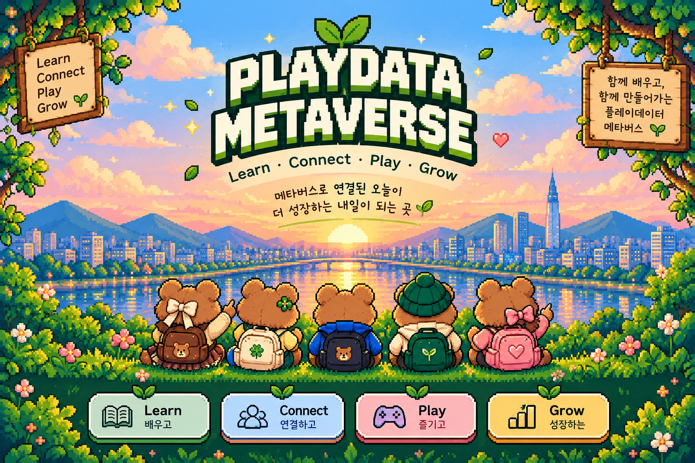
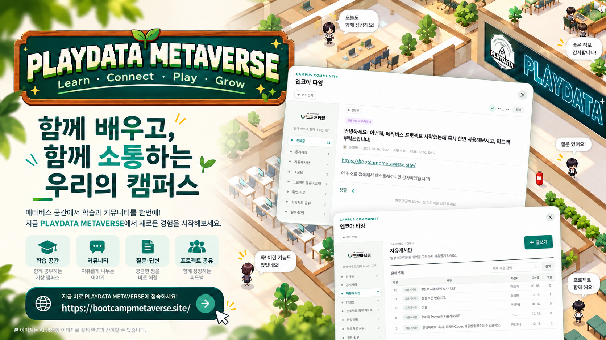
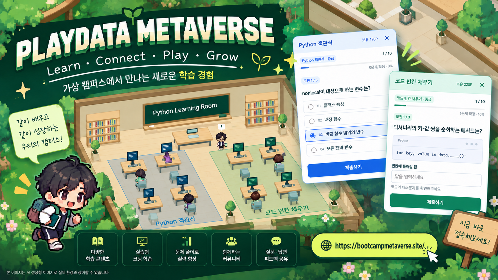
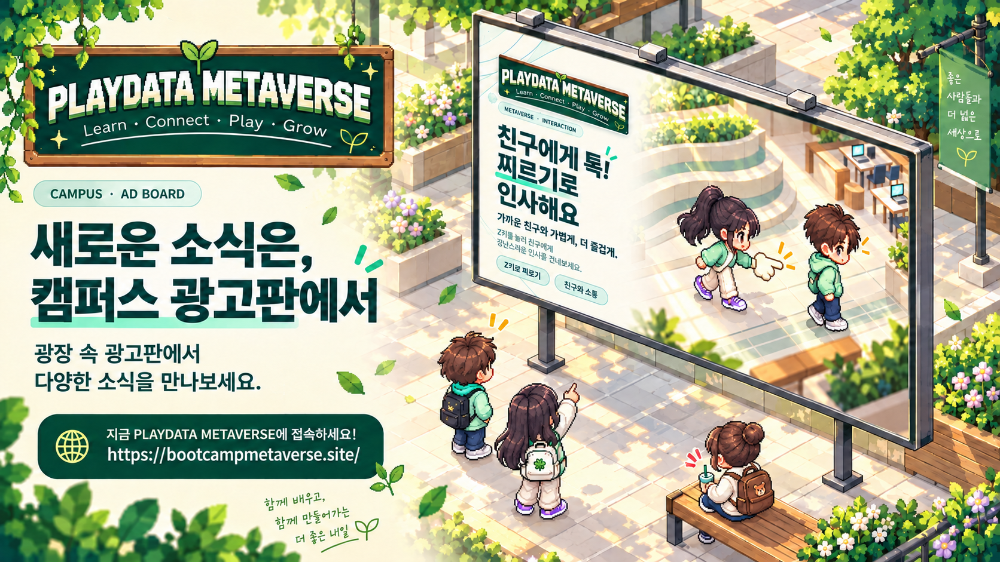
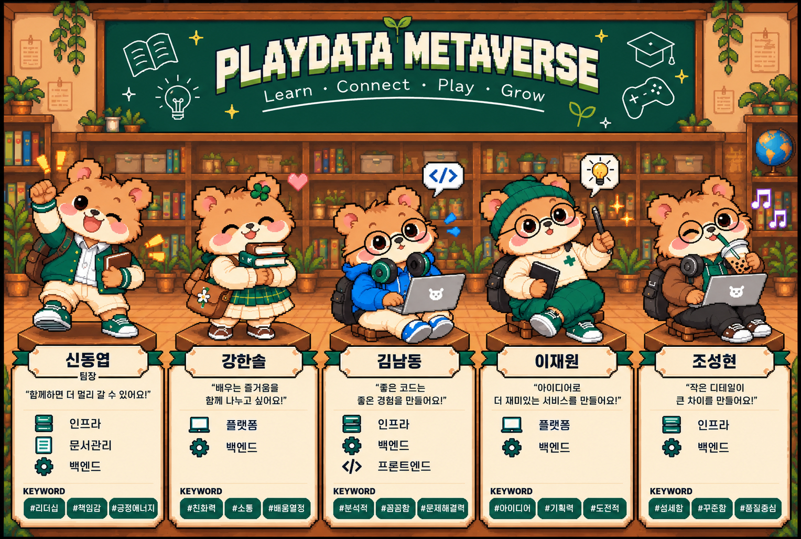

# PLATDATA 캠퍼스 메타버스

PLAYDATA 캠퍼스 메타버스는 부트캠프 수강생이 가상 캠퍼스에서 동료를 만나고, Python·SQL을 연습하며, 쉬는 시간의 콘텐츠와 캠퍼스 소식을 함께 즐길 수 있는 서비스입니다.

**프로젝트 진행 기간**: 2026년 10월 1일 ~ 2026년 10월 19일

**서비스 주소**: [bootcampmetaverse.site](https://bootcampmetaverse.site/)

## 대상 사용자와 제공 가치

| 대상 사용자 | 사용 목적 | 제공 가치 |
|---|---|---|
| 부트캠프 수강생 | 같은 반과 다른 과정의 동료 만나기 | 가상 공간에서의 만남과 실시간 소통 |
| Python·SQL 학습자 | 수준에 맞는 문제 풀이와 복습 | 난이도별 연습, 결과·해설 확인, 오답 복습 |
| 캠퍼스 커뮤니티 참여자 | 질문, 자료, 프로젝트 및 취업 정보 공유 | 게시글과 댓글을 통한 지속적인 교류 |
| 캠퍼스 소식을 알리려는 사용자 | 이미지와 링크를 활용한 홍보 | 광고 위치·기간·예산 설정과 성과 확인 |

## 주요 기능

### 1. 가상 캠퍼스와 실시간 소통

닉네임과 캐릭터를 설정하고 18층 캠퍼스와 옥상을 자유롭게 둘러봅니다. 같은 반뿐 아니라 다른 과정의 수강생과도 만날 수 있습니다.

- 실시간 채팅과 말풍선으로 대화합니다.
- 가까운 동료를 바라보고 **Z 키**를 누르면 찌르기로 인사합니다.
- 찌르기는 손 동작과 반응 효과를 통해 가볍게 교류하는 기능입니다.

### 2. 캠퍼스 커뮤니티

게시판에서 수업 밖의 대화를 이어가고, 댓글로 의견을 나눕니다.

- 프로젝트 진행 상황을 공유합니다.
- 학습 중 막힌 문제를 질문합니다.
- 학습 자료와 취업 정보를 나눕니다.
- 함께 공부할 동료를 알아갑니다.

### 3. Python·SQL 학습교실

Python과 SQL을 연습하고 부족한 부분을 확인하는 학습 공간입니다. 초급·중급·고급 중 원하는 난이도를 선택합니다.

| 학습 기능 | 사용자 경험 |
|---|---|
| 객관식 문제 | 보기를 비교하며 개념과 코드 동작을 확인합니다. |
| 코드 빈칸 문제 | 답을 직접 작성하며 배운 내용을 적용합니다. |
| 결과·해설 확인 | 성적과 해설을 확인합니다. |
| 오답 복습 | 틀린 문제를 다시 살펴봅니다. |

### 4. 학습 보상 포인트

학습교실에서 정답을 맞히면 포인트가 적립됩니다. 지도에서 보유 포인트와 적립 내역을 확인할 수 있습니다.

캠퍼스 포인트와 광고 포인트는 별도로 운영됩니다. 캠퍼스에서 모은 포인트를 광고에 활용할 수 있도록 **두 포인트를 전환하는 기능을 준비 중입니다.**

### 5. 옥상 콘텐츠

쉬는 시간에 옥상을 방문해 원하는 콘텐츠를 선택합니다.

- 게임 부스
- 심리 테스트 존
- YouTube 스튜디오
- 분수와 쉼터가 있는 광장

### 6. 식단 확인과 점심 메뉴 추천

- 게시판에서 구내식당 메뉴를 확인합니다.
- 점심 메뉴 룰렛으로 메뉴를 고릅니다.

### 7. 캠퍼스 광고 서비스

이미지와 연결 주소를 등록해 알리고 싶은 소식을 홍보합니다.

- 광고를 보여줄 위치와 기간, 예산을 선택합니다.
- 광고 성과와 포인트 사용 내역을 확인합니다.
- 노출 수와 클릭 수를 살펴보며 광고 운영에 활용합니다.

## 대표 이용 흐름

| 이용 목적 | 흐름 |
|---|---|
| 동료와 교류하기 | 닉네임·캐릭터 설정 → 캠퍼스 탐색 → 채팅·말풍선·찌르기로 인사 → 게시판과 댓글로 대화 이어가기 |
| 학습하고 복습하기 | Python·SQL 학습교실 선택 → 난이도 선택 → 문제 풀이 → 성적·해설 확인 및 오답 복습 → 정답 보상 포인트 확인 |
| 쉬는 시간 보내기 | 옥상 방문 → 게임 부스·심리 테스트 존·YouTube 스튜디오 중 원하는 콘텐츠 선택 |
| 점심 정하기 | 게시판에서 구내식당 메뉴 확인 → 필요하면 점심 메뉴 룰렛 이용 |
| 소식 홍보하기 | 광고 이미지·연결 주소 등록 → 위치·기간·예산 선택 → 노출·클릭 성과와 포인트 사용 내역 확인 |

## 팀 구성

| 이름 | 담당 | GitHub |
|---|---|---|
| 신동엽 | 데이터 파이프라인 | [sdyeob](https://github.com/sdyeob) |
| 강한솔 | 플랫폼 | [hansolsmart](https://github.com/hansolsmart) |
| 김남동 | 광고 서버 | [rlaskaehd](https://github.com/rlaskaehd) |
| 이재원 | 플랫폼 | [vvjeffvv3](https://github.com/vvjeffvv3) |
| 조성현 | 인프라 구축 | [seonghyeonjo2](https://github.com/seonghyeonjo2) |
