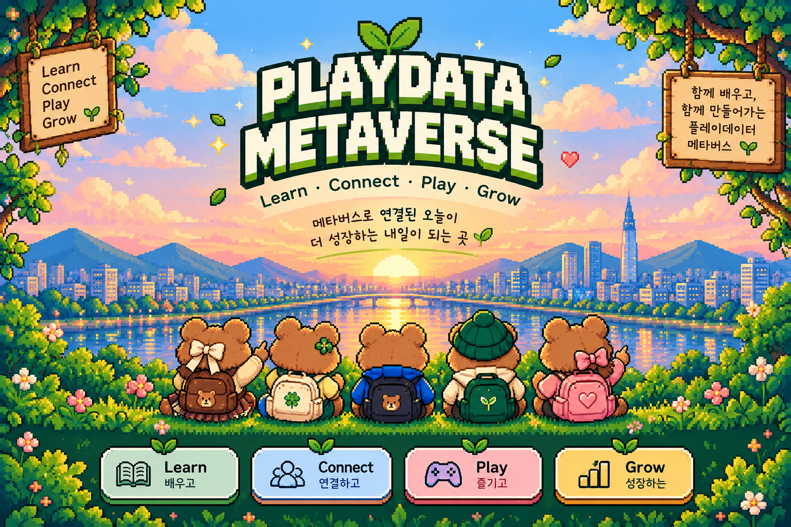
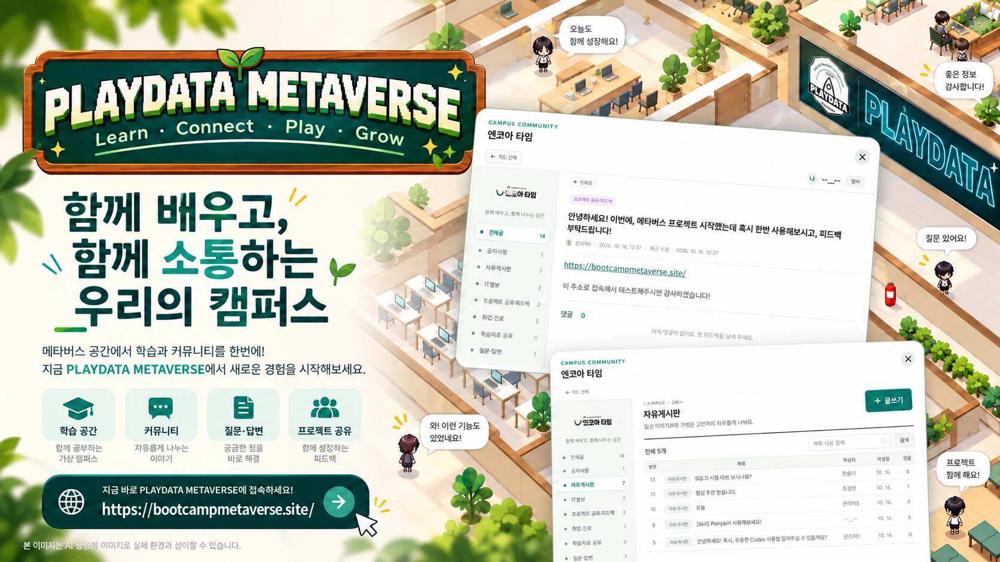
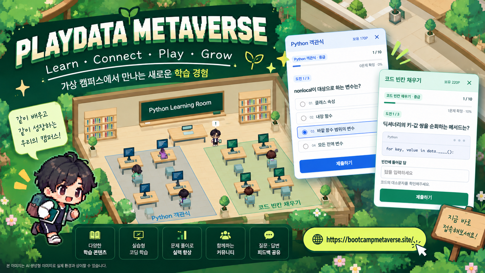
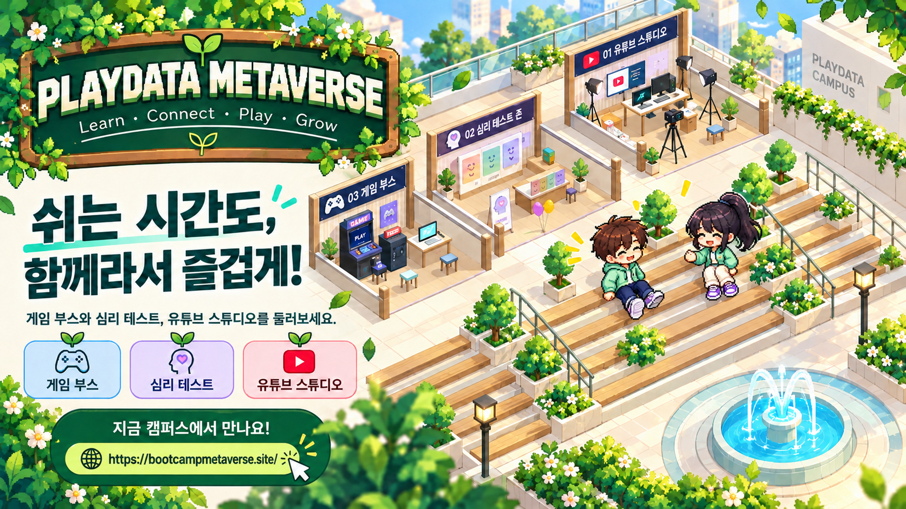
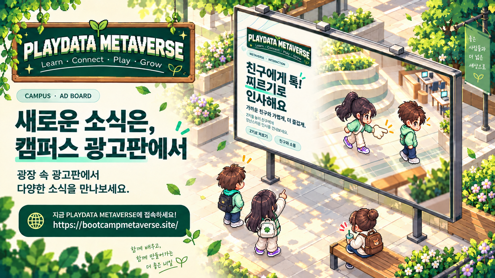
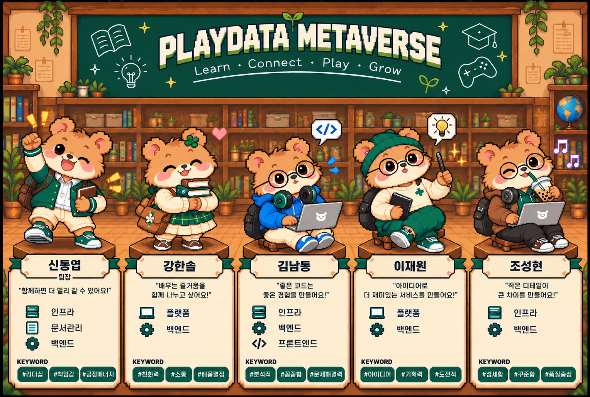

  

  <strong>📅 프로젝트 진행 기간: 2026년 10월 1일 ~ 2026년 10월 19일</strong>

<h1 align="center">🚀 PLAYDATA 캠퍼스 메타버스 OPEN!</h1>

  <strong>이제 누구나 접속할 수 있습니다. 지금 바로 캠퍼스에서 만나요!</strong>

<h2 align="center">
  <a href="https://bootcampmetaverse.site/">👉 https://bootcampmetaverse.site/</a>
</h2>

## 시연 영상

https://github.com/user-attachments/assets/1a88be7e-7d3f-4d0a-8036-f4b4ca2c817a

## 동료를 만나는 가상 캠퍼스

닉네임과 캐릭터를 설정하고 18층 캠퍼스와 옥상을 자유롭게 둘러볼 수 있습니다.
실시간 채팅과 말풍선으로 함께 접속한 동료들에게 인사를 건네보세요.
같은 반뿐 아니라 다른 과정의 수강생들과도 이야기를 나눌 수 있습니다.

게시판에서는 수업 밖의 대화도 이어집니다.
프로젝트 진행 상황을 공유하고, 막힌 문제를 질문하거나, 학습 자료와 취업 정보를 나눠보세요.
댓글로 의견을 주고받으며 함께 공부할 동료를 알아갈 수 있습니다.

## 찌르기로 친구에게 인사하기

가까운 동료를 바라보고 **Z**를 누르면 찌르기로 인사할 수 있습니다.
손 동작과 반응 효과로 대화 전에도 가볍게 인사를 나눠보세요.

## 내 수준에 맞게 배우는 Python·SQL 학습교실

Python과 SQL 학습교실에서 배운 내용을 연습하고 부족한 부분을 확인할 수 있습니다.
초급·중급·고급 중 원하는 난이도를 선택해 학습해보세요.

- **객관식 문제**: 보기를 비교하며 개념과 코드의 동작을 확인합니다.
- **코드 빈칸 문제**: 답을 직접 작성하며 배운 내용을 적용합니다.
- **결과와 오답 복습**: 성적과 해설을 확인하고, 틀린 문제를 다시 살펴봅니다.

## 학습의 보상으로 쌓이는 포인트

학습교실에서 정답을 맞히면 포인트가 적립됩니다.
공부한 만큼 보상을 모으고, 지도에서 보유 포인트와 적립 내역을 확인할 수 있습니다.

캠퍼스에서 모은 포인트를 광고에 활용하는 경험도 준비하고 있습니다.

- 현재 캠퍼스 포인트와 광고 포인트는 따로 운영되며, 두 포인트를 전환하는 기능은 준비 중입니다.

## 쉬는 시간에 찾아가는 옥상 콘텐츠

옥상에는 게임 부스, 심리 테스트 존, YouTube 스튜디오가 마련돼 있습니다.
분수와 쉼터가 있는 광장을 둘러보며 원하는 콘텐츠를 골라보세요.

## 점심 고민을 덜어주는 식단과 메뉴 추천

게시판에서 구내식당 메뉴를 확인하며 오늘의 점심을 계획할 수 있습니다.
무엇을 먹을지 고민된다면 점심 메뉴 룰렛으로 메뉴를 골라보세요.

## 알리고 싶은 소식을 전하는 광고

광고 서비스에서는 이미지와 연결 주소를 등록해 알리고 싶은 소식을 홍보할 수 있습니다.
광고를 보여줄 위치와 기간, 예산을 선택해 원하는 방식으로 운영해보세요.

광고 성과와 포인트 사용 내역도 확인할 수 있습니다.
얼마나 노출되고 클릭됐는지 살펴보며 광고 운영에 활용하세요.

## 팀 소개

서로 다른 역할을 맡은 다섯 명이 함께 캠퍼스를 만듭니다.
플랫폼, 광고 서비스, 데이터 처리와 인프라를 연결해 학습과 소통을 지원합니다.

### 팀구성

| 이름 | 작업 | GitHub 주소 |
|---|---|---|
| 신동엽 | 데이터 파이프라인 | [sdyeob](https://github.com/sdyeob) |
| 강한솔 | 플랫폼 | [hansolsmart](https://github.com/hansolsmart) |
| 김남동 | 광고 서버 | [rlaskaehd](https://github.com/rlaskaehd) |
| 이재원 | 플랫폼 | [vvjeffvv3](https://github.com/vvjeffvv3) |
| 조성현 | 인프라 구축 | [seonghyeonjo2](https://github.com/seonghyeonjo2) |

## 한 줄 회고

| 이름 | 회고 |
|---|---|
| 신동엽 |  |
| 강한솔 |  |
| 김남동 |  |
| 이재원 |  |
| 조성현 |  |
