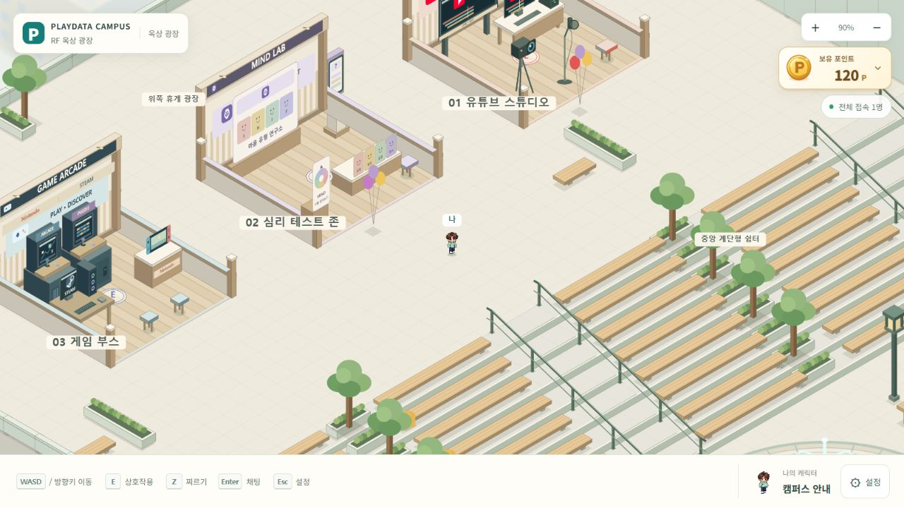

# PLAYDATA 캠퍼스 메타버스

**함께 배우고, 이야기하고, 즐기는 우리 캠퍼스.**

부트캠프 수강생을 위한 온라인 캠퍼스입니다.
내 캐릭터로 동료들을 만나고, Python·SQL을 학습하며, 쉬는 시간에는 게임과 이벤트를 즐길 수 있습니다.
학습부터 소통과 휴식까지, 캠퍼스의 일상을 한 공간에서 경험해보세요.

**[캠퍼스 접속하기 →](https://43.203.25.153/accounts/login/)**

## 시연 영상

[![PLAYDATA 캠퍼스 시연 영상 보기]](https://github.com/user-attachments/assets/03797865-0b57-4f57-94c4-7c20dd7f8ade)

## 동료를 만나는 가상 캠퍼스

닉네임과 캐릭터를 설정하고 18층 캠퍼스와 옥상을 자유롭게 둘러볼 수 있습니다.
실시간 채팅과 말풍선으로 함께 접속한 동료들에게 인사를 건네보세요.
같은 반뿐 아니라 다른 과정의 수강생들과도 이야기를 나눌 수 있습니다.

게시판에서는 수업 밖의 대화도 이어집니다.
프로젝트 진행 상황을 공유하고, 막힌 문제를 질문하거나, 학습 자료와 취업 정보를 나눠보세요.
댓글로 의견을 주고받으며 함께 공부할 동료를 알아갈 수 있습니다.

## 내 수준에 맞게 배우는 Python·SQL 학습교실

Python과 SQL 학습교실에서 배운 내용을 연습하고 부족한 부분을 확인할 수 있습니다.
초급·중급·고급 중 원하는 난이도를 선택해 학습해보세요.

- **객관식 문제**: 보기를 비교하며 개념과 코드의 동작을 확인합니다.
- **코드 빈칸 문제**: 답을 직접 작성하며 배운 내용을 적용합니다.
- **결과와 오답 복습**: 성적과 해설을 확인하고, 틀린 문제를 다시 살펴봅니다.

문제를 푸는 데서 끝나지 않고, 어떤 부분을 이해했는지 돌아볼 수 있습니다.

## 학습의 보상으로 쌓이는 포인트

학습교실에서 정답을 맞히면 포인트가 적립됩니다.
공부한 만큼 보상을 모으고, 지도에서 보유 포인트와 적립 내역을 확인할 수 있습니다.

캠퍼스에서 모은 포인트를 광고에 활용하는 경험도 준비하고 있습니다.

- 현재 캠퍼스 포인트와 광고 포인트는 따로 운영되며, 두 포인트를 전환하는 기능은 준비 중입니다.

## 쉬는 시간에 찾아가는 옥상 콘텐츠

옥상에는 게임 부스, 심리 테스트 존, YouTube 스튜디오가 마련돼 있습니다.
분수와 쉼터가 있는 광장을 둘러보며 원하는 콘텐츠를 골라보세요.

## 함께 참여하는 캠퍼스 이벤트

옥상 이벤트 부저에서 진행 중인 이벤트를 확인할 수 있습니다.
설문과 연계된 추첨 이벤트에 참여하고, 추첨 결과를 확인해보세요.
당첨자에게는 기프티콘 수령 안내가 제공됩니다.

## 점심 고민을 덜어주는 식단과 메뉴 추천

게시판에서 구내식당 메뉴를 확인하며 오늘의 점심을 계획할 수 있습니다.
무엇을 먹을지 고민된다면 점심 메뉴 룰렛으로 메뉴를 골라보세요.

## 알리고 싶은 소식을 전하는 광고

광고 서비스에서는 이미지와 연결 주소를 등록해 알리고 싶은 소식을 홍보할 수 있습니다.
광고를 보여줄 위치와 기간, 예산을 선택해 원하는 방식으로 운영해보세요.

광고 성과와 포인트 사용 내역도 확인할 수 있습니다.
얼마나 노출되고 클릭됐는지 살펴보며 광고 운영에 활용하세요.

## 캠퍼스에 참여하기

[캠퍼스 로그인 화면](https://43.203.25.153/accounts/login/)에서 시작하세요.
회원가입에서 수강 과정과 기수를 선택하고, 닉네임과 캐릭터를 설정하면 캠퍼스 생활을 시작할 수 있습니다.
처음 이용 안내를 따라 공간을 둘러본 뒤, 학습교실이나 옥상 부스에서 원하는 활동을 즐겨보세요.
