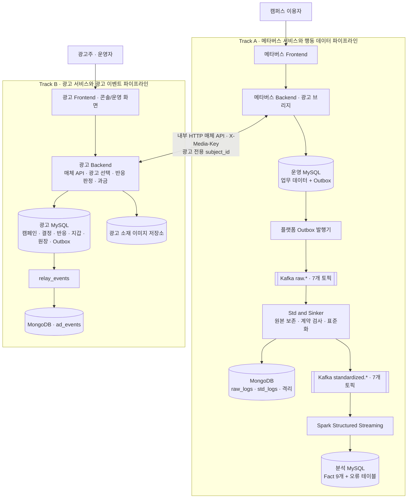
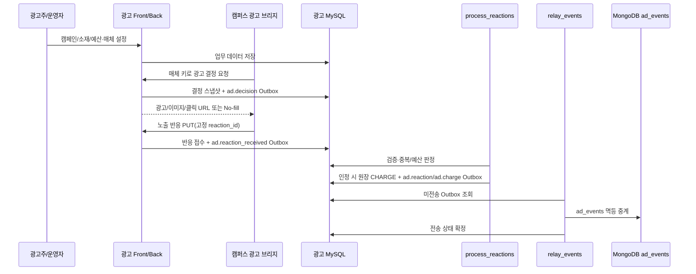

# MLO 1기 3차 프로젝트 — PLAYDATA 메타버스 × 광고 플랫폼

> **팀:** `mlo-01-p3-team2`  
> **프로젝트 기간:** 2026.10.01 ~ 2026.10.19  
> **제품·브랜드 소개:** [PRODUCT.md](./PRODUCT.md)  
> **문서 기준:** 저장소 `main`의 구현·DRD·WBS·모듈별 README를 대조하여 정리 (2026-11-02)

이 프로젝트는 **메타버스 서비스와 광고 서비스, 두 개의 독립적인 제품 트랙**을 구축하고 연동한 프로젝트입니다.

- **Track A — 메타버스 플랫폼:** 가상 캠퍼스·커뮤니티·학습 서비스의 행동 이벤트를 수집하고, Kafka·MongoDB·Spark를 거쳐 분석 가능한 데이터로 적재합니다.
- **Track B — 광고 플랫폼:** 광고주와 매체를 연결하고, 캠페인·소재·광고 선택·노출·클릭·예산·과금 원장을 관리합니다. 광고 업무 이벤트는 **광고 MySQL Outbox → MongoDB `ad_events`** 경로로 독립적으로 보존합니다.

**두 트랙은 API로 연결되지만, 업무 데이터의 소유권·이벤트 계약·적재 경로는 서로 다릅니다.** 이 README는 두 트랙의 **데이터 아키텍처, 데이터 무결성, 처리·복구 방식, 구현 근거**를 설명합니다. 화면·브랜드·사용자 경험은 [PRODUCT.md](./PRODUCT.md)에서 소개합니다.

## 1. 팀 소개

### 팀명

`mlo-01-p3-team2`

### 팀 구성

| 이름 | 담당 영역 | 주요 작업 | GitHub |
|---|---|---|---|
| 신동엽 | 데이터 파이프라인 | Raw Kafka 수신, MongoDB 보존·표준화, Spark 분석 적재 | [sdyeob](https://github.com/sdyeob) |
| 강한솔 | 메타버스 — 학습 | Python·SQL 학습교실, 문제은행, 채점·포인트 | [hansolsmart](https://github.com/hansolsmart) |
| 김남동 | **광고 플랫폼** | 광고주 콘솔, 캠페인·소재, 광고 선택, 반응 판정·과금·광고 이벤트 | [rlaskaehd](https://github.com/rlaskaehd) |
| 이재원 | 메타버스 — 캠퍼스 | 계정·아바타·커뮤니티·이동, 플랫폼 이벤트 Outbox | [vvjeffvv3](https://github.com/vvjeffvv3) |
| 조성현 | 인프라·연동 | AWS·클러스터·배포 자동화, 광고 브리지 연동 | [seonghyeonjo2](https://github.com/seonghyeonjo2) |

세부 역할과 병합 이력은 [WBS](./wbs/wbs.md)를 참고합니다.

## 2. 프로젝트 개요

### 프로젝트명

**PLAYDATA 캠퍼스 메타버스 및 광고 플랫폼 — 2-Track 데이터 아키텍처 구축**

### 프로젝트 필요성

메타버스에서는 로그인·채팅·학습·이동과 같은 활동이 발생합니다. 광고 플랫폼에서는 광고 요청·선택·노출·클릭·과금이 발생합니다. 이 둘을 하나의 서비스나 이벤트 계약으로 취급하면, **활동 분석과 광고 과금의 데이터 정합성·책임 경계가 혼재**됩니다.

따라서 본 프로젝트는 두 트랙을 각자의 업무 DB와 처리 흐름으로 분리하고, 메타버스에서 광고를 이용해야 할 때에만 **인증된 광고 매체 API**로 연동합니다.

### 2.1 두 트랙의 역할

| 구분 | Track A — 메타버스 플랫폼 | Track B — 광고 플랫폼 |
|---|---|---|
| 서비스 사용자 | 캠퍼스 이용자·학습자 | 광고주·운영자·광고 매체 |
| 핵심 기능 | 캠퍼스, 채팅, 게시판, Python·SQL 학습, 포인트 | 캠페인·소재·매체·슬롯, 광고 선택, 반응 판정, 과금·성과 |
| 업무 정본 | **운영 MySQL** | **광고 MySQL** |
| 이벤트 생성 | 플랫폼 업무 DB의 Transactional Outbox | 광고 업무 DB의 Transactional Outbox |
| 후속 이벤트 경로 | Kafka `raw.*` → Std and Sinker → Kafka `standardized.*` → Spark | `events_outbox` → `relay_events` → MongoDB `ad_events` |
| 원천·처리 보존 | MongoDB `raw_logs`, `std_logs`, 격리 receipts | 광고 MySQL 결정·반응·원장 + MongoDB `ad_events` |
| 파생 데이터 | 분석 MySQL의 9개 Fact 테이블 | 광고주 성과 조회·원장 대조·정합성/구간 검증 |
| 트랙 간 연결 | 광고 브리지를 통해 매체 API 호출 | 인증·슬롯·정책·예산을 확인한 결정/반응 응답 |

**광고 데이터가 플랫폼 Kafka `raw.*` → Spark 경로를 거친다고 가정하지 않습니다.** 광고 이벤트의 Kafka 전환은 DRD에서 정의한 후속 확장 범위입니다.

### 2.2 전체 시스템 아키텍처



**공유 인프라와 독립 데이터의 구분:** 운영·광고·분석은 MySQL 8.4 복제 클러스터 안의 **서로 다른 DB**입니다. MongoDB 8.0 Replica Set은 활용하되, 메타버스 Raw/Std 기록과 광고 `ad_events`의 **소유권·스키마·처리기는 분리**됩니다. AWS 네트워크와 공통 클러스터는 인프라 트랙이 관리합니다. 상세 배치: [DRD §2](./docs/drd.md#2-데이터-배치).

### 프로젝트 목표

1. 두 제품의 업무 데이터와 이벤트 계약을 분리하면서 API로 안전하게 연동합니다.
2. 메타버스의 15종 활동 이벤트를 **원본 보존 → 검증·표준화 → 분석 Fact 적재**로 연결합니다.
3. 광고의 **결정 → 반응 수신 → 판정 → 과금**을 정본 MySQL과 이벤트 로그에서 추적 가능하게 합니다.
4. Kafka 재발행, MongoDB 중계 재시도, 처리기 재실행에서도 **이벤트 중복과 중복 과금**을 방지합니다.
5. 원장·잔액·예산·이벤트 구간을 대조할 수 있도록 운영·복구 근거를 제공합니다.

## 3. 핵심 데이터 기준

### 3.1 공통 원칙 — 소유권, 가명, 무결성

| 원칙 | 적용 기준 |
|---|---|
| 데이터 소유권 | 메타버스는 운영 DB, 광고는 광고 DB가 정본입니다. 상대 트랙의 DB를 직접 읽지 않습니다. |
| 업무 + 이벤트 일관성 | 각 트랙은 업무 변경과 Outbox 기록을 **같은 DB 트랜잭션**에 저장합니다. |
| 이벤트 재전달 | 발행·중계 중 장애가 나면 재전달될 수 있으므로 **중복 수용 및 멱등 처리**가 필요합니다. |
| 시간 | 이벤트 시각·처리 시각을 구분하고 UTC를 기준으로 관리합니다. |
| 사용자 분리 | 메타버스 활동 분석은 `user_uuid`를, 광고는 비밀 키로 변환한 **광고 전용 `subject_id`**를 사용합니다. |
| 개인정보 최소화 | 채팅/게시글/댓글 본문, 제출 답안 원문, 인증 정보는 메타버스 행동 이벤트로 전달하지 않습니다. |
| 기록 대조 | 설계·코드·자동화 테스트·실제 배포/운영 검증을 서로 다른 근거로 취급합니다. |

### 3.2 Track A — 메타버스 이벤트 계약

메타버스는 **Raw 토픽 7개 → Standardized 토픽 7개**, **행동 이벤트 15종**으로 구성됩니다. `quiz_answered`의 Raw 1.0/1.1을 모두 세면 **버전별 계약은 16개**입니다.

| Raw → Std 토픽 | 이벤트 | 분석 MySQL |
|---|---|---|
| `raw.account` → `standardized.account` | `session_started`, `session_ended` | `account_activity_fact` |
| `raw.chat` → `standardized.chat` | `chat_sent` | `chat_activity_fact` |
| `raw.board` → `standardized.board` | `post_created`, `post_updated`, `post_deleted`, `post_read` | `post_activity_fact` |
| `raw.comment` → `standardized.comment` | `comment_created`, `comment_updated`, `comment_deleted` | `comment_activity_fact` |
| `raw.content_usage` → `standardized.content_usage` | `content_open_requested`, `quiz_answered` | `content_activity_fact`, `quiz_attempt_fact` |
| `raw.movement` → `standardized.movement` | `movement_observed`, `floor_transferred` | `movement_fact`, `floor_transfer_fact` |
| `raw.points` → `standardized.points` | `point_granted` | `point_grant_fact` |

**Raw:** Kafka key `user_uuid`, value `{event_uuid, raw_manifest, raw_data}`.  
**Std:** Kafka key `user_uuid`, value `{std_manifest, std_data}`.  
**공통 키:** `user_uuid`, `session_uuid`, `class_group_uuid`; 이벤트 ID는 재시도에도 유지됩니다.  
**검증:** 버전·필수 필드·타입·허용값·`xxh3_64` fingerprint·Kafka key를 검사합니다.

상세 기준: [KAFKA_TOPICS.md](./KAFKA_TOPICS.md), [Std/Raw 라우팅](./pipeline/std_and_sinker/contracts/routes.json), [DRD §6](./docs/drd.md#6-행동-이벤트-데이터).

### 3.3 Track B — 광고 업무·이벤트 계약

광고 서버는 **광고 요청에 대한 결정**, **반응의 접수와 판정**, **광고 포인트 과금**을 별도 데이터 모델로 처리합니다. 광고 결정·반응·원장은 **광고 MySQL이 정본**이며, 관련 이벤트는 같은 트랜잭션의 `events_outbox`를 거쳐 MongoDB `ad_events`로 보존합니다.

| 광고 이벤트 | 버전 | 발생 시점 | 주요 내용 |
|---|---|---|---|
| `ad.decision` | v2 | 매체의 광고 요청 결정(광고 없음 포함) | 매체·슬롯·광고·적용 입찰/정책, 후보·제외 사유 |
| `ad.reaction_received` | v1 | 노출·클릭 등의 반응 접수 | 반응 유형, 수신 시각, 접수 원문 |
| `ad.reaction` | v1 | 반응 최종 판정 | 인정·거절 및 적용 규칙·사유 |
| `ad.charge` | v1 | 인정 반응에 대한 과금 | 요청 금액, 실제 차감액·부족분, 예산 기준일 |

- 광고 이벤트는 플랫폼 행동 이벤트의 `raw_manifest`/`std_manifest` 계약을 **사용하지 않습니다**.
- 광고 이벤트 ID는 원천 업무 기록에서 **결정적으로 산출되는 UUIDv5**를 사용합니다. 같은 ID·같은 내용은 재중계해도 중복 저장하지 않고, **같은 ID·다른 내용은 충돌로 중단**합니다.
- 매체 인증에는 서버 간 `X-Media-Key`를 사용하고, 광고 전용 가명 `subject_id`는 HMAC-SHA256으로 생성합니다. 원본 `user_uuid`를 광고 서버에 전달하지 않습니다.
- `records_reaction`의 **접수(RECEIVED)**는 **인정(ACCEPTED)**이나 **과금 완료**를 의미하지 않습니다. 판정·중복 검사·예산/원장 반영은 별도 처리 단계입니다.
- 광고의 캠퍼스 학습 포인트와 광고주 광고 포인트는 **서로 다른 장부**이며, 포인트 전환은 후속 범위입니다.

상세 기준: [DRD §8](./docs/drd.md#8-광고-데이터), [광고 백엔드 README](./apps/ads_server/README.md), [게임 광고 브리지](./backend/ad_bridge/README.md).

### 3.4 Bronze / Silver / Fact / Gold 구분

| 단계 | 메타버스 트랙 | 광고 트랙 |
|---|---|---|
| 정본 업무 기록 | 운영 MySQL | 광고 MySQL(결정·반응·지갑·원장 포함) |
| 원천 보존 | MongoDB `raw_logs`, Kafka `raw.*` | MySQL 원천/Outbox, MongoDB `ad_events`의 이벤트 복제본 |
| 검증·파생 | MongoDB `std_logs`, Kafka `standardized.*` | 광고 정책 판정, 기록·원장 정합성 검사 |
| 분석/조회 | MySQL Fact 9개와 분석 쿼리 | 광고주 성과 대시보드, 캠페인/반응·원장 조회 |
| 향후 확장 | Gold 집계 테이블·추천/순위 등 | 광고 이벤트 Kafka 전환·추가 분석 파이프라인 등 |

**주의:** MySQL의 메타버스 Fact 9개는 **이벤트 단위의 분석 기초 테이블**입니다. 정답률·활동량 등의 **상시 적재 Gold 집계 테이블은 현재 MVP의 완료 범위가 아닙니다.** 광고 데이터 역시 Spark Fact 9개에 적재되는 구조가 아닙니다.

## 4. 기술 스택

| 영역 | 기술·컴포넌트 | 책임 |
|---|---|---|
| 메타버스 Front/Back | Django, 웹/실시간 통신, Python | 캠퍼스 경험·업무 DB·이벤트 Outbox |
| 플랫폼 이벤트 스트림 | Apache Kafka 4.3.1 (DRD 기준) | 7개 Raw + 7개 Std 토픽 |
| 원본 보존·정제 | Python Std and Sinker, MongoDB 8.0 Replica Set | 계약 검사·표준화·실패/충돌 격리 |
| 분석 적재 | Apache Spark 4.2.0 Structured Streaming | Std 재검증·`foreachBatch`·MySQL 멱등 쓰기 |
| 광고 Front | Django (`apps/ads_frontend`) | 광고주·운영 화면 렌더링, Backend 데이터 전달 |
| 광고 Back | Django / Python 3.14 (`apps/ads_server`) | 캠페인·광고선택·매체 API·판정·과금·Outbox |
| 광고 비동기 처리 | `process_reactions`, `relay_events` | 반응 판정/과금, 광고 이벤트 MongoDB 중계 |
| 업무·분석 DB | MySQL 8.4 | 운영·광고·분석 **논리 DB 분리** |
| 매체 연결 | `backend/ad_bridge`, 내부 HTTP 매체 API | 광고 발급·노출 보고·재전송·결과 확인 |
| 공통 인프라 | AWS EC2, Terraform, Ansible, systemd, Redis | 배치·네트워크·서비스 설치·운영; Redis는 실시간 상태 지원 |

버전·배포 조건은 모듈별 문서에 명시된 기준이며, 모든 환경에 같은 버전이 **실제로 배포·가동 중임을 의미하지는 않습니다.**

## 5. 문서 안내

| 목적 | 문서 |
|---|---|
| **브랜드·메타버스·광고 제품 소개** | [PRODUCT.md](./PRODUCT.md) |
| 업무·제품 요구사항 | [BRD](./docs/brd.md), [PRD](./docs/prd.md) |
| 데이터 소유권·이벤트·ERD | [DRD](./docs/drd.md), [DRD 부록](./docs/drd-appendix.md) |
| 메타버스 행동 이벤트 발행 | [KAFKA_TOPICS.md](./KAFKA_TOPICS.md) |
| Kafka 수신·원천 보존·정제 | [Std and Sinker README](./pipeline/std_and_sinker/README.md), [라우팅 계약](./pipeline/std_and_sinker/contracts/routes.json) |
| Spark → 분석 MySQL | [Spark README](./pipeline/spark/README.md), [EC2 배포](./pipeline/spark/deploy/README.md) |
| **광고 백엔드·과금·이벤트 운영** | [ads_server README](./apps/ads_server/README.md) |
| **광고주·운영자 화면** | [ads_frontend README](./apps/ads_frontend/README.md) |
| **캠퍼스–광고 실제 연결 모듈** | [backend/ad_bridge README](./backend/ad_bridge/README.md) |
| 광고 브리지의 원형·재전송 계약 | [ad-bridge 패키지](./ad-bridge/scripts/README.md) |
| 메타버스 로컬 실행 | [RUN_GUIDE.md](./RUN_GUIDE.md) |
| 인프라·배포 상태 | [aws-infra](./aws-infra/README.md), [운영 구성(2026-10-18)](./aws-infra/docs/operations/current-state.md) |
| 담당·구현 이력·검토 | [WBS](./wbs/wbs.md), [검토 기록](./wbs/review.md) |

## 6. WBS 및 요구사항 명세

| 작업 영역 | 주요 작업 | 담당 |
|---|---|---|
| 메타버스 — 캠퍼스·커뮤니티 | 로그인·아바타·이동·채팅·게시판·포털 연동 | 이재원 |
| 메타버스 — 학습 | Python·SQL 출제·채점·복습, 학습 포인트 | 강한솔 |
| **광고 플랫폼** | 광고주/운영자 UI, 캠페인·소재, 매체 API·결정, 반응·과금·원장, 광고 이벤트 | **김남동** |
| 메타버스 데이터 파이프라인 | Kafka Raw → MongoDB Raw/Std → Kafka Std → Spark → MySQL Fact | 신동엽 |
| 인프라·서비스 연동 | 다계정 AWS·클러스터·배포·운영, 광고 브리지 협업 | 조성현 |

광고 영역은 WBS에서 **3.1~3.6**, 플랫폼 데이터 파이프라인은 **4.1~4.6**으로 별도 관리됩니다. 두 트랙의 연결 작업은 [WBS §4](./wbs/wbs.md#4-영역-간-연결)에 정리돼 있습니다. 캠페인/매체/API가 존재한다는 사실과 운영 환경에서 연동이 활성화됐다는 사실은 구분합니다.

## 7. 저장 구조 및 ERD

### 7.1 Track A — 메타버스

- **운영 MySQL(정본):** 계정·세션·채팅·게시판·학습·포인트 및 플랫폼 Outbox.
- **MongoDB(원본 및 처리 결과):**
  - `raw_logs`: 첫 Raw 원본.
  - `std_logs`: 표준화 성공·실패.
  - `raw_wrong_receipts`: 해석·저장 불가능한 입력 격리.
  - `raw_conflict_receipts`: 같은 이벤트 ID의 내용 충돌.
- **분석 MySQL(파생):** `account_activity_fact`, `chat_activity_fact`, `post_activity_fact`, `comment_activity_fact`, `content_activity_fact`, `quiz_attempt_fact`, `movement_fact`, `floor_transfer_fact`, `point_grant_fact` 및 `stream_processing_error`.

모든 Fact는 `event_uuid`를 PK로 사용합니다. 상세 ERD: [DRD §5~7](./docs/drd.md#5-플랫폼-운영-데이터), 실제 DDL: [001_facts.sql](./pipeline/spark/migrations/001_facts.sql).

### 7.2 Track B — 광고

광고 MySQL은 **광고주/운영자 계정, 캠페인·광고그룹·소재, 매체·슬롯·입찰 정책, 결정·반응, 광고 포인트 지갑·원장·Outbox**를 분리해 관리합니다.

| 데이터 영역 | 대표 테이블 | 역할 |
|---|---|---|
| 사용자·감사 | `foundation_user`, `foundation_audit_log` | 광고주·관리자, 운영 감사 |
| 매체·정책 | `masters_media`, `masters_slot`, `masters_bid_policy`, `masters_media_key` | 매체 인증·광고 위치·가격 정책 |
| 캠페인·소재 | `campaigns_campaign`, `campaigns_ad_group`, `campaigns_creative`, `campaigns_bid` | 일정·예산·광고 구성·소재·입찰 |
| 광고 결정·반응 | `records_decision`, `records_reaction` | 결정 당시 스냅샷, 수신·판정·중복·거절 사유 |
| 지갑·과금 | `billing_wallet`, `billing_ledger_entry` | 광고주 잔액·추가 전용 지급/차감/조정 원장 |
| 이벤트 전송 | `events_outbox` | 업무 트랜잭션 안에서 기록한 비동기 중계 대기 |
| 이벤트 사본 | MongoDB `ad_events` | 결정·접수·판정·과금의 감사·추적용 이벤트 |

광고 소재 이미지는 광고 서버가 관리하는 파일 저장소에 있으며 이벤트나 MySQL의 이미지 바이트로 대체하지 않습니다. 상세 ERD와 필드 규약: [DRD §8](./docs/drd.md#8-광고-데이터), [DRD 부록 D](./docs/drd-appendix.md).

## 8. 주요 프로시저

### 8.1 Track A — 메타버스 활동 데이터 처리

1. 플랫폼이 업무 기록과 Outbox를 **동일 DB 트랜잭션**에 기록합니다.
2. 발행기가 Outbox 미발행 행을 Kafka `raw.*`에 전송하고 ACK 이후 발행 상태를 남깁니다.
3. Std and Sinker가 Raw 메시지를 읽고 `event_uuid` 충돌 여부를 확인해 최초 원문을 MongoDB에 보존합니다.
4. 계약·지문·타입·조건을 검증합니다. 오류·충돌은 격리하고 **SUCCESS만** Kafka `standardized.*`에 발행합니다.
5. 결과 보존 및 Std ACK가 완료된 뒤 Raw offset을 커밋합니다.
6. Spark Structured Streaming이 Std를 다시 검증하고 `foreachBatch`로 Fact 9개에 적재합니다. 동일 `event_uuid`의 재처리는 버전 순위와 지문으로 판단합니다.
7. 오류는 `stream_processing_error`와 MongoDB 격리 기록에 남기고, 미완료 Spark 마이크로배치는 checkpoint를 통해 재처리합니다.

### 8.2 Track B — 광고 결정·반응·과금



**클릭은 별도 경로**입니다. 캠퍼스 화면이 제공된 `click_url`(광고 서버 `/c/{token}`)로 이동하면 광고 서버가 클릭을 관측·접수하고, 이후 규칙에 따라 판정·과금합니다. 매체 브리지가 클릭을 별도의 Kafka 이벤트로 보내는 방식이 아닙니다.

광고 플랫폼의 핵심 무결성 기준은 다음과 같습니다.

- **결정:** 슬롯·매체 인증·기간·예산·입찰/정책을 확인하고, 광고 없음(No-fill)도 정상 결과로 기록합니다. 결정 당시 스냅샷을 보존합니다.
- **반응:** 접수와 최종 판정을 구분합니다. 같은 반응 재전송은 중복 과금하지 않고, 정책 위반·충돌·선행 조건 미충족은 판정 규칙에 따라 처리합니다.
- **과금:** 인정된 반응에만 결정 시점의 적용 금액·반응 정책을 적용합니다. 지갑·원장·예산을 함께 대조합니다.
- **비동기 이벤트:** 업무 트랜잭션의 광고 Outbox를 `relay_events`가 MongoDB `ad_events`로 옮깁니다. MongoDB 중단 동안 Outbox는 대기하며, 같은 이벤트 ID의 다른 내용은 덮어쓰지 않고 충돌로 처리합니다.
- **정합성 복구:** `export_integrity`, `backfill_events`, `export_hop_manifests`, `verify_hops`를 통해 원본·Outbox·MongoDB 구간을 확인하고, 누락 이벤트를 원본 행에서 재생성할 수 있습니다.

### 8.3 트랙 간 연동 경계

1. 캠퍼스 `backend/ad_bridge`가 사용자·슬롯/회차 상태를 검증하고, 내부 식별자 대신 **HMAC 기반 광고 `subject_id`**를 준비합니다.
2. 내부 매체 API에서 `X-Media-Key`로 인증한 뒤 광고 결정을 받습니다. 캠퍼스는 발급·소유권을 자신의 DB에 저장합니다.
3. 옥상의 **shared** 슬롯은 회차 단위, 포털의 **individual** 슬롯은 사용자 이동 단위로 처리하도록 코드가 구성돼 있습니다.
4. 브라우저의 유효 노출 알림은 캠퍼스가 최초 반응 ID·시각을 저장한 후 광고 서버에 전달합니다. 일시적인 실패는 같은 ID로 재전송합니다.
5. 광고 서버는 반응 판정·과금을 독립적으로 수행합니다. 캠퍼스는 광고 서버의 지갑·과금 원장을 직접 갱신하지 않습니다.

**배포 주의:** `backend/ad_bridge`의 구현·설정·검증 문서에는 `ADS_ENABLED` 기본값이 `0`으로 명시돼 있고, 실제 매체 키·슬롯·이미지 출처 및 서버 배포를 별도 검증하도록 합니다. 또한 [2026-10-18 인프라 운영 기록](./aws-infra/docs/operations/current-state.md)에는 당시 게임의 `/api/ads/`가 `503 ads_disabled`로 구성돼 있습니다. **코드상 지원**과 **실제 운영 연동 활성화**를 동일시하지 않습니다.

## 9. 구현 순서 및 실행 안내

### 9.1 메타버스 / 플랫폼 이벤트

1. [프론트·백엔드 실행 가이드](./RUN_GUIDE.md)에 따라 플랫폼 개발 환경을 구성합니다.
2. `backend/.env`에서 Kafka 접속 정보를 관리합니다. 브로커 설정이 없으면 이벤트는 플랫폼 Outbox에 대기합니다.
3. Kafka·MongoDB에 접근할 수 있는 환경에서 Std and Sinker를 설치·구동합니다.

```bash
python3 -m venv pipeline/std_and_sinker/.venv
pipeline/std_and_sinker/.venv/bin/python -m pip install -r pipeline/std_and_sinker/requirements.txt
# 접속 주소·구독 토픽·MongoDB 설정은 로컬 환경변수/비공개 설정 파일로 제공
pipeline/std_and_sinker/.venv/bin/python pipeline/std_and_sinker/manage_topics.py
pipeline/std_and_sinker/.venv/bin/python pipeline/std_and_sinker/std_and_sinker.py
```

`STD_SINKER_INPUT_TOPICS`의 예시 목록에 `raw.points`가 없을 수 있으므로 실제 구독 목록을 확인합니다. 기본 토픽 생성 값은 **파티션 3·복제 3·최소 ISR 2**이며, 이미 존재하는 토픽 설정을 자동 변경하지 않습니다.

4. [Spark README](./pipeline/spark/README.md)와 [EC2 배포 가이드](./pipeline/spark/deploy/README.md)에 따라 버전 고정 JAR·계약·checkpoint 및 MySQL 스키마를 준비합니다.

```bash
python3 pipeline/spark/build_contracts.py
python3 pipeline/spark/prepare_jars.py
```

Spark는 `standardized.points`를 포함한 7개 Std 토픽 구독을 확인해야 합니다. 기존 DB의 퀴즈 Fact에는 [002 마이그레이션](./pipeline/spark/migrations/002_quiz_question_type.sql)이 별도로 필요할 수 있습니다.

### 9.2 광고 서버 / 광고 이벤트

아래는 **로컬 개발 환경 기준**입니다. 실제 운영에서는 분리된 Front·Backend 및 프로세스 관리 설정을 사용합니다.

```bash
cd apps/ads_server
python3.14 -m venv .venv
source .venv/bin/activate
pip install -r requirements.txt
cp .env.example .env
# 광고 MySQL 8.4·MongoDB 8.0 연결 값을 비공개로 설정
python manage.py migrate
python manage.py ensure_event_store
python tools/run_split.py
```

개발 분리 실행의 기본 포트는 **Backend 8000 / Frontend 8001**이며, 브라우저는 Frontend로 접속합니다. Backend의 광고 **매체 API는 브라우저 공개 화면 경로가 아닙니다.**

광고 MySQL 업무 기록 → 이벤트 보존이 동작하려면 다음의 **독립 상시 작업**을 운영해야 합니다.

```bash
# 운영에서는 반드시 DJANGO_SETTINGS_MODULE=config.settings.prod 등 설정을 먼저 확인
python manage.py process_reactions  # 반응 판정·과금
python manage.py relay_events      # 광고 Outbox → MongoDB ad_events
```

실제 기동·환경 설정·DB 스키마·프록시·관리자·systemd·주기 작업은 [광고 서버 README](./apps/ads_server/README.md)를 기준으로 합니다. 게임 측 광고 결합은 [backend/ad_bridge](./backend/ad_bridge/README.md)의 배포·마이그레이션·키 설정을 따릅니다.

### 9.3 검증 체크리스트

| 확인 영역 | 검증할 내용 |
|---|---|
| 메타버스 발행 | 업무 변경 ↔ 플랫폼 Outbox ↔ Kafka Raw 수신 및 재전송 ID |
| 메타버스 정제 | MongoDB Raw 보존, Std SUCCESS/FAIL, 충돌 격리, Raw/Std 토픽·lag |
| 메타버스 적재 | Spark checkpoint, 파서 버전 호환, Fact 9개, `stream_processing_error`, 재시작 중복 |
| 광고 캠페인 | 기간·일예산·소재·슬롯·정책·계정 권한 |
| 광고 반응·과금 | 결정/반응 ID, RECEIVED ↔ ACCEPTED/REJECTED, 중복 차감 방지, 지갑/원장 |
| 광고 이벤트 | `events_outbox` ↔ MongoDB `ad_events`, 중계 지연, 이벤트 충돌·누락·백필 |
| 연동 | 매체 키·가명 보호, shared/individual 슬롯, 최초 노출·클릭, 광고 서버 최종 판정 |
| 운영 | 광고 Front/Back 각각 `ops_check`, `process_reactions --status`, `relay_events --status` |

## 10. 수행 결과 및 검증 범위

### Track A — 메타버스 데이터 파이프라인

- **구현 코드:** 플랫폼 Outbox 발행, 15종 이벤트/16개 버전별 계약, Std and Sinker 원본·표준화·격리, Spark Fact 9개 + 오류 테이블, checkpoint·멱등 적재.
- **발행 검증 기록:** [KAFKA_TOPICS.md](./KAFKA_TOPICS.md)는 2026-10-14 AWS Kafka 브로커 3대·Raw 7개 토픽 및 대기 Outbox 716건 ACK 전송, 10-15 MySQL Outbox 전환 확인을 기록합니다.
- **후속 처리 기록:** [WBS 4.5~4.6](./wbs/wbs.md#34-파이프라인)에 퀴즈·포인트 계약 및 `point_grant_fact` 31건 적재·재시작 검증이 기록돼 있습니다.
- **주의:** 기록된 테스트·특정 경로 검증을 전체 운영의 무손실·무중단 보장으로 확대하지 않습니다.

### Track B — 광고 플랫폼 및 광고 이벤트

- **구현 코드:** 광고주·관리자 콘솔, 캠페인/광고그룹/소재, 매체·슬롯·입찰정책, 광고 결정·반응 수신·판정, 예산·지갑·원장, 광고 MySQL Outbox → MongoDB 이벤트 중계.
- **운영/복구 도구:** `ops_check`, `check_ledger`, `process_reactions`, `relay_events`, `export_integrity`, `backfill_events`, `export_hop_manifests`, `verify_hops`가 저장소에 있습니다.
- **검증 기록:** [WBS 3.1~3.6](./wbs/wbs.md#33-광고)는 광고주 화면·성과·판정·과금·정합성 시험과 병합 이력을 구분해 설명합니다. [광고 브리지](./backend/ad_bridge/README.md)는 실제 슬롯·브라우저·EC2 통합 검증이 별도라고 명시합니다.
- **주의:** 광고 트랙의 코드와 로컬 테스트가 있더라도, 메타버스 운영 서버의 광고 기능 활성화를 자동으로 의미하지는 않습니다.

### 공통 운영 환경

[2026-10-18 인프라 현황](./aws-infra/docs/operations/current-state.md)은 당시 AWS 5계정·단일 AZ, 다수 클러스터 자원 및 조회 시 EC2 중지 상태를 기록합니다. **이 문서는 과거 스냅샷이며 2026-11-02 현재의 실행 상태를 뜻하지 않습니다.**

## 11. 한 줄 회고

| 이름 | 회고 |
|---|---|
| 신동엽 | 미작성 |
| 강한솔 | 메타버스 플랫폼 내 학습교실 구현을 맡으며, 사용자가 가상 공간에서 학습 콘텐츠를 이용할 수 있도록 화면과 기능을 연결하는 경험을 했습니다. 문제를 풀고 결과를 확인하는 과정에서 사용자가 현재 무엇을 해야 하는지 쉽게 이해할 수 있도록 학습 흐름을 고려하는 것이 중요하다는 점을 배웠습니다. 또한 학습교실이 독립된 화면이 아니라 메타버스 플랫폼 안에서 자연스럽게 이어지는 기능인 만큼, 기존 서비스의 구조와 다른 기능과의 연결을 함께 살펴볼 필요가 있었습니다. 앞으로도 웹 퍼블리셔로서 쌓아온 화면 구성 경험을 바탕으로, 사용자가 편리하게 이용할 수 있는 기능 구현까지 역량을 넓혀가고 싶습니다. |
| 이재원 | 미작성 |
| 조성현 | 미작성 |

## 12. 주의사항과 확장 범위

1. **복구 경계:** Kafka 보존 기간 초과, Spark Driver 타 서버 자동 전환, 광고 DB/중계의 장기 장애·백필은 자동 복구가 보장되는 것으로 표현하지 않습니다.
2. **운영 전제:** 광고 `ADS_ENABLED`, 매체 키, 슬롯, 이미지·CORS, 프록시/방화벽, 2개의 광고 상시 작업이 실제로 구성·검증돼야 합니다.
3. **비밀정보·민감정보:** `.env`, 매체 키, HMAC 비밀, 데이터베이스 비밀번호를 저장소에 게시하지 않습니다. 행동 데이터·광고 이벤트의 개인정보 최소화 규칙을 지킵니다.
4. **후속 범위:** 캠퍼스 포인트 ↔ 광고 포인트 전환, 광고 이벤트 Kafka 전환, 상시 Gold 집계 테이블, 원천 재처리 자동화 등은 **확장 항목**입니다. 완료 기능으로 취급하지 않습니다.

---

**제품과 사용자 경험:** [PRODUCT.md](./PRODUCT.md) · **데이터 상세 설계:** [DRD](./docs/drd.md) · **구현 이력:** [WBS](./wbs/wbs.md)
