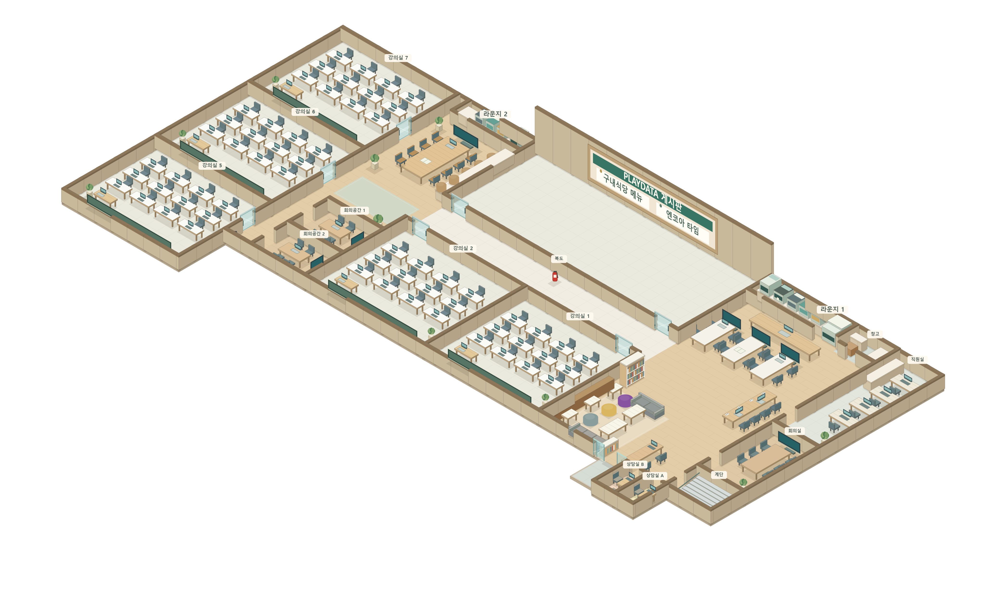

# PLAYDATA 캠퍼스 메타버스

실제 캠퍼스 설계도와 실내 사진을 바탕으로 만든 2.5D 맵 탐방 프로토타입입니다. 오른쪽으로 45도 회전한 지도에 높이가 있는 벽·가구를 표시하고, 캐릭터 대비 맵을 1.5배 넓혔습니다. 캐릭터를 움직여 강의실과 라운지를 둘러보고, 시설 안내와 참고 사진을 확인할 수 있습니다.

문서 기준일은 2026년 10월 11일입니다. `C:\3rd_project_develop`의 구현된 기능을 기준으로 캠퍼스·옥상 지도, 과정별 회원가입·아바타, 웹소켓 실시간 접속·채팅과 마지막 위치 복원을 설명합니다.

옥상은 18층 오른쪽 아래 계단으로 연결됩니다. 계단 위쪽으로 걷거나 가까이서 **E**를 누르면 올라갑니다. 라운지 2의 강의실 5 쪽 벽면 소화기에서 **E**를 누르고 확인창에서 **예**를 선택하면 옥상 왼쪽 끝 포탈로 이동합니다. 같은 위치의 옥상 포탈에 들어가거나 **E**를 누르면 **예 / 아니오** 확인 후 라운지 2로 돌아옵니다. 도착 직후와 **아니오** 선택 후에는 포탈에서 나가기 전까지 자동 확인창을 반복하지 않습니다. 맵 중앙 1/2 지점의 세로 8단 계단이 양쪽 길이가 같은 휴게 광장과 아래 광장을 나눕니다. 위쪽 광장에는 유튜브·심리 테스트·게임 부스 세 개를 회전한 맵의 긴 변을 따라 나란히 놓고, 입구를 오른쪽으로 90도 돌렸습니다. 아래 광장은 분수 주변의 원형 포장, 산책로, 벤치와 꽃 화단으로 꾸몄습니다. 광고·행사 게시판은 18층 연결 계단 왼편으로 옮기고 바닥 방향에 맞춰 세웠습니다. 부스 줄을 위쪽 광장 중앙에 맞추고 우상단 벽을 더 높이고 계단 뒤쪽과 위쪽 광장 끝까지 연결했습니다. 오른쪽 아래 계단은 18층으로 이어집니다.

계단·포탈로 18층과 옥상을 이동하면 화면 전체를 검게 덮고 **`loading...`을 3초간 표시**합니다. 글씨는 프로젝트에 포함한 Press Start 2P 픽셀 폰트로 표시합니다. 전환 중에는 이동과 상호작용을 막고, 도착 후에는 이동키를 떼었다 다시 눌러 이동합니다. 포탈의 **아니오** 선택과 로그인 시 마지막 위치 복원에는 로딩 화면을 띄우지 않습니다. 전환 중 시작된 전체 추첨 팝업은 로딩이 끝난 뒤 표시합니다. 이후 광고를 넣을 수 있도록 전환 화면에 별도의 빈 콘텐츠 영역을 마련했으며 현재 광고는 표시하지 않습니다.

옥상에서는 캐릭터가 계단 높이에 맞춰 부드럽게 이동하며, PNG 저장은 해당 층을 기준으로 동작합니다. 다른 캐릭터는 같은 층에 있는 사람을 표시하고, 오른쪽 위 **전체 접속 N명**은 나를 포함한 18층·옥상 전체 접속 수를 표시합니다. 층을 이동해도 전체 접속 수는 유지되며 입장·퇴장에 맞춰 갱신됩니다. 접속 수는 지도 탭별 웹소켓 연결을 기준으로 하므로 같은 계정의 여러 지도 탭도 각각 한 접속으로 계산합니다.

## 실행 방법

이 개발 복사본은 `run-develop.cmd` 또는 `run-local.cmd`로 실행한 뒤 [개발 캠퍼스](http://127.0.0.1:8003/)에 접속합니다. 원본의 8002 서버와 함께 실행할 수 있습니다. 자세한 환경 준비는 [RUN_GUIDE.md](RUN_GUIDE.md)를 참고하세요.

방향키·WASD로만 캐릭터를 이동하며, 이동속도는 기존의 1.25배입니다. 기본 확대는 145%이고, 일반 계정도 휠·+/− 버튼·+/− 키로 50~150% 범위에서 확대·축소할 수 있습니다. 확대 비율과 +/− 버튼은 지도 오른쪽 위 전체 접속자 표시 옆에 있습니다. 일반 계정의 화면은 캐릭터를 따라갑니다. 관리자(is_staff) 계정은 기존 35~360% 확대 범위와 **화면 고정: 켬 / 끔** 버튼을 이용합니다. 고정을 끄면 마우스로 화면을 드래그해 둘러보고, 다시 켜면 캐릭터 중심으로 돌아옵니다. 전체 보기, 클릭·자동 이동과 미니맵은 제거했습니다. 게시판, 로그아웃과 실시간 접속도 이용할 수 있습니다.

기존에 공유한 [PLAYDATA 지도 미리보기](https://playdata-campus-metaverse.mlops-1-7302.chatgpt.site)는 별도로 배포한 결과물입니다. 로컬 소스 수정이 그 페이지에 자동 반영되지는 않습니다. 현재 개발본은 위의 8003 서버에서 확인합니다.

회원가입·로그인을 이용하려면 아래 Django 실행 방법을 따릅니다. 지도만 미리 확인하려면 `dist/index.html`을 웹 브라우저로 열어도 됩니다. 파일 선택부터 수정 후 확인까지의 절차는 [실행 가이드](RUN_GUIDE.md)에 정리했습니다.

## 현재 구현한 기능

현재 저장소에는 로그인 후 지도 화면을 제공하는 Django 프로젝트가 포함되어 있습니다. 가상환경과 의존성을 준비한 뒤 `run-local.cmd`를 실행하면 `http://127.0.0.1:8003/`에서 로그인 화면을 열 수 있습니다. 처음 설치하는 방법은 [실행 가이드](RUN_GUIDE.md)의 Django 실행 항목을 참고해 주세요.

같은 와이파이·공유기의 조원은 실행 창에 표시되는 서버 PC의 내부 IP 주소로 접속합니다. 예를 들어 서버 주소가 `192.168.0.77`이면 `http://192.168.0.77:8003/`을 엽니다. 처음 한 번 `allow-lan.cmd`를 관리자 권한으로 실행해 현재 LAN의 TCP 8003 접속 규칙을 준비합니다. 서버는 `0.0.0.0:8003`에서 실행되며 허용 호스트는 이 PC의 실제 사설 주소로 제한합니다. 자세한 절차와 IP 변경 시 갱신 방법은 실행 가이드에 정리했습니다.

회원가입은 두 화면으로 진행합니다. 첫 화면에서 아이디·비밀번호와 **MLO 1기·2기·3기 / SKN 34기·36기** 중 참여한 과정·기수를 선택합니다. 다음 화면에서는 닉네임과 해당 과정의 캐릭터를 고릅니다. **MLO는 남자 1(민트 후드)·여자 2(초록색 카디건)**, **SKN은 남자 2(보라색 재킷)·여자 1(보라색 후드)** 중 선택합니다. 기수에 관계없이 같은 과정은 같은 아바타 조합을 사용합니다. 닉네임과 캐릭터 설정을 완료하면 지도로 입장하며, 중간에 로그아웃한 경우 다음 로그인에서 설정을 이어갑니다.

선택한 과정·기수, 닉네임, 아바타와 로그인 세션은 로컬 SQLite 데이터베이스에 저장하고 비밀번호는 해시로 저장합니다. 아바타는 최초 저장 후 고정되며, 이후 캐릭터 변경 버튼과 변경 주소는 제공하지 않습니다. 기존 계정은 현재 아바타를 고정해서 유지하고, 기수는 임의로 추정해 배정하지 않습니다. 닉네임은 지도 오른쪽 위 설정 메뉴의 `닉네임 변경`으로 변경합니다.

| 기능 | 동작 |
| --- | --- |
| 회원가입·과정·프로필 | 계정·과정·기수 선택 후 다음 화면에서 닉네임·과정별 아바타 최초 선택, 저장 후 아바타 고정 |
| 실시간 접속 | 같은 서버에 접속한 캐릭터의 이동·방향·선택한 코디 공유, 다른 캐릭터 머리 위에 닉네임 표시, 접속 수 표시 |
| 입장·퇴장 | 새 접속자는 현재 접속자를 바로 표시, 로그아웃·탭 닫기는 캐릭터 제거, 일시적인 연결 끊김은 자동 재연결 |
| 로그인·로그아웃 | 로그인 최대 8시간, 실제 활동이 30분 없으면 자동 로그아웃, 만료 1분 전 안내, 설정·외부 출입구에서 직접 로그아웃 |
| 외부 출입구 | 나갈 때 “나가시겠습니까?” 표시, 예는 로그아웃 후 로그인 화면으로 이동, 아니오 또는 Esc는 출입문 안쪽으로 돌아와 지도 이용 계속 |
| 캐릭터 이동 | WASD 또는 방향키로만 이동, 기존 속도의 1.25배 |
| 공간 선택 | 왼쪽 공간 목록에서 시설 안내 확인 |
| 지도 조작 | 기본 145%, 일반 계정 50~150% 확대·축소와 캐릭터 추적, 관리자 35~360% 확대·축소·화면 고정 토글·화면 드래그 |
| 시설 안내 | 시설 클릭 또는 가까운 시설 옆에서 E를 눌러 설명과 참고 사진 확인 |
| 강의실 유리문 | 문 7개를 E·클릭으로 열기·닫기, 문 상태를 접속자끼리 공유, 통합 강의실에는 문 2개 |
| 부스 팝업 | 각 부스 중앙 E 상호작용, 별도 게임 창에서 카드 선택 후 같은 창으로 이동, 심리 테스트도 별도 창에서 열기, 유튜브 안내는 지원 환경에서 전체 PiP |
| 캐릭터 코디 | 4종 스프라이트의 앞·뒤·좌·우 걷기, 멈추면 기본 자세, 코디는 계정에 저장하며 재로그인 시 유지 |
| 마지막 위치 | 마지막 층·좌표·방향을 계정에 저장하고 재접속 시 복원, 최초 입장은 18층 외부 출입구 바로 안쪽 |
| 채팅 | 18층·옥상 전체 채팅, 좌측 하단 채팅창과 현재 층 캐릭터 위 5초 말풍선 |
| 개인 설정 | 다른 사람 닉네임·채팅창·말풍선 표시 켬·끔, 계정별 브라우저 저장, 닉네임 변경·로그아웃 |
| 게시판 | 통합 강의실 긴 벽의 게시판에서 E·클릭 또는 18층 우하단 축소창으로 구내식당 메뉴·엔코아 타임 카드 열기, 옥상 광고·행사 이미지 표시 |
| 엔코아 타임 | 기존 카드 선택 후 같은 팝업에서 전체글·게시판별 탐색, 제목·내용 검색, 글과 댓글 작성·수정·삭제 |
| 옥상 이벤트 | 중앙 계단 앞 광장의 부저에서 계정당 한 번 참여, 부저 팝업에서 참가 완료 닉네임 실시간 표시, 18층·옥상 전체 접속자에게 슬롯 추첨 팝업과 같은 당첨 결과 표시 |
| 지도 저장 | 현재 층의 2.5D 지도 전체를 PNG로 다운로드 |

실시간 다중 접속은 Django 서버에서 동작합니다. 파일로 직접 여는 지도는 혼자 지도만 탐방하는 용도입니다. 음성·화상 통화와 다른 접속자와의 화면 공유는 구현하지 않았습니다. Raw 행동 이벤트는 설정된 경우 Kafka로 전송합니다. 게임은 별도 게임 창에서 카드를 선택하면 같은 창이 원본 게임 페이지로 이동하며, 창이 열린 동안에는 캐릭터 이동이 멈춥니다. 심리 테스트존도 심심테스트 사이트를 별도 창에서 엽니다. 유튜브 부스는 콘텐츠 준비 중 안내를 표시하며 외부 유튜브 사이트로 이동하지 않습니다. TV와 노트북은 지도에 표현된 시설이며 실제 PC 연결이나 영상 전송 기능은 없습니다.

현재 서버는 Django Channels와 Daphne로 HTTP·웹소켓을 함께 제공합니다. 이동 좌표는 소수점을 유지하며 최대 초당 10회 전송하고, 다른 캐릭터는 중간 위치를 보간해 표시합니다. 계정마다 마지막 층·좌표·바라보는 방향 한 건을 DB에 저장합니다. 이동 중 약 5초 간격, 층 이동, 창 닫기와 로그아웃 시 갱신하며, 다시 로그인하거나 새로고침하면 저장된 자리에서 시작합니다. 저장된 위치가 없는 계정은 18층 외부 출입구 바로 안쪽에서 시작합니다. 로그인 세션과 허용된 출처를 확인하며, 외부 탭에서 로그아웃해도 최대 약 10초 안에 해당 연결을 종료합니다.

출입구로 나가 로그아웃하면 다음 입장 위치는 입구 안쪽입니다. 지도 수정으로 저장된 자리에 가구가 생긴 경우 가까운 통행 가능한 자리로 보정합니다. 여러 탭을 사용하면 가장 최근에 이동한 위치를 유지하며, 오래된 탭이 닫혀도 새 위치를 덮어쓰지 않습니다. 마지막 위치는 서버 재시작 후에도 유지되지만, 강제 종료·전원 차단 시에는 마지막 DB 저장 시점까지 복원됩니다. 마지막 위치와 별도로, 실제 좌표가 바뀐 Raw 이동 관측은 Kafka가 연결된 경우 약 0.1초 간격으로 전송합니다. 전체 이동 경로를 운영 DB에 쌓지는 않습니다.

접속자 목록과 전달 채널은 한 서버 프로세스의 메모리에 있습니다. 여러 프로세스·서버로 운영할 때는 전달 채널과 접속자 상태를 함께 Redis 등 공유 저장소로 옮겨야 합니다. 현재 이동 판정은 클라이언트가 담당하고 서버는 좌표 범위와 메시지 형식을 검사합니다.

## 옥상 기프티콘 이벤트

옥상 중앙 계단 바로 앞의 넓은 광장에 빨간 이벤트 부저를 배치했습니다. 부저 옆에서 **E**를 누르거나 장치를 클릭한 뒤 **부저 눌러 참여하기**를 선택합니다. 이벤트마다 계정당 한 번 참여할 수 있고, 서버가 현재 층·부저와의 거리·참여 마감 시간을 확인합니다. 같은 계정으로 여러 탭을 열어도 참여 횟수는 늘어나지 않습니다. 참여 당시 닉네임과 전체 참가자 목록은 부저 팝업에서 실시간으로 확인합니다. 지도 위의 별도 참가 명단 게시판은 제거했습니다.

관리자 계정은 화면 위 **이벤트 관리**에서 **참여 시작 → 지금 추첨**으로 시연할 수 있습니다. 운영 시간은 기본으로 비워 두었습니다. **새 이벤트 준비** 후 **이벤트 이름 · 시간 설정**에 한국 시간의 참여 시작·추첨 시각을 저장하면 실행 중인 서버가 예약 시간에 진행합니다. 시간 설정을 비우면 관리자 버튼으로 진행합니다. 주간 반복 일정과 상품 지급은 아직 정하지 않았으며 자동으로 생성하지 않습니다.

추첨 시 참여를 마감하고 서버에서 참가 계정 중 **1명**을 무작위로 뽑아 저장합니다. 18층·옥상의 전체 접속자에게 화면을 채우는 슬롯 팝업이 나타나며, 모든 화면은 같은 당첨자를 표시합니다. 기본 애니메이션은 10초입니다. **결과 먼저 보기**로 즉시 확인하거나 창을 닫을 수 있고, 움직임 줄이기 설정에서는 바로 결과를 표시합니다. 추첨 중 재접속하면 진행 중인 시점부터 이어 보며, 종료 후 1분 안에 처음 접속하면 결과 팝업을 표시합니다. 이후에는 부저에서 결과를 확인합니다.

이벤트, 참가 계정·닉네임·참여 시각과 당첨 결과는 `db.sqlite3`에 저장합니다. 새 이벤트를 준비해도 지난 기록은 보존합니다. 추첨 요청이 중복되거나 서버를 다시 시작해도 같은 이벤트의 당첨자를 다시 뽑지 않습니다. 참가자가 없으면 당첨자 없이 추첨 완료로 처리합니다. 서버가 꺼져 있는 동안 지난 예약은 다음 시작 시 한 번 처리하며, 종료한 이벤트의 미참여 계정을 자동으로 참가시키지 않습니다. 실시간 알림은 기존의 단일 서버 프로세스 웹소켓 구조를 사용합니다. 부저 참여·추첨과 기프티콘 지급 이벤트는 현재 Raw Kafka 범위에서 제외했습니다.

## 로그인 유지와 자동 로그아웃

로그인은 최대 **8시간**, 실제 사용자 활동이 없으면 **30분**까지 유지합니다. 만료 **1분 전** 화면 위에 남은 시간을 안내합니다. 비활동 안내의 **계속 이용하기**를 누르거나 이동·클릭·입력하면 비활동 시간을 갱신합니다. 8시간의 최대 유지 시간은 연장되지 않으며 다시 로그인해야 합니다. 같은 로그인 세션을 공유하는 여러 탭의 활동은 함께 반영합니다.

웹소켓 접속 확인, 세션 상태 조회와 자동 이미지 갱신은 사용자 활동으로 세지 않습니다. 만료되면 서버가 마지막으로 받아 검증한 위치를 먼저 저장하고, 해당 로그인 세션을 삭제한 다음 연결된 웹소켓을 종료합니다. 재로그인하면 저장된 위치에서 시작합니다. 다른 사이트의 별도 게임·심리 테스트 창에서 하는 입력은 캠퍼스가 감지할 수 없으므로 그동안 캠퍼스에서 활동이 없으면 자동 로그아웃 대상입니다.

로그인 기간·비활동 기간·안내 시점은 `config/settings.py`의 환경 변수로 바꿀 수 있습니다. 실행 방법과 변수 목록은 [실행 가이드의 로그인 설정](RUN_GUIDE.md#로그인-유지-시간과-만료-세션-정리)을 참고하세요. 기존 로그인 세션은 새 정책으로 처음 접속할 때부터 최대 8시간·비활동 30분 제한을 적용합니다.

개발 서버는 기본 한국 시간 **새벽 4시**에 Django `clearsessions`로 만료된 세션만 하루 한 번 정리합니다. 최초 시작 시 이전 만료 세션도 정리하고, 실행 결과를 Git에서 제외한 `var/session-cleanup.json`에 남겨 재시작·자동 재로딩 때 중복 실행을 막습니다. 서버가 꺼져 있으면 다음 실행 때 놓친 정리를 수행합니다. 계정·닉네임·위치·게시글은 삭제하지 않습니다.

## 엔코아 타임 커뮤니티

18층의 게시판이나 우하단 **게시판 열기**에서 기존 **엔코아 타임** 카드를 선택합니다. 카드와 로고를 유지하며 같은 팝업 안에 커뮤니티 화면을 표시합니다. 팝업을 닫거나 **카드 선택**으로 돌아오면 지도와 식단 사진 기능을 그대로 이용합니다. 커뮤니티가 열려 있는 동안 캐릭터 이동은 멈춥니다.

**전체글**, **공지사항**, **자유게시판**, **IT정보**, **프로젝트 공유·피드백**, **취업·진로**, **학습자료 공유**, **질문·답변** 탭을 제공합니다. 전체글에는 모든 게시판 글을 최신순으로 표시하고, 탭을 선택하면 해당 게시판 글만 보여줍니다. 제목·내용 검색과 12개씩 페이지 이동을 지원합니다.

로그인한 사용자는 글과 댓글을 작성하고 본인 글·댓글을 수정하거나 삭제합니다. 관리자(`is_staff`)는 공지사항 작성과 다른 사용자의 글·댓글 관리를 할 수 있습니다. 작성자와 닉네임은 로그인 계정에서 가져옵니다. 글의 웹 주소를 링크로 표시하고 코드·본문 줄바꿈을 유지하며, HTML은 실행하지 않습니다. 저장하지 않은 글·댓글을 떠나려 하면 확인하고, 다른 화면에서 이미 수정된 글·댓글의 오래된 수정 요청은 거부합니다.

각 댓글의 **답글**을 눌러 대댓글을 작성합니다. 대댓글은 부모 댓글 아래에 표시하며, 본인 대댓글의 수정·삭제와 관리자 관리를 지원합니다. 대댓글은 한 단계까지만 작성하고, 부모 댓글을 삭제해도 대댓글은 유지하며 부모 자리에는 **삭제된 댓글입니다.**를 표시합니다. 댓글 목록은 부모 댓글 30개씩 페이지를 나누고 답글을 같은 페이지에 함께 표시하며, 댓글 수에는 대댓글도 포함합니다.

글·댓글·대댓글은 현재 `db.sqlite3`에 저장하므로 서버를 다시 시작해도 유지됩니다. 게시글을 삭제하면 댓글·대댓글도 화면에서 숨기며 기존 기록은 보존합니다. 샘플 글을 실제 DB에 자동 등록하지 않습니다. 게시판을 다시 열거나 목록으로 돌아오면 최신 목록과 게시판별 글 수를 가져오며, 댓글은 **새로고침**으로 갱신할 수 있습니다.

## Raw 행동 로그와 Kafka

토픽별 이벤트·JSON 필드·저장 및 전송 규칙은 [KAFKA_TOPICS.md](KAFKA_TOPICS.md)에 정리했습니다.

계정·채팅·게시판·댓글·외부 콘텐츠 열기·층 이동 이벤트를 DRD 형식으로 기록합니다. 아래 토픽은 Kafka에서 먼저 생성되어 있어야 합니다.

| Kafka 토픽 | 이벤트 |
| --- | --- |
| raw.account | session_started, session_ended |
| raw.chat | chat_sent |
| raw.board | post_created, post_read, post_updated, post_deleted |
| raw.comment | comment_created, comment_updated, comment_deleted |
| raw.content_usage | content_open_requested |
| raw.movement | movement_observed, floor_transferred |

댓글과 대댓글 모두 `raw.comment`의 `comment_created`, `comment_updated`, `comment_deleted`를 사용합니다. 일반 댓글의 `parent_comment_uuid`는 `null`, 대댓글은 부모 댓글의 UUIDv4입니다. 대댓글을 수정·삭제해도 부모 UUID를 유지하며, 새 토픽이나 이벤트 종류·스키마 버전은 추가하지 않습니다.

공통 Raw 데이터에는 user_uuid, session_uuid, class_group_uuid가 포함됩니다. 메시지 본문·닉네임·비밀번호·세션 토큰은 Kafka로 보내지 않습니다. 채팅 본문은 운영 DB에만 보관하고 30일 후 정리합니다. 게시글·댓글 내용은 기존 커뮤니티 DB에서 관리하며 Raw 이벤트에는 UUID와 개정 번호만 남습니다. 콘텐츠 이벤트는 게임·심리 테스트의 실제 열기 요청을 기록합니다. 게임과 심리 테스트는 모두 `REST` 도메인으로 분류하며, 각각 `game`·`psychology` 카테고리 UUID로 구분합니다. `LEARNING` 도메인은 추후 학습 콘텐츠용으로 남겨두며 현재 등록된 콘텐츠는 없습니다. 퀴즈 응답·점수 지급·옥상 부저 이벤트는 이번 범위에서 제외했습니다.

새 식별자는 UUIDv4로 발급하며 반·층·구역·콘텐츠 기준정보도 같은 형식을 사용합니다. 저장·발행 전에 허용 필드와 값의 형식을 검사합니다. 추가 필드나 중첩된 원문이 들어오면 거부하고 오류 기록에도 원문을 남기지 않습니다. 층 전환 로그는 마지막 위치 저장에 성공한 경우에만 생성합니다. 일일 정리는 오프라인 사용자의 만료 세션 종료도 기록합니다.

발행하는 JSON에는 event_uuid, raw_manifest, raw_data가 있으며 사용자 UUID를 Kafka key로 사용합니다. 주요 변경 이벤트는 운영 데이터와 같은 DB 트랜잭션에서 Outbox에 기록하고 Kafka 확인 뒤 발행 완료로 표시합니다. 전송 실패 시 같은 이벤트 UUID로 재시도하므로 소비자는 중복을 제거할 수 있어야 합니다. movement_observed는 실제 위치가 바뀔 때 약 0.1초 간격으로 발행하며 메모리 큐를 사용해 장애·과부하 시 일부 좌표가 빠질 수 있습니다.

로컬 기본 설정은 SQLite이며 Kafka 없이도 이벤트는 event_outbox에 대기합니다. 실제 발행을 켜려면 .env.example을 .env로 복사한 뒤 팀에서 받은 MySQL·Kafka 접속 정보와 보안 설정을 채우고 패키지를 설치한 후 마이그레이션을 실행합니다. .env는 Git에 올리지 않습니다. KAFKA_BOOTSTRAP_SERVERS가 비어 있으면 발행기는 시작하지 않습니다. 설정한 경우 개발용 단일 runserver 프로세스가 Outbox 발행기를 시작합니다.

운영 서버를 여러 프로세스로 확장하기 전에는 Outbox 발행기를 단일 전용 작업자로 분리하고 이동 이벤트 큐를 공유 전달 구조로 바꿔야 합니다. 실제 팀 Kafka의 인증 방식·브로커 주소·토픽 생성은 팀 운영 설정에 맞춰야 합니다.

`eventing/tests.py`는 개인정보 제외, DB·로그 동시 확정과 실패 시 취소, 세션 만료, 콘텐츠 열기, Kafka ACK·재시도, UUID 카탈로그 이전을 검사합니다. 실제 Kafka·MySQL 연결 검사는 팀의 접속 정보가 있는 환경에서 별도로 수행합니다.

## 최신 맵 배치



위 이미지는 현재 18층 배치를 저장한 PNG입니다. 유리문은 서버 시작 시 기본 상태인 닫힘으로 표시합니다. 실행 중인 지도에서는 접속자들이 조작한 문 상태를 공유합니다.

### 강의실

- 강의실 3·4는 가운데 벽을 없애 하나로 합쳤습니다. 내부 책상·의자·모니터·칠판 등 수업 가구와 지도 안내 표시·공간 안내 팝업을 제거했습니다. 기존 두 유리문은 유지합니다.
- 통합 강의실 뒤쪽 긴 벽 가운데에 대형 PLAYDATA 칠판형 게시판을 달았습니다. 짙은 녹색 칠판 왼쪽에는 로켓·방패 엠블럼, 가운데에는 후광이 있는 PLAYDATA 로고와 게시판 글씨를 표시합니다. 칠판 표면에는 메뉴·엔코아 타임 카드 이름을 표시하지 않습니다. 바닥 통행을 막지 않으며, 가까이서 **E** 또는 게시판 클릭으로 구내식당 메뉴·엔코아 타임 카드 선택창을 엽니다. 우하단 게시판 축소창도 이용할 수 있습니다.
- 강의실 1·2·5·6·7의 강의 전면과 학생 좌석 방향은 아래쪽입니다. 강의실 1·2와 통합 강의실의 유리문은 중앙 복도 양 끝에 배치했습니다.
- 복도 양쪽 라운지 입구를 복도 폭과 같은 153맵 픽셀로 넓혔습니다. 강의실 유리문 일곱 개는 실내 쪽으로 90도 열리며, 가까이서 **E** 또는 문 클릭으로 여닫습니다. 열린 문은 통과할 수 있고 닫힌 문은 이동을 막습니다. 문이 움직일 자리에 캐릭터가 있으면 조작하지 않습니다.
- 문 상태는 웹소켓으로 모든 접속자에게 공유하고 새로 접속한 사용자도 현재 상태를 받습니다. 서버 메모리에 보관하며 서버를 다시 시작하면 모두 닫힙니다.
- 왼쪽 상단, 중단, 하단은 각각 강의실 7·6·5입니다. 각 강의실에 학생 책상을 4열 3줄로 배치했습니다.

### 라운지 1

- 복도로 들어가기 전 왼쪽 벽 앞에 얕은 3단 책장 하나를 놓았습니다. 벽 두께와 겹치지 않도록 앞쪽으로 여유를 두었으며, 복도 입구와 옆 소파·스툴·탁자의 휴식 공간은 비워 둡니다.
- 프린터 바로 앞 구획벽을 프린터 폭보다 넓게 비워 조작 화면과 출력부가 보이도록 했습니다.
- 라운지 1의 화분을 모두 제거했습니다.
- 오른쪽의 세로로 긴 작업 탁자에는 콘센트 4곳과 오른쪽 네 좌석을 배치했습니다.
- 현장 칠판 게시판을 제거하고, 18층 화면 우하단에 게시판 접근 축소창을 배치했습니다. **게시판 열기**를 누르면 기존 구내식당 메뉴·엔코아 타임 카드 팝업이 열립니다. 옥상에서는 축소창을 숨깁니다.
- 브라운 벽을 강의실 1 옆면에 붙이고, 사진의 작은 흰 탁자와 원형 스툴을 벽을 따라 배치했습니다.
- 위쪽으로 옮긴 2칸 소파가 아래 소파와 마주보도록 배치했습니다.
- 안내 데스크의 탁자 폭을 줄이고 직원용 의자를 2개로 늘렸습니다. 의자 외에 데스크 뒤쪽 탁자나 수납 가구는 두지 않았습니다.
- 휴게 공간과 안내 데스크 사이 아래쪽 외벽에 유리 슬라이딩 출입문을 배치했습니다. 기존 실내 유리 칸막이는 제거했고, 열린 문을 지나 바깥 출입구와 라운지를 오갈 수 있습니다.
- 위쪽에는 노트북 한 대가 놓인 긴 탁자와 세 회의 탁자별 PC 연결용 TV를 배치했습니다.
- 두 기둥과 각각 둘러싸던 책장 세 개씩을 제거해 중앙 통로를 비웠습니다.
- 상단 휴게 설비는 정수기, 커피머신, 세 분리수거함, 대형 사무용 프린터 순서로 배치했습니다. 프린터는 분리수거함과 창고 사이에 있습니다.

### 라운지 2

- 중앙 소파를 제거했습니다.
- 상단 정수기를 맨 오른쪽 끝에 두고 분리수거함을 함께 배치했습니다.
- 위쪽 긴 탁자의 PC 연결용 TV를 탁자 중앙선에 맞춰 위쪽에 배치했습니다.
- 오른쪽 벽면에는 바 테이블이 있습니다.
- 아래쪽 회의공간 1과 2의 크기, 벽, 출입문, 탁자, 의자, TV 배치는 기존 구조를 유지했습니다.
- 강의실 5 쪽 벽면의 소화기는 옥상 왼편 포탈과 연결됩니다. E 상호작용 후 예 / 아니오 확인으로 왕복 이동합니다.

### 상담실과 기타 공간

상담실 A는 노란색, 상담실 B는 주황색 벽을 반영했습니다. 각 상담실에는 상담 테이블, 의자, 모니터가 있습니다. 설계도의 복도, 직원실, 창고, 회의실, 계단도 포함했습니다. 통합 강의실을 제외한 강의실, 직원실, 회의실의 가구는 기본 구성으로 배치했습니다.

## 소스 구성

이 프로젝트에서는 `dist` 폴더에 실제 HTML, CSS, JavaScript 원본이 들어 있습니다.

| 파일 | 역할 |
| --- | --- |
| `manage.py`, `config/` | Django 실행 명령과 프로젝트 설정 |
| `campus/` | 지도 페이지, 인증된 웹소켓 접속, 실시간 이동·채팅, 이동 관측 발행과 식단 사진 수집 |
| `campus/positions.py` | 마지막 층·좌표·방향의 검증·저장·복원과 기본 입구 위치 |
| `campus/doors.py` | 강의실 유리문 7개의 서버 좌표·충돌·조작 거리 검사 |
| `accounts/` | 회원가입·최초 프로필 설정·로그인·로그아웃, 닉네임 변경과 사용자 UUID |
| `accounts/session_policy.py`, `accounts/session_views.py` | 최대 유지·비활동 기한의 서버 검증, CSRF 보호 활동 갱신·상태 조회 API, 만료 시 위치 저장과 세션 삭제 |
| `accounts/session_cleanup.py`, `campus/session_registry.py` | 일일 만료 세션 정리, 로그인 세션별 웹소켓과 최신 위치 연결 |
| `community/` | 엔코아 타임 게시글·댓글 모델, UUID·개정 번호·삭제 보존과 Raw 이벤트 기록 |
| `eventing/` | DRD 카탈로그, 계정·채팅·게시판·콘텐츠·층 이동 이벤트, Outbox와 Kafka 발행기 |
| `accounts/cohorts.py` | MLO·SKN 과정·기수 선택지와 과정별 아바타 조합 |
| `db.sqlite3` | 계정·과정·세션·마지막 위치·커뮤니티·채팅 보관·Raw Outbox 데이터 (Git 제외) |
| `.env.example` | 로컬 SQLite, MySQL·Kafka 연결, 로그인 유지 시간 환경변수 예시 |
| `requirements.txt` | Django, Channels·Daphne, Kafka·XXH3, MySQL·dotenv와 Pillow 의존성 |
| `run-local.cmd` | Windows에서 Django 로컬 서버 실행 |
| `run-develop.cmd` | 개발 복사본을 8003 포트로 실행 |
| `run-campus.py` | 같은 네트워크용 서버 실행과 접속 주소 표시 |
| `allow-lan.cmd`, `configure-lan.py` | 현재 LAN의 TCP 8003 접속만 허용하는 방화벽 설정 |
| `dist/index.html` | 화면 구조와 버튼, 안내 창 |
| `dist/board-shortcut.css` | 18층 우하단 게시판 접근 축소창과 작은 화면 배치 |
| `dist/community.js`, `dist/community.css` | 기존 엔코아 타임 카드에서 여는 커뮤니티 팝업, 게시판 탭·검색·글·댓글 화면과 모바일 배치 |
| `dist/style.css` | 화면 디자인과 모바일 배치 |
| `dist/map-data.js` | 방, 벽, 출입구, 가구의 위치와 시설 설명 |
| `dist/rooftop-data.js` | 옥상 축제 구역, 높이가 다른 바닥과 양방향 연결 계단 |
| `dist/isometric.js` | 오른쪽 45도 투영, 입체 벽·가구·캐릭터와 가림 처리 |
| `dist/classroom-doors.js` | 유리문의 열린 유리판·닫힌 입구 표현, 충돌과 조작 거리 계산 |
| `dist/avatars.js`, `dist/assets/characters/` | 4종 캐릭터 스프라이트·코디 미리보기·걷기 프레임 표시 |
| `dist/campus.js` | Canvas 지도 표시, 캐릭터 조작, 화면 조작과 안내 |
| `dist/floor-transition.js`, `dist/floor-transition.css` | 층 이동 시 3초 검은 로딩 화면과 입력 잠금, 광고용 콘텐츠 영역 |
| `dist/assets/fonts/` | 로딩 화면의 Press Start 2P 픽셀 폰트 원본과 SIL Open Font License |
| `tests/floor-transition.test.cjs` | 전환 대기·중복 요청·세션 만료·실패 시 입력 잠금 해제 검사 |
| `tests/isometric.test.cjs` | 회전·좌표 변환, 통합 강의실·대형 게시판·프린터 앞 벽·작업 탁자 배치 검사 |
| `tests/classroom-doors.test.cjs` | 복도 입구 전체 폭, 유리문 7개의 열림 방향·충돌 검사 |
| `tests/rooftop.test.cjs` | 계단·소화기 연결, 위쪽의 전시 부스 3개, 중앙 8단 계단과 높이 좌표 검사 |
| `dist/presence.js` | 웹소켓 연결·재연결, 다른 캐릭터 상태와 이동 보간 |
| `dist/social.js`, `dist/social.css` | 채팅창·5초 말풍선·개인 표시 설정과 화면 디자인 |
| `dist/session-policy.js`, `dist/session-policy.css` | 실제 사용자 활동 감지, 만료 전 안내·계속 이용하기, 만료 후 로그인 화면 이동 |
| `dist/booth-panel.js` | 부스 중앙 상호작용, 안내 팝업·Document PiP와 게임 팝업 열기 |
| `dist/game-booth.html` | 오목·전쟁시대·아빠와 나·지뢰찾기 카드 선택 후 같은 팝업에서 게임 페이지로 이동 |
| `tests/presence.test.cjs` | 전송 주기·좌표 정밀도·닉네임·문 상태 공유·재연결·로그아웃 검사 |
| `accounts/test_sessions.py`, `campus/test_session_policy.py` | 고정 기한·비활동·CSRF·동시 탭·마지막 위치 저장 순서·웹소켓 종료·일일 정리 검사 |
| `dist/navigation.js` | 경로 탐색 보조 모듈. 현재 클릭·자동 이동 기능은 사용하지 않음 |
| `dist/assets/` | 원본 설계도, 참고 사진, 지도 PNG |
| `dist/assets/campus-map.png` | 현재 18층 배치의 전체 지도 PNG. 소스 수정 후 별도로 다시 저장 |
| `README.md` | 프로젝트 설명과 최신 구현 상태 |
| `RUN_GUIDE.md` | 실행 방법, 조작법, 수정 후 확인 방법 |

## 확인한 사항

실내 공간 사이의 이동 경로, 벽과 주요 가구의 충돌, 외부 출입구와 라운지 사이의 통과를 확인했습니다. 회의공간 1과 2의 기존 구조 유지, 안내 데스크 좌석 2개, TV 정렬, 강의실과 소파 배치도 확인했습니다. 데스크톱 및 모바일 화면과 시설 안내, 별도로 제공한 단일 HTML 파일의 스크립트와 이미지 포함 상태를 확인했습니다.

과정·기수별 가입과 아바타 최초 선택 제한, 닉네임 수정, 로그인·로그아웃, 접근 제한·CSRF 보호, 마지막 위치 저장·복원, 웹소켓 입장·이동·퇴장·채팅·유리문 조작과 내부 IP 검출을 아래 명령으로 검사합니다. 테스트는 실제 계정 데이터와 분리된 임시 DB를 사용합니다.

```powershell
.\.venv\Scripts\python.exe manage.py test accounts campus config community raffle eventing
```

Node.js가 있으면 지도 배치·좌표 변환·문 충돌·실시간 접속·옥상 이동 검사도 함께 실행합니다.

```powershell
node --test tests/isometric.test.cjs tests/classroom-doors.test.cjs tests/presence.test.cjs tests/rooftop.test.cjs tests/raffle-map.test.cjs tests/floor-transition.test.cjs
```

분리된 두 로그인 세션으로 문 열림·닫힘 공유를 확인했습니다. 게시판 축소창과 대형 게시판의 카드 선택, 줌과 전체 접속 표시의 배치, 복도 양 입구 통행, 책장의 벽 가림과 휴식 공간 통로, 프린터 앞 시야도 확인했습니다.

## 채팅과 개인 설정

- 지도 오른쪽 위 **설정** 버튼 또는 **Esc**로 설정을 엽니다. 다른 사람 머리 위 닉네임, 좌측 하단 채팅창, 캐릭터 말풍선을 각각 켜거나 끌 수 있습니다. 본인 캐릭터의 `나` 표시는 유지합니다.
- 표시 설정은 본인 화면에만 적용하며 같은 브라우저의 계정별로 저장합니다. 닉네임 변경과 로그아웃도 설정 메뉴에서 이용합니다. 아바타는 최초 설정 후 고정됩니다.
- 채팅은 18층과 옥상에 접속한 사람 모두에게 전달합니다. 메시지에는 보낸 사람과 보낸 층을 표시하고, 말풍선은 현재 층에 보이는 캐릭터 위에 **5초** 동안 표시합니다. 새 메시지는 기존 말풍선을 교체합니다.
- **Enter**로 채팅 입력에 들어가고 입력 후 **Enter** 또는 **전송**으로 보냅니다. 입력 중에는 이동·상호작용·확대 키가 캐릭터에 적용되지 않습니다. 입력창에서 **Esc**를 누르면 맵 조작으로 돌아옵니다.
- 메시지는 최대 200자입니다. 채팅창을 숨겨도 메시지는 수신하며 말풍선 설정은 독립적으로 적용합니다. 채팅창에는 현재 페이지에서 받은 최근 100개 메시지를 유지합니다.
- 채팅창 배경은 40% 투명하게 표시합니다. 글자와 입력창은 불투명하게 유지합니다.
- 채팅 메시지는 운영 DB에 30일 동안 보관합니다. chat_sent 이벤트에는 메시지 UUID·채널·층만 포함하며 본문과 닉네임은 Kafka로 보내지 않습니다.
