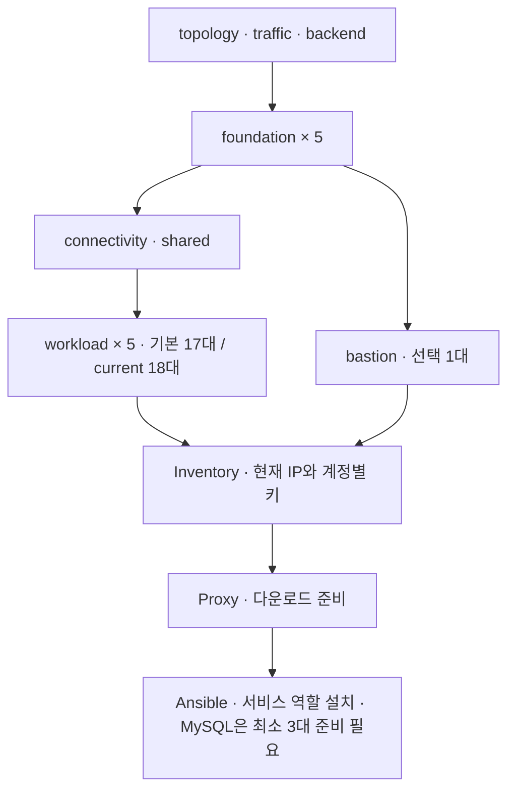

# aws-infra

AWS EC2의 배치·네트워크·보안규칙·상태를 Terraform과 PowerShell로 관리한다. 2026-10-18 [현재 운영 구성](docs/operations/current-state.md)을 기준으로 기본 topology(18대), 로컬 current·실제 AWS(19대)를 구분한다. 서버 실행·서비스 검증은 별도다.

실행은 [배포 절차](docs/deployment-runbook.md), 명령별 옵션은 [배포 명령 설명](infra/scripts/scripts.md), 코드 위치는 [라우팅 문서](docs/infra-routing/ROUTING-README.md)에서 확인한다. 복원·운영 명령은 [복원·운영 절차](docs/operations-recovery.md)에서 확인한다. EC2 내부 프로그램 설치는 별도 [platform](../aws-platform/platform/README.md)이 담당한다.

## 현재 기본 구성

- 서울 리전 ap-northeast-2, 모든 서버를 논리 A=apne2-az1에 배치한다. 네트워크의 A·C(apne2-az3) 서브넷과 공통 AZ 설정은 유지한다.
- 독립 VPC 다섯 개를 모든 쌍의 직접 Peering 10개로 연결한다.
- Account 1만 Public 서브넷·IGW를 사용하며, 기본 및 current 설정의 ALB는 비활성화돼 있다. 기본 NAT Gateway 수는 0개다.
- 기본 서비스 17대, current 서비스 18대는 workload 상태에 두고 Bastion 한 대는 별도 bastion 상태에 둔다.
- 게임·광고 Front와 Bastion은 각각 EIP를 사용한다. 게임 정식 주소는 https://bootcampmetaverse.site 이며 IP 접속은 도메인으로 이동한다.
- ALB와 전용 연결 3개를 기본 및 current 설정에서 제외했다. 게임 Front→게임 Backend, 광고 Front→광고 Backend TCP 8000을 사용하며 외부 사용자는 각 Front의 HTTPS로 진입한다. SG 허용과 실제 Nginx·인증서 설치 성공은 별도다.
- 프라이빗 서버의 다운로드는 Bastion Squid:3128을 명시적으로 사용한다. Proxy 프로그램·APT·Ansible 다운로드 준비와 서비스 설치는 서로 다른 단계다.

과거 변경 기록: 2026-10-10 광고 서버의 선언 배치를 account1 Private C에서 Private A로 변경했다. 기본 topology와 로컬 current 프로필을 함께 수정했으며 실제 AWS 이전은 아직 적용하지 않았다. EC2 교체 전 루트 디스크의 앱·설정·데이터 보존과 account1 workload의 전체 변경 계획을 확인해야 한다.

## 서버 수와 사양

| 구성 | 대수 | 기본 사양 | 별도 데이터 gp3 |
| --- | ---: | --- | ---: |
| MongoDB | 3 | t3a.small | 900GiB/대 |
| Kafka | 3 | t3a.large | 200GiB/대 |
| Spark·ZooKeeper | 3 | t3a.large | 100GiB/대 |
| 평탄화 Consumer | 1 | t3a.medium | 없음 |
| MySQL | 3 | t3a.small | 100GiB/대 |
| 게임·광고 Front | 2 | t3.small | 없음 |
| game-server | 1 | t3.large | 없음 |
| ad-server | 1 | t3.large | 없음 |
| Bastion | 선택 1 | t3a.small | 없음 |
| game-server-test(current 추가) | 1 | t3.2xlarge | 없음 |
| 합계 | current 19 / 기본 18 | small 9 + medium 1 + large 8 + 2xlarge 1(current) | 3,900GiB |

OS 디스크는 20GiB/대다. Bastion을 포함한 기본 EBS 선언량은 4,260GiB, current 및 AWS 연결 볼륨 합계는 4,280GiB이며, 데이터 디스크 생성·연결이 포맷·마운트나 서비스 데이터 저장 위치 설정을 수행하지는 않는다. 사양과 용량은 초기 설정값이며 실측 성능 권장치가 아니다.

## 계정과 AZ 배치

| 계정 / VPC | A | C | 서비스 / Bastion 포함 |
| --- | --- | --- | ---: |
| account1 · 10.10.0.0/16 | Public Bastion·front-a·front-b, Private game-server·game-server-test·ad-server·flatten-1 | 서버 없음 · 서브넷 유지 | 6 / 7 |
| account2 · 10.20.0.0/16 | Private mongo-1·spark-2 | 서버 없음 · 서브넷 유지 | 2 / 2 |
| account3 · 10.30.0.0/16 | Private mysql-1·spark-1·mongo-2 | 서버 없음 · 서브넷 유지 | 3 / 3 |
| account4 · 10.40.0.0/16 | Private kafka-1·kafka-2·mysql-3·spark-3 | 서버 없음 · 서브넷 유지 | 4 / 4 |
| account5 · 10.50.0.0/16 | Private mongo-3·mysql-2·kafka-3 | 서버 없음 · 서브넷 유지 | 3 / 3 |

current 기준 A 19대·C 0대이며 기본값은 테스트 Backend를 제외한 18대다. 계정 콘솔의 AZ 끝 글자는 물리 AZ ID와 구분한다. 상세 배치는 [계정 배치](docs/costs/account-allocation.md), SG 관계는 [보안규칙](docs/security-groups.md)에 있다.

2026-10-13 기본 topology와 로컬 profiles/current의 front-b·mongo-2·spark-3·mysql-2·kafka-3를 A로 변경했다. 서버 수·역할·Public/Private 구분·사양·디스크와 공통 az_ids는 유지하며 C 서브넷도 남긴다. 이 설명은 설정 변경이며 실제 AWS 이전 완료를 뜻하지 않는다. 기존 환경은 영향 계정의 새 workload Plan에서 EC2·데이터 EBS 교체 범위를 검토하고, 적용 후 인벤토리와 IP를 사용하는 서버 설정을 갱신한다.

## 생성부터 서비스 설치까지

1. Windows 도구·계정별 AWS 인증·공개키·S3 상태 버킷을 준비한다.
2. 기본 config 또는 deploy.ps1의 NewProfile로 만든 topology·traffic·platform.json 구성을 선택한다.
3. foundation 5계정 → connectivity shared → workload 5계정 → bastion account1 순서로 Plan을 검토하고 Apply한다.
4. Inventory로 현재 EC2 주소와 계정별 키 경로를 플랫폼 인벤토리에 반영한다.
5. Proxy로 Squid·APT·다운로드를 준비한다. 이 명령은 MySQL·Kafka·Spark를 설치하지 않는다.
6. WSL에서 Vault·데이터 마운트·역할 그룹을 준비하고 Ansible의 공통 설정·방화벽·각 서비스 역할을 실행한다.
7. 서비스 상태뿐 아니라 DB 복제·Kafka 송수신·ZooKeeper ensemble·Spark Master/Worker와 PySpark 작업을 확인한다.

인프라 기본값은 MySQL EC2 세 대다. mysql-1은 account3 Private A, mysql-2는 account5 Private A, mysql-3는 account4 Private A에 배치한다. 현재 플랫폼의 [MySQL 역할](../aws-platform/platform/docs/platform-routing/roles/mysql/README.md)이 요구하는 3~9대의 수량 조건을 충족한다. 2026-10-10 current 프로필의 mysql-3 EC2·디스크·SG 규칙을 실제 AWS에 반영했으며, 설치 전 인벤토리 재생성·Proxy·데이터 마운트·OS 방화벽을 준비해야 한다. Cluster 설치·자동 Primary 전환은 아직 이번 작업에서 검증하지 않았다. 기존 ReplicaSet의 자동 데이터 이전은 제공하지 않는다.

[로컬 Router](../aws-platform/platform/docs/platform-routing/roles/backend/README.md)는 game·Spark·선택 backend 서버에 설치하며 앱 접속은 127.0.0.1:6446(RW)·6447(RO)이다. Spark는 인벤토리 앞 두 대에 Master, 전체 세 대에 Worker·ZooKeeper를 배치한다. flatten-1은 account1 Private A의 t3a.medium 평탄화 Consumer 전용 서버다. Kafka 세 브로커의 9092와 MongoDB 세 노드의 27017에 접속하도록 선언하며 Kafka·Spark 그룹에 포함하지 않는다. EC2와 통신 규칙만 준비하고, 평탄화 프로그램·Front·game·ad 애플리케이션·Spark 잡 배포는 별도 구현 영역이다. 모든 업무 쓰기의 Kafka 우선 방침은 애플리케이션 요구이며 SG가 이를 강제하지 않는다.

## Bastion 운영과 삭제

[bastion.ps1](infra/scripts/bastion.ps1)은 Status·Output·Stop·Start·Restart와 PlanCreate/Create·PlanDelete/Delete를 제공한다. Stop은 인스턴스 삭제가 아니다. Bastion 삭제 후에도 foundation SG와 workload의 SSH·Proxy 규칙은 남는다.

전체 정리는 [destroy-all.ps1 안내](docs/operations-recovery.md#6-전체-인프라-삭제)의 Plan → 검토 → Apply 또는 단일 Destroy를 사용한다. 현재 데이터 EBS는 prevent_destroy=false다. true로 보호한 구성에서만 아래 임시 해제 설명이 적용된다. Plan·Apply와 DeleteDataVolumes만으로는 보호를 해제하지 않는다. Destroy에 DisableDataVolumeProtection을 함께 지정한 경우에만 Plan 전에 보호를 잠시 해제하고 종료 시 원본으로 복원한다. 단일 Destroy는 추가 확인 입력 없이 실제 삭제까지 진행한다.

## 운영 일정과 비용

현재 AWS 예약은 **평일 08:30 시작·매일 22:00 중지(한국 시간)**다. 기존 18대만 대상이고 game-server-test는 수동 관리한다. 현재 중지 상태라도 다음 예약은 유효하다. 예약 이름·대상과 수동 전체 전원 명령의 차이는 [전원 안내](docs/operations/ec2-power.md)에 있다.

[통합 비용계산](docs/operations/daily-usage.md)은 사용자 제공 실제 금액 **91,782원(10월 16일 16:30 KST)**을 누적 기준으로 사용하고 이후 비용만 추가한다. 10월 18일 24:00까지 이후 중지를 가정한 추가 추정 약 44,418원을 더해 예상 누적은 **약 136,200원**이다. 기존 추정과 과거 45시간·126시간 견적은 비교 이력으로 보존하며 새 기준에 합산하지 않는다. EBS·EIP는 중지 후에도 유지된다.

[성능 측정과 사양 조정 기록](docs/operations/performance-sizing.md)에는 동시 사용자·이벤트 발생량, CPU·RAM·디스크·네트워크·응답 지연·Kafka lag, 사양 변경 전후 결과를 기록한다. 비용 문서와 날짜·계정·서버·측정 ID로 연결한다. 10월 17일 수집 이력과 상시 모니터링을 구분하며, 현재 자동 수집을 실행 중이라는 의미는 아니다.

[기존 비용 자료](docs/costs/costs.md)는 과거 견적과 계산 가정을 참고하는 용도다. 실제 청구액은 위 운영 기록에 조회 근거와 함께 남긴다.

## 문서와 구현 경계

| 문서 | 내용 |
| --- | --- |
| [요구사항](docs/project_requirements.md) | 현재 구성과 요구·미정 사항, 과거 결정 기록 |
| [일별 비용 기록](docs/operations/daily-usage.md) | 계정별 실제 비용 양식, 126시간 견적, 과거 사용 구성과 계산 기록 |
| [성능·사양 조정 기록](docs/operations/performance-sizing.md) | 부하 조건·측정 지표·변경 근거·재측정·비용 비교 |
| [공통 실행 안내](infra/infra.md) | 입력·상태·배포·변경 경계 |
| [배포 절차](docs/deployment-runbook.md) | PowerShell·WSL 명령, Vault, 설치·검증 순서 |
| [서버 설치 경계](infra/bootstrap/bootstrap.md) | 포트·마운트·프록시·애플리케이션 설치 구분 |
| [Windows 도구](infra/setup-windows/setup-windows.md) | 도구 설치와 별도 인증 준비 |

기존 시험용 test/ 및 docs/test/ 경로는 현재 배포 안내가 아니다. 개편·이관 이력은 [구조 개편 설명](infra/terraform-restructure-plan.md)에 남긴다. 새 코드가 기존 상태·자원이나 데이터를 자동으로 이관하지 않는다.

2026-10-10 MySQL 증설의 [실제 AWS 검증 기록](docs/infra-routing/verification.md#2026-10-10-mysql-3-증설과-실제-aws-검증)을 별도로 남겼다. account1 ALB는 실제 AWS에서 없으며 비용 증가를 원하지 않은 사용자 요청에 따라 복원을 보류했다. 당시에는 alb.enabled=true를 유지했으나, 2026-10-11 기본 및 current 설정을 false로 바꾸고 ALB 연결 3개를 제거했다. 다른 기존 프로필은 별도 확인한다. 이번에는 MySQL 규칙 세 개만 제한 적용했다. ALB가 없는 동안 기존 ALB 주소로 웹 접속할 수 없다.

## 과거 변경 기록: 광고 서버 생성 위치

기본 topology의 nodes.ad-server.az는 a이며 account1 Private A(apne2-az1)에 새로 생성한다. 기존 프로필은 자동 갱신되지 않으므로 선택한 프로필의 동일 항목을 확인한다. profiles/current도 로컬에서 A로 변경했지만 Git 제외 대상이다. ALB 설정·클러스터 노드 수는 이 AZ 변경에 포함하지 않는다. 사용자는 전체 삭제 명령 후 VPC 등 자원 삭제를 확인했다고 알렸으며, 이번 작업에서 실제 AWS 상태를 조회하거나 재생성하지 않았다.

## 평탄화 Consumer 변경 연결

flatten-1은 account1 Private A의 t3a.medium·OS 20GiB·공인 IP 및 별도 데이터 디스크 없음으로 정의한다. role=consumer를 유지하고 Kafka·Spark 그룹에 넣지 않는다. traffic의 consumer_kafka는 consumer→Kafka TCP 9092, forward_proxy는 consumer→Bastion TCP 3128, SSH 연결은 Bastion→consumer TCP 22를 허용한다. 역할별 흐름은 송신·수신 보안그룹 규칙으로 펼쳐진다. Consumer 프로그램 배포와 Kafka의 OS 방화벽 허용은 별도 확인 대상이다. foundation의 account2_private, workload의 account2_three_nodes·flatten.tftest.hcl·console-ssh.tftest.hcl과 fixtures.json의 consumer SG가 관련 검사 위치다. 이번 문서 작업은 테스트 실행 결과를 새로 주장하지 않는다.

2026-10-11 Front·게임·광고·Consumer·MySQL의 [애플리케이션 통신 규칙](docs/security-groups.md#2026-10-11-애플리케이션-연결-추가)을 기본 및 current 설정에 추가했다. Terraform 모의 검사와 방화벽 템플릿 검증은 통과했으며 AWS·EC2에는 아직 적용하지 않았다.

## 과거 변경 기록: ALB 비활성화 설정

2026-10-11 기본 및 current 프로필의 alb.enabled를 false로 바꾸고 alb_front·alb_game·alb_ad를 제거했다. ALB 모듈과 선택적 활성화 기능은 유지한다. AWS에 적용하지 않았으며 Front 두 대·EIP·게임·광고·클러스터 구성은 변경하지 않았다. 외부 웹 접속은 후속 Front 설정이 필요하다. 기존 자원 정리 순서는 [배포 절차](docs/deployment-runbook.md#alb-비활성화-적용-순서)를 따른다.

## 진입용 EC2 생성 설정

아래는 과거 edge-1 설계다. 현재 기본·current에는 edge-1이 없으며 두 Front가 HTTPS를 담당한다.

edge-1은 account1 Public A(apne2-az1), role=edge, t3a.small, OS gp3 20GiB, EIP 1개로 선언한다. 전용 SG는 edge→frontend 80, Bastion→edge SSH 22, edge→Bastion Proxy 3128과 콘솔 SSH 정책을 사용한다. 외부 ACME 검증 80, game_client_cidrs의 443, admin_public_cidrs의 22 및 edge 인터넷 HTTPS 송신을 허용한다. 다른 EC2가 없는 환경에서는 [edge 단독 초기 구축](docs/deployment-runbook.md#edge-단독-초기-구축)으로 이 서버만 먼저 생성한다. 프로그램 설치와 인증서·Front 연결 검증은 플랫폼 단계다.

## 2026-10-12 학원 접속 범위

아래는 당시 정책이다. 현재 Front 443은 7개 /32, 80은 전체 IPv4이며 최신 기준은 [현재 운영 구성](docs/operations/current-state.md)을 따른다.

- 학원 공인 IP는 `222.112.208.69/32`다. 앞서 전달된 `.72`는 사용하지 않는다.
- `admin_public_cidrs`: 학원 IP. Bastion SSH 22 및 Private 서버의 역할별 SG에 학원 IP의 SSH 22를 허용한다.
- `public_http_cidrs`: `0.0.0.0/0`. Public Front의 HTTP 80만 전체 공개한다. 필드가 없는 이전 프로필은 game_client_cidrs로 동작한다.
- `game_client_cidrs`: 학원 IP. 기존 edge HTTPS 443 범위를 전체 공개로 확대하지 않는다.
- Bastion의 EC2 Instance Connect 콘솔 SSH 출처 규칙은 생성하지 않는다. 기존 규칙이 있다면 다음 workload Plan에 해당 규칙 삭제가 표시된다. 서비스 서버의 기존 콘솔 SSH 규칙은 유지한다.
- Private SSH CIDR 규칙은 인터넷 경로를 만들지 않는다. Bastion 경유 시 목적 서버에는 Bastion 사설 IP가 출처로 보이므로 기존 Bastion→서버 SG 규칙도 유지한다. OS 방화벽·접속 경로의 실제 성공은 별도다.
- 기존 저장 Plan은 다시 만들어야 한다. 코드만 수정했으며 AWS Apply는 실행하지 않았다.
