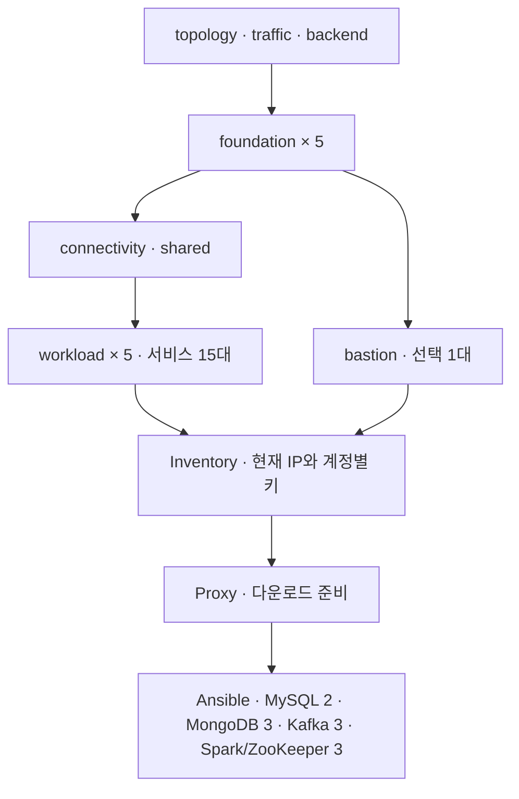

# aws-infra

AWS EC2의 배치·네트워크·보안규칙·상태를 Terraform과 PowerShell로 관리한다. 현재 구성 기준은 2026-10-10의 [topology](infra/config/topology.tfvars.json)와 [traffic](infra/config/traffic.tfvars.json)이며, 이 문서가 실제 AWS 배포나 서비스 동작 완료를 보증하지는 않는다.

실행은 [배포 절차](docs/deployment-runbook.md), 명령별 옵션은 [실행 README](infra/scripts/README.md), 코드 위치는 [라우팅 문서](docs/infra-routing/ROUTING-README.md)에서 확인한다. EC2 내부 프로그램 설치는 별도 [platform](../aws-platform/platform/README.md)이 담당한다.

## 현재 기본 구성

- 서울 리전 ap-northeast-2, 논리 A=apne2-az1·C=apne2-az3의 물리 AZ 두 개를 사용한다.
- 독립 VPC 다섯 개를 모든 쌍의 직접 Peering 10개로 연결한다.
- Account 1만 Public 서브넷·IGW·ALB를 사용한다. 기본 NAT Gateway 수는 0개다.
- 서비스 EC2 15대는 workload 상태에, 선택적으로 생성하는 Bastion 한 대는 별도 bastion 상태에 둔다.
- Front 두 대는 EIP를 사용하고, Bastion은 실행 중 자동 공인 IP를 받는다. Bastion의 중지·시작 뒤 주소가 달라질 수 있다.
- 외부 HTTP 80 → ALB, /static/* → Front:80, /ads/* → 광고:8000, 기본 경로 → game:8000이다. 현재 HTTPS 리스너·리다이렉트는 없다.
- 프라이빗 서버의 다운로드는 Bastion Squid:3128을 명시적으로 사용한다. Proxy 프로그램·APT·Ansible 다운로드 준비와 서비스 설치는 서로 다른 단계다.

## 서버 수와 사양

| 구성 | 대수 | 기본 사양 | 별도 데이터 gp3 |
| --- | ---: | --- | ---: |
| MongoDB | 3 | t3a.small | 900GiB/대 |
| Kafka | 3 | t3a.large | 200GiB/대 |
| Spark·ZooKeeper | 3 | t3a.large | 100GiB/대 |
| MySQL | 2 | t3a.small | 100GiB/대 |
| Front | 2 | t3a.small | 없음 |
| game-server | 1 | t3a.large | 없음 |
| ad-server | 1 | t3a.large | 없음 |
| Bastion | 선택 1 | t3a.small | 없음 |
| 합계 | Bastion 포함 16 | small 8 + large 8 | 3,800GiB |

OS 디스크는 20GiB/대다. Bastion을 포함한 전체 EBS 선언량은 4,120GiB이며, 데이터 디스크 생성·연결이 포맷·마운트나 서비스 데이터 저장 위치 설정을 수행하지는 않는다. 사양과 용량은 초기 설정값이며 실측 성능 권장치가 아니다.

## 계정과 AZ 배치

| 계정 / VPC | A | C | 서비스 / Bastion 포함 |
| --- | --- | --- | ---: |
| account1 · 10.10.0.0/16 | Public Bastion·front-a, Private game-server | Public front-b, Private ad-server | 4 / 5 |
| account2 · 10.20.0.0/16 | Private mongo-1·spark-2 | 서비스 노드 없음 | 2 / 2 |
| account3 · 10.30.0.0/16 | Private kafka-1·mysql-1·spark-1 | Private mongo-2 | 4 / 4 |
| account4 · 10.40.0.0/16 | Private kafka-2 | Private spark-3 | 2 / 2 |
| account5 · 10.50.0.0/16 | Private mongo-3 | Private mysql-2·kafka-3 | 3 / 3 |

A 10대·C 6대는 Bastion 포함 수량이다. 계정 콘솔의 AZ 끝 글자는 물리 AZ ID와 구분한다. 상세 배치는 [계정 배치](docs/costs/account-allocation.md), SG 관계는 [보안규칙](docs/security-groups.md)에 있다.

## 생성부터 서비스 설치까지

1. Windows 도구·계정별 AWS 인증·공개키·S3 상태 버킷을 준비한다.
2. 기본 config 또는 deploy.ps1의 NewProfile로 만든 topology·traffic·platform.json 구성을 선택한다.
3. foundation 5계정 → connectivity shared → workload 5계정 → bastion account1 순서로 Plan을 검토하고 Apply한다.
4. Inventory로 현재 EC2 주소와 계정별 키 경로를 플랫폼 인벤토리에 반영한다.
5. Proxy로 Squid·APT·다운로드를 준비한다. 이 명령은 MySQL·Kafka·Spark를 설치하지 않는다.
6. WSL에서 Vault·데이터 마운트·역할 그룹을 준비하고 Ansible의 공통 설정·방화벽·각 서비스 역할을 실행한다.
7. 서비스 상태뿐 아니라 DB 복제·Kafka 송수신·ZooKeeper ensemble·Spark Master/Worker와 PySpark 작업을 확인한다.

MySQL은 현재 InnoDB ReplicaSet 두 대이며 세 대 Group Replication 클러스터 구성이 아니다. Spark는 인벤토리 앞 두 대에 Master, 전체 세 대에 Worker·ZooKeeper를 배치한다. Front·game·ad 애플리케이션과 업무 Consumer·Spark 잡 배포는 별도 구현 영역이다. 모든 업무 쓰기의 Kafka 우선 방침은 애플리케이션 요구이며 SG가 이를 강제하지 않는다.

## Bastion 운영과 삭제

[bastion.ps1](infra/scripts/bastion.ps1)은 Status·Output·Stop·Start·Restart와 PlanCreate/Create·PlanDelete/Delete를 제공한다. Stop은 인스턴스 삭제가 아니다. Bastion 삭제 후에도 foundation SG와 workload의 SSH·Proxy 규칙은 남는다.

전체 정리는 [destroy-all.ps1 안내](infra/scripts/README.md#15-전체-인프라-삭제)의 Plan → 검토 → Apply를 사용한다. 현재 데이터 EBS는 prevent_destroy=false이며 삭제 대상에 포함될 수 있다. 자동 백업·이전·복구와 일일 기동·종료 예약은 구현하지 않았다.

## 운영 일정과 비용

문서상의 정규 일정은 2026-10-13·14·15·16·19일, 한국 시간 09:00~18:00, EC2 45시간이다. 이 일정으로 예약 실행을 설정한 상태는 아니다. 저장 자원·ALB·EIP의 153시간 유지 가정은 EC2 실행 시간과 다르며 종료 후 데이터 보관·삭제 정책도 별도로 결정해야 한다.

[비용 안내](docs/costs/README.md)는 현재 자원 배치와 이전 견적의 계산 가정을 구분한다. 광고 서버의 account1 이동, Bastion의 자동 IP, 선택한 프로필의 용량·실행 시간을 반영하지 않은 과거 금액을 현재 청구 예상액으로 사용하지 않는다. 실제 크레딧 잔액·성능·트래픽은 이번 문서 대조에서 조회하지 않았다.

## 문서와 구현 경계

| 문서 | 내용 |
| --- | --- |
| [요구사항](docs/project_requirements.md) | 현재 구성과 요구·미정 사항, 과거 결정 기록 |
| [공통 실행 안내](infra/README.md) | 입력·상태·배포·변경 경계 |
| [배포 절차](docs/deployment-runbook.md) | PowerShell·WSL 명령, Vault, 설치·검증 순서 |
| [서버 설치 경계](infra/bootstrap/README.md) | 포트·마운트·프록시·애플리케이션 설치 구분 |
| [테스트](infra/tests/README.md) | 정적·모의 검사와 과거 실행 결과 |
| [Windows 도구](infra/setup-windows/README.md) | 도구 설치와 별도 인증 준비 |

기존 시험용 test/ 및 docs/test/ 경로는 현재 배포 안내가 아니다. 개편·이관 이력은 [구조 개편 설명](infra/terraform-restructure-plan.md)에 남긴다. 새 코드가 기존 상태·자원이나 데이터를 자동으로 이관하지 않는다.
