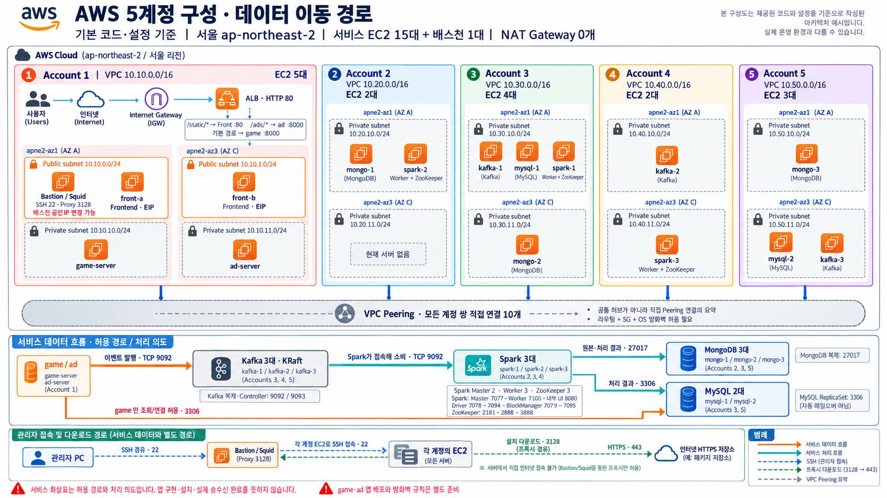

# aws-infra

MongoDB, Kafka, Spark, MySQL, 게임 서버와 광고 서버를 **AWS EC2에서 운영하기 위한 인프라 구성 저장소**입니다. 서버 배치, 네트워크, 설치·운영 절차와 비용 계획을 이 저장소에서 관리합니다.

현재는 구성 기준을 정리하는 단계입니다. 이 README는 앞으로 세부 설계를 추가할 출발점이며, 아래 구성은 배포 완료 상태를 의미하지 않습니다.

## 현재 구성 기준

- 서비스 실행 서버는 모두 EC2를 사용합니다.
- 서울 리전의 **물리 가용 영역 2개**에 노드를 나눠 배치합니다.
- MongoDB는 EC2 3대, Kafka는 EC2 3대, Spark는 EC2 3대로 구성하는 배치안입니다.
- MySQL은 EC2 2대에 직접 설치하는 배치안입니다.
- 게임 서비스는 Front 2대와 game-server 1대로 배치합니다.
- 광고 서버는 별도 EC2 1대에 배치합니다.
- Bastion은 관리 작업이 필요할 때만 접근할 수 있도록 운영합니다.
- 기존의 노트북 기반 Spark 구성은 현재 구성안에 포함하지 않습니다.

> **Spark 수량 해석:** 현재 문서에서는 “스파크 클러스터 3개”를 하나의 Spark 클러스터에 속한 노드 3대로 해석했습니다. 독립된 클러스터 3개를 뜻하는 경우에는 클러스터별 노드 수와 전체 EC2 수량을 다시 정합니다.

## EC2 배치

다음 표는 현재 [Terraform 배치 설정](infra/config/topology.tfvars.json)의 EC2 수량·사양·데이터 디스크를 요약합니다. 비용 견적용 입력값이며 실측 성능을 보장하지 않습니다.

| 구성 요소 | EC2 수량 | 노드 이름 | 사양 | 별도 데이터 gp3 |
| --- | ---: | --- | --- | ---: |
| MongoDB | 3대 | `mongo-1` ~ `mongo-3` | `t3a.small` | 900GiB/대 |
| Kafka | 3대 | `kafka-1` ~ `kafka-3` | `t3a.large` | 200GiB/대 |
| Spark | 3대 | `spark-1` ~ `spark-3` | `t3a.large` | 100GiB/대 |
| MySQL | 2대 | `mysql-1` ~ `mysql-2` | `t3a.small` | 100GiB/대 |
| Front | 2대 | `front-a`, `front-b` | `t3a.small` | 없음 |
| game-server | 1대 | `game-server` | `t3a.large` | 없음 |
| 광고 서버 | 1대 | `ad-server` | `t3a.large` | 없음 |
| Bastion | 1대 | `bastion` | `t3a.small` | 없음 |
| **합계** | **16대** | | **t3a.small 8대 + t3a.large 8대** | **총 3,800GiB** |

OS 디스크는 20GiB/대이며 표의 데이터 디스크는 OS와 별도입니다. 서버별 계정·가용 영역·서브넷은 아래 계정 배치표에 정리했습니다.

모든 애플리케이션 쓰기는 Kafka를 먼저 경유합니다. 업무 Consumer의 상태 반영, 원본 저장 Consumer와 Spark 집계는 [보안 그룹 설계](docs/security-groups.md)의 제안 배치를 따르며 추가 EC2는 아직 계산하지 않습니다. 150명 접속 수만으로 성능을 보장하지 않고, 이벤트 발생량·로그인/상태 반영 지연·Consumer lag·DB 복제 지연·가용 메모리·디스크 지연·CPU 크레딧을 측정한 뒤 조정합니다. Driver·Consumer를 함께 실행하는 노드에는 그 자원도 별도로 확보합니다.

Bastion을 제외한 서비스용 EC2는 15대입니다. 서비스는 아래 일정에 맞춰 운영하며, 별도 관리 노드 등이 필요해지면 수량을 갱신합니다.

## 5개 계정 배치와 비용 문서

서버는 아래처럼 다섯 계정의 독립 VPC에 나눕니다. 세부 비용 시나리오와 계산 가정은 [비용 문서](docs/costs/README.md)에서 관리합니다.

| 계정 / VPC | 가용 영역 A | 가용 영역 C | 대수 |
| --- | --- | --- | ---: |
| account1 · `10.10.0.0/16` | Public Bastion, Front A Private game-server | Public Front B | 4 |
| account2 · `10.20.0.0/16` | Private Mongo-1, Spark-2 | Private Ad-server | 3 |
| account3 · `10.30.0.0/16` | Private Kafka-1, MySQL-1, Spark-1 | Private Mongo-2 | 4 |
| account4 · `10.40.0.0/16` | Private Kafka-2 | Private Spark-3 | 2 |
| account5 · `10.50.0.0/16` | Private Mongo-3 | Private MySQL-2, Kafka-3 | 3 |
| **합계** | **A 10대** | **C 6대** | **16** |

가용 영역 A·C는 서로 다른 물리 AZ ID입니다. 현재 설정은 Account 1만 Public 서브넷과 IGW를 만들고, **NAT Gateway는 0개**입니다. 계정 간 경로는 비용·통신 가정과 함께 [상세 계정 배치](docs/costs/account-allocation.md)에 정리했습니다.

## 운영 일정

- 운영일: **2026년 10월 13일(화)~19일(월) 중 평일 5일**, 즉 **13·14·15·16·19일**입니다. **10월 13일 시작을 확정**했습니다.
- 매일 **09:00~18:00, 한국 시간(Asia/Seoul)**에 운영합니다.
- 정규 실행 시간은 서버당 **5일 × 9시간 = 총 45시간**입니다. 17·18일 주말과 야간은 정규 운영에서 제외합니다.
- 비용 견적은 운영 시간 외 EC2를 중지하는 조건입니다. 기동·종료 자동화와 준비·테스트 시간은 별도 확정합니다.
- EBS·NAT Gateway·고정 공인 IPv4는 유지하는 동안 별도로 과금됩니다. 비용표는 **13일 09시 생성~19일 18시 정리, 총 153시간 유지**를 계산용으로 가정합니다.
- Bastion은 실제 관리 시간에 따라 달라지며, 비교 견적에서는 45시간 실행을 가정합니다.

기간별 비용 계산과 미포함 항목은 [비용 안내](docs/costs/README.md)와 [가용 영역 2개 운영 견적](docs/costs/dual-az.md)에서 확인합니다. 현재 인프라 설정은 **NAT Gateway 0개**를 사용합니다. 견적은 부하와 운영 시간에 따른 계산 예시이며 실제 청구액이나 계정 한도를 보장하지 않습니다. 실제 크레딧 잔액은 조회하지 않았고, 이 일정은 문서 기준이며 리소스 기동·종료 예약을 설정한 상태는 아닙니다.

## 구성 개요

아래 그림은 구성 요소와 수량을 보여 줍니다. 모든 쓰기의 Kafka 우선 경유는 확정했으며, 세부 처리·조회 경로와 VPC·서브넷 배치·통신 규칙은 보안 그룹 설계의 제안을 바탕으로 구현 전에 검증합니다.

## Bastion 운영 기준

Bastion은 필요한 관리 작업이 있을 때만 엽니다. 다만 “연다/닫는다”를 구현하는 방식은 아직 정하지 않았습니다.

- 필요할 때 EC2를 시작하고 작업 후 중지할지
- EC2는 유지하고 관리 접근 규칙만 임시로 열지
- 작업마다 생성하고 종료 후 삭제할지

방식을 결정한 뒤 접근 허용 대상, 인증 방법, 작업 종료 후 접근 차단 절차를 추가합니다.

## 보안 그룹 설계 초안

광고 서버 포함 EC2 16대의 [보안 그룹 설계](docs/security-groups.md)를 정리했습니다. Frontend·Backend·별도 Bastion은 account1에 두되 각각 다른 SG를 사용합니다. 논리적인 역할은 8종류지만, 계정별 VPC에 필요한 역할 그룹을 따로 생성하므로 **실제 SG는 16개**입니다. Spark는 account2·3·4의 프라이빗 노드에 나누고, 게임의 HTTPS/WSS 접속은 TCP 443을 후보로 둡니다. 계정별 배치·서비스 연결·고정 포트는 설계 제안이며 실제 AWS에는 적용하지 않았습니다.

문서에는 인바운드·아웃바운드 규칙, 계정 간 Peering, Spark 동적 포트 제한, Bastion 관리 접속과 CloudWatch 전송 조건을 포함합니다. 게임 프로토콜과 Spark 역할 배치 등이 확정되면 조건부 규칙을 갱신합니다.

## 앞으로 정할 항목

| 구분 | 추가할 내용 |
| --- | --- |
| AWS 배치 | 서울·가용 영역 2개 기준의 AZ ID 선택과 계정별 자원 배치 |
| 네트워크 | VPC, 서브넷, IP 대역, 라우팅, 외부 통신 방식 |
| 접근 관리 | AWS CLI 로그인 방식, 계정별 프로필, IAM 권한, 서버 접속 방법 |
| 서버 사양 | 선택한 초기 사양의 부하 검증, 운영체제, EBS 종류·용량, Driver·Consumer 자원 배분 |
| MongoDB | 복제·샤딩 방식, 노드 역할, 인증, 데이터 저장 경로 |
| Kafka | 버전, Broker·Controller 배치, 복제 설정, 데이터 보관 기간 |
| Spark | 버전, 클러스터 실행 방식, 노드 역할, CPU·메모리 할당 |
| MySQL 클러스터 | 버전, InnoDB Cluster 통신 방식, Router, 복제·장애 전환, 데이터 용량과 백업·복구 |
| 게임 서버 | 실행 환경, 서버별 역할, 배포 방식, 접속 포트 |
| 광고 서버 | 광고 제공 방식, 게임 연동, 이미지·영상 저장량, 외부 송신량과 공개 접속 방식 |
| 서비스 연동 | 데이터 입력·처리·저장 흐름, 접속 주소, 포트와 접근 범위 |
| 설치·운영 | 설치 방식, 자동화 범위, 기동·종료 순서, 로그·상태 확인 |
| 장애 대응 | 장애 감지, 재시작, 백업, 복구 절차 |
| 비용 | 평일 5일·총 45시간 기준 견적의 실제 사용량·계정별 배분 검증 |

## 저장소 안내

현재 저장소에 있는 주요 경로입니다.

| 경로 | 내용 |
| --- | --- |
| `README.md` | 현재 구성 기준과 앞으로 정할 항목 |
| `docs/` | 요구사항과 네트워크 등 상세 문서 |
| `docs/costs/account-allocation.md` | 5개 계정의 노드별 AZ·VPC·비용 배치 |
| `infra/setup-windows/` | 팀원 Windows PC의 Terraform·AWS CLI 설치 자료 |
| `test/` | 시험용 네트워크 Terraform 코드와 PowerShell 실행 스크립트 |
| `docs/costs/` | 10월 13일 시작·평일 5일·가용 영역 2개의 현재 비용 견적 |

### 기존 자료 참고

- [시험용 네트워크 실행 안내](test/README.md)
- [시험용 네트워크 상세 문서](docs/test/network.md)
- [Windows 도구 설치 안내](infra/setup-windows/README.md)
- [운영 일정에 따른 비용 검토 자료](docs/costs/README.md)

기존 시험용 네트워크 코드는 `test/infra/network/`에 있습니다. 해당 코드는 네트워크 시험용이며, 위의 EC2 16대와 서비스 클러스터 전체를 배포하는 코드는 아닙니다.

상세 비용 문서는 현재 배치와 운영 가정을 설명합니다. 실제 사용량과 비용은 운영 중 검증해야 합니다.

## 문서 확장 순서

1. Spark 수량 해석과 서비스별 노드 역할을 확정합니다.
2. 계정·리전·네트워크와 서버 접근 방식을 정합니다.
3. EC2 사양, 저장 공간, 프로그램 버전을 정합니다.
4. 설치·설정·기동 절차를 추가합니다.
5. 서비스 간 연결과 동작 확인 절차를 추가합니다.
6. 백업·복구·모니터링과 비용 계획을 구체화합니다.

결정된 사항은 이 README의 구성표에 반영하고, 구체적인 설정값과 실행 절차는 관련 상세 문서에서 관리합니다.
