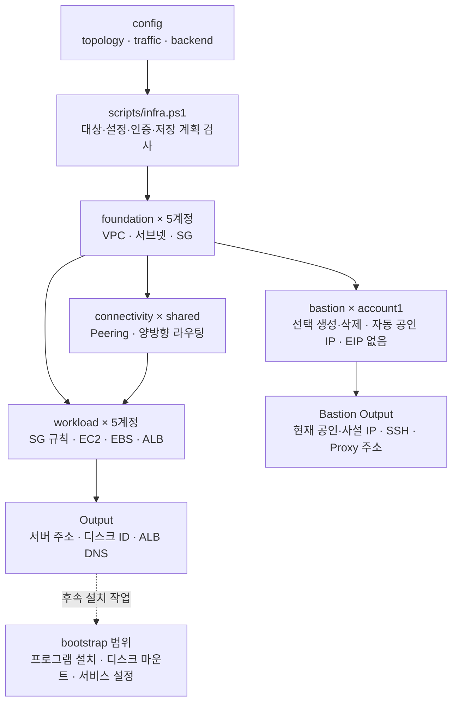

# 인프라 코드 탐색 안내

어떤 설정과 코드를 찾아 수정해야 하는지 안내하는 문서다. 기준은 **2026-10-10의 실제 작업 파일**이며, AWS에 배포된 자원이나 서비스 연결을 확인한 보고서는 아니다.

## 시작점과 경로 기준

- 프로젝트 루트는 `C:\third_project\aws-infra`다. 본문에 적은 `infra/...` 경로는 이 루트를 기준으로 한다.
- 문서 링크는 각 Markdown 파일 위치를 기준으로 작성했다. 다른 PC에서도 저장소 내부 링크를 그대로 사용할 수 있다.
- 라우팅 문서는 `docs/infra-routing/` 안에서 `infra/`의 하위 구조에 대응한다. Terraform 모듈들은 하나의 [모듈 목록](terraform/README.md)에 모았다.
- 배경은 [프로젝트 README](../../README.md), 실행법은 [인프라 실행 안내](../../infra/infra.md)를 참고한다. 프로젝트 README에서 이 **docs/infra-routing/ROUTING-README.md**로 연결한다.
- 적용 규칙은 [AGENTS.md](../../AGENTS.md), 구조 검사와 기존 문서 차이는 [검증 기록](verification.md)을 참고한다.

## 하위 폴더별 시작 문서

2026-10-11 기본 및 current 설정의 ALB와 전용 연결 3개를 비활성화했다. [설정 지도](config/README.md#alb-비활성화)와 [기존 자원 정리 순서](../deployment-runbook.md#alb-비활성화-적용-순서)를 함께 본다. Front 외부 웹 접속·Nginx·HTTPS 설치는 후속 작업이다. 아래 ALB 표기는 선택적 모듈의 관리 위치를 뜻한다.

| 원본 폴더 | 라우팅 시작점 | 탐색 범위 |
| --- | --- | --- |
| infra/config | [설정 지도](config/README.md) | topology·traffic·backend와 비용별 프로필 입력 |
| infra/scripts | [스크립트 지도](scripts/README.md) | 배포·배스천·전체 삭제·SSH 키 준비 실행기 |
| infra/scripts/lib | [공통 함수 지도](scripts/lib/README.md) | 입력·상태·계획 검사와 삭제 보호 조건 |
| infra/terraform/stacks·modules | [Terraform 지도](terraform/README.md) | 상태 소유권, 네 stack과 공통 모듈 연결 |
| infra/tests·Terraform tests | [테스트 지도](tests/README.md) | 모의 실행기·삭제 회귀·콘솔 SSH·Spark 포트 범위 검사 |
| infra/bootstrap | [설치 경계](bootstrap/README.md) | 인프라 생성과 플랫폼 프로그램 설치의 연결 |
| infra/setup-windows | [도구 설치기](setup-windows/install-tools.ps1.md) | Windows 실행 도구 준비 |

프로그램 설치 쪽은 [플랫폼 라우팅 시작점](../../../aws-platform/platform/docs/ROUTING-README.md)으로 이어진다. 이 문서에서는 인프라 자원과 실행기 위치를 찾고, 플랫폼 문서에서는 Ansible 역할·템플릿·검증 작업을 찾는다.

실행 단계는 [배포 절차](../deployment-runbook.md), 오류 확인·접속 복원·배스천 운영·전체 삭제 명령은 [복원·운영 절차](../operations-recovery.md)에서 확인한다.

## 작업별로 어디를 보는가

| 하려는 일 | 먼저 볼 문서 | 실제 코드·설정 |
| --- | --- | --- |
| 실행 옵션·저장 계획·계정 확인 흐름 파악 | [공통 실행기](scripts/infra.ps1.md) | [infra.ps1](../../infra/scripts/infra.ps1) |
| 비용별 구성·EC2 생성·인벤토리·프록시 일괄 준비 | [구성별 배포](scripts/deploy.ps1.md) | [deploy.ps1](../../infra/scripts/deploy.ps1) |
| 배스천 생성·삭제·상태 조회·중지·시작 | [배스천 관리](scripts/bastion.ps1.md) | [bastion.ps1](../../infra/scripts/bastion.ps1) |
| 전체 인프라 삭제 Plan·적용·진행 확인 | [전체 삭제 실행기](scripts/destroy-all.ps1.md) | [destroy-all.ps1](../../infra/scripts/destroy-all.ps1) |
| 전체 삭제 순서·자원 범위·상태·결과 검사 | [삭제 공통 함수](scripts/lib/infra-destroy.ps1.md) | [infra-destroy.ps1](../../infra/scripts/lib/infra-destroy.ps1) |
| CIDR·계정·상태 버킷·파일 해시 검사 수정 | [실행기 공통 함수](scripts/lib/infra-common.ps1.md) | [infra-common.ps1](../../infra/scripts/lib/infra-common.ps1) |
| 서버 계정·AZ·사양·디스크·AMI 변경 | [설정 지도](config/README.md) | [topology.tfvars.json](../../infra/config/topology.tfvars.json) |
| 팀원 공인 IP·서비스 포트·통신 대상 변경 | [설정 지도](config/README.md) | [traffic.tfvars.json](../../infra/config/traffic.tfvars.json) |
| S3 상태 저장 위치 변경 | [설정 지도](config/README.md) | [backend.json](../../infra/config/backend.json) |
| VPC·서브넷·IGW·NAT·SG 자체 생성 | [foundation](terraform/stacks/foundation.md) | [foundation stack](../../infra/terraform/stacks/foundation/main.tf) |
| 계정 간 Peering·양방향 라우팅 변경 | [connectivity](terraform/stacks/connectivity.md) | [connectivity stack](../../infra/terraform/stacks/connectivity/main.tf) |
| 보안규칙·EC2·EBS·ALB 변경 | [workload](terraform/stacks/workload.md) | [workload stack](../../infra/terraform/stacks/workload/main.tf) |
| 서비스 EC2의 콘솔 SSH 접두사 목록 규칙 | [콘솔 SSH 범위](terraform/stacks/workload.md#콘솔-ssh-규칙의-범위) | [workload 선언](../../infra/terraform/stacks/workload/main.tf), [5개 계정 모의 테스트](../../infra/terraform/stacks/workload/tests/console-ssh.tftest.hcl) |
| Spark의 고정 포트·재시도 범위와 SG 규칙 검사 | [Spark 포트 범위 테스트](tests/README.md#spark-포트-범위) · [플랫폼 Spark 설정](../../../aws-platform/platform/docs/platform-routing/roles/spark/README.md#프라이빗-서버의-통신-포트) | traffic의 port_end → model.flows → workload 범위 병합 → security-rules |
| Bastion EC2·OS 디스크·전용 키페어 변경 | [bastion](terraform/stacks/bastion.md) | [bastion stack](../../infra/terraform/stacks/bastion/main.tf) |
| Squid 패키지 설치 범위 확인 | [Proxy 설치 스크립트](../../../aws-platform/platform/docs/platform-routing/scripts/install-squid.sh.md) | [install-squid.sh](../../../aws-platform/platform/scripts/install-squid.sh) |
| 공통 자원 생성 방식 수정 | [Terraform 모듈 목록](terraform/README.md) | [modules](../../infra/terraform/modules) |
| SSH 키 준비 | [키 준비 스크립트](scripts/prepare-key.sh.md) | [prepare-key.sh](../../infra/scripts/prepare-key.sh) |
| 계정별 PEM 준비·기존 서버 공개키 등록 | [계정별 SSH 키 전환](scripts/account-keys.ps1.md) | [account-keys.ps1](../../infra/scripts/account-keys.ps1) |
| Windows 도구 설치 동작 확인 | [설치 스크립트](setup-windows/install-tools.ps1.md) | [install-tools.ps1](../../infra/setup-windows/install-tools.ps1) |
| 테스트와 모의 입력 찾기 | [테스트 지도](tests/README.md) | [실행기 테스트](../../infra/tests/test_runner.py), [fixtures](../../infra/tests/fixtures.json) |
| Python 함수·시그니처 찾기 | [test_runner.py 구조](tests/test_runner.py.md) | routing-doc-sync AST 분석 결과 기준 |
| EC2 생성 이후 설치 범위 확인 | [bootstrap 경계](bootstrap/README.md) | [현재 bootstrap 안내](../../infra/bootstrap/bootstrap.md) |

account2의 flatten-1은 Private A, t3a.medium, role=consumer다. 기본 topology와 기존 current 프로필에 함께 반영하며 consumer_kafka·admin_nodes·forward_proxy로 Kafka·SSH·프록시를 연결한다. [평탄화 모의 검사](../../infra/terraform/stacks/workload/tests/flatten.tftest.hcl)와 [플랫폼 Kafka 방화벽 출처](../../../aws-platform/platform/docs/platform-routing/roles/firewall/vars/main.yml.md)를 함께 본다.

## 실행 흐름

화살표는 구성과 상태의 의존 관계다. 실행기가 5개 계정을 자동으로 순회한다는 뜻은 아니다. 각 대상에서 Plan → 검토 → Apply를 수행하며 실제 명령은 [기존 실행 상세 안내](../../infra/scripts/scripts.md)에 있다.

## 현재 구현의 범위

- 계정 키는 account1~account5이며 shared는 connectivity 실행 구분이다.
- workload의 서비스 서버는 5 / 3 / 4 / 3 / 3대, 전체 18대다. Bastion 한 대는 별도 bastion 단계에서 필요할 때 생성·삭제한다. ad-server는 Account 1의 Private A에 배치한다. 현재 NAT는 0개이며 Account 1에만 Public 서브넷·IGW를 구성하며 ALB는 비활성화돼 있다. edge-1은 Public A의 신규 진입 노드 선언이다.
- 보안그룹 자체는 foundation, 통신 규칙은 workload가 소유한다. Peering과 상대 VPC 경로는 connectivity가 소유한다.
- 서비스 콘솔 SSH는 해당 리전의 EC2 Instance Connect 관리형 IPv4 접두사 목록에서 TCP 22를 허용한다. 계정별 서비스 SG 4 / 3 / 4 / 3 / 3개, 총 17개가 대상이며 기존 Bastion 규칙과 별도로 선언한다. Private 접속 경로나 SSH 공개키를 준비하는 기능은 아니다.
- ALB는 HTTP 80에서 요청을 받는다. `/static/*`는 Front 두 대의 HTTP 80으로, `/ads/*`는 ad-server의 HTTP 8000으로, 기본 경로는 game-server의 HTTP 8000으로 보낸다. HTTPS 리스너와 ACM 인증서 검사는 없다.
- topology의 Bastion 역할은 유지하지만 workload의 EC2 대상에서는 제외한다. foundation의 Bastion SG와 workload의 SSH·Proxy 규칙은 Bastion 삭제 후에도 유지한다. 현재 관리자·사용자 CIDR은 각각 한 항목이며 계정별 AMI·공개키 경로도 채워져 있다. 설정값은 [설정 지도](config/README.md)에서 확인한다.
- 공통 실행기 Output은 Terraform 상태를 읽은 값이고, bastion.ps1의 Status·Output은 AWS CLI로 현재 EC2를 조회한다. 프로그램 설치·디스크 마운트·클러스터 구성·실제 접속 성공은 별도 확인 대상이다.
- [bastion.ps1](scripts/bastion.ps1.md)은 PlanCreate → 검토 → Create, PlanDelete → 검토 → Delete와 Status·Output·Stop·Start·Restart를 지원한다. Stop은 삭제가 아니다. 전체 삭제는 [destroy-all.ps1](scripts/destroy-all.ps1.md)의 Plan → 검토 → Apply와 단일 Destroy를 지원한다. Destroy에서 DisableDataVolumeProtection을 지정한 경우에만 데이터 EBS 보호를 임시 해제하고 원본으로 복원한다. EC2 전체의 일일 예약 실행, 백업·복구·데이터 이전 자동화는 없다.
- 현재 compute 모듈의 데이터 EBS는 prevent_destroy=true다. 데이터 볼륨 삭제·교체가 포함된 계획은 보호 설정 때문에 실패할 수 있다. 별도 Plan·Apply는 이 보호를 자동 해제하지 않는다. 단일 Destroy의 DisableDataVolumeProtection은 임시 해제·원본 복원 옵션이다. 이번 문서 동기화에서도 소스의 보호 값을 변경하지 않았다.

Python 구조는 지정한 routing-doc-sync 스킬로 확인했다. PowerShell·Terraform·JSON·Bash는 스킬의 Python 분석 범위 밖이므로 실제 파일을 대조했다. 검사 깊이와 기존 문서의 남은 차이는 [검증 기록](verification.md)에 구분했다.

mysql-3는 account4 Private A의 t3a.small, OS 20GiB·데이터 gp3 100GiB이며 공인 IP가 없다. 기본 topology와 profiles/current에 함께 반영했다. [설정 지도](config/README.md#mysql-3-증설) → [workload 증설 경계](terraform/stacks/workload.md#mysql-3-증설과-alb-복원-보류) → [실제 AWS 검증](verification.md#2026-10-10-mysql-3-증설과-실제-aws-검증)에서 선언·적용·설치 준비 상태를 구분한다. 당시에는 설정에 ALB가 활성화돼 있어도 실제 ALB는 없어 복원을 보류했다. 현재 기본 및 current 설정은 ALB를 비활성화했으며 이번에 AWS 상태를 재조회하지 않았다.
