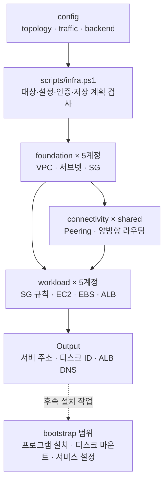

# 인프라 코드 탐색 안내

어떤 설정과 코드를 찾아 수정해야 하는지 안내하는 문서다. 기준은 **2026-10-09의 실제 작업 파일**이며, AWS에 배포된 자원이나 서비스 연결을 확인한 보고서는 아니다.

## 시작점과 경로 기준

- 프로젝트 루트는 `C:\third_project\aws-infra`다. 본문에 적은 `infra/...` 경로는 이 루트를 기준으로 한다.
- 문서 링크는 각 Markdown 파일 위치를 기준으로 작성했다. 다른 PC에서도 저장소 내부 링크를 그대로 사용할 수 있다.
- 기존 파일별 라우팅 문서 규칙은 발견되지 않았다. 이번 문서는 사용자가 지정한 `docs/infra-routing/` 안에서 `infra/`의 하위 구조에 대응하도록 구성했다. Terraform 모듈들은 하나의 [모듈 목록](terraform/README.md)에 모았다.
- 배경은 [프로젝트 README](../../README.md), 실행법은 [인프라 실행 안내](../../infra/README.md)를 참고한다. 코드 탐색 시작 파일은 **docs/infra-routing/ROUTING-README.md**, 즉 이 문서다. 현재 프로젝트 README에는 이 문서로 가는 링크가 아직 없다.
- 적용 규칙은 [AGENTS.md](../../AGENTS.md), 구조 검사와 기존 문서 차이는 [검증 기록](verification.md)을 참고한다.

## 작업별로 어디를 보는가

| 하려는 일 | 먼저 볼 문서 | 실제 코드·설정 |
| --- | --- | --- |
| 실행 옵션·저장 계획·계정 확인 흐름 파악 | [공통 실행기](scripts/infra.ps1.md) | [infra.ps1](../../infra/scripts/infra.ps1) |
| CIDR·계정·상태 버킷·파일 해시 검사 수정 | [실행기 공통 함수](scripts/lib/infra-common.ps1.md) | [infra-common.ps1](../../infra/scripts/lib/infra-common.ps1) |
| 서버 계정·AZ·사양·디스크·AMI 변경 | [설정 지도](config/README.md) | [topology.tfvars.json](../../infra/config/topology.tfvars.json) |
| 팀원 공인 IP·서비스 포트·통신 대상 변경 | [설정 지도](config/README.md) | [traffic.tfvars.json](../../infra/config/traffic.tfvars.json) |
| S3 상태 저장 위치 변경 | [설정 지도](config/README.md) | [backend.json](../../infra/config/backend.json) |
| VPC·서브넷·IGW·NAT·SG 자체 생성 | [foundation](terraform/stacks/foundation.md) | [foundation stack](../../infra/terraform/stacks/foundation/main.tf) |
| 계정 간 Peering·양방향 라우팅 변경 | [connectivity](terraform/stacks/connectivity.md) | [connectivity stack](../../infra/terraform/stacks/connectivity/main.tf) |
| 보안규칙·EC2·EBS·ALB 변경 | [workload](terraform/stacks/workload.md) | [workload stack](../../infra/terraform/stacks/workload/main.tf) |
| 공통 자원 생성 방식 수정 | [Terraform 모듈 목록](terraform/README.md) | [modules](../../infra/terraform/modules/) |
| SSH 키 준비 | [키 준비 스크립트](scripts/prepare-key.sh.md) | [prepare-key.sh](../../infra/scripts/prepare-key.sh) |
| Windows 도구 설치 동작 확인 | [설치 스크립트](setup-windows/install-tools.ps1.md) | [install-tools.ps1](../../infra/setup-windows/install-tools.ps1) |
| 테스트와 모의 입력 찾기 | [테스트 지도](tests/README.md) | [실행기 테스트](../../infra/tests/test_runner.py), [fixtures](../../infra/tests/fixtures.json) |
| Python 함수·시그니처 찾기 | [test_runner.py 구조](tests/test_runner.py.md) | routing-doc-sync AST 분석 결과 기준 |
| EC2 생성 이후 설치 범위 확인 | [bootstrap 경계](bootstrap/README.md) | [현재 bootstrap 안내](../../infra/bootstrap/README.md) |

## 실행 흐름

화살표는 구성과 상태의 의존 관계다. 실행기가 5개 계정을 자동으로 순회한다는 뜻은 아니다. 각 대상에서 Plan → 검토 → Apply를 수행하며 실제 명령은 [기존 실행 상세 안내](../../infra/scripts/README.md)에 있다.

## 현재 구현의 범위

- 계정 키는 account1~account5이며 shared는 connectivity 실행 구분이다.
- 서버는 4 / 3 / 4 / 2 / 3대, 전체 16대다. 현재 NAT는 0개이며 Account 1에만 Public 서브넷·IGW·ALB를 구성한다.
- 보안그룹 자체는 foundation, 통신 규칙은 workload가 소유한다. Peering과 상대 VPC 경로는 connectivity가 소유한다.
- 출력은 Terraform 상태를 읽은 값이다. 프로그램 설치·디스크 마운트·클러스터 구성·실제 접속 성공은 별도 확인 대상이다.
- EC2 일일 Stop/Start, 백업·복구·데이터 이전 자동화는 현재 실행기에 없다.

Python 구조는 지정한 routing-doc-sync 스킬로 확인했다. PowerShell·Terraform·JSON·Bash는 스킬의 Python 분석 범위 밖이므로 실제 파일을 대조했다. 검사 깊이와 기존 문서의 남은 차이는 [검증 기록](verification.md)에 구분했다.
