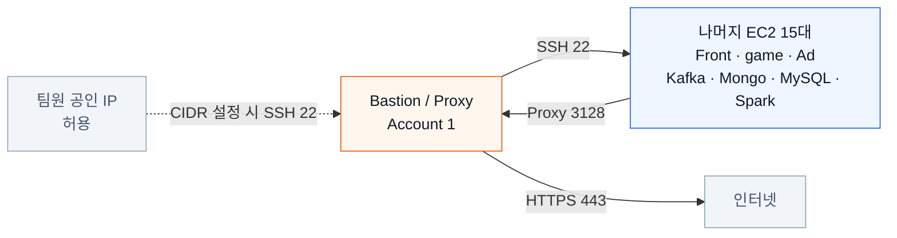
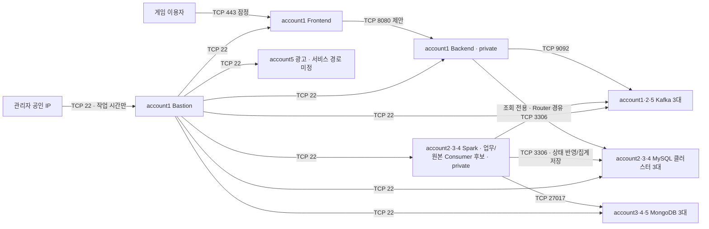

# EC2 보안 그룹 설계 초안

EC2 16대를 5개 계정에 나눠 기본 자원비를 비슷하게 만드는 배치의 보안 그룹 설계다. 역할은 8종이며, 같은 역할도 계정별 VPC마다 별도 SG를 생성하므로 **실제 SG는 16개**다. Frontend와 별도 Bastion EC2는 account1의 퍼블릭, Backend는 같은 계정의 프라이빗에 둔다. 게임 접속은 HTTPS/WSS의 TCP 443을 후보로 두며, Kafka·Spark·DB는 사설 주소로 통신한다.

- 작성일: 2026-10-08, 한국 시간
- 상태: 설계 제안. AWS 리소스에 적용하지 않은 상태
- 구성 기준: [README](../README.md)의 광고 서버 포함 EC2 16대와 서울 리전의 물리 AZ 2개
- 사용자 확인: Spark는 프라이빗에 배치. 게임은 Frontend 1대와 Backend 1대로 분리. HTTPS 및 WebSocket으로 예상하며 실제 프로토콜·포트는 확인 필요
- 계정 배치: 2026-10-08 계정별 비용 균등화 요청에 따른 [5개 계정 배치](account-allocation.md)의 제안. Frontend와 Bastion의 동일 계정 배치를 유지하며 실제 배포 상태를 의미하지 않음

Frontend와 Backend의 역할 분리는 사용자 확인 사항이며, 계정별 노드 배치와 Backend 포트 8080은 이번 설계 제안이다. 실제 게임 코드의 리스너와 프록시 설정에 맞춰 포트를 확정한다.

## 현재 공통 스크립트의 Bastion·Proxy 연결

아래 그림은 [현재 공통 스크립트](../infra/README.md)의 관리 접속과 인터넷 HTTPS 연결 경로다. 이 문서에 남아 있는 기존 NAT 기반 설계와 구분한다.

## 계정과 보안 그룹 배치

| 계정 | 노드 | 역할별 보안 그룹 이름 | 배치 제안 |
| --- | --- | --- | --- |
| account1 | game-01 · Frontend | `aws-infra-frontend` | AZ A 퍼블릭, HTTPS 진입점과 리버스 프록시 |
| account1 | bastion-01 | `aws-infra-bastion` | AZ B 퍼블릭, 관리할 때만 가동 |
| account1 | game-02 · Backend | `aws-infra-backend` | AZ B 프라이빗, 게임 로직과 API·WebSocket 처리 |
| account1 | kafka-01 | `aws-infra-kafka` | AZ A 프라이빗 |
| account2 | kafka-02 | `aws-infra-kafka` | AZ A 프라이빗 |
| account2 | mysql-01 | `aws-infra-mysql` | AZ A 프라이빗 |
| account2 | spark-01 · Master | `aws-infra-spark` | AZ A 프라이빗 |
| account3 | spark-02 · Worker | `aws-infra-spark` | AZ B 프라이빗 |
| account3 | mongo-01 | `aws-infra-mongo` | AZ A 프라이빗 |
| account3 | mysql-02 | `aws-infra-mysql` | AZ A 프라이빗 |
| account4 | spark-03 · Worker | `aws-infra-spark` | AZ B 프라이빗 |
| account4 | mongo-02 | `aws-infra-mongo` | AZ A 프라이빗 |
| account4 | mysql-03 | `aws-infra-mysql` | AZ B 프라이빗 |
| account5 | kafka-03 | `aws-infra-kafka` | AZ B 프라이빗 |
| account5 | mongo-03 | `aws-infra-mongo` | AZ B 프라이빗 |
| account5 | ad-01 | `aws-infra-ad` | AZ B, 공개 여부 미정. 비용은 공인 IP 보유 가정 |
| **합계** | **16대** | **8개 역할 · 실제 SG 16개** | **AZ A 8대 · AZ B 8대** |

계정별 EC2 수와 실제 SG 수는 account1부터 **4·3·3·3·3개**다. Kafka·MongoDB·MySQL은 각각 하나의 클러스터를 계정 3개에 나눈 것이며, 계정마다 별도 클러스터를 추가하는 것이 아니다. 인스턴스 사양·디스크 총량과 노드별 물리 AZ는 유지하고 노드의 계정만 재배치한다.

계정마다 독립 VPC 하나를 두고 역할이 존재하는 VPC마다 SG를 생성한다. 같은 VPC의 동일 역할 노드들은 AZ가 달라도 SG를 공유할 수 있지만, 이번 배치에는 계정 안에 같은 역할의 노드가 중복되지 않아 16개가 된다. **다른 계정의 동일한 SG 이름은 서로 다른 SG**이며, 클러스터 통신에는 상대 계정의 실제 SG ID 참조가 필요하다. Frontend·Bastion·Backend도 각자의 SG를 사용한다.

표의 이름은 생성할 그룹의 이름이다. 실제 규칙에서는 생성 후 받은 보안 그룹 ID를 사용한다. 여러 그룹을 한 EC2에 붙이면 허용 규칙이 합쳐지므로, 별도의 전체 허용 그룹을 함께 붙이지 않는다. [AWS 보안 그룹 규칙](https://docs.aws.amazon.com/vpc/latest/userguide/security-group-rules.html)

## 서비스 연결 가정

브라우저는 Frontend의 HTTPS/WSS 주소로 연결하고, Frontend의 리버스 프록시가 API·WebSocket 요청을 사설 Backend로 전달한다. Frontend가 정적 파일만 제공하고 브라우저가 Backend 사설 IP로 직접 접속하는 방식으로는 외부 접속이 성립하지 않는다. WebSocket 프록시에는 프로토콜 전환 헤더와 연결 유지 설정이 필요하다. [NGINX WebSocket 프록시](https://nginx.org/en/docs/http/websocket.html)

**사용자 확정: 로그인·계정 변경·게임 상태 변경을 포함한 모든 애플리케이션 쓰기는 Kafka를 먼저 경유한다.** Backend 요청 처리기가 MySQL에 먼저 저장하고 Kafka에도 전송하는 방식은 사용하지 않는다. DB 조회와 인증 정보 검증은 쓰기와 구분하며 Backend의 DB 읽기 접근은 허용하는 제안이다. Frontend에는 DB·Kafka 직접 접속을 허용하지 않는다.

Kappa는 스트림 처리와 재처리를 중심으로 하는 구조이며, 모든 업무 쓰기를 Kafka로 보낸다는 것은 이번 프로젝트에서 추가로 선택한 정책이다. 아래 처리 역할과 배치는 구현 전 제안이며, 현재 실행 중이라는 뜻은 아니다.

| 처리 역할 | 데이터 흐름 | 배치 제안 |
| --- | --- | --- |
| Backend 요청 처리기 | 입력 검증 → Kafka 명령·이벤트 발행. MySQL 직접 변경 금지 | account1 Backend |
| 업무 Consumer | Kafka 명령 소비 → 업무 규칙·중복·버전 검증 → MySQL 상태 반영 | account2·3·4의 기존 Spark 노드 중 별도 프로세스로 배치. 정확한 노드·자원은 미정 |
| 원본 저장 Consumer | Kafka에서 보관 대상 이벤트 소비 → MongoDB | account2·3·4의 기존 Spark 노드 중 배치. Spark와 별도 Consumer group 사용 제안 |
| Spark | Kafka 이벤트 소비 → 스트림 집계 → MySQL 집계 테이블 저장 | account2 Master, account3·4 Worker |
| Backend 조회 처리기 | MySQL의 반영된 상태·집계 결과 읽기 | account1 Backend, 읽기 전용 DB 계정 |

업무 Consumer와 원본 저장 Consumer는 Spark 자체 기능으로 자동 제공되지 않는다. 별도로 구현하거나 적합한 Connector를 선택해야 한다. 로그인 처리를 장시간 집계 작업 완료에 묶지 않도록 업무 Consumer를 분리하는 제안이다. 이 초안에서는 Consumer도 해당 Spark 노드의 SG를 공유한다. 따라서 Spark 역할 SG의 DB 권한에는 함께 배치할 Consumer의 권한도 포함한다. 3개 Spark 노드는 Consumer 배치 후보이므로 아래 표에는 역할 범위로 표시하되, 배포 시 원본 저장 Consumer가 실행되지 않는 노드의 MongoDB 접근은 제거한다. 프로세스별 권한은 Kafka ACL과 DB 계정으로 나누며, 노드를 분리하면 전용 SG·비용을 재설계한다.

데이터 흐름은 `Backend → Kafka → 업무 Consumer / 원본 저장 Consumer / Spark → MySQL / MongoDB`이며, 조회는 `Backend → MySQL`이다. 광고 서버가 데이터를 쓰는 경우에도 Kafka 우선 정책을 적용하되 직접 Producer인지 Backend API 경유인지 확정 후 규칙을 추가한다.

### 쓰기 완료와 재처리 조건

- Kafka 발행 성공은 DB 반영 완료가 아니다. 요청 ID로 접수·처리 완료·실패를 구분하고, 로그인·계정 변경 등은 필요한 상태 반영을 확인한 뒤 최종 성공을 응답한다. 시간 초과 시 무조건 실패나 재실행으로 간주하지 않고 같은 요청 ID로 처리 결과를 확인한다.
- 로그인 비밀번호 검증은 인증 로직이 담당한다. 로그인 기록·세션 상태 변경 같은 쓰기는 Kafka를 경유하지만, 비밀번호 원문·세션 토큰을 일반 이벤트나 MongoDB 원본 로그에 넣지 않는다. 계정 생성·변경에 필요한 인증 정보는 제한된 전용 토픽·Consumer·보관 정책을 별도로 설계하며 일반 분석·원본 보관 대상에서 제외한다.
- 동일 사용자·게임 개체의 순서가 필요한 레코드는 같은 키로 분할하고, Consumer는 요청 ID·이벤트 ID와 상태 버전으로 중복 및 오래된 갱신을 방지한다. 업무 명령은 처리 실패가 가능하므로 명령 접수와 상태 변경 확정 이벤트를 구분한다.
- Kafka의 처리 보장만으로 MySQL·MongoDB까지 자동으로 exactly-once가 되지는 않는다. DB 반영 후 offset을 확정하고, 재전달에 대비한 고유 키·트랜잭션·멱등 갱신을 설계한다. MySQL과 MongoDB 사이의 동시 원자적 반영도 가정하지 않는다. [Kafka 처리 보장](https://kafka.apache.org/design/)
- 재처리는 별도 Consumer group과 검증용 대상 테이블로 수행하는 안이다. 과거 로그인 명령 재생으로 세션 발급 등 업무 부수 효과가 다시 발생하지 않도록 한다. Kafka 보관 기간 이후에도 재구축하려면 재생 가능한 이벤트 아카이브와 스키마·순서 정보가 필요하며, 원본을 저장했다는 이유만으로 재생 가능하다고 가정하지 않는다.

아래 화살표는 데이터 이동 방향이 아니라 **TCP 연결을 시작하는 방향**이다. Spark는 Kafka Consumer이므로 Kafka로 연결을 시작한다.

Kafka Broker 자체에서 DB로 직접 쓰는 연결은 열지 않는다. Consumer가 Kafka와 DB 각각에 연결한다. Consumer의 실제 노드가 정해지면 출발지 SG를 해당 노드로 좁히고, Spark 외의 노드에 배치한다면 해당 역할 SG를 추가 검토한다. Spark·Consumer와 DB의 서비스 연결은 Bastion을 통과하지 않는다.

## 기본 인바운드 규칙

인바운드는 서버로 들어오는 **새 연결**의 허용 규칙이다. 아래 표의 이름은 논리 역할을 표시한다. Kafka는 account1·2·5, Spark는 account2·3·4, MongoDB는 account3·4·5, MySQL은 account2·3·4의 실제 SG들로 각각 확장한다. `동일 역할 SG 전체`는 **로컬 SG와 상대 계정의 해당 역할 SG 각각**을 참조한다는 뜻이며, 같은 VPC 전체를 허용한다는 뜻이 아니다. 기존의 자기 SG 참조만 복사하면 다른 계정의 복제 노드는 연결되지 않는다.

예를 들어 account1의 Kafka SG에서 Broker 복제를 허용하려면 TCP 9092에 account1 Kafka SG와 account2·account5 Kafka SG를 각각 참조하고, 9093에도 같은 범위를 적용한다. 타 계정 참조는 `상대 계정 ID/실제 SG ID`를 사용한다. account2·account5 Kafka SG도 같은 방식으로 설정한다. 출발지·목적지가 다른 역할인 규칙 역시 필요한 모든 상대 역할 SG로 확장한다.

| 대상 그룹 | 출발지 | 프로토콜과 목적지 포트 | 목적과 적용 조건 |
| --- | --- | --- | --- |
| `aws-infra-bastion` | `ADMIN_PUBLIC_CIDRS` | TCP 22 | 관리자의 현재 공인 IP `/32` 목록. 관리 시간에만 허용 |
| `aws-infra-frontend` | `GAME_CLIENT_CIDRS` | TCP 443 | HTTPS/WSS 확인 후 활성화. 초기 팀 테스트는 접속자 공인 CIDR, 공개 서비스는 `0.0.0.0/0` |
| frontend·backend·ad·kafka·spark·mongo·mysql 그룹 각각 | `aws-infra-bastion` | TCP 22 | Bastion에서 대상 서버로 SSH 접속 |
| `aws-infra-backend` | `aws-infra-frontend` | TCP 8080 | API·WebSocket 프록시. Backend 실제 포트에 맞춰 변경할 제안 값 |
| `aws-infra-kafka` | `aws-infra-backend` | TCP 9092 | 게임의 이벤트 전송 |
| `aws-infra-kafka` | `aws-infra-spark` | TCP 9092 | Spark Driver·Executor와 함께 배치한 Consumer의 Kafka 접근 |
| `aws-infra-kafka` | 동일 역할 SG 전체 | TCP 9092 | Broker 통신과 복제 |
| `aws-infra-kafka` | 동일 역할 SG 전체 | TCP 9093 | KRaft Controller 통신 |
| `aws-infra-spark` | 동일 역할 SG 전체 | TCP 7077 | Standalone Master 접속 |
| `aws-infra-spark` | 동일 역할 SG 전체 | TCP 7078 | Worker RPC를 이 포트로 고정하는 안 |
| `aws-infra-spark` | 동일 역할 SG 전체 | TCP 35000–35015 | Driver RPC의 지정 범위 |
| `aws-infra-spark` | 동일 역할 SG 전체 | TCP 35100–35115 | Driver·Executor의 Block Manager 통신 |
| `aws-infra-mongo` | `aws-infra-spark` | TCP 27017 | 원본 저장 Consumer의 저장·조회. 실제 실행 노드의 SG로 제한 |
| `aws-infra-mongo` | 동일 역할 SG 전체 | TCP 27017 | MongoDB Replica Set 복제·선출 통신 |
| `aws-infra-mysql` | `aws-infra-backend` | TCP 3306 | Backend의 로컬 Router 경유 조회. DB 읽기 전용 계정으로 쓰기 금지 |
| `aws-infra-mysql` | `aws-infra-spark` | TCP 3306 | 업무 Consumer 상태 반영·Spark 집계 저장. 역할별 DB 계정 분리 |
| `aws-infra-mysql` | 동일 역할 SG 전체 | TCP 3306 | MYSQL 통신 스택의 Group Replication·노드 복구 |

`ADMIN_PUBLIC_CIDRS`와 `GAME_CLIENT_CIDRS`는 실제 값으로 채울 설계 변수이며, 현재 규칙이 생성된 것은 아니다. IPv4 기준으로 작성했고 IPv6는 별도 검토 없이 `::/0`를 추가하지 않는다.

Frontend에서 TLS를 종료하고 Backend 8080으로 전달하는 경우 내부 구간은 자동으로 암호화되지 않는다. 내부 TLS도 사용하려면 Backend의 TLS 리스너와 프록시·SG 목적지 포트를 함께 바꾼다. 광고 서버는 역할 확인 전까지 SSH 관리 외 서비스 인바운드를 열지 않는다.

Kafka는 3대 모두 Broker와 KRaft Controller를 겸하는 소규모 구성으로 가정했다. 9092는 클라이언트·Broker용, 9093은 Controller용으로 정하는 안이며, 포트 번호만으로 TLS 사용 여부가 결정되지는 않는다. `listeners`와 `advertised.listeners`는 모든 허용 클라이언트가 접근할 수 있는 사설 주소·포트로 맞춘다. [Kafka Listener 설정](https://kafka.apache.org/42/security/listener-configuration/)

MongoDB는 샤딩이 아닌 데이터 노드 3개의 Replica Set을 가정했다. 샤딩을 선택하면 라우터·설정 서버와 통신표를 다시 설계한다. MongoDB 27017과 MySQL 3306은 기본 포트를 사용하는 안이다. MySQL은 EC2 3대의 클러스터이며, 아래 제안한 통신 스택에 맞춰 내부 포트를 허용한다. [MongoDB 포트](https://www.mongodb.com/docs/manual/reference/default-mongodb-port/), [MySQL 포트](https://dev.mysql.com/doc/refman/8.4/en/server-system-variables.html#sysvar_port)

## MySQL 클러스터 통신과 접속

EC2 3대로 직접 구성하는 것은 확정 사항이다. 구체적인 구현은 **InnoDB Cluster의 단일 Primary 구성**을 제안한다. Primary 1대가 쓰기를 받고 Secondary 2대가 복제하며, 읽기 분산과 장애 시 재연결은 애플리케이션 설정까지 함께 검증한다. NDB Cluster나 단순 비동기 복제 구성으로 확정한 것은 아니다. [InnoDB Cluster](https://dev.mysql.com/doc/mysql-shell/26.7/en/mysql-innodb-cluster.html)

- 통신 스택은 지원되는 MySQL 버전에서 `communicationStack: MYSQL`을 선택하는 안이다. 이 경우 노드 간 통신에 MySQL 리스너 3306을 사용한다.
- `XCOM`을 선택하면 별도 내부 포트가 필요하다. 33061로 설정하는 경우 MySQL 역할 SG 전체 간 TCP 33061 인바운드·아웃바운드를 함께 추가한다. 두 방식의 규칙을 무조건 함께 열지 않는다.
- X Protocol을 쓰지 않는 기본안에는 33060을 추가하지 않는다.

[MySQL 통신 스택](https://dev.mysql.com/doc/mysql-shell/26.7/en/shell-admin-api-communication-stack.html), [InnoDB Cluster 포트](https://dev.mysql.com/doc/mysql-shell/26.7/en/configuring-cluster-instance-ports.html)

MySQL Router는 account1 Backend EC2와 DB에 연결하는 account2·3·4의 Spark/Consumer 노드에 함께 설치하는 안이다. 쓰기 Consumer와 Spark는 `127.0.0.1:6446`을 통해 Primary에 접속한다. Backend도 반영 지연을 줄이기 위해 이 Primary 경로로 조회하되 **읽기 전용 DB 계정**을 사용한다. 6446이라는 포트나 SG 자체는 쓰기 금지를 강제하지 않는다. Primary 조회도 Kafka Consumer 처리 완료 전 상태까지 최신으로 만드는 것은 아니다. Router가 account2·3·4의 DB 3대의 3306에 연결하므로 Backend와 실제 DB 연결을 만드는 Spark/Consumer SG 모두 DB 3대에 접근할 수 있어야 한다. Router 바인딩은 localhost로 제한하고 6446·6447은 EC2 인바운드에 열지 않는다. 별도 Router EC2는 추가하지 않는다. Router 관리 자격 증명과 애플리케이션 계정도 분리한다. [MySQL Router 옵션](https://dev.mysql.com/doc/mysql-router/8.4/en/mysqlrouter.html)

실제 DB 연결을 만드는 Driver·Executor·Consumer 노드에 Router를 배치하고 연결 풀 재접속을 검증한다. MySQL 3306 규칙만으로 Primary 변경을 자동 처리하는 것은 아니다. 업무 Consumer와 Spark는 서로 다른 테이블·권한을 사용해 게임 상태와 집계 쓰기가 충돌하지 않도록 한다.

두 AZ에 MySQL 3대를 2:1로 배치하면 두 대가 있는 AZ 장애 시 과반을 잃는다. 정상 멤버 과반이 남는 노드 장애에 대한 전환과 AZ 전체 장애 대응을 구분하고, Router 경로·연결 풀 재접속·중복 쓰기 방지와 복구를 함께 검증한다.

## Spark 포트와 실행 위치

Spark는 Standalone을 가정하며 Master·Worker·Driver를 account2·3·4의 프라이빗 Spark 노드 안에서 실행한다. [README의 초기 사양](../README.md)에 맞춰 spark-01은 account2 Master(t3.medium), spark-02·03은 account3·4 Worker(t3.large)로 구분한다. Driver와 업무·원본 Consumer의 실제 실행 노드와 자원 배분은 별도로 정한다. Driver·Consumer를 Master 서버에서 실행하면 그 자원도 필요하므로 Master 전용 서버와 구분한다.

Worker RPC, Driver RPC, Block Manager는 기본 설정에서 동적 포트를 사용할 수 있다. 보안 그룹만 위 표대로 열어 두면 안 되고, 아래 값을 실제 실행 설정에 반영해야 한다. 7078과 35000·35100은 이 설계에서 선택한 값이며 제품 기본 포트가 아니다. [Spark 네트워크 포트](https://spark.apache.org/docs/latest/security.html#configuring-ports-for-network-security)

| 설정 위치 | 설정 항목 | 제안 값 | 적용 목적 |
| --- | --- | --- | --- |
| Master 환경 | `SPARK_MASTER_PORT` | `7077` | Master RPC 고정 |
| Worker 환경 | `SPARK_WORKER_PORT` | `7078` | Worker RPC 고정 |
| Master·Worker JVM 옵션 | `spark.port.maxRetries` | `0` | 데몬 포트 충돌 시 다른 포트로 이동하지 않고 기동 실패 처리 |
| 각 Spark 애플리케이션 | `spark.driver.port` | `35000` | Driver RPC 시작 포트 |
| 각 Spark 애플리케이션 | `spark.blockManager.port` | `35100` | Block Manager 시작 포트 |
| 각 Spark 애플리케이션 | `spark.driver.blockManager.port` | `35100` | Driver도 같은 Block Manager 범위 사용 |
| 각 Spark 애플리케이션 | `spark.port.maxRetries` | `15` | 시작 포트부터 15 증가한 포트까지 재시도 |

데몬 JVM 옵션은 `SPARK_MASTER_OPTS`·`SPARK_WORKER_OPTS`에 `-Dspark.port.maxRetries=0`으로 적용하는 안이다. 애플리케이션 설정과 데몬 설정을 구분하고, 실제 설치 버전에서 적용 여부를 확인한다. 35000–35015와 35100–35115는 각각 16개 포트다. 같은 호스트의 동시 프로세스가 범위를 소진하면 임의 포트를 열지 말고 실행 수 또는 범위를 함께 조정한다. [Spark 재시도 설정](https://spark.apache.org/docs/latest/configuration.html#networking), [Standalone 데몬 설정](https://spark.apache.org/docs/latest/spark-standalone.html)

`spark.driver.host`는 Executor에서 도달 가능한 Driver의 사설 주소로 설정한다. 노트북이나 Bastion에서 Driver를 계속 실행하는 방식은 기본안에서 제외한다. Bastion을 통해 Spark 서버에 SSH로 들어간 뒤 그 서버에서 작업을 제출하면 된다. 따라서 Spark 프라이빗 배치를 유지하면서 Bastion을 끌 수 있다.

초기안에서는 외부 Shuffle Service, REST 제출, Spark Connect와 Master HA를 필수로 가정하지 않는다. 아래 조건부 규칙에서 사용하는 기능만 추가한다. 노드별 서비스 기동은 관리 접속으로 수행하며, Spark의 SSH 기반 일괄 기동 스크립트를 쓰려면 별도 SSH 규칙이 필요하다.

## 조건부 인바운드 규칙

다음은 실제 사용이 확인된 경우에만 추가한다. 기본 인바운드 표에 자동 합산하지 않는다.

| 출발지 | 목적지 | 프로토콜과 포트 | 추가 조건 |
| --- | --- | --- | --- |
| `aws-infra-backend` | `aws-infra-mongo` | TCP 27017 | Backend의 원본 조회가 필요할 때. 읽기 전용 DB 계정, 직접 저장 금지 |
| `aws-infra-ad` | `aws-infra-kafka` | TCP 9092 | account5 광고 서버가 Kafka에 직접 발행할 때. account1·2·5 Kafka SG와 양쪽 규칙 추가 |
| `aws-infra-frontend` | `aws-infra-ad` | 광고 앱의 실제 TCP 포트 | Frontend에서 광고 요청을 프록시할 때. 광고는 private 배치 가능 |
| 광고 접속 클라이언트 CIDR | `aws-infra-ad` | TCP 443 | 광고를 별도 HTTPS 주소로 직접 제공할 때. 공개 경로 필요 |
| `aws-infra-backend` | `aws-infra-ad` | 광고 앱의 실제 TCP 포트 | Backend가 광고 API를 직접 호출할 때 |
| 확인한 접속 경로 | 게임 서비스 노드 | 확인한 UDP 포트 | UDP 사용이 확인되면 TCP 프록시와 별개로 진입점·배치를 재설계 |
| `aws-infra-spark` | 동일 역할 SG 전체 | TCP 2181, 2888, 3888 | Spark 3대에 ZooKeeper를 함께 배치하고 Master HA를 구성할 때 |
| `aws-infra-spark` | 동일 역할 SG 전체 | TCP 7337 | External Shuffle Service를 실제 활성화할 때 |
| `aws-infra-spark` | 동일 역할 SG 전체 | TCP 6066 | Standalone REST 제출을 실제 사용할 때 |
| 기동 명령을 실행할 Spark 노드의 사설 IP `/32` | `aws-infra-spark` | TCP 22 | Spark 노드에서 SSH 기반 일괄 기동을 사용할 때 |

ZooKeeper 2181은 클라이언트 접속, 2888·3888은 복제와 리더 선출용 설정 예시다. ZooKeeper를 별도 노드에 배치하면 전용 그룹과 노드 수를 다시 정한다. [ZooKeeper 구성](https://zookeeper.apache.org/doc/current/zookeeperAdmin.html)

Spark UI 8080·8081·4040 계열은 인터넷에 열지 않는다. DB 관리 도구도 동일하게 SSH 경유로 사용한다. 여기서는 **Bastion을 점프 호스트로 사용해 최종 대상 서버까지 SSH 연결한 뒤, 대상 서버의 localhost 포트로 포워딩**하는 방식을 기준으로 한다. 이 경우 Bastion에서 대상 UI·DB 포트로 향하는 별도 SG 규칙은 필요 없다. Bastion 자체를 터널 종점으로 삼아 원격 DB에 접속하는 다른 방식을 선택하면 해당 목적지 포트를 Bastion에 한해 추가해야 한다.

## 아웃바운드 규칙

아웃바운드는 해당 서버에서 시작하는 새 연결이다. SG의 기본 전체 아웃바운드 허용을 제거하고 아래 목적지·포트를 등록하는 안이다. 인바운드 표의 출발지와 목적지가 서로 다른 SG이면 **출발지의 아웃바운드와 목적지의 인바운드가 모두 허용**돼야 한다.

| 출발 그룹 | 목적지 | 프로토콜과 목적지 포트 |
| --- | --- | --- |
| `aws-infra-bastion` | 나머지 7개 역할의 실제 SG 15개 각각 | TCP 22 |
| `aws-infra-frontend` | `aws-infra-backend` | TCP 8080, Backend 실제 포트와 함께 조정 |
| `aws-infra-backend` | `aws-infra-kafka` | TCP 9092 |
| `aws-infra-backend` | `aws-infra-mysql` | TCP 3306 |
| `aws-infra-ad` | 내부 서비스 | 기본안에 새 연결 없음. 실제 광고 저장·집계 경로 확인 후 추가 |
| `aws-infra-kafka` | 동일 역할 SG 전체 | TCP 9092, 9093 |
| `aws-infra-spark` | 동일 역할 SG 전체 | TCP 7077, 7078, 35000–35015, 35100–35115 |
| `aws-infra-spark` | `aws-infra-kafka` | TCP 9092 |
| `aws-infra-spark` | `aws-infra-mongo` | TCP 27017 |
| `aws-infra-spark` | `aws-infra-mysql` | TCP 3306, 업무 Consumer·Spark의 Router 접속 |
| `aws-infra-mongo` | 동일 역할 SG 전체 | TCP 27017 |
| `aws-infra-mysql` | 동일 역할 SG 전체 | TCP 3306, MYSQL 통신 스택·복구용 |
| 모든 역할 그룹 | `0.0.0.0/0` | TCP 443, 패키지 다운로드·AWS API·CloudWatch 전송용 |

조건부 통신을 활성화하면 해당 아웃바운드도 함께 추가한다. 인바운드와 동일하게 역할 이름을 계정별 실제 SG ID로 확장하며, MongoDB 접근은 실제 원본 저장 Consumer 노드로 제한한다. 쉼표로 나열된 개별 포트는 실제 SG에서 각각의 규칙으로 만들며, 연속 범위만 한 규칙으로 표현한다.

TCP 443의 `0.0.0.0/0` 허용은 설치·운영 편의를 위한 초기 타협이다. CloudWatch만 허용하는 규칙은 아니며, 일반 SG로 도메인 이름을 허용 목록에 넣을 수는 없다. 게임이나 외부 라이브러리가 다른 목적지 포트를 요구하면 실제 사용처를 확인해 추가한다. TCP 80은 기본 제외하고, 설치 저장소가 HTTP를 요구할 때만 설치 기간에 한해 허용한다.

응답 트래픽은 SG가 연결 상태를 추적해 허용하므로, 게임 이용자에게 응답하거나 Kafka 데이터를 받기 위해 반대 방향의 임시 포트 전체를 추가하지 않는다. VPC 기본 DNS와 Amazon Time Sync 같은 AWS 제공 특수 트래픽은 SG로 필터링되지 않는다. 외부 DNS·NTP를 따로 사용하면 목적지별 규칙을 별도로 검토한다. [AWS 보안 그룹 동작](https://docs.aws.amazon.com/vpc/latest/userguide/vpc-security-groups.html)

## 계정 간 Peering과 외부 통신

각 VPC의 CIDR은 서로 겹치지 않게 정하고, 통신은 Peering을 통한 사설 IP로 수행한다. 같은 서울 리전의 직접 Peering이 `active`인 경우, 다른 계정 SG를 출발지 또는 목적지로 참조할 수 있다. 콘솔에서는 상대 계정 ID와 실제 SG ID를 `계정ID/sg-ID` 형식으로 지정한다. [교차 계정 SG 참조](https://docs.aws.amazon.com/vpc/latest/peering/vpc-peering-security-groups.html)

기본 연결에 필요한 Peering은 **5개 VPC의 모든 쌍, 총 10개**다. 아래는 각 연결이 필요한 주요 이유이며, 같은 쌍의 다른 허용 경로도 해당 Peering을 공유한다. Peering 연결 자체의 시간당 요금은 없으며, 같은 물리 AZ 사설 통신은 전송료가 없고 AZ 교차 전송은 별도 과금한다. [AWS Peering 비용](https://docs.aws.amazon.com/prescriptive-guidance/latest/saas-network-access-options/evaluating.html)

| VPC 연결 | 목적 |
| --- | --- |
| account1 ↔ account2 | Kafka-01 ↔ Kafka-02 복제, Backend → MySQL-01, Bastion 관리 |
| account1 ↔ account3 | Worker-02 → Kafka-01, Backend → MySQL-02, Bastion 관리 |
| account1 ↔ account4 | Worker-03 → Kafka-01, Backend → MySQL-03, Bastion 관리 |
| account1 ↔ account5 | Kafka-01 ↔ Kafka-03 복제, Backend → Kafka-03, Bastion 관리 |
| account2 ↔ account3 | Master ↔ Worker-02, MySQL-01 ↔ MySQL-02 복제 |
| account2 ↔ account4 | Master ↔ Worker-03, MySQL-01 ↔ MySQL-03 복제 |
| account2 ↔ account5 | Kafka-02 ↔ Kafka-03 복제, Master/Driver → Kafka-03 |
| account3 ↔ account4 | Spark 노드 간 통신, MongoDB·MySQL 복제 |
| account3 ↔ account5 | Worker-02 → Kafka-03, Mongo-01 ↔ Mongo-03 복제 |
| account4 ↔ account5 | Worker-03 → Kafka-03, Mongo-02 ↔ Mongo-03 복제 |

각 연결에는 양쪽의 실제 통신 서브넷에 상대 VPC CIDR → 해당 Peering 경로도 필요하다. Peering만 만들거나 SG만 열어서는 통신이 완성되지 않는다. Peering은 중계 라우팅을 제공하지 않으므로 account1에 연결된 것만으로 모든 계정 사이가 연결되는 것은 아니다. 현재 10개 연결에서는 조건부 Backend → MongoDB 조회나 광고의 Kafka 발행을 추가해도 Peering 수는 늘지 않으며 필요한 SG 규칙을 별도로 추가한다. VPC 전체를 연결했다는 이유로 모든 포트를 허용하지 않는다. [Peering 제한](https://docs.aws.amazon.com/vpc/latest/peering/vpc-peering-basics.html)

외부 통신은 [현재 비용 문서](../costs/dual-az.md)의 **계정당 Zonal Public NAT Gateway 1개, 총 5개** 가정을 따른다. account1·2·3은 AZ A, account4·5는 AZ B의 퍼블릭 서브넷에 두는 제안이며 프라이빗 서버는 같은 계정의 NAT를 이용한다. 반대 AZ의 노드는 NAT 사용 시 AZ 교차 비용과 NAT가 위치한 AZ 장애의 영향을 받는다. 다른 계정 NAT를 Peering 너머로 공유할 수 없다. NAT Gateway 자체에는 SG를 붙이지 않으며, EC2의 HTTPS 목적지를 NAT의 사설 IP로 지정하지 않는다. NAT는 경로상의 주소 변환 장치이고 실제 목적지는 외부 API·패키지 서버다. 클러스터 간 사설 통신은 NAT가 아닌 Peering을 사용한다. 과거 단일 AZ 문서의 Bastion Proxy 3128은 이 안에 포함하지 않는다. [AWS NAT Gateway](https://docs.aws.amazon.com/vpc/latest/userguide/vpc-nat-gateway.html), [Peering 경로 제한](https://docs.aws.amazon.com/vpc/latest/peering/vpc-peering-basics.html)

AZ A/B는 계정마다 같은 **AZ ID**를 가리키도록 선택해야 한다. 계정별 `ap-northeast-2a` 같은 이름만 일치시켜 같은 물리 AZ라고 가정하지 않는다. 실제 ID 선택·기존 CIDR 중복 확인은 배포 전에 수행한다. [AWS AZ ID](https://docs.aws.amazon.com/ram/latest/userguide/working-with-az-ids.html)

CloudWatch Agent는 각 EC2에서 지표·로그를 전송하므로 CloudWatch 수신용 EC2 인바운드 규칙은 만들지 않는다. 프라이빗 서버에는 NAT 또는 서비스별 VPC Endpoint 경로와 IAM 권한이 필요하다. Endpoint 방식으로 바꾸면 해당 Endpoint SG에 수집 대상 노드로부터 TCP 443을 허용하고 EC2 egress도 이에 맞춘다. Endpoint는 현재 기본 16개 SG와 비용 계산에 추가되는 선택 사항이다. [CloudWatch Agent 네트워크 조건](https://docs.aws.amazon.com/AmazonCloudWatch/latest/monitoring/prerequisites.html)

2026-10-08 갱신한 비용표는 Backend 프라이빗 배치를 반영해 NAT 5개·Frontend·광고·Bastion의 공인 IP 총 8개로 계산한다. 광고 서버의 공인 IP는 공개 여부가 미정인 계산 가정이다. 계정별 기본 자원비는 분리했지만, 실제 전송 경로·사용량·현재 크레딧 잔액은 미검증이다.

## 관리 시간과 배포 검증

Bastion은 관리할 때 시작하고 관리자 공인 IP의 SSH 규칙을 열며, 작업 종료 시 세션을 종료하고 해당 규칙을 제거한 뒤 중지하는 안이다. 그동안에도 서비스 노드의 데이터 경로는 유지된다. SG 변경만으로 기존 연결이 즉시 끊긴다고 가정하지 않고 Bastion 중지까지 수행한다.

배포 전에는 게임 포트·TLS 종료 위치, Spark 버전과 역할·Driver 위치, MongoDB 복제 방식, Kafka Listener, 광고 호출 경로와 실제 DB 사용처를 확정한다. Backend는 Frontend에서 도달 가능한 사설 주소에 리슨해야 하며 localhost에만 바인딩하면 프록시 연결이 실패한다. 별도 ALB를 도입하면 공개 443의 종점을 ALB로 옮기고 수신 노드 SG는 ALB SG만 허용하도록 다시 설계한다.

적용 순서는 VPC·서브넷 생성, 역할 SG 생성, Peering 활성화와 라우팅, SG ID 참조 규칙 등록, 서비스 포트 설정, 통신 검증이다. NACL을 별도로 제한한다면 SG와 달리 응답용 임시 포트까지 고려해야 한다. 이 초안은 NACL을 동시에 강화하지 않는 전제다.

| 검증 구간 | 기대 결과 |
| --- | --- |
| 허용된 관리자 IP → Bastion 22 | 관리 시간에 성공 |
| 다른 외부 IP → Bastion 22 | 신규 연결 실패 |
| 게임 이용자 → Frontend 443 → Backend 8080 | HTTPS/WSS 확정·설정 후 일반 API와 WebSocket 모두 성공 |
| 인터넷 → Backend·DB·Kafka·Spark | 신규 연결 실패 |
| Frontend → DB·Kafka, Backend → Kafka Controller 9093 | 신규 연결 실패 |
| Backend → Kafka 9092, MySQL 3306 | Kafka 발행·DB 조회 성공, Backend DB 계정의 INSERT/UPDATE/DELETE는 권한 오류 |
| 실제 Consumer·Spark 노드 → Kafka 9092, MongoDB 27017, MySQL 3306 | 허용된 역할의 소비·저장 성공, 권한 밖 테이블·토픽 접근 실패 |
| 상태 변경 요청 → Kafka → 업무 Consumer → MySQL → Backend 조회 | 접수와 반영 완료를 구분하고 처리된 결과 확인 |
| Consumer 중지·재시작 및 같은 요청 재전달 | 대기·실패 상태를 정확히 응답하고 중복 상태 변경 방지 |
| 검증용 재처리 | 과거 이벤트로 대상 결과 재구축, 세션 발급 등 부수 효과 재실행 방지 |
| Spark 내부 | Worker 등록, 작업 제출, Driver 연결과 Shuffle 성공 |
| MongoDB 내부 | 복제 상태와 선출 통신 정상 |
| MySQL 내부 | 3개 멤버 ONLINE, 복제·Primary 선출과 Router를 통한 읽기·쓰기 확인 |
| 계정이 다른 동일 클러스터 노드 사이 | 직접 Peering과 상대 SG 참조를 통한 사설 통신 성공. 같은 이름의 SG만 만든 상태와 구분 |
| MySQL Primary 1대 장애 | 과반이 남는 조건에서 Primary 전환 후 애플리케이션 재접속·쓰기 복구 확인 |
| Bastion 중지 후 | 기존 서비스의 새 연결·처리와 Agent 전송 정상 |

검증은 리스너가 정상 실행된 상태에서 TCP 연결과 실제 서비스 요청을 함께 확인한다. 포트가 닫혀 있거나 인증이 실패한 것과 SG 차단을 구분한다. 계정별 인증·VPC·SG ID·패킷 경로에 대한 실제 조회와 테스트는 배포 단계에서 수행한다.

보안 그룹은 네트워크 접근 범위만 제어한다. Kafka·MongoDB·MySQL·Spark 자체 인증과 TLS는 별도로 설정해야 한다. 이 설계의 포트 허용만으로 인증 또는 암호화가 적용되지는 않는다.
