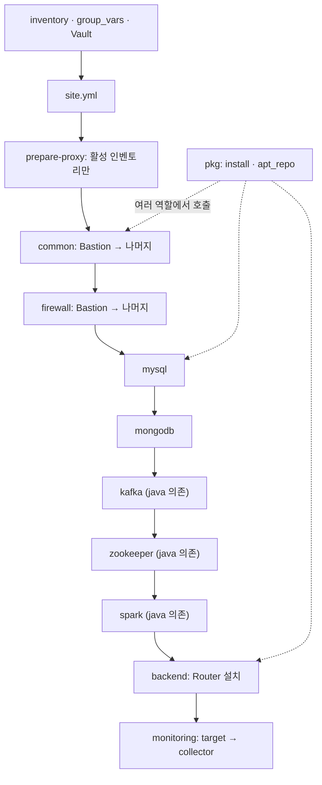
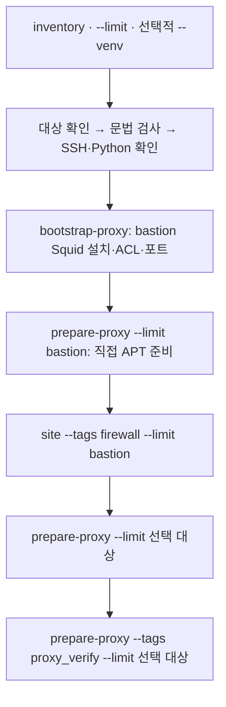

# Platform 코드 탐색 라우팅

[실행 안내](../README.md) · [인벤토리](inventory/README.md) · [역할 지도](roles/README.md) · [검증 코드](tests/README.md) · [검증 기록](verification.md)

## 경로 대응 기준

이 문서의 소스 경로는 aws-platform/platform 디렉터리 기준이다. 소스의 상대경로를 유지하고 파일명 끝에 .md를 붙인다. 예: 저장소 기준 aws-platform/platform/roles/mysql/tasks/main.yml → aws-platform/platform/platform-routing/roles/mysql/tasks/main.yml.md. Python의 정규 AST 참조만 Git 최상위 기준 aws-platform/platform/ 접두사를 붙인다. 실제 소스·문서 링크는 각 문서 위치를 기준으로 계산했다.

현재 코드·설정 파일을 문서화하며 같은 프로젝트 루트의 설계·구현 계획은 별도 참고 자료다. AGENTS.md와 README.md는 파일별 코드 문서 대상에서 제외하고 탐색·검증 문서에서 연결한다. 운영자 로컬 파일과 Secret은 제외한다.

## 작업별 탐색

| 하려는 일 | 먼저 볼 문서 | 주요 소스 |
| --- | --- | --- |
| play 실행 순서·태그·대상 변경 | [최상위 playbook](site.yml.md) | site.yml |
| Ansible 기본 설정·의존성 변경 | [컨트롤 노드 설정](ansible.cfg.md) | ansible.cfg, requirements.txt |
| 구성별 프록시 준비를 한 번에 실행 | [프록시 스크립트](scripts/setup-proxy.sh.md) | scripts/setup-proxy.sh, bootstrap-proxy.yml |
| 배스천 Squid 설치·ACL·수신 포트·설정 복구 변경 | [배스천 프록시 준비](bootstrap-proxy.yml.md) | bootstrap-proxy.yml, scripts/install-squid.sh |
| 프록시·Ubuntu HTTPS 저장소 준비 | [프록시 준비](prepare-proxy.yml.md) | prepare-proxy.yml, inventory/group_vars/all/proxy.yml |
| 서버 목록·Bastion 경유·Vault 입력 변경 | [인벤토리 지도](inventory/README.md) | inventory/ |
| SSH·팀원 계정·sudo·시간원 변경 | [common](roles/common/README.md) | roles/common/ |
| SSH·그룹 간 통신·복구 규칙 변경 | [firewall](roles/firewall/README.md) | roles/firewall/ |
| APT/dnf 설치와 저장소 동작 변경 | [pkg](roles/pkg/README.md) | roles/pkg/ |
| Java 설치·OS 패키지명 변경 | [java](roles/java/README.md) | roles/java/ |
| MySQL 계정·ReplicaSet·Router 계정 변경 | [mysql](roles/mysql/README.md) | roles/mysql/ |
| MongoDB 인증·커널 처리·Replica Set 변경 | [mongodb](roles/mongodb/README.md) | roles/mongodb/ |
| Kafka KRaft·리스너·토픽 검증 변경 | [kafka](roles/kafka/README.md) | roles/kafka/ |
| ZooKeeper ensemble·Spark 복구 변경 | [zookeeper](roles/zookeeper/README.md) | roles/zookeeper/ |
| Spark Master·Worker·JAR·Python 변경 | [spark](roles/spark/README.md) | roles/spark/ |
| Spark 데몬·작업 포트와 AWS SG 범위 맞추기 | [Spark 통신 포트](roles/spark/README.md#프라이빗-서버의-통신-포트) · [인프라 포트 범위 테스트](../../../aws-infra/docs/infra-routing/tests/README.md#spark-포트-범위) | Spark defaults·환경·Worker unit·작업 설정, aws-infra의 선택한 traffic 구성 |
| Backend Router 설치 변경 | [backend](roles/backend/README.md) | roles/backend/ |
| 수집 권한·주기·하트비트·로그 보관 변경 | [monitoring](roles/monitoring/README.md) | roles/monitoring/ |
| PySpark와 서비스 연동 테스트 찾기 | [검증 코드 지도](tests/README.md) | tests/spark_integration.py, Spark verify 템플릿 |

## 실행 연결

화살표는 site.yml의 play 순서와 보조 역할 연결이다. 모든 서비스가 모든 서버에 설치된다는 뜻은 아니다. 대상 그룹·limit·tags에 따라 실행 범위가 달라진다. verify 태그는 각 역할의 검증 연결을 찾는 시작점이며 실제 태그 실행 경로는 Ansible 실행으로 별도 확인한다.

## 구성별 프록시 준비 연결

[scripts/setup-proxy.sh](scripts/setup-proxy.sh.md)는 위 서비스 설치 흐름과 별도로 프록시 준비만 실행한다. [bootstrap-proxy.yml](bootstrap-proxy.yml.md)은 site.yml의 import 대상이 아니므로 이 스크립트에서 먼저 호출한다.

배스천 준비 세 단계는 --limit과 관계없이 실행한다. 프록시 ACL은 전체 인벤토리의 proxy_client_cidrs를 사용하며 --limit으로 축소하지 않는다. 실패하면 이후 명령은 중단한다. bootstrap-proxy의 설정 적용 블록에는 설정 복구가 있지만 전체 스크립트의 이전 변경을 일괄 취소하지 않는다.

## 최상위 파일

| 소스 | 대응 문서 | 책임 |
| --- | --- | --- |
| .gitignore | [.gitignore](.gitignore.md) | 운영자별 인벤토리·Vault와 실행 부산물을 Git에서 제외한다. |
| ansible.cfg | [ansible.cfg](ansible.cfg.md) | 기본 인벤토리, 역할 경로, 대상 시스템 Python과 SSH 연결 재사용을 지정한다. |
| requirements.txt | [requirements.txt](requirements.txt.md) | 컨트롤 노드에 설치할 Ansible 버전을 ansible==14.4.0으로 고정한다. 실제 설치 가능 여부는 이번 작업에서 확인하지 않았다. |
| site.yml | [site.yml](site.yml.md) | 프록시 준비 import와 원격 환경변수, Bastion 우선 공통 보안·방화벽, 서비스 역할, 마지막 모니터링을 연결한다. |
| prepare-proxy.yml | [prepare-proxy.yml](prepare-proxy.yml.md) | 활성 인벤토리의 Ubuntu HTTPS 저장소·APT 프록시를 준비하고 원격 다운로드를 검사한다. |
| scripts/setup-proxy.sh | [scripts/setup-proxy.sh](scripts/setup-proxy.sh.md) | 인벤토리와 대상 그룹을 받아 문법·SSH·배스천·클라이언트 준비를 순서대로 실행한다. |
| scripts/install-squid.sh | [Squid 설치기](scripts/install-squid.sh.md) | 배스천의 Ubuntu HTTPS 저장소에서 Squid 패키지를 설치한다. |
| bootstrap-proxy.yml | [bootstrap-proxy.yml](bootstrap-proxy.yml.md) | 배스천의 Squid 최초 설치·ACL·수신 포트 구성과 설정 실패 복구를 맡는다. |

## 현재 구현 경계

- OS 선택은 distribution·os_family facts와 역할의 vars/amazon.yml·vars/ubuntu.yml로 분기한다. 저장소에 선언된 버전·URL·해시는 현 구현 값이며 외부 배포처의 현재 제공 여부는 검증하지 않았다.
- site.yml의 prepare-proxy import는 항상 포함되며 내부 작업이 proxy_enabled 활성 조건으로 분기한다. APT 준비는 Ubuntu 24.04 x86_64의 기본 ubuntu.sources를 대상으로 한다. Squid 설치·ACL·포트 구성은 별도 bootstrap-proxy에서 맡으며 이 playbook은 proxy_enabled=true를 필수로 검사한다.
- Frontend 설치 역할은 없다. Backend는 MySQL Router 설치까지다.
- MySQL·MongoDB는 그룹 크기로 단일/복제 모드를 나누며 지원 대수 제한 자체를 검사하지 않는다. Kafka의 기본 복제 수는 3, Spark의 기본 Master 수는 2다.
- 모니터링 수집 목표 주기는 10초, 서비스 상태는 3주기마다다. 로그 회전·수집·압축 보관은 각각 다른 파일에서 처리한다.
- Python AST 구조·문서 참조와 실제 서비스 실행 검증은 범위가 다르다. 이번 작업은 코드·설정을 실행하거나 서버에 적용하지 않았다.

## 기존 참고 문서

- [자동화 설계](../../design/infra-automation-design.md)
- [구현 계획](../../design/implementation-plan.md)
- [Ubuntu 포팅 계획](../../design/ubuntu-porting-plan.md)
- [작업 규칙](../AGENTS.md)
