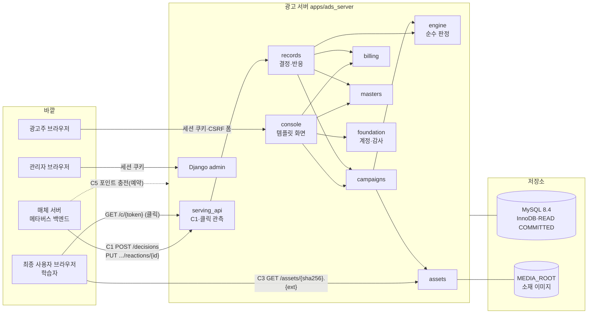
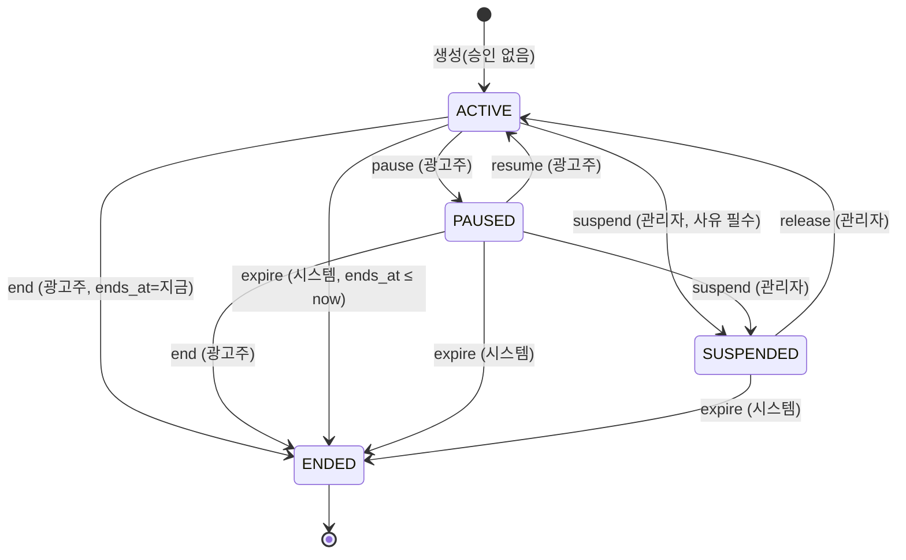
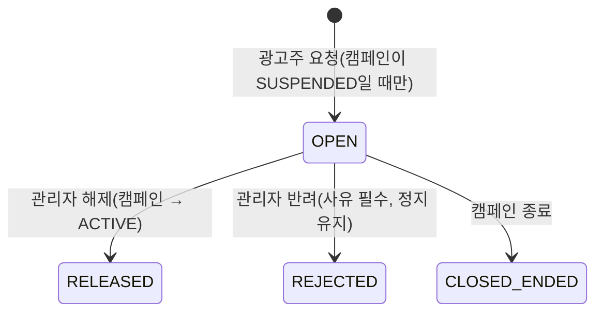
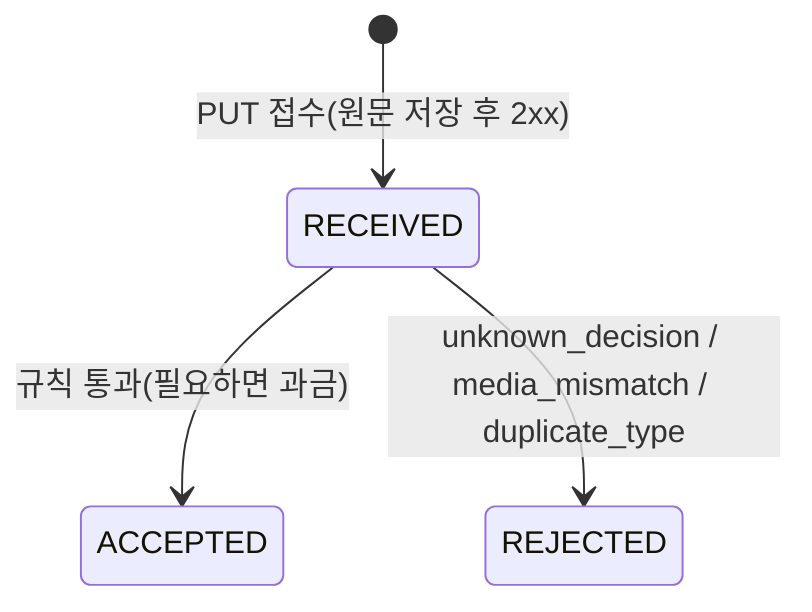
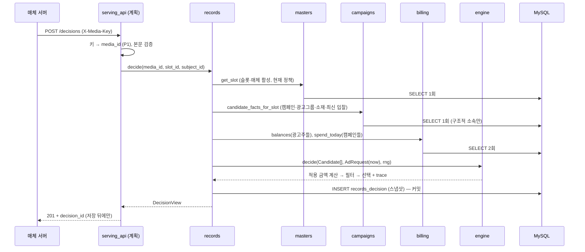
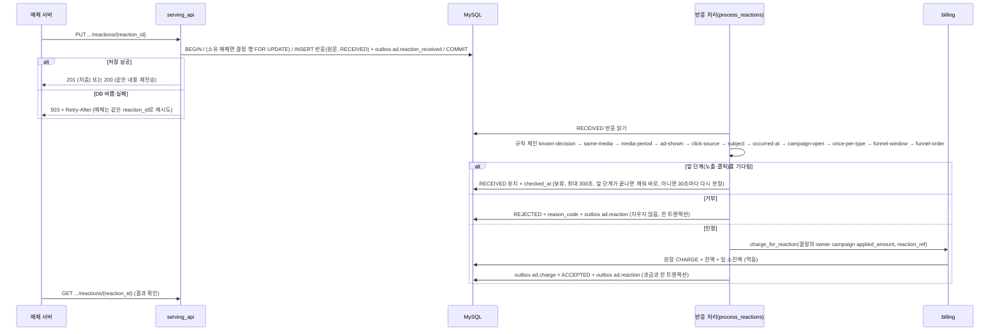

# 광고 서버 데이터 요구사항 문서 (DRD)

> Status: **정식 문서** (2026-10-08 `intake/`에서 `docs/ads-server/`로 승격). 광고 서버만 다룬다. `[제안]`·`[열림]` 항목은 확정되면 이 문서를 고친다.
> 관련 문서: [ads-server-design.md](ads-server-design.md) (설계), [implementation-plan.md](implementation-plan.md) (구현 계획), [threat-model.md](threat-model.md) (위협 모델), [contracts/](contracts/) (OpenAPI 계약)
> 기준일: 2026-10-08 · 기준 코드: Step 2 전체(C1 v1.1 포함, 2-11)까지 · 구현 위치: `apps/ads_server/`
> **PK 규칙(§3 R-2, 2026-10-08)은 코드에 적용됐다**(2026-10-08, 모델·마이그레이션 재생성). 적용 전 모양과의 차이는 §4.8에 기록으로 남겼다.
> 근거: 설계서 `docs/ads-server/ads-server-design.md`, 구현 계획 `implementation-plan.md`, 계약 `contracts/serving.openapi.yaml`(C1·C3), `contracts/console.openapi.yaml`(C6), 실제 모델 코드(`*/models.py`)
> 표기: **[구현]** 코드에 있음 · **[계획]** 구현 계획에 있고 아직 코드 없음 · **[제안]** 이 문서가 처음 제안함(동의 필요) · **[열림]** 정하지 못함

---

## 0. 한눈에 보기

| 항목 | 내용 |
|---|---|
| 목적 | 광고 서버가 **어떤 데이터를 어떤 모양으로 갖고, 바깥과 어떤 데이터를 주고받는지**를 한 문서로 고정한다. 구현·계약·파이프라인이 같은 기준을 쓰게 한다 |
| 범위 | 광고 서버의 저장 데이터(DB·파일), 서버 간 계약(C1~C6)의 데이터 모양, 내부 처리 흐름, 수명주기, 보안 분류, 팀 DRD와의 대응 |
| 범위 밖 | 매체 서버(메타버스)·데이터 파이프라인의 내부 데이터, 화면 설계, 인프라 구성 |
| 저장소 | **MySQL 8.4**(업무 데이터) + **로컬 파일**(소재 이미지). Step 2까지는 SQLite였고 Step DB의 DB-1(2026-10-09)에서 MySQL로 옮겼다. **MongoDB 8.0**(이벤트 로그 `ad_events`)은 DB-2에서 연결·컬렉션·색인을 준비했고, Step 4(2026-10-10)부터 결정·반응·과금 이벤트를 MySQL outbox에 쓰고 중계가 MongoDB로 옮긴다. Kafka·Spark는 서버가 감당하지 못할 때의 확장(§2.1) |
| 엔터티 | 구현 20개(계정·감사 3, 마스터 4, 운영 7, 지갑·원장·결정·반응 4, 파생 1, 이벤트 outbox 1 — Step 4) |
| 핵심 규칙 | **모든 PK는 UUIDv7, 자동 증가 없음**(예외: outbox의 이벤트 ID는 결정적 UUIDv5) · 자연 키는 업무 규칙용 유일 제약 · 시각은 UTC · 금액은 **정수 포인트** · 이력은 **추가 전용**(입찰·정책·원장·결정·감사) · 삭제 없음 · 판정 규칙은 한 곳(`engine`) |
| 먼저 볼 것 | §1.2 **광고 도메인은 이 문서가 팀 DRD보다 우선**. §10 열린 이슈, D-1~D-3(2-3)과 PK 규칙의 코드 적용(D-8)은 해결됨. 식별자 방식 차이(D-4)는 해결됨. 과금 이벤트의 결정 연결(D-6)은 Step 4에서 해결됨 |

---

## 1. 목적·범위·다른 문서와의 관계

### 1.1 왜 따로 쓰나

팀 DRD(`docs/requirements/data-requirements-document.md`)는 **플랫폼 전체의 표준 사전**(단어·용어·도메인)과 분석 계층(Bronze/Silver/Gold)의 엔터티를 정한다. 광고 서버는 설계 원칙상 **독립 서버이고 내부 모델 이름을 팀 DRD에 맞추지 않는다**(설계서 §3 독립성 규칙). 이름 대응은 **나가는 경계(C2 이벤트)에서만** 한다.

그래서 이 문서는 두 가지를 한다.

1. 광고 서버 **안쪽** 데이터의 실제 모양을 적는다(팀 DRD에는 없는 지갑·원장·감사·재검토 요청·결정 근거 등 포함).
2. 광고 서버가 **바깥과 주고받는** 데이터의 모양을 적고, 팀 DRD 이름과의 대응을 §9에 정리한다.

### 1.2 문서 우선순위

| 순위 | 문서 | 이 문서와 다를 때 |
|---:|---|---|
| 1 | 계약 파일(`contracts/*.openapi.yaml`) | **계약이 맞다.** 이 문서를 고친다. 단 계약과 구현이 어긋난 곳은 §10에 적고 결정한다 |
| 2 | 설계서(`ads-server-design.md`) | 설계서가 맞다. 이 문서는 설계를 데이터 관점으로 옮긴 것이다 |
| 3 | 코드(`apps/ads_server/*/models.py`) | 저장 모양의 **현재 사실**. 설계와 다르면 §10에 적는다 |
| 4 | 이 문서 | 위 셋에 없는 것(이벤트 페이로드 제안, 보존·분류, 대응표)의 원본 |

**팀 DRD와의 우선순위 [확정, 2026-10-07]**: 광고 도메인 데이터는 **이 문서가 팀 DRD보다 우선**한다. 팀 DRD의 광고 영역(E15–E17, E20–E25)은 광고 서버 설계가 나오기 전의 가정으로 작성된 Draft라서, 둘이 다르면 팀 DRD를 이 문서에 맞춰 고친다(§9.1). 단 이름 짓는 규칙(표준 단어·용어)은 팀 DRD의 것을 따르고, 내부 이름과의 변환은 C2 경계에서 한다.

---

## 2. 데이터 배치 개요

### 2.1 누가 무엇을 주고받나 (단계별)

단계마다 표를 따로 둔다. 뒤 단계의 행은 **계획이나 조건부 확장**이며 지금 확정된 구조가 아니다.

**V1 (지금 · MySQL 8.4 단일 노드. Step 2까지는 SQLite였음)**

| 계약 | 방향 | 상대 | 방식 | 상태 |
|---|---|---|---|---|
| C1 광고 요청·반응 보고 | 들어옴 | 매체 서버 | HTTPS(앞단 nginx에서 종단, 6-5) `/api/media/v1`, `X-Media-Key` | [구현], v1.1 진행 중 |
| C3 이미지 | 나감 | 학습자 브라우저 | `GET /assets/{sha256}.{ext}` | [구현] |
| 클릭 관측 | 들어옴 | 학습자 브라우저 | `GET /c/{token}` → 302 | [구현] 2-8 |
| 퍼널 집계·분석 | 내부 | 광고주 콘솔 | `records.api`가 조회할 때 계산 | [구현] 2-10 |
| C6 콘솔 | 들어옴 | 광고주·관리자 브라우저 | 세션, 템플릿 | Step 3 |
| C2 이벤트 내보내기 | — | — | **없음** | V1 범위 밖 |

**DB 전환 (Step DB: DB-1 MySQL 완료, DB-2 MongoDB 연결 로컬 완료) → Step 4**

| 계약 | 방향 | 상대 | 방식 | 상태 |
|---|---|---|---|---|
| C1·C3·클릭 | (V1과 같음) | | | 변경 없음 |
| 업무 데이터 | 내부 | — | MySQL(업무 데이터 + outbox, 한 트랜잭션) | [구현] DB-1(업무 데이터), Step 4-1(outbox) |
| C2 이벤트 | 나감 | 파이프라인 쪽(읽기) | outbox → 중계 → MongoDB `ad_events`(멱등). 이 컬렉션과 이벤트 스키마(§5.6)가 계약 면이고 MySQL 테이블은 읽게 하지 않는다 | [구현] Step 4-1(2026-10-10) |
| 검증·백필 | 내부 | 운영자 | NDJSON + manifest(checksum): `export_integrity`·`verify_ndjson` | [구현] Step 4-2(백필 대상 목록), Step 4-3(백필 실행·구간별 정합 manifest·구간 대조, 2026-10-10, §5.6·§5.9) |
| 퍼널 집계 | 내부 | 콘솔 | `records.api`(MySQL 조회) | 변경 없음 |

**확장 (서버가 감당하지 못할 때 · 판단 지표: 조회 시간·부하, 수치는 나중에)**

| 계약 | 방향 | 상대 | 방식 | 상태 |
|---|---|---|---|---|
| C2 이벤트 | 나감 | 파이프라인 쪽 | Debezium(outbox 라우터) → Kafka, 스키마 저장소 | 예정 |
| 분석 계층 | 파이프라인 | — | Spark → Delta Bronze/Silver/Gold(§2.3 대응 그대로) | 예정 |
| C4 Insight | 들어옴 | 파이프라인 쪽 | 집계 결과를 광고 서버로(`records.api` 안쪽 교체) | 예정, 방식 미정 |

**V1 내부 흐름**



### 2.2 저장소

| 저장소 | 담는 것 | 형식 | 상태 |
|---|---|---|---|
| 로컬 디렉터리(`MEDIA_ROOT`) | 소재 이미지(재인코딩된 바이트) | `<해시 앞 2자>/<sha256>.<jpg\|png>`, 임시 파일 → `os.replace`로 원자적 확정, 권한 0640 | [구현] |
| 정적 파일(`STATIC_ROOT`) | 화면 CSS·JS 등(데이터 아님) | `collectstatic` 결과. 운영에서도 Django가 WhiteNoise로 서빙한다(앞단 nginx는 통로만, 6-5e) | [구현] |
| MySQL 8.4 | 아래 §4의 모든 엔터티(계정·마스터·캠페인·입찰·지갑·원장·결정·반응 수신함), 세션, 로그인 잠금 기록 + **outbox**(같은 트랜잭션, P3) | InnoDB, UUIDv7 PK(§3 R-2), 격리 수준 `READ COMMITTED`, 커밋마다 로그를 디스크에(`innodb_flush_log_at_trx_commit=1`), `STRICT_ALL_TABLES`, 정렬 `utf8mb4_0900_as_cs` | [구현] DB-1(2026-10-09), outbox는 Step 4-1(2026-10-10). Step 2까지는 SQLite 파일(WAL·`synchronous=FULL`)이었다 |
| MongoDB `ad_events` | C2 이벤트 로그(중계가 outbox에서 옮겨 씀, 추가만) | `_id = event_id`, 멱등 저장. 컬렉션은 공통 봉투(`_id`·`event_name`·`schema_version`·`produced_at`·`payload`)가 없는 문서를 거부하고, 색인은 (`event_name`, `produced_at`)·(`payload.decision_id`, `produced_at`). 쓰기는 과반 확인(`w=majority`) | [구현] DB-2(연결·컬렉션·색인·상태 확인) · Step 4-1(중계가 쓰기, 2026-10-10) |
| NDJSON 파일 | manifest·검증·백필 대상 목록 **전용**(이벤트 통로 아님) | 한 줄 = 레코드 하나. **게시 = 내용 해시가 이름에 들어간 불변 데이터 파일(`<이름>.<SHA-256 앞 16자>.ndjson`) + manifest(`<이름>.manifest.json`, 현재 게시본을 가리키는 포인터)의 원자적 교체**. manifest에 데이터 파일 이름·SHA-256·행 수·`schema_version`·`source_kind`·`checkpoint`(범위 서술: 스냅샷 종류·시작 시각·훑은 행 수, 재개 위치 아님)·만든 시각. manifest가 가리키는 파일은 언제나 완결. 파일 종류: `ledger_check`·`event_gaps`·`event_delivery`(점검 결과) [구현]. 4-3 [구현]: `backfill_result`(백필 결과), `hop_source`·`hop_outbox`·`hop_mongo`(구간별 정합 manifest), `hop_report`(구간 대조 결과) | [구현] Step 4-2(2026-10-10, 외부 검토 보완 반영) |
| Kafka 토픽 | C2 이벤트(확장) | `ad.decision.v2` 등, 키 `decision_id` | 확장(조건부) |

**저장소를 고르는 기준 [확정, 2026-10-08, MySQL 전환 2026-10-09]**: Step 2까지는 **가장 저렴한 방식**(SQLite + 로컬 파일)을 썼고, Step 2(v1.1 포함)가 끝나면 바로 **Step DB**에서 MySQL·MongoDB로 옮긴 뒤 Step 3으로 간다(늦출수록 전환이 어렵다). 업무 데이터와 outbox는 한 트랜잭션이어야 하므로 MySQL에, 이벤트 로그는 MongoDB에 둔다(두 DB는 한 트랜잭션으로 묶을 수 없다). 이 문서의 데이터 구조 결정(PK·순번·잠금)은 **MySQL(InnoDB)·MongoDB에서도 성립하는지**로 판단한다(설계서 §10 "저장소 단계").

### 2.3 분석 계층 대응 [확정, 2026-10-08]

분석은 지금 광고 서버가 한다(설계서 §10 "분석 주체"). Bronze/Silver/Gold를 물리적으로 나누지 않고 **대응만** 둔다. Kafka·Spark가 붙으면 이 대응 그대로 Delta 메달리온으로 옮긴다.

| 계층 | 광고 서버에서 해당하는 것 |
|---|---|
| Bronze(원문) | MongoDB `ad_events`, 반응 원문(`records_reaction.raw`) |
| Silver(검증·판정 끝남) | MySQL의 결정, 판정된 반응(`ACCEPTED`/`REJECTED`), 원장 |
| Gold(집계) | `records.api` 퍼널 집계(조회 시점 계산) |

---

## 3. 공통 데이터 규칙

| # | 규칙 | 근거·강제 수단 |
|---|---|---|
| R-1 | **식별자는 UUID**(소문자 하이픈 표기). 모든 행은 UUID로 식별되고, 계약·이벤트·다른 모듈은 UUID로만 가리킨다 | 설계서 §4 [확정]. 형식이 틀린 ID는 "없는 것"과 같게 404(`foundation.parse_uuid`, `owned_or_404`) |
| R-2 | **PK 규칙** [확정, 2026-10-08]: ① **모든 테이블의 PK는 UUIDv7** ② **자동 증가 열은 두지 않는다** ③ 자연 키((광고그룹, `bid_version`), (슬롯, `policy_version`), (매체, 슬롯 이름) 등)는 식별자가 아니라 **업무 규칙을 지키는 유일 제약**으로 유지 ④ 확실한 순서가 필요한 곳은 **원장 하나**이고 `(지갑, seq)` 유일 제약으로 둔다(지갑 잠금 안에서 +1) ⑤ 그 밖의 정렬은 시각 열. **예외(Step 4)**: 이벤트 outbox의 PK `event_id`는 원천 행 ID와 이벤트 종류에서 결정적으로 만든 UUIDv5다(재처리·재전송에도 같은 값, 설계서 §10 "Step 4 이벤트 결정") | 자동 증가가 꼭 필요한 곳이 없다(정수 `id` 순서에 기대던 곳은 원장 점검·원장 커서·관리자 정렬뿐). 정수 PK는 DB 이관·병합 때 번호 충돌과 키 이중화(정수·UUID)를 만든다. MongoDB는 자동 증가가 없고 `_id`에 UUID를 쓴다. MySQL(InnoDB)은 PK가 데이터 정렬 기준이라 무작위 v4 대신 **시각이 앞에 오는 v7**(Python 3.14 `uuid.uuid7`, 같은 밀리초 안에서도 단조 증가)이 새 행을 뒤에 붙인다. 상세는 설계서 §10 "PK 규칙" |
| R-3 | **시각은 UTC**로 저장·계산·전송한다. 계약은 RFC 3339 `…Z`만 허용. KST는 화면 표시에서만 | 설계서 §3 [확정]. 서비스는 시간대 없는 값(naive)을 거부, `engine`은 UTC가 아니면 생성 단계에서 거부 |
| R-4 | **금액은 정수 포인트**, 0 이상, 최대 `2^53 − 1`(JSON 정수로 정확히 표현되는 한계) | 설계서 §10 [확정]. DB `CHECK` + 서비스 검증. 팀 DRD의 `DECIMAL(18,2)`와 다르다(§9) |
| R-5 | **추가 전용(append-only)**: 입찰 정책, 입찰, 원장, 결정, 감사 로그. INSERT만 허용하고 수정·삭제·같은 PK로 덮어쓰기·upsert를 막는다 | `foundation.AppendOnlyModel`(저장은 항상 `force_insert`, `update`·`delete`·`bulk_create(update_conflicts)` 거부). 정정은 반대 부호의 새 행 |
| R-6 | **삭제 기능이 없다.** 캠페인·광고그룹은 끄기(`status`·`enabled`)로 처리한다. 소재는 끄기가 없고(6-9b — 광고그룹을 끈다), 화면의 "삭제"는 보관(`archived_at`, 행은 남김, 6-9c)이다 | 결정·원장이 참조하는 이력을 지키기 위해. 앱 사이 FK는 `PROTECT` |
| R-7 | **문자열 입력**: 앞뒤 공백 제거·NFC 정규화, 제어·서식 문자(제로폭 공백 등) 금지, 길이 1~상한 | `foundation.clean_text`. 상한: 이름 100, 제목 200, 사유·메모 500 |
| R-8 | **코드 값은 대문자**(예 `ACTIVE`, `IMPRESSION`) | DB `choices` + 서비스 검증. 계약의 enum과 같은 값 |
| R-9 | **소유권**: 광고주 데이터는 소유자 기준으로만 조회한다. 남의 것·없는 것·형식이 틀린 ID는 모두 404 | `owned_or_404`. 위협 모델 T4 |
| R-10 | **판정 규칙은 한 곳**: 적용 금액·하한·종료 판정은 `engine` 순수 함수(`effect_of`, `is_expired`)에만 있다. 다른 곳은 값을 공급만 한다 | 소스 검사 테스트가 강제(`test_pricing_and_expiry_rules_are_defined_only_in_engine`) |
| R-11 | **감사는 변경과 같은 트랜잭션**에 남긴다. 비밀 키 이름(`password`, `token`, `key` 등)은 기록 전에 제거 | `record_audit`. "감사 없는 변경"이 남지 않게 |
| R-12 | **외부 JSON 입력 제한**: 본문 16 KiB(C1), 매체 `context` 직렬화 4 KiB·깊이 4, 직접 식별자 키 금지, 모든 숫자 ±(2^53−1)(정수·실수, 중첩 포함 — 밖이면 400, C1 1.3.0, 6-2c) | 계약 C1, `foundation.parse_json` |

---

## 4. 데이터 구조

### 4.1 ERD

```mermaid
erDiagram
    foundation_user ||--o| billing_wallet : "owner (1:1)"
    foundation_user ||--o{ campaigns_campaign : "owner"
    masters_media ||--o{ masters_slot : "media"
    masters_slot ||--o{ masters_bid_policy : "slot (버전)"
    masters_slot ||--o{ campaigns_ad_group_slot : "slot"
    campaigns_campaign ||--o{ campaigns_ad_group : "campaign"
    campaigns_campaign ||--o{ campaigns_review_request : "campaign"
    campaigns_ad_group ||--o{ campaigns_ad_group_slot : "ad_group"
    foundation_user ||--o{ campaigns_creative : "owner (소재 목록, 6-9c)"
    campaigns_ad_group ||--o{ campaigns_ad_group_creative : "ad_group (연결)"
    campaigns_creative ||--o{ campaigns_ad_group_creative : "creative (연결)"
    campaigns_creative |o--o{ campaigns_ad_group : "선택한 소재"
    campaigns_ad_group ||--o{ campaigns_bid : "ad_group (버전)"
    billing_wallet ||--o{ billing_ledger_entry : "wallet"
    masters_media ||--o{ masters_media_key : "media"
    masters_media ||--o{ masters_media_deactivation : "media (끈 기록)"
    campaigns_creative ||--o{ campaigns_creative_image : "creative (보유 파일)"
    foundation_user ||--o| campaigns_advertiser_quota : "owner (상한 잠금, 1:1)"

    foundation_user {
        uuid id PK
        string username UK
        string role "admin|advertiser"
        string nickname
        string class_label "반"
        string password "Argon2 해시"
        bool is_active
        datetime created_at
    }
    masters_media {
        uuid media_id PK
        string name UK
        bool is_active
    }
    masters_slot {
        uuid slot_id PK
        uuid media_id FK
        string name "매체 안에서 유일"
        string audience "individual·shared, 변경 불가"
        bool is_active
    }
    masters_bid_policy {
        uuid bid_policy_id PK
        uuid slot_id FK
        int policy_version "UK(slot, version)"
        int floor_amount
        int base_amount
        int cap_amount
        int impression_share "비율 %(6-10b)"
        int click_share
        int conversion_share
        uuid changed_by
        string reason
    }
    campaigns_campaign {
        uuid campaign_id PK
        uuid owner_id FK
        string name
        datetime starts_at
        datetime ends_at "NULL=무기한"
        int daily_budget
        string status
        string ended_from
        string request_key "UK, 캠페인 만들기 요청 멱등 키"
    }
    campaigns_ad_group {
        uuid ad_group_id PK
        uuid campaign_id FK
        bool enabled
        uuid creative_id FK "선택된 소재, NULL=없음"
        string request_key "UK, 광고 만들기 요청 멱등 키"
    }
    campaigns_ad_group_creative {
        uuid link_id PK
        uuid ad_group_id FK "UK(ad_group, creative)"
        uuid creative_id FK "추가 전용"
    }
    campaigns_ad_group_slot {
        uuid ad_group_slot_id PK
        uuid ad_group_id FK
        uuid slot_id FK "UK(ad_group, slot)"
    }
    campaigns_creative {
        uuid creative_id PK
        uuid owner_id FK "광고주 소유"
        datetime archived_at "NULL=보관 안 함"
        string title
        string redirect_url "https만"
        string image_name "sha256.ext"
    }
    campaigns_bid {
        uuid bid_id PK
        uuid ad_group_id FK
        int bid_version "UK(ad_group, version)"
        int amount
    }
    campaigns_review_request {
        uuid review_request_id PK
        uuid campaign_id FK
        string status "OPEN은 캠페인당 1개"
    }
    billing_wallet {
        uuid wallet_id PK
        uuid owner_id FK "UK"
        int balance "0 이상"
    }
    billing_ledger_entry {
        uuid entry_id PK
        uuid wallet_id FK
        int seq "UK(wallet, seq) 지갑 안 순서"
        string entry_type
        int amount "부호 있음"
        int balance_after
        string reaction_ref "UK, 과금 멱등 키"
    }
    billing_campaign_spend {
        uuid spend_id PK
        uuid campaign_id "UK(campaign, day)"
        date budget_day
        int spent "파생값"
    }
    records_decision {
        uuid decision_id PK
        uuid media_id
        uuid slot_id
        string audience "슬롯 성격 스냅샷"
        uuid campaign_id "스냅샷"
        uuid bid_id "선택된 입찰 버전 행"
        uuid bid_policy_id "판정에 쓴 정책 버전 행"
        int applied_amount "스냅샷"
        int impression_share "비율 스냅샷(6-10c)"
        int click_share
        int conversion_share
    }
    masters_media_key {
        uuid key_id PK
        uuid media_id FK
        string secret_hash "SHA-256, 평문 없음"
        datetime expires_at
        datetime revoked_at
        string request_key "UK, 발급 요청 멱등 키"
    }
    masters_media_deactivation {
        uuid deactivation_id PK
        uuid media_id FK
        datetime deactivated_at "추가만"
    }
    campaigns_creative_image {
        uuid creative_image_id PK
        uuid creative_id FK "UK(creative, image_name)"
        string image_name
        int image_bytes
    }
    campaigns_advertiser_quota {
        uuid quota_id PK
        uuid owner_id FK "UK, 잠금 전용"
    }
    foundation_audit_log {
        uuid log_id PK
        uuid actor_id
        string action
        json detail
    }
```



`records_decision`·`billing_campaign_spend`·`billing_ledger_entry.campaign_id`는 **다른 모듈의 행을 FK가 아닌 UUID 값으로** 가리킨다(점선 관계, 그림에서 생략). 결정은 과거 사실이라 가리키는 대상이 바뀌거나 사라져도 그대로여야 하고, `billing`은 `campaigns`를 import하지 않는다(설계서 §6 R1).

### 4.2 엔터티 목록

| # | 엔터티(테이블) | 모듈 | 구분 | 쓰는 주체 | 행이 늘어나는 때 | 상태 |
|---|---|---|---|---|---|---|
| A1 | 사용자 `foundation_user` | foundation | 계정 | 가입(광고주), 서버 명령(관리자) | 가입 | [구현] |
| A2 | ~~가입 시도 `foundation_signup_attempt`~~ | foundation | 보안 기록 | — | — | **[제거]** 6-5b(가입 시도 제한을 두지 않는다, 마이그레이션 `foundation/0003`) |
| A3 | 감사 로그 `foundation_audit_log` | foundation | 감사(추가 전용) | 모든 서비스 | 변경·인증 사건마다 | [구현] |
| M1 | 매체 `masters_media` | masters | 마스터 | 관리자 | 매체 등록 | [구현] |
| M2 | 게재 위치 `masters_slot` | masters | 마스터 | 관리자 | 슬롯 등록 | [구현] |
| M3 | 입찰 정책 `masters_bid_policy` | masters | 마스터(추가 전용 버전) | 관리자 | 정책 변경마다 | [구현] |
| M4 | 매체 키 `masters_media_key` | masters | 보안 | 관리자(서버 명령) | 키 발급·교체 | [구현] 2-2 |
| M5 | 매체 비활성화 기록 `masters_media_deactivation` | masters | 기록(추가 전용) | 관리자(매체 끄기) | 켜져 있던 매체를 끌 때마다 | [구현] 6-1a `42de743` |
| O1 | 캠페인 `campaigns_campaign` | campaigns | 운영 | 광고주(상태는 관리자·시스템도) | 캠페인 생성 | [구현] |
| O2 | 광고그룹 `campaigns_ad_group` | campaigns | 운영 | 광고주 | 광고그룹 생성 | [구현] |
| O3 | 광고그룹-슬롯 `campaigns_ad_group_slot` | campaigns | 운영(연결) | 광고주 | 슬롯 선택·교체 | [구현] |
| O4 | 소재 `campaigns_creative` | campaigns | 운영 | 광고주 | 소재 등록 | [구현] |
| O5 | 입찰 `campaigns_bid` | campaigns | 운영(추가 전용 버전) | 광고주 | 입찰 변경마다 | [구현] |
| O6 | 재검토 요청 `campaigns_review_request` | campaigns | 운영 | 광고주(생성), 관리자·시스템(닫기) | 요청마다 | [구현] |
| O7 | 소재 이미지 보유 `campaigns_creative_image` | campaigns | 운영(추가 전용) | 소재 등록·이미지 교체 | 이미지가 바뀔 때마다 | [구현] |
| O8 | 광고주 상한 잠금 `campaigns_advertiser_quota` | campaigns | 잠금 전용(값 없음) | 만들기·이미지 교체 | 광고주가 처음 만들 때 | [구현] `7fdc76f` |
| B1 | 지갑 `billing_wallet` | billing | 운영 | 가입 흐름 | 광고주 가입 | [구현] |
| B2 | 원장 `billing_ledger_entry` | billing | 기록(추가 전용) | 가입 지급·과금·관리자 조정 | 포인트가 움직일 때마다 | [구현] |
| B3 | 캠페인 일 소진액 `billing_campaign_spend` | billing | **파생값**(원장에서 재계산) | 과금 | 캠페인·예산 일당 1행 | [구현] |
| R1 | 결정 `records_decision` | records | 기록(추가 전용 스냅샷) | 광고 요청 | **광고 요청마다**(광고 없음 포함) | [구현] |
| P2 | 반응 | records | 기록(inbox, 수신 후 상태만 바뀜) | 매체 보고·처리 작업 | **반응 보고마다** | [구현] 수신(2-4)·처리(2-5)·판정 확장(2-9) |
| P3 | 이벤트 outbox `events_outbox` | events | 전달 대기열 | 결정·접수·판정·과금과 같은 트랜잭션 | 이벤트마다 | [구현] Step 4-1(2026-10-10) |
| — | 세션·로그인 잠금 | Django·django-axes | 프레임워크 | 로그인 | 로그인·실패마다 | [구현] 라이브러리 관리 |

### 4.3 엔터티별 컬럼

표기: **N** = NOT NULL, **Y** = NULL 허용. 타입은 Django 필드 기준(DB 저장 형태는 괄호).

#### A1. 사용자 `foundation_user` [구현]

> 아래 모든 표에서 PK 열은 **UUIDv7**이다(R-2). 코드도 같다(§4.8).
>
> **키·제약 열은 실제 MySQL 구현(물리)을 적는다.** MySQL은 조건부 유일 제약(`… WHERE 조건`)을 만들지 않는다(Django 경고 W036). 그래서 "캠페인당 대기 요청 하나" 같은 **논리 규칙**은 둘 중 하나로 구현한다: ① 규칙에 해당하는 줄에만 값을 채우는 **NULL 허용 일반 `UNIQUE`**(NULL끼리는 서로 다른 값 — `reaction_ref`·`adjust_key`·`accepted_key`) ② DB가 계산해 저장하는 열(`GeneratedField`, `db_persist`)에 해당 줄만 값을 두고 그 위에 일반 `UNIQUE`(`open_campaign`·`signup_grant_wallet`). 논리 규칙은 설명 열과 §4.4 무결성 규칙 표에 적는다.

광고주와 관리자가 쓰는 계정 하나. 역할로 화면이 나뉜다. 이메일·실명·전화는 받지 않는다(설계서 §5.1).

| 컬럼 | 타입 | NULL | 키·제약 | 설명 |
|---|---|:---:|---|---|
| `id` | UUID | N | PK | |
| `username` | 문자 30 | N | UNIQUE | 로그인 아이디. `[a-z0-9_]{4,20}` |
| `password` | 문자 | N | | **Argon2 해시만**. 원문은 어디에도 저장·기록하지 않는다. 원문 길이 **10~128자** — 최소·최대 모두 비밀번호 검증기(최대는 `MaximumLengthValidator`, `89c8a38`)가 서비스와 `changepassword` 명령까지 지키며(비대화형 `createsuperuser`는 Django가 검증기를 돌리지 않는다 — 운영자 전용 경로), C6 `SignupRequest.password`·`PasswordChange.new_password`의 `minLength`·`maxLength`와 같다 |
| `role` | 문자 20 | N | `admin`·`advertiser` | 가입은 항상 `advertiser`. 관리자는 서버 명령으로만 만든다. 사용자 관리 화면에서도 추가·변경할 수 없다 |
| `nickname` | 문자 20 | N | | 2~20자 |
| `class_label` | 문자 30 | N | | "반". 표시용 자유 입력, 로직에 쓰지 않는다 |
| `is_active` | 불리언 | N | | 관리자가 비활성화할 수 있다(사유 필수). 거짓이면 로그인·세션·광고 송출·공개 이미지가 멈춘다(§6) |
| `is_superuser` | 불리언 | N | | 관리자만 참. 계정을 만드는 곳(매니저)이 역할과 함께 정하고 사용자 관리 화면에서 바꿀 수 없다 [구현 `ab5bc59`] |
| `session_epoch` | 양의 정수 | N | 기본 0 | **세션 폐기 버전.** 비활성화할 때 올라가고 세션 검증 값에 들어가, 그 전의 로그인 세션은 다시 활성화해도 돌아오지 않는다 [구현 `ab7a607`] |
| `last_login` | 시각 | Y | | Django 기본 |
| `created_at` | 시각 | N | | |

#### A2. ~~가입 시도 `foundation_signup_attempt`~~ [제거 2026-10-13, Step 6-5b]

IP당 시간당 가입 시도 수 제한(기본 5회)용이었다. 같은 내부망(강의실 NAT)에서는 모두 같은 IP로 보여 정상 사용자를 막아, **가입 시도 제한을 두지 않기로** 하고 표를 지웠다(마이그레이션 `foundation/0003_delete_signupattempt`, 하루치 기록·개인정보 없음 — 설계서 §10 "가입 시도 제한"). 번호 A2는 비워 둔다. 아래는 지우기 전의 모양이다.

| 컬럼 | 타입 | NULL | 키·제약 | 설명 |
|---|---|:---:|---|---|
| `attempt_id` | UUID | N | PK | |
| `ip` | 문자 45 | N | 인덱스(ip, created_at) | IPv6 최대 길이. 신뢰 프록시 수 설정에 따라 판정 |
| `created_at` | 시각 | N | 인덱스 | 오래된 행은 가입 처리 중 정리 |

#### A3. 감사 로그 `foundation_audit_log` [구현, 추가 전용]

누가·언제·무엇을. 관리자 행위와 광고주의 주요 변경, 인증 사건을 남긴다.

| 컬럼 | 타입 | NULL | 키·제약 | 설명 |
|---|---|:---:|---|---|
| `log_id` | UUID | N | PK | 시각 순서(v7) |
| `actor_id` | UUID | Y | 인덱스 | **FK 아님**(사용자가 바뀌어도 기록은 그대로). 시스템 작업은 NULL |
| `actor_username` | 문자 30 | N | | 그 시점의 아이디 |
| `action` | 문자 64 | N | 인덱스 | 예: `account.signup`, `auth.login_failed`, `masters.policy_added`, `campaign.suspended`, `bid.added`, `billing.adjusted`, `campaign.expired` |
| `target_type`, `target_id` | 문자 64 | N | | 대상(예 `campaigns.campaign` + UUID) |
| `detail` | JSON | N | | **비밀 키 이름은 제거**, 문자열 500자, 전체 4,000자 초과 시 `{"truncated": true}` |
| `ip` | 문자 45 | N | | 요청이 없는 서비스 호출이면 빈 값 |
| `request_id` | 문자 36 | N | | 요청 ID(요청 없이 호출돼도 로깅 컨텍스트에서 채움) |
| `created_at` | 시각 | N | 인덱스 | |

#### M1. 매체 `masters_media` [구현]

광고를 내보내는 서비스(예: 메타버스). 광고 서버는 매체의 내부(사용자·강의실)를 모른다.

| 컬럼 | 타입 | NULL | 키·제약 | 설명 |
|---|---|:---:|---|---|
| `media_id` | UUID | N | PK | C1에서는 본문이 아니라 **매체 키로 식별**한다 |
| `name` | 문자 100 | N | UNIQUE | |
| `is_active` | 불리언 | N | | 꺼지면 그 매체의 슬롯도 쓸 수 없다. 켜져 있던 매체를 끌 때마다 M5에 한 줄 남는다 — 그 전에 만든 결정의 반응은 다시 켠 뒤에 와도 인정되지 않는다(`media_deactivated`, 6-1b) |
| `created_at` | 시각 | N | | |

#### M2. 게재 위치(슬롯) `masters_slot` [구현]

광고가 놓이는 자리. 과금 방식은 M3 입찰 정책 버전의 **반응별 비율**이다(6-10 — 과금 단위 열은 6-10d에 지웠다, 마이그레이션 `masters/0007`).

| 컬럼 | 타입 | NULL | 키·제약 | 설명 |
|---|---|:---:|---|---|
| `slot_id` | UUID | N | PK | C1 요청은 이 값으로 슬롯을 지정한다 |
| `media_id` | UUID | N | FK→M1 `PROTECT` | |
| `name` | 문자 100 | N | UNIQUE(media, name) | 사람용 이름. **식별에 쓰지 않는다** |
| `audience` | 코드 | N | `individual`·`shared`, **변경 시 거부**, 기본값 없음(만드는 쪽이 정한다) | 슬롯 성격 [구현 2-7]. `individual` = 결정 하나를 한 사람이 본다, `shared` = 여러 사람이 같은 광고를 본다. 타기팅이 아니다 |
| `is_active` | 불리언 | N | | |
| `created_at` | 시각 | N | | |

슬롯은 **항상 현재 정책을 가진다**: `create_slot`이 슬롯과 정책 버전 1을 한 트랜잭션에 만든다.

#### M3. 입찰 정책 `masters_bid_policy` [구현, 추가 전용 버전]

슬롯별 노출 범위. 현재 정책 = 슬롯의 최대 `policy_version`.

| 컬럼 | 타입 | NULL | 키·제약 | 설명 |
|---|---|:---:|---|---|
| `bid_policy_id` | UUID | N | PK | 버전 행 하나의 식별자. 결정·이벤트가 이것으로 가리킨다 |
| `slot_id` | UUID | N | FK→M2 `PROTECT`, UNIQUE(slot, policy_version) | |
| `policy_version` | 정수 | N | 슬롯별 1부터 | 변경은 새 행. `expected_version`이 틀리면 거절(낙관적 잠금) |
| `floor_amount` | 정수 | N | `CHECK 0 < floor ≤ base ≤ cap ≤ 2^53−1`, `CHECK floor ≥ 100`(6-10c) | 하한. 미만이면 노출 안 됨. 최소 100 — 비율 ≥ 1% 와 함께 반응 하나의 과금(내림)이 0 이 되지 않게 한다 |
| `base_amount` | 정수 | N | 〃 | 기준가. 입찰 화면 기본값(V1 선택 알고리즘은 쓰지 않음) |
| `cap_amount` | 정수 | N | 〃 | 상한. 초과 입찰은 상한으로 적용 |
| `impression_share`·`click_share`·`conversion_share` | 작은 정수 | N | `CHECK` 각각 1~98, `CHECK` 합 = 100 | 반응 유형별 과금 비율(%) [구현 6-10b]. 반응 하나의 과금 = 내림(적용 금액 × 그 유형의 % ÷ 100) — 과금 전환은 6-10c(설계서 §10 "구성별 반응 비율 과금"). 마이그레이션 `masters/0005`는 빈 DB 전제(옛 행 이전 없음, 구현 계획 §8.4.11 K1) |
| `changed_by` | UUID | N | FK 아님 | 바꾼 관리자 |
| `changed_at` | 시각 | N | | |
| `reason` | 문자 200 | N | | 사유 필수. 단 슬롯을 만들 때(버전 1)는 비워도 되고 "없음"이 들어간다(6-8c) — 가격을 바꾸는 새 버전·일괄 변경은 필수 |

#### M4. 매체 키 `masters_media_key` [구현, 2-2]

매체 서버가 `X-Media-Key`로 보내는 키. **평문은 저장하지 않는다** — 발급할 때 한 번만 돌려준다. 키 형식은 `<key_id 32자 16진>.<token_urlsafe(32)>`이고, `key_id`로 행을 찾아 비밀의 SHA-256을 상수 시간으로 비교한다(비밀이 256비트 무작위라 느린 해시가 필요 없다).

| 컬럼 | 타입 | NULL | 키·제약 | 설명 |
|---|---|:---:|---|---|
| `key_id` | UUID | N | PK | 공개 식별자(키 문자열의 앞부분) |
| `media_id` | UUID | N | FK→M1 `PROTECT` | 매체마다 여러 키가 동시에 유효할 수 있다(교체 유예) |
| `secret_hash` | 문자 64 | N | | 비밀의 SHA-256(16진) |
| `label` | 문자 100 | N | | 사람용 메모 |
| `created_at` | 시각 | N | | |
| `expires_at` | 시각 | Y | | 교체 유예가 끝나는 시각. NULL이면 계속 유효 |
| `revoked_at` | 시각 | Y | | 즉시 폐기 |
| `request_key` | 문자 64 | Y | **UNIQUE**(NULL 제외) | 발급 요청의 멱등 키(화면 폼 하나 = 키 하나). 같은 요청 키로는 다시 발급하지 않고 409와 키 식별자를 돌려준다(평문은 다시 보일 수 없음) [구현 `1e72031`] |

#### M5. 매체 비활성화 기록 `masters_media_deactivation` [구현, 6-1a `42de743`]

매체를 끈 시각. 반응 판정의 규칙 `media-period`가 "결정 뒤·접수 전에 그 매체가 꺼진 적이 있나"를 이 기록으로 본다(설계서 §10 "반응의 401·403 뒤 재전송과 매체 비활성화"). **추가만** 하고, 다시 켜도 지우지 않는다. 관리자 화면은 읽기 전용이다. 마이그레이션 `masters/0004`.

| 컬럼 | 타입 | NULL | 키·제약 | 설명 |
|---|---|:---:|---|---|
| `deactivation_id` | UUID | N | PK(UUIDv7) | |
| `media_id` | UUID | N | FK→M1 `PROTECT`, 색인 `(media, deactivated_at)` | |
| `deactivated_at` | 시각 | N | | 끈 시각(서버 시계) |

- **쓰는 곳은 하나**: `set_media_active(False)`가 **켜져 있던 매체를 실제로 끌 때만** 같은 트랜잭션에서 한 줄 더한다. 조건부 UPDATE(`is_active=True`인 행만)라 두 관리자가 동시에 꺼도 한 줄이고, 이미 꺼진 매체를 다시 끄거나 켜면 기록하지 않는다.
- **읽는 곳은 하나**: `masters.api.first_deactivation(매체, after, until)` = (after, until] 안의 가장 이른 비활성화 시각(없으면 `None`). 판정은 (결정 시각, 접수 시각]으로 부른다 — 결정과 같은 시각에 끈 것은 결정 전, 접수와 같은 시각에 끈 것은 접수 전으로 본다.

#### O1. 캠페인 `campaigns_campaign` [구현]

광고주가 성과를 묶어 보는 단위. 기간·일예산·상태를 가진다.

| 컬럼 | 타입 | NULL | 키·제약 | 설명 |
|---|---|:---:|---|---|
| `campaign_id` | UUID | N | PK | |
| `owner_id` | UUID | N | FK→A1 `PROTECT` | 광고주 |
| `name` | 문자 100 | N | | |
| `starts_at` | 시각 | N | | |
| `ends_at` | 시각 | Y | `CHECK ends_at IS NULL OR ends_at ≥ starts_at` | **종료 시각(미포함)**. NULL이면 무기한. 조기 종료 시 현재로 확정 |
| `daily_budget` | 정수 | N | `CHECK 0 < x ≤ 2^53−1` | 일예산(소프트 한도) |
| `status` | 코드 | N | `ACTIVE`·`PAUSED`·`SUSPENDED`·`ENDED`, 인덱스(status, ends_at) | **쓰는 곳은 `transitions.py` 뿐**(§4.5) |
| `ended_from` | 코드 | Y | | `ENDED` 직전 상태(중단된 채 끝났는지 알 수 있다) |
| `suspended_reason` | 문자 500 | N | | 관리자 중단 사유 |
| `suspended_at` | 시각 | Y | | |
| `request_key` | 문자 64 | Y | **UNIQUE**(NULL 제외) | **캠페인 만들기**의 멱등 키(화면 폼 하나 = 캠페인 하나, 6-9d — 그 전에는 캠페인까지 한 번에 만들던 광고 만들기의 키). 같은 키로는 다시 만들지 않고 처음 만든 캠페인을 돌려준다. 키 없이 만든 캠페인은 NULL [구현 `b61112a`, 뜻 바뀜 6-9d] |
| `created_at`, `updated_at` | 시각 | N | | |

#### O2. 광고그룹 `campaigns_ad_group` [구현]

입찰·게재 위치를 묶는 단위(화면의 "광고"). 아무 게재 위치나 함께 고른다 — 과금 단위 열은 6-10d에 지웠다(마이그레이션 `campaigns/0008`).

| 컬럼 | 타입 | NULL | 키·제약 | 설명 |
|---|---|:---:|---|---|
| `ad_group_id` | UUID | N | PK | |
| `campaign_id` | UUID | N | FK→O1 `PROTECT` | |
| `name` | 문자 100 | N | | |
| `enabled` | 불리언 | N | | 광고주가 켜고 끈다 |
| `created_at` | 시각 | N | | |
| `updated_at` | 시각 | N | | 마지막 변경(이름·게재 위치·켜기/끄기·소재 선택). 화면이 본 값과 대조해 옛 폼이 그 사이의 변경을 덮지 않게(`expected_updated_at`) [구현 `7fdc76f`] |
| `creative_id` | UUID | Y | FK→O4 `PROTECT` | **선택된 소재** — 결정에 나가는 것. O9에 연결된 소재 중에서만 고른다(서비스). 없으면 후보가 아니다 [구현 6-9c] |
| `request_key` | 문자 64 | Y | UNIQUE | **광고 만들기**의 멱등 키(이미 있는 캠페인에 광고 만들기 폼 하나 = 광고그룹 하나, 두 번 눌러도 하나) [구현 6-9c, 화면 6-9d] |

#### O3. 광고그룹-슬롯 `campaigns_ad_group_slot` [구현]

| 컬럼 | 타입 | NULL | 키·제약 | 설명 |
|---|---|:---:|---|---|
| `ad_group_slot_id` | UUID | N | PK | |
| `ad_group_id` | UUID | N | FK→O2 `CASCADE`, UNIQUE(ad_group, slot) | |
| `slot_id` | UUID | N | FK→M2 `PROTECT` | 활성 슬롯·활성 매체이고 단위가 같을 때만 저장 |

슬롯 목록을 바꾸면 이 연결 행이 교체된다(이력 없음). 과거 어느 슬롯에 나갔는지는 **결정(R1)의 `slot_id`가 기록**한다.

#### O4. 소재 `campaigns_creative` [구현]

| 컬럼 | 타입 | NULL | 키·제약 | 설명 |
|---|---|:---:|---|---|
| `creative_id` | UUID | N | PK | C1 응답의 `creative_id` |
| `owner_id` | UUID | N | FK→A1 `PROTECT` | **광고주 소유 목록**(6-9c — 그 전에는 광고그룹 소속 `ad_group_id`, 광고그룹당 1개). 광고그룹에는 O9로 연결한다 |
| `archived_at` | 시각 | Y | | 보관(화면의 "삭제", 6-9c). 끝나지 않은 캠페인의 광고그룹에 연결돼 있으면 보관할 수 없다. 보관한 소재는 개수 상한에서 빠지고 이미지 보유량(O7)에는 남는다 |
| `title` | 문자 200 | N | | **신뢰할 수 없는 값**(매체가 이스케이프) |
| `redirect_url` | 문자 2048 | N | | `https`만, 사용자 정보(`user:pw@`)·공백 금지 |
| `image_name` | 문자 80 | N | 인덱스 | `<sha256>.<jpg\|png>`. 파일은 §4.6 |
| `image_bytes` | 정수 | N | | 업로드 총량 쿼터 계산용 |
| `created_at`, `updated_at` | 시각 | N | | |

이미지를 교체하면 `image_name`이 바뀌고 **이전 파일은 지우지 않는다**(과거 결정이 가리킬 수 있다).

#### O9. 광고그룹-소재 연결 `campaigns_ad_group_creative` [구현 6-9c, 추가 전용]

광고그룹에 연결한 소재. **끊지 않는다** — 연결 기록이 ① 보관 가능 여부(끝나지 않은 캠페인의 광고그룹에 연결돼 있으면 불가) ② C3 서빙 가능 여부(연결된 적 있는 광고그룹의 캠페인이 살아 있으면 공개 — 선택을 바꿔도 이전 결정의 이미지가 열림)의 근거다. 선택은 O2의 `creative_id`.

| 컬럼 | 타입 | NULL | 키·제약 | 설명 |
|---|---|:---:|---|---|
| `link_id` | UUID | N | PK | |
| `ad_group_id` | UUID | N | FK→O2 `PROTECT`, UNIQUE(ad_group, creative) | |
| `creative_id` | UUID | N | FK→O4 `PROTECT` | 같은 광고주의 보관하지 않은 소재만 |
| `linked_at` | 시각 | N | | 운영 모니터링의 마지막 변경에 들어간다 |

#### O5. 입찰 `campaigns_bid` [구현, 추가 전용 버전]

| 컬럼 | 타입 | NULL | 키·제약 | 설명 |
|---|---|:---:|---|---|
| `bid_id` | UUID | N | PK | 버전 행 하나의 식별자. 결정·이벤트가 이것으로 가리킨다 |
| `ad_group_id` | UUID | N | FK→O2 `PROTECT`, UNIQUE(ad_group, bid_version) | |
| `bid_version` | 정수 | N | 광고그룹별 1부터 | 현재 입찰 = 최대 버전. `expected_version`(첫 입찰은 null)이 틀리면 거절 |
| `amount` | 정수 | N | `CHECK 0 < x ≤ 2^53−1` | **하한 미만·상한 초과도 저장**한다. 적용 금액은 선택 시점에 계산 |
| `created_by` | UUID | N | FK 아님 | |
| `created_at` | 시각 | N | | 기록용. 현재 입찰의 기준이 아니다 |

#### O6. 재검토 요청 `campaigns_review_request` [구현]

관리자가 중단한 캠페인을 광고주가 고친 뒤 다시 봐 달라는 요청.

| 컬럼 | 타입 | NULL | 키·제약 | 설명 |
|---|---|:---:|---|---|
| `review_request_id` | UUID | N | PK | |
| `campaign_id` | UUID | N | FK→O1 `PROTECT` | **캠페인당 대기(`OPEN`) 요청은 하나**(논리 규칙 — 아래 `open_campaign`의 `UNIQUE`가 지킨다) |
| `message` | 문자 500 | N | | 광고주 메모(선택, 빈 값 가능) |
| `status` | 코드 | N | `OPEN`·`RELEASED`·`REJECTED`·`CLOSED_ENDED` | §4.5 |
| `response_note` | 문자 500 | N | | 반려 사유 등 |
| `created_at` | 시각 | N | | |
| `closed_at` | 시각 | Y | | |
| `open_campaign` | UUID | Y | **UNIQUE**, DB 계산 열(`GeneratedField`, `db_persist`) | `status = 'OPEN'`이면 `campaign_id`, 그 밖에는 NULL. 닫히면 DB가 비우므로 상태를 바꾸는 코드는 이 열을 다루지 않는다. 마이그레이션 `campaigns 0003`(DB-1b) |

#### O7. 소재 이미지 보유 `campaigns_creative_image` [구현, 추가 전용]

소재가 **지금까지 보유한 이미지 파일**(현재 + 교체된 과거분). 이미지를 교체해도 이전 파일은 지우지 않으므로(과거 결정이 URL을 가리킴) 이 관계로 ① 광고주별 **보유 총량 쿼터**(교체를 반복해 쿼터를 우회하지 못하게 — 보관한 소재도 센다, 6-9c) ② **C3 서빙 가능 여부**(교체 후에도 과거 결정의 이미지가 열림, 6-9c부터 O9 연결 기준)를 판단한다. `campaigns_creative.image_name`은 그중 현재 것을 가리킨다.

| 컬럼 | 타입 | NULL | 키·제약 | 설명 |
|---|---|:---:|---|---|
| `creative_image_id` | UUID | N | PK | |
| `creative_id` | UUID | N | FK→O4 `PROTECT`, UNIQUE(creative, image_name) | |
| `image_name` | 문자 80 | N | 인덱스 | `<sha256>.<ext>` |
| `image_bytes` | 정수 | N | | 쿼터 계산용 |
| `created_at` | 시각 | N | | |

#### O8. 광고주 상한 잠금 `campaigns_advertiser_quota` [구현 `7fdc76f`, 잠금 전용]

광고주 전체 상한(캠페인·광고그룹·소재 수, 이미지 보유량)을 지키는 **잠금 행**. **값을 담지 않는다** — 수는 이 행을 잠근 안에서 센다. 캠페인·광고그룹·소재 만들기와 이미지 교체가 **가장 먼저** 잠근다(그다음 캠페인 → 광고그룹 → 소재. 목록에만 올리는 소재·이미지 교체는 광고주 → 소재, 설계 §10 "캠페인 행 잠금 규약"). 보관한 소재는 개수에서 빠지고 이미지 보유량에는 남는다(6-9c). **처음 쓸 때 만든다**(동시에 처음 만들면 한쪽은 유일 제약에서 기다렸다가 있는 행을 읽는다). 사용자 행 대신 따로 두는 것은 인증·계정 경로와 잠금 순서를 섞지 않기 위해서다.

| 컬럼 | 타입 | NULL | 키·제약 | 설명 |
|---|---|:---:|---|---|
| `quota_id` | UUID | N | PK | |
| `owner_id` | UUID | N | FK→A1 `PROTECT`, UNIQUE | 광고주 하나에 행 하나 |
| `created_at` | 시각 | N | | |

#### B1. 지갑 `billing_wallet` [구현]

| 컬럼 | 타입 | NULL | 키·제약 | 설명 |
|---|---|:---:|---|---|
| `wallet_id` | UUID | N | PK | |
| `owner_id` | UUID | N | FK→A1 `PROTECT`, UNIQUE | 광고주당 하나 |
| `balance` | 정수 | N | `CHECK 0 ≤ x ≤ 2^53−1` | **원장 합계와 항상 같다**(`check_ledger`로 확인) |
| `created_at` | 시각 | N | | |

#### B2. 원장 `billing_ledger_entry` [구현, 추가 전용]

포인트가 움직인 모든 기록. 잔액은 이것의 합계다.

| 컬럼 | 타입 | NULL | 키·제약 | 설명 |
|---|---|:---:|---|---|
| `entry_id` | UUID | N | PK | |
| `wallet_id` | UUID | N | FK→B1 `PROTECT` | |
| `seq` | 정수 | N | **UNIQUE(wallet, seq)**, 1부터 | **지갑 안의 순서.** 과금·조정·지급이 이미 잡는 지갑 잠금 안에서 +1. `balance_after` 연속성 점검과 원장 목록 커서의 기준 |
| `entry_type` | 코드 | N | `SIGNUP_GRANT`·`CHARGE`·`ADMIN_ADJUST`·`TOPUP`(예약) | |
| `amount` | 정수(부호) | N | 유형별 부호 `CHECK`(아래) | |
| `balance_after` | 정수 | N | ≥ 0 | 이 줄을 반영한 뒤의 잔액 |
| `campaign_id` | UUID | Y | FK 아님 | 과금일 때 |
| `reaction_ref` | 문자 100 | Y | **UNIQUE**(NULL 허용 — NULL끼리는 서로 다름), `CHARGE`만 허용(`CHECK`) | 과금 멱등 키 `<media_id>:<reaction_id>` — `records.processing.reaction_ref`가 만드는 **표준 표기(UUID 소문자, 하이픈 있음)일 때만 그 반응의 키**다(`parse_reaction_ref`). 같은 UUID라도 대문자·하이픈 없음·중괄호 같은 다른 표기면 원본 구간에 놓을 수 없는 과금으로 세고(§5.6 `checkpoint.unresolved_charges`), 백필도 해석 불가로 남긴다 [`13f3bc2`] |
| `charge_policy` | 문자 64 | N | | 과금 정책 이름(지금 `share/v1`, 6-10c 전에는 `by-unit/v1`) |
| `shortfall` | 정수 | N | ≥ 0 | 잔액이 모자라 못 받은 금액 |
| `note` | 문자 200 | N | | 조정 사유 등 |
| `adjust_key` | 문자 64 | Y | **UNIQUE**(NULL 제외), `ADMIN_ADJUST`만 허용(`CHECK`) | 관리자 조정의 멱등 키(화면 폼 하나 = 조정 하나). 같은 키는 한 번만 반영하고 다른 내용이면 거절 [구현 `ab7a607`] |
| `signup_grant_wallet` | UUID | Y | **UNIQUE**, DB 계산 열(`GeneratedField`, `db_persist`) | `entry_type = 'SIGNUP_GRANT'`이면 `wallet_id`, 그 밖에는 NULL — **가입 지급은 지갑당 한 번**(논리 규칙). 마이그레이션 `billing 0003`(DB-1b) |
| `created_at` | 시각 | N | 인덱스 | |

유형별 부호 규칙(DB `CHECK`): `CHARGE`는 `-(2^53−1) ≤ amount ≤ 0`(잔액이 0이면 0으로 기록하고 부족분은 `shortfall`), `SIGNUP_GRANT`·`TOPUP`은 `0 < amount`, `ADMIN_ADJUST`는 0이 아님. 가입 지급은 **지갑당 한 번**(`signup_grant_wallet`의 `UNIQUE`).

#### B3. 캠페인 일 소진액 `billing_campaign_spend` [구현, 파생값]

| 컬럼 | 타입 | NULL | 키·제약 | 설명 |
|---|---|:---:|---|---|
| `spend_id` | UUID | N | PK | |
| `campaign_id` | UUID | N | UNIQUE(campaign, budget_day) | FK 아님 |
| `budget_day` | 날짜 | N | | 예산 일 경계 함수의 결과(§4.7) |
| `spent` | 정수 | N | ≥ 0 | 실제 차감액 합(부족분 제외) |

**원장에서 다시 만들 수 있다**(`recompute_spend`). 예산 일 경계 설정을 바꾸면 재계산한다.

#### R1. 결정 `records_decision` [구현, 추가 전용 스냅샷]

광고 요청 한 번의 결과. **선택 당시의 값을 복사해 둔다** — 입찰·정책·소재를 나중에 고쳐도 이 행은 바뀌지 않는다. 반응의 과금액은 이 행의 `applied_amount`다.

| 컬럼 | 타입 | NULL | 키·제약 | 설명 |
|---|---|:---:|---|---|
| `decision_id` | UUID | N | PK | C1 응답·반응 경로의 식별자 |
| `media_id` | UUID | N | 인덱스(media, decided_at) | 요청한 매체(키로 인증된 값). 조회는 이 매체만 |
| `slot_id` | UUID | N | | |
| `subject_id` | 문자 200 | Y | `CHECK`: `audience`가 `individual`이면 NOT NULL, `shared`이면 NULL | 노출 대상 **가명 UUID**. 수집만 하고 해석하지 않는다. 일괄 슬롯의 결정에는 없다. **매체가 자기 비밀로 만든 광고 전용 가명**이어야 한다(다른 시스템의 식별자 금지, C1 v1.2, §10 D-5) |
| `audience` | 코드 | N | `individual`·`shared`(슬롯이 같은 값을 갖는다) | 슬롯 성격 **스냅샷** [구현 2-7]. 이벤트·집계가 슬롯을 다시 조회하지 않아도 되게 결정이 자기 사실을 들고 있다 |
| `context` | JSON | N | 기본 `{}` | 매체 부가 정보. **저장만 하고 해석하지 않는다**(선택에 쓰지 않음). 경계에서 속성 50개·4 KiB·깊이 4·직접 식별자 키 금지를 검사한다. 숫자는 공통 JSON 파서가 ±(2^53−1)로 제한한다(R-12) — MySQL JSON에 정수가 정확히 남는 범위 안이다 |
| `decided_at` | 시각 | N | 인덱스 | |
| `owner_id` | UUID | Y | 아래 묶음 | 과금할 지갑 주인 |
| `campaign_id`, `ad_group_id`, `creative_id` | UUID | Y | 〃 | 선택된 광고 |
| `impression_share`·`click_share`·`conversion_share` | 작은 정수 | Y | 〃, `CHECK` 각각 1~98·합 100(광고 없음이면 NULL) | 판정에 쓴 정책 버전의 반응 유형별 과금 비율 **스냅샷**(6-10c — 과금 단위 `pricing_unit` 열을 대신한다). 과금은 이 값으로 한다 |
| `bid_amount` | 정수 | Y | 〃 | 입찰 원금액 |
| `applied_amount` | 정수 | Y | 〃 | 적용 금액(상한 적용 후). **과금액의 근거**(반응 하나 = 내림(적용 금액 × 그 유형의 비율 ÷ 100)), 다시 계산하지 않는다 |
| `bid_version`, `policy_version` | 정수 | Y | 〃 | 어느 입찰·정책으로 판정했나(자연 키) |
| `bid_id`, `bid_policy_id` | UUID | Y | 〃 | 같은 버전 행의 UUID(FK 아님: 결정은 과거 사실). 팀 DRD의 `selected_bid_id`·`selected_bid_policy_id` |
| `snapshot` | JSON | Y | 〃 | `{title, redirect_url, image_name}` 그 시점 값 |
| `selection_policy` | 문자 64 | N | | 알고리즘 이름(예 `highest-bid/v1`) |
| `trace` | JSON | N | | 알고리즘별 판단 근거(예: 최대 적용 금액, 동점 후보, 뽑힌 값) |
| `candidate_count` | 정수 | N | | 들어온 후보 수 |
| `rejected_counts` | JSON | N | | 필터 거절 사유별 개수(예 `{"below_floor": 2}`) |

**묶음 제약**(DB `CHECK`): 선택된 광고 열(`owner_id`~`snapshot`)은 **모두 값이 있거나 모두 NULL**이다. 모두 NULL = 광고 없음이고, 이것도 한 건으로 기록한다.

#### P2·P3. P2 반응 [구현 2-4] · P3 outbox [구현 4-1a]

| 엔터티 | 컬럼(계획) | 핵심 제약 | 출처 |
|---|---|---|---|
| P2 반응 `records_reaction` **[구현, 수신 2-4]** | `inbox_id`(UUIDv7, PK), `media_id`, `reaction_id`(매체가 만든 UUID), `decision_id`(FK 아님), `type`(`IMPRESSION`·`CLICK`·`CONVERSION`), `occurred_at`(매체 감지 시각, 참고), `received_at`(서버 수신 시각, 기준), `raw`(받은 본문 JSON), `source`(`media` 매체가 보고 / `server` 광고 서버가 관측한 클릭, 기본 `media`) [2-8], `subject_id`(**보고된** 사람, 소문자: 매체 보고의 선택 필드·서버 관측 클릭의 사람) [2-8·2-9], `person_id`(**판정 단위의 사람**: 인정할 때 확정해 저장 — 개인 슬롯은 결정의 사람, 일괄 슬롯은 보고된 사람) [2-9], `accepted_key`(`<결정>:<사람>:<유형>`, **인정된 행에만**, 그 밖에는 NULL) [2-9], `checked_at`(앞 단계 반응을 기다리며 보류한 마지막 판정 시각) [2-9], `basis`(JSON, **판정에 쓴 사실**: 규칙·사유, 판정 단위의 사람, 슬롯 성격, 결정 시각, 사용한 수치, 인정 근거가 된 앞 단계 반응(같은 결정·사람·유형에 최대 1개라 항상 저장)·처리 전 후보(상한 + 총 개수)·표시 교체 신호의 `inbox_id`, 캠페인 종료 시각, 결정 뒤·접수 전 매체 비활성화 시각(`media_deactivated_at`, 없으면 `null` — v3, 6-1b `a70d769`). `person`은 확인한 사람만(없는 결정이면 `null`). 판정과 같은 트랜잭션에서 한 번 쓰고 바꾸지 않음, 보류에는 없음, DB `CHECK`: 판정한 행 ⇔ 근거 있음, 2-13 이전 판정 행은 `v: 0` "기록 이전") [구현 2-13, 마이그레이션 0009], `status`(`RECEIVED`·`ACCEPTED`·`REJECTED`, 처음은 `RECEIVED`), `reason_code`(`REJECTED`일 때만). `applied_rule`(거부한 규칙 이름), `processed_at`(처리 시각), `attempts`(처리 실패 횟수) | **UNIQUE(media_id, reaction_id)**, `type`·`status`·`source` 값 `CHECK`, `reason_code`는 거부일 때만 `CHECK`, 상태와 `processed_at`·`applied_rule`의 짝 `CHECK`, **같은 (결정, 사람, 유형)의 `ACCEPTED`는 하나뿐**(`accepted_key`의 조건 없는 UNIQUE — 개인 슬롯은 결정당, 일괄 슬롯은 사람마다, MySQL에서도 성립), 인정 ⇔ 키 있음(`CHECK`). 수신은 짧은 트랜잭션 하나다: 먼저 일반 조회로 결정의 소유 매체를 확인하고, 보고 매체가 **소유한** 결정이면 그 결정 행을 잠근 뒤 수신 시각을 정해 INSERT하고(같은 결정의 접수 순서 — 설계서 §10 "반응 판정 세부" ⑪), 없는 결정·남의 결정이면 잠금 없이 INSERT한다(재전송은 쓰기 없이 조회만). 처리는 별도 트랜잭션. 거부돼도 지우지 않는다. 색인 `records_reaction_received_idx (received_at)`·`records_reaction_processed_idx (processed_at)` [구현 3-3e `6654077`, 외부 검토 00d3067 P3-3]: 구간 manifest가 접수 이벤트(수신 시각)와 판정·과금 이벤트(처리 시각)를 창마다 그 범위만 읽는다 — **반응 표의 색인이 둘 늘어 수신(INSERT)·처리(UPDATE) 쓰기 비용이 조금 는다**. **결정의 존재·소유를 이유로 수신을 거절하지 않는다**(응답이 존재를 알리지 않는다) | 2-4·2-5 [구현] |
| P3 outbox `events_outbox` **[구현 4-1a]** | 아래 표 | 결정·접수·판정·과금과 **같은 트랜잭션**에 쓴다(트랜잭션 밖이면 거부). 중계는 "마지막으로 보낸 번호 이후"가 아니라 **`sent_at`이 비어 있는 행**을 보낸다(번호 방식은 늦게 커밋된 행을 건너뛸 수 있다) | 설계서 §6.3, §10 "outbox 쓰기 규약" |

**P3 `events_outbox` 컬럼** [구현 4-1a, 2026-10-10]. Debezium outbox 라우터의 기본 열과 대응을 적었다(확장 때 라우터 설정에서 매핑).

| 컬럼 | 타입 | NULL | 키·제약 | 설명 |
|---|---|---|---|---|
| `event_id` | UUID | N | **PK** | 이벤트 ID = MongoDB `_id`. 원천 행 ID(결정 `decision_id`·수신함 `inbox_id`·원장 `entry_id`)와 `event_name`에서 결정적으로 만든 **UUIDv5**(R-2의 예외). 같은 이벤트를 두 번 쓰면 PK가 막아 한 줄만 남는다(다시 써도 바뀌지 않음). 모델 기본값은 없다 — 빠뜨리면 저장이 실패한다(6-7c). Debezium `id` |
| `event_name` | 문자 64 | N | 색인(아래) | `ad.decision`·`ad.reaction_received`·`ad.reaction`·`ad.charge`(버전은 붙이지 않음). Debezium `type` |
| `schema_version` | 작은 정수 | N | | 이벤트 종류별: `ad.decision` 2(6-10c), 나머지 1. 그 종류의 페이로드 모양이 바뀌면 그 종류만 올린다 |
| `aggregate_id` | UUID | N | | 메시지 키 = `decision_id`(모든 이벤트). Debezium `aggregateid` |
| `payload` | JSON | N | | §5.6의 필드. 이름·형식은 `events/schemas.py` 한 곳 |
| `created_at` | 시각 | N | 색인(아래) | 이벤트의 `produced_at`: 결정 = 결정 시각, 접수 = 수신 시각, 판정 = 처리 시각, 과금 = 과금을 일으킨 반응의 처리 시각(판정과 같은 처리 트랜잭션의 같은 시각). MongoDB에는 밀리초로 잘라 넣는다 |
| `sent_at` | 시각 | Y | 색인(아래) | MongoDB에 저장한 시각. **비어 있으면 미전송** |

색인 `events_outbox_pending_idx (sent_at, created_at)`: 중계가 미전송 행을 오래된 것부터 집고, 보존 정리가 오래전에 보낸 행을 찾는다(구간 manifest의 미전송 건수도 이것으로 미전송 행만 읽는다). `events_outbox_name_created_idx (event_name, created_at)` [구현 3-3e `6654077`]: 구간 manifest가 이벤트 종류·창마다 그 범위만 읽는다. FK는 없다(원천 행과 같은 트랜잭션에 쓰는 대기열). 집계 종류(Debezium `aggregatetype`) 열은 두지 않았다 — 모든 이벤트의 집계가 결정이다. 보낸 행은 7일 뒤 지운다(§6).

### 4.4 무결성 규칙 — 어디서 지키나

| 규칙 | DB 제약 | 서비스 규칙 | 테스트(대표) |
|---|---|---|---|
| 정책 `0 < 하한 ≤ 기준가 ≤ 상한` | `CHECK` | 입력 검증 | `test_policy_check_constraint_in_db` |
| 정책 비율 각각 1~98, 합 100(6-10b) | `CHECK` 둘 | 입력 검증(만들기·정책 변경·일괄 변경 같은 검사) | `test_policy_check_constraint_in_db`, `test_charge_shares_are_checked_the_same_way_in_all_three_places` |
| 정책 하한 ≥ 100(6-10c) | `CHECK` | 입력 검증(세 곳 같은 검사) | `test_policy_check_constraint_in_db`, `test_the_floor_is_at_least_100_in_all_three_places` |
| 결정 비율 각각 1~98·합 100, 광고 없음이면 비움(6-10c) | `CHECK` 셋(묶음 포함) | 결정이 정책 버전의 값을 그대로 남긴다 | `test_charge_shares_follow_the_policy_rule_in_db` |
| 입찰·정책·원장·결정·감사는 추가만 | — | `AppendOnlyModel` | `test_*_is_append_only*` |
| 같은 버전 동시 저장은 한쪽만 | UNIQUE(부모, 버전) — 안전망 | `expected_version` 비교 — 주 방어 | `test_concurrent_*_only_one_wins` |
| 슬롯 성격 불변(과금 단위는 6-10d에 없어짐) | — | 모델 `save()` 거부 | `test_slot_audience_immutable` |
| 광고그룹의 슬롯은 활성(단위 조건은 6-10d에 없어짐) | — | 400 | `test_ad_group_slot_validation`, `test_an_ad_may_combine_any_slots` |
| 잔액 0 이상·최대값 이하, 잔액 = 원장 합계 | `CHECK` | 남은 잔액까지만 차감 | `test_balance_never_below_zero`, `check_ledger` |
| 원장은 지갑 안에서 1부터 빈틈없이 이어진다 | UNIQUE(wallet, seq), `seq ≥ 1` | 지갑 잠금 안에서 +1, `check_ledger`가 연속성 확인 | `test_seq_runs_from_one_without_gaps_and_per_wallet`, `test_db_rejects_a_duplicate_or_non_positive_seq`, `test_check_ledger_detects_a_gap_in_seq`, `test_charges_adjustments_and_reads_on_one_wallet_keep_seq_balance_and_spend_consistent` |
| 모든 PK는 UUIDv7(outbox `event_id`는 예외 — 기본값 없음) | — | 모델 규약 | `test_every_primary_key_is_a_uuid7_and_nothing_auto_increments` |
| 같은 반응은 한 번만 과금 | UNIQUE(`reaction_ref`, NULL 허용) | 처음 결과 반환 | `test_charge_idempotent_by_reaction_ref` |
| 같은 발급 요청은 키 하나 | UNIQUE(`request_key`) | 409 + 키 식별자 | `test_the_same_request_key_issues_once` |
| 광고주 상한은 동시 쓰기에도 넘지 않는다 | UNIQUE(O8 `owner_id`) — 잠금 행 하나 | O8 행을 가장 먼저 잠그고 그 안에서 센다 | `test_two_new_ads_with_different_keys_do_not_pass_the_campaign_limit`, `test_two_image_replacements_in_different_campaigns_do_not_pass_the_upload_quota` |
| 같은 광고 만들기 폼은 광고 하나 | UNIQUE(O2 `request_key`, 6-9d 전에는 O1) | 만들기 전에 키를 먼저 보고 같은 키면 처음 결과(상한에서 다시 보내도), 남의 캠페인에 붙은 키면 409(서비스 응답 — 화면은 오류 메시지와 함께 광고 만들기 화면으로 302, 계획 §8.1.1) | `test_the_same_form_sent_twice_at_once_creates_once`, `test_a_resubmission_at_the_quota_still_finds_the_first_ad` |
| 같은 캠페인 만들기 폼은 캠페인 하나(6-9d) | UNIQUE(O1 `request_key`) | 만들기 전에 키를 먼저 보고 같은 키면 처음 캠페인, 동시 제출은 광고주 잠금 안에서 다시 봄, 남의 캠페인에 붙은 키면 409 | `test_the_same_campaign_form_twice_creates_once`, `test_an_overlapping_resubmission_of_the_same_campaign_form_creates_once` |
| 같은 조정 폼은 한 번만 반영 | UNIQUE(`adjust_key`), 조정 줄에만(`CHECK`) | 같은 키면 처음 결과, 다른 내용이면 409 | `test_db_keeps_one_entry_per_key_and_keys_only_on_adjustments`, `test_same_key_applies_once_and_a_different_content_is_refused` |
| 가입 지급은 한 번, 가입과 같은 트랜잭션 | UNIQUE(계산 열 `signup_grant_wallet`) | 가입 뷰의 트랜잭션 | `test_signup_and_grant_same_transaction` |
| 캠페인당 대기 재검토 요청 하나 | UNIQUE(계산 열 `open_campaign`) | `review_pending` | `test_only_one_open_review_request_per_campaign` |
| `ENDED`는 끝(하위 포함 쓰기 금지) | — | 종료 가드(기간 기준) | `test_edit_rejected_when_expired_but_status_still_active` |
| 결정의 선택 열은 전부 있거나 전부 없음 | `CHECK` | — | `test_chosen_columns_are_all_or_none_in_db` |
| 결정은 저장한 뒤에만 응답 | — | 저장 실패는 예외로 전파 | `test_decision_not_saved_when_storage_fails` |
| 업무 데이터와 이벤트는 함께 커밋되거나 함께 되돌려진다 | outbox PK(같은 이벤트는 한 줄) | outbox는 호출한 쪽 트랜잭션 안에서만 쓴다(밖이면 거부) | `test_refuses_to_write_outside_a_transaction`, `test_rolls_back_with_the_business_data`, `test_if_the_event_cannot_be_written_the_decision_is_not_stored`, `test_if_the_charge_event_cannot_be_written_nothing_is_charged_or_judged` |

### 4.5 상태 전이

**캠페인** (`campaigns/transitions.py` 한 파일, 상태를 쓰는 유일한 곳)



- **보이는 상태와 저장된 상태**: 기간이 지났지만 전환 작업이 아직 돌지 않았으면 저장된 상태는 `ACTIVE`일 수 있다. 화면·API에 보이는 상태(`CampaignView.status`)와 모든 쓰기 가드는 기간(`is_expired`)으로 판정하므로 **이미 `ENDED`로 취급**한다.
- 예산 소진·잔액 부족은 상태가 아니다. 선택 시점에 계산되는 조건이다.

**재검토 요청**



**반응** [계획 Step 2]



### 4.6 파일 데이터: 소재 이미지 [구현]

| 항목 | 규칙 |
|---|---|
| 받는 형식 | **내용으로 판별**한 JPEG·PNG만(확장자·`Content-Type`은 믿지 않음). SVG·GIF·WebP·애니메이션 거부 |
| 크기 | 업로드 최대 2 MB(`ASSET_MAX_BYTES`), 픽셀 수 최대 1,600만(압축 폭탄 방어). 선언된 요청 길이가 상한 + 64 KiB를 넘으면 본문을 읽기 전에 413 |
| 처리 | ① 내장 ICC로 **sRGB 변환** ② JPEG 회전 정보를 픽셀에 반영 ③ **픽셀만 새 이미지로 옮겨** 다시 인코딩 → ICC·EXIF·XMP·텍스트·dpi 제거, 투명도 보존 ④ 형식은 유지(JPEG → JPEG, PNG → PNG) |
| 이름 | 재인코딩한 바이트의 **SHA-256 + 확장자**. 같은 내용은 같은 파일(중복 제거). 사용자 입력 이름은 쓰지 않는다 |
| 경로 | `MEDIA_ROOT/<이름 앞 2자>/<이름>`. 이름 형식(`[0-9a-f]{64}\.(jpg|png)`)이 아니면 경로가 되지 않는다 |
| 쓰기 | 임시 파일 → `os.replace`(반쯤 쓴 파일이 보이지 않음) |
| 삭제 | 하지 않는다(과거 결정이 참조). 소재가 보유한 파일은 O7에 남는다 |
| 내보내기 | §5.4 (C3) |

### 4.7 저장하지 않는 값과 계산 규칙

| 값 | 계산 | 저장 여부 | 원본 |
|---|---|---|---|
| 적용 금액·노출 자격 | `입찰 < 하한` 제외 / `하한 ≤ 입찰 ≤ 상한` 그대로 / `입찰 > 상한` 상한 | **선택 시점 계산**. 결정에는 그 결과(`applied_amount`)를 스냅샷으로 남긴다 | `engine.effect_of` |
| 종료 여부 | `ends_at IS NOT NULL AND ends_at ≤ now` | 계산. 전환 작업이 `status`에 옮겨 둔다 | `engine.is_expired` |
| 예산 일(budget day) | `(시각 + BUDGET_DAY_OFFSET_HOURS).date()`. 기본 0 = UTC 자정(KST 09:00 리셋) | 계산 | `billing.budget_day_of` |
| 다음 리셋 시각 | 다음 예산 일의 시작 | 계산(화면 표시) | `billing.next_reset` |
| 오늘 남은 예산 | `max(0, 일예산 − 오늘 소진액)` | 계산 | `records.assemble` |
| 오늘 소진액(캠페인) | 그날 `CHARGE` 실제 차감액 합 | **저장(B3, 파생값)** — 원장에서 재계산 가능 | `billing` |
| 오늘 소진액(지갑) | 그날 원장 `CHARGE` 합 | 계산 | `billing.get_wallet` |
| 잔액 | 원장 합계 | **저장(B1)** — 성능 때문, `check_ledger`로 일치 확인 | `billing` |

### 4.8 PK 규칙 적용 기록 (2026-10-08 적용 완료)

| 테이블 | 적용 전 PK | 적용 후(R-2) | 정수 `id`에 기대던 코드(적용으로 바뀐 곳) |
|---|---|---|---|
| `foundation_signup_attempt` | 정수 자동 증가 | `attempt_id` UUIDv7 | 없음(6-5b에서 표를 지움) |
| `foundation_audit_log` | 정수 자동 증가 | `log_id` UUIDv7 | 테스트 도우미의 정렬(시각 순으로 대체) |
| `masters_media_key` | 정수 + `key_id` UNIQUE | `key_id` PK | 없음(`key_id`로 찾는다) |
| `masters_bid_policy` | 정수 + `bid_policy_id` UNIQUE | `bid_policy_id` PK | 없음 |
| `campaigns_ad_group_slot` | 정수 | `ad_group_slot_id` UUIDv7 | 없음 |
| `campaigns_creative_image` | 정수 | `creative_image_id` UUIDv7 | 없음 |
| `campaigns_bid` | 정수 + `bid_id` UNIQUE | `bid_id` PK | 없음 |
| `billing_wallet` | 정수 | `wallet_id` UUIDv7 | 원장의 FK가 정수 |
| `billing_ledger_entry` | 정수 + `entry_id` UNIQUE, `seq` 없음 | `entry_id` PK + `(wallet, seq)` | **원장 정합성 점검·원장 목록 커서**(`id` 순서) |
| `billing_campaign_spend` | 정수 | `spend_id` UUIDv7 | 없음 |
| `records_decision` | 정수 + `decision_id` UNIQUE | `decision_id` PK | 관리자 화면 정렬(`-decided_at`으로 대체) |

이미 UUID PK인 테이블(사용자·매체·슬롯·캠페인·광고그룹·소재·재검토 요청)은 기본값만 `uuid4` → `uuid7`로 바꾼다(기존 값은 그대로 유효).

---

## 5. 서버 간 데이터 상호작용

### 5.1 계약 목록

| # | 계약 | 방향 | 상대 | 전송·인증 | 데이터 형식 | 상태 |
|---|---|---|---|---|---|---|
| C1 | Serving API | 들어옴 | 매체 서버 | HTTPS(앞단 nginx에서 종단, Django는 HTTP로 받음 — 설계서 §10 "배포 구성"), `/api/media/v1`, 헤더 `X-Media-Key` | JSON(UTF-8), 오류는 `application/problem+json` | 계약 확정(2-1), 매체 인증·요청 제한 [구현] 2-2, 결정 엔드포인트 [구현] 2-3, 반응 접수·조회 [구현] 2-4, 반응 처리 [구현] 2-5 |
| C2 | 이벤트 | 나감 | 데이터 파이프라인 | Step 4: MongoDB `ad_events`(계약 면). 확장: Kafka | JSON 이벤트(§5.6) | [구현] Step 4-1(MongoDB, 2026-10-10). 확장(Kafka)은 예정 |
| C3 | 이미지 URL | 나감 | 매체·최종 사용자 브라우저 | HTTPS GET(앞단 nginx에서 종단), 인증 없음 | JPEG·PNG | [구현] |
| C4 | Insight 입력 | 들어옴 | 데이터 파이프라인 | [열림] HTTP·Kafka·파일 | JSON 메시지(§5.7 [제안]) | 예약(확장) |
| C5 | 포인트 충전 | 들어옴 | 매체 서버 | [열림] | JSON(§5.8 [제안]) | 예약 |
| C6 | 콘솔 API | 들어옴 | 분리된 광고주 프론트 | 세션 | JSON | 계약 초안만. V1은 템플릿 |
| — | 콘솔 화면 | 들어옴 | 광고주·관리자 브라우저 | 세션 쿠키 `ads_sessionid`(HttpOnly, SameSite=Lax), CSRF. 경로: `/accounts/signup/`·`/accounts/login/`(공개), `/accounts/logout/`(로그인 필요), `/advertiser/`(광고주), 관리자 경로(`ADMIN_URL_PATH`). **`/`는 `/accounts/login/`으로 임시 이동(302)하는 공개 주소**(내용 없음, 쿼리는 넘기지 않음, `7fd1fa8`) | HTML 폼(multipart 업로드 포함) | [구현] 가입·로그인, 나머지 Step 3 |

### 5.2 C1 광고 요청 → 결정

**요청** (`POST /api/media/v1/decisions`)

```json
{
  "slot_id": "6b1f2c3d-4e5f-4a6b-8c7d-9e0f1a2b3c4d",
  "subject_id": "0f8b2c1d-3e44-4a55-8f66-7a77b88c99d0",
  "context": {"scene": "lobby"}
}
```

| 필드 | 필수 | 규칙 |
|---|:---:|---|
| `slot_id` | O | UUID. 그 매체의 슬롯이어야 한다 |
| `subject_id` | 슬롯에 따라 | **가명 UUID**. 직접 식별자 금지. **매체가 자기만 아는 비밀로 만든 광고 전용 가명**이어야 한다(다른 시스템의 식별자 — 회원 ID 등 — 를 그대로 쓰지 않는다, 같은 사람은 늘 같은 값, C1 v1.2 MUST. 예: `HMAC-SHA256(매체 비밀, "ads-subject/v1:" + 회원 ID)` 앞 16바이트 → UUID. 서버는 가명인지 구별할 수 없어 계약과 연동 검토로 지킨다). 수집만 하고 선택에 쓰지 않는다. **개인(`individual`) 슬롯은 필수, 일괄(`shared`) 슬롯은 보내지 않는다**(어기면 400 — 슬롯을 확인한 뒤에 검사하므로 404·403이 먼저) [구현 2-7] |
| `context` | | 불투명 JSON, 4 KiB·깊이 4·속성 50개 이하, 직접 식별자 키 금지, 숫자 ±(2^53−1)(C1 1.3.0) |

**응답** (`201 Created`, `Location: /api/media/v1/decisions/{decision_id}`)

```json
{
  "decision_id": "3c2b1a00-9f8e-4d7c-8b6a-5f4e3d2c1b0a",
  "slot_id": "6b1f2c3d-4e5f-4a6b-8c7d-9e0f1a2b3c4d",
  "slot_name": "로비 상단 배너",
  "audience": "individual",
  "decided_at": "2026-10-07T12:00:00Z",
  "ad": {
    "creative_id": "9a8b7c6d-5e4f-4a3b-8c2d-1e0f9a8b7c6d",
    "title": "파이썬 입문 강의",
    "image_url": "https://ads.example.com/assets/<sha256>.png",
    "redirect_url": "https://example.com/landing",
    "click_url": "https://ads.example.com/c/<서명 토큰>"
  }
}
```

- `audience`(슬롯 성격, [구현 2-7])와 `ad.click_url`([구현 2-8])은 v1.1에서 더해졌다. **클릭은 매체가 보고하지 않고 `click_url`로 이동시키면 광고 서버가 관측한다**(`GET /c/{token}` → 302 → `redirect_url`). 일괄 슬롯의 `click_url`은 끝에 `?s={subject_id}` 자리가 있고 매체가 클릭한 사람의 값으로 바꿔 넣는다.

- 광고가 없으면 `"ad": null`이고 그래도 **201**이다(결정은 기록됨).
- 응답에는 **입찰·금액·정책 정보가 없다**(매체가 알 필요 없는 내부 정보).

**서버 안에서 일어나는 일** — 읽기 4번(모듈마다 1번, 후보 수와 무관), 쓰기 1번



`engine`에 들어가는 후보(`Candidate`)의 필드는 설계서 §4.3 표와 같다: 식별(캠페인·광고그룹·소재·슬롯), 입찰(금액·버전·생성 시각), 정책 스냅샷(하한·기준가·상한·버전), 자격 판정용 사실(캠페인 상태, 광고그룹 켜짐, 기간 시작·끝, 지갑 잔액, 오늘 남은 예산).

### 5.3 C1 반응 보고 → 접수 [구현 2-4] → 처리 → 과금 [구현 2-5]

**요청** (`PUT /api/media/v1/decisions/{decision_id}/reactions/{reaction_id}`)

```json
{"type": "IMPRESSION", "occurred_at": "2026-10-07T12:00:03Z", "subject_id": "0f8b2c1d-3e44-4a55-8f66-7a77b88c99d0"}
```

`type`은 노출(`IMPRESSION`)·전환(`CONVERSION`)이다(매체가 보낸 `CLICK`은 접수만 하고 거부). `subject_id`는 일괄 슬롯에서 필수, 개인 슬롯에서는 선택이며 보내면 결정의 사람과 같아야 한다 [구현 2-9]. 결정 요청과 같은 광고 전용 가명이다(C1 v1.2).

**응답** — 처음 접수 **201**, 같은 내용 재전송 **200**, 같은 ID 다른 내용 **409**

```json
{
  "reaction_id": "5d4c3b2a-1f0e-4d9c-8b7a-6f5e4d3c2b1a",
  "decision_id": "3c2b1a00-9f8e-4d7c-8b6a-5f4e3d2c1b0a",
  "subject_id": "0f8b2c1d-3e44-4a55-8f66-7a77b88c99d0",
  "type": "IMPRESSION",
  "occurred_at": "2026-10-07T12:00:03Z",
  "received_at": "2026-10-07T12:00:03.214Z",
  "status": "RECEIVED",
  "reason_code": null
}
```



| 데이터 | 멱등 키 | 지켜지는 것 |
|---|---|---|
| 반응 접수 | (매체, `reaction_id`) UNIQUE | 몇 번을 보내도 한 행. 최소 한 번 전달 + 중복 제거 = 유실 0 |
| 과금 | `reaction_ref` UNIQUE | 처리를 몇 번 다시 해도 차감은 한 번 |
| 매체 키 발급·교체 | `request_key` UNIQUE(폼마다 새 키) | 두 번 누름·동시 제출·응답 실패 뒤 재시도도 키는 하나(두 번째는 409 + 키 식별자) |
| 관리자 조정 | `adjust_key` UNIQUE(폼마다 새 키) | 두 번 누름·동시 제출·응답 실패 뒤 재시도도 조정은 한 번 |
| 광고 만들기 | O2 `request_key` UNIQUE(폼마다 새 키, 6-9d 전에는 O1) | 두 번 누름·동시 제출·응답 실패 뒤 재시도·상한에서 다시 보냄도 광고는 하나 |
| 캠페인 만들기(6-9d) | O1 `request_key` UNIQUE(폼마다 새 키) | 두 번 누름·동시 제출·응답 실패 뒤 재시도도 캠페인은 하나 |
| 과금액 | 결정의 `applied_amount` × 결정의 그 유형 비율(내림) | 결정 이후 입찰·정책(비율 포함)이 바뀌어도 그대로 |
| 과금 여부 | `share/v1`: 인정된 모든 유형(6-10c) | 과금액이 0이면 기록만 — 하한 100 · 비율 1 이상인 결정에서는 생기지 않는다 |
| 인정 | `accepted_key` UNIQUE | (결정, 사람, 유형)당 인정은 한 번 [구현 2-9] |
| 클릭 | 결정적 `reaction_id`(서버 비밀 HMAC)로 (매체, `reaction_id`) UNIQUE | 같은 사람의 클릭은 한 건, 매체가 미리 선점할 수 없음 [구현 2-8] |

판정 단위는 개인 슬롯이면 결정, 일괄 슬롯이면 (결정, 사람)이다. 순서(노출 → 클릭 → 전환)·기간·보류는 설계 §10 "반응 판정 세부", 매체용 요약은 [contracts/README.md](contracts/README.md).

### 5.4 C3 이미지 전달 [구현]

`GET /assets/<sha256>.<jpg|png>` — 학습자 브라우저가 매체 화면에서 직접 받는다.

| 응답 | 조건 |
|---|---|
| 200 + 이미지 | 그 파일을 **보유한**(현재 또는 교체된 과거분, O7) 소재가 하나라도 있고, 그 캠페인이 `ACTIVE`·`PAUSED`이며 기간이 끝나지 않았다. 같은 내용의 파일은 같은 주소라 여러 캠페인이 공유할 수 있다 |
| 304 | `If-None-Match`가 `ETag`(해시)와 같고 위 조건이 참 |
| 404 | 등록되지 않은 이름, 형식이 틀린 이름, 그 파일을 보유한 캠페인이 **모두** 중단(`SUSPENDED`)·종료(`ENDED`) |

헤더: 고정 `Content-Type`, `Cache-Control: no-cache`(사본은 쓰기 전에 서버에 확인 → 중단이 즉시 반영), `ETag`, `X-Content-Type-Options: nosniff`, `Cross-Origin-Resource-Policy: cross-origin`. **쿠키를 만들지 않는다.**

### 5.5 콘솔 데이터 흐름 [구현 일부, 화면은 Step 3]

| 사건 | 한 트랜잭션에서 쓰는 것 | 감사 로그 |
|---|---|---|
| 광고주 가입 | A1 사용자 + B1 지갑 + B2 `SIGNUP_GRANT`(기본 50,000). 가입 시도 기록(A2)은 6-5b에서 지웠다 | `account.signup`, `billing.signup_grant` |
| 로그인 성공·실패·잠금·로그아웃 | 세션, axes 기록 | `auth.*` |
| 캠페인 생성 | O1 | `campaign.created` |
| 광고그룹 생성(입찰 포함) | O2 + O3 + O5(버전 1) | `ad_group.created` |
| 소재 등록 | 파일 저장 + O4 | `creative.created` |
| 입찰 변경 | O5 새 버전 | `bid.added` |
| 관리자 정책 변경 | M3 새 버전 | `masters.policy_added`(이전 값 포함) |
| 관리자 중단·해제·반려 | O1 상태, O6 상태 | `campaign.suspended`·`released`·`review_rejected` |
| 관리자 포인트 조정 | B2 `ADMIN_ADJUST`(`adjust_key` 포함) + B1 | `billing.adjusted` |
| 관리자 광고주 비활성화·다시 활성화 | A1 `is_active`·`session_epoch`(비활성화 때 +1) | `account.deactivated`·`account.reactivated`(사유) |
| 계정 수정(사용자 관리 화면: 프로필·비밀번호 초기화만) | A1 | `account.admin_updated`·`account.password_reset_by_admin`. 계정 추가가 없어져 `account.admin_created`는 더 이상 생기지 않고(`ab7a607`), 역할·활성 여부·슈퍼유저 여부는 어떤 계정도 이 화면에서 바꾸지 않고 계정 삭제도 없다(사용자 결정 2026-10-11, `3eb5f77`) |
| 이벤트 백필(`--apply`, 청크마다) | P3 | `events.backfilled`(입력 manifest SHA-256·건수) |
| 구간별 정합 manifest 게시 | — | `events.hop_manifests_exported`(세 구간 최신 manifest의 SHA-256 — 고정점) |

C6(콘솔 JSON API)의 응답 중 서비스가 직접 주지 않는 값은 콘솔이 조합한다: 입찰 `effects`·`bid-preview`(`masters` 정책 + `engine.effect_of`), 캠페인 `today`(`billing.spend_today` + `next_reset`). 대조표는 구현 계획 §6.8.1.

### 5.6 C2 이벤트 [구현 Step 4-1, 2026-10-10]

이벤트 네 종류의 필드를 **구현으로 확정**했다(이전 판의 제안 그대로이고, 제안에서 열어 둔 것은 아래에 결정을 적었다). 필드 이름·형식의 원본은 `apps/ads_server/events/schemas.py`이고, 결정 근거는 설계서 §10 "C2 이벤트 모양"·"Step 4 이벤트 결정"이다. 팀 DRD 이름과의 대응은 §9.

**이름 표기**: 이 절의 `ad.decision.v2`는 `event_name = ad.decision`, `schema_version = 2`를 뜻한다. `event_name`에는 버전을 붙이지 않는다. **버전은 이벤트 종류별이다**(6-10c): `ad.decision`만 2이고 나머지는 1이다.

**공통 봉투**

| 필드 | 타입 | 설명 |
|---|---|---|
| `event_id` | UUID | 이벤트 고유 ID = MongoDB `_id`(UUID 표준 이진). 원천 행 ID와 `event_name`에서 결정적으로 만든 UUIDv5라 **재처리·재전송해도 같은 값**(소비자가 중복 제거) |
| `event_name` | 문자 | 예 `ad.decision` |
| `schema_version` | 정수 | 종류별 — `ad.decision` 2, `ad.reaction_received`·`ad.reaction`·`ad.charge` 1 |
| `produced_at` | 시각(UTC) | 이벤트를 만든 시각: **결정 = 결정 시각, 접수 = 수신 시각, 판정 = 처리 시각, 과금 = 과금을 일으킨 반응의 처리 시각(판정과 같은 처리 트랜잭션의 같은 시각)**. 과금 이벤트의 `produced_at`은 페이로드의 원장 시각(`created_at` = 반응 수신 시각)과 다르다. MongoDB 날짜라 **밀리초까지** |
| `payload` | 객체 | 아래. 안의 UUID는 문자열, 시각은 UTC ISO 8601 문자열(마이크로초까지) |

**전달 방식**: outbox(MySQL, 같은 트랜잭션) → Step 4는 광고 서버 중계가 MongoDB `ad_events`에 멱등 저장(`_id = event_id`), 확장 때는 Debezium outbox 라우터가 Kafka로 보낸다. 스키마 저장소는 확장 항목이다. **최소 한 번 전달**이므로 소비자는 `event_id`로 중복을 제거한다. **메시지 키는 `decision_id`**(outbox `aggregate_id`, 모든 이벤트 [구현]. 팀 DRD 6.9는 `user_id`를 키로 쓰지만 광고 서버는 `user_id`를 모른다, §10 D-5). **순서는 보장한다고 가정하지 않는다**: Kafka의 순서 보장은 같은 토픽·같은 파티션 안뿐이라 결정·반응·과금이 서로 다른 토픽이면 사이의 순서가 없고, 최소 한 번 전달의 재전송도 순서를 흐트러뜨린다. 소비자는 반응이 결정보다 먼저 보일 수 있다고 보고 `decision_id`로 다시 맞춘다. **Step 4에서는 순서를 보장하지 않는 것으로 확정했다**(중계는 오래된 것부터 보내지만 여러 중계가 동시에 돌고 재전송이 있다). 토픽·파티션 단위의 순서 보장은 Kafka 확장 때 다시 정한다. **요청 경로는 MongoDB를 호출하지 않는다** — 요청은 outbox에만 쓰고, MongoDB가 끊기면 이벤트는 쌓였다가 복구 뒤 상시 중계가 옮긴다(짧은 재시작 시험에서 요청 503 0은 관찰값이고, 장기 장애는 확인하지 않았다 — 설계서 §10 "MongoDB 장애와 요청").

**`ad.decision.v2`** — 결정을 저장할 때 한 건(결정과 같은 트랜잭션, 광고 없음 결정 포함). v1 → v2(6-10c): `selected.pricing_unit`을 `selected.charge_shares`로 바꿨다

| 필드 | 원본 | 비고 |
|---|---|---|
| `decision_id`, `media_id`, `slot_id`, `decided_at` | R1 | |
| `audience` | R1 | 슬롯 성격 스냅샷(`individual`·`shared`) |
| `subject_id` | R1 | 가명 UUID. 분석 계층 접근 권한 분리 필요(§7). **일괄 슬롯 결정은 `null`** — 사람별 퍼널은 반응 이벤트의 사람 필드로 복구한다 |
| `selected` | R1 선택 열 | 광고 없음이면 `null`. 아니면 `campaign_id`·`ad_group_id`·`creative_id`·`charge_shares`(`{"IMPRESSION": %, "CLICK": %, "CONVERSION": %}` — 키가 반응 `type` 값)·`bid_id`·`bid_version`·`bid_policy_id`·`policy_version`·`bid_amount`·`applied_amount` |
| `selection_policy`, `candidate_count`, `rejected_counts` | R1 | `trace`는 크기 때문에 싣지 않는다(필요하면 별도 이벤트). 광고주 계정(`owner_id`)·매체 `context`도 싣지 않는다 |

반응은 **접수와 판정을 두 이벤트로 나눈다** [확정 2026-10-09, 설계서 §10 "C2 반응 이벤트"]. 두 이벤트의 `event_id`는 **수신함 ID(`inbox_id`)와 이벤트 종류에서 결정적으로** 만들어 재처리·재전송에도 같은 값이다(종류가 달라 두 이벤트의 ID는 서로 다르다).

**`ad.reaction_received.v1`** — 접수할 때 한 건(접수 트랜잭션의 outbox. 서버가 관측한 클릭은 클릭 기록 트랜잭션). 보류·`stuck` 중인 반응도 이 이벤트로 바로 보인다(Bronze 입력). **보고된 사실만** 담는다 — 접수는 결정의 존재·소유를 이유로 거절하지 않고(없는 결정도 받는다) 사람을 정하는 판정도 하지 않으므로 판정 단위의 사람·슬롯 성격은 싣지 않는다(접수가 하는 결정 조회는 잠글지 정하는 **소유 확인**뿐이고, 소유 매체의 접수가 결정 행을 잠그는 것은 순서를 정하기 위해서다 — 판정이 아니다)

| 필드 | 원본 | 비고 |
|---|---|---|
| `inbox_id`, `reaction_id`, `media_id`, `decision_id` | P2 | 매체 범위 ID는 (`media_id`, `reaction_id`)로만 유일 — 전역 식별은 `event_id`(§9) |
| `type`, `occurred_at`, `received_at` | P2 | |
| `subject_id` | P2 | 보고에 실린 값(없으면 `null`) |
| `source` | P2 | `media`(PUT 보고)·`server`(클릭 관측) |
| `raw` | P2 | 받은 원문 그대로(설계서 §10 "Step 4 이벤트 결정" E3) |

**`ad.reaction.v1`** — 판정(`ACCEPTED`/`REJECTED`)이 정해질 때 한 건(판정 트랜잭션의 outbox, Silver 입력)

| 필드 | 원본 | 비고 |
|---|---|---|
| `inbox_id`, `reaction_id`, `media_id`, `decision_id` | P2 | 접수 이벤트와 같은 값으로 잇는다 |
| `type`, `occurred_at`, `received_at` | P2 | 분석 기준 시각은 `received_at` |
| `subject_id`, `person_id`, `source`, `audience` | P2 / R1 | 보고된 사람, **판정 단위의 사람**(개인 슬롯 = 결정의 사람, 일괄 슬롯 = 보고된 사람), 출처, 슬롯 성격 스냅샷 |
| `status`, `reason_code`, `applied_rule` | P2 | 거부된 반응도 보낸다(분석에서 걸러낼 수 있게) |
| `basis` | P2 | 판정에 쓴 사실(설계서 §10 "판정 근거 기록") 그대로. 열은 [구현 2-13], 이벤트는 [구현 4-1c] |

**`null` 규칙**: `unknown_decision`이면 `person_id`·`audience` 모두 `null`. 결정은 있으나 사람을 정할 수 없는 거부(일괄 슬롯 `subject_required`)이면 `person_id`만 `null`. 그 밖에는 둘 다 채운다. 이 이벤트의 `person_id`·`audience`는 **`basis.person`·`basis.audience`에서 읽고**(같은 `null` 규칙), 보고된 사람은 `basis.reaction.reported_subject_id`(=접수 이벤트의 `subject_id`)에만 있다. 반응 행의 `person_id`는 인정된 행에만 채워져 거부 행의 원본으로 쓰지 않는다. 판정에 쓰는 반응은 **결정 소유 매체가 보낸 것만**이다(설계서 §10 "판정 사실의 범위").

**`ad.charge.v1`** — 원장 `CHARGE` 한 줄마다(과금과 같은 트랜잭션. 과금이 없는 반응은 이벤트도 없다)

| 필드 | 원본 | 비고 |
|---|---|---|
| `entry_id`, `campaign_id`, `charge_policy`, `created_at` | B2 | `created_at`은 원장 시각(= 반응 수신 시각, 예산 일 기준). 봉투의 `produced_at`(처리 시각)과 다르다 |
| `reaction_ref`, `decision_id` | B2 / P2 | 원장에는 `decision_id` 열이 없다. **과금하는 반응 처리 트랜잭션에서 그 반응의 결정으로 채운다**(원장은 바꾸지 않음, 설계서 §10 "Step 4 이벤트 결정" E1, §10 D-6 해결) |
| `requested_amount`, `charged_amount`, `shortfall` | B2 | `charged = -amount`, `requested = charged + shortfall` |
| `budget_day` | 계산 | 원장 시각을 그 시점의 경계 설정으로 |

지갑 잔액·광고주 계정 정보는 어느 이벤트에도 넣지 않는다 [구현](파이프라인에 필요하지 않고 개인 연결 위험만 늘어남).

**구간별 manifest 계약** [구현 Step 4-3b·c, 2026-10-10 — 결정은 설계서 §10 "Step 4-3 백필·구간 manifest 결정", 규칙의 원본은 `apps/ads_server/events/hops.py`]. 파이프라인 쪽이 같은 규칙으로 manifest를 만들어 광고 서버의 manifest와 대조할 수 있게 하는 **언어 중립 규칙**이다.

| 항목 | 규칙 |
|---|---|
| 구간 | ① 원본 기대(`hop_source`, 업무 DB 원본 행에서 재구성) ② outbox(`hop_outbox`) ③ MongoDB(`hop_mongo`) ④ 파이프라인 수령(확장 — 같은 규칙으로 만든 manifest(`source_kind` = `hop_pipeline`)를 `verify_hops --pipeline`이 ③과 대조) |
| 창 | `produced_at` 기준 **UTC 자정 고정 하루**(예산 일 설정과 무관). 옵션으로 UTC 정시 고정 한 시간. 창 시작 + 크기 + 여유 ≤ 지금이면 닫힌 창이다. 여유는 120초(설정 `EVENTS_HOP_GRACE_SECONDS`, 설계서 H11 A안). 늦은 이벤트가 보이면 잠금 대기 제한으로 상한을 정해 여유를 다시 정한다(B안) |
| 정규화 문서 | 키 `event_id`·`event_name`·`schema_version`·`produced_at`·`payload`. `event_id`는 **소문자 하이픈 UUID 문자열**, `produced_at`은 **`YYYY-MM-DDTHH:MM:SS.mmmZ`**(UTC, 밀리초는 반올림하지 않고 자름 — MongoDB 날짜 정밀도), `payload`는 저장된 JSON 그대로 |
| JSON 정규화 | **RFC 8785(JCS)**: 객체 키는 UTF-16 코드 단위 순 정렬, 공백 없음, UTF-8, 문자열은 JSON 이스케이프(비 ASCII는 그대로), 불리언·`null`은 그대로, 정수는 10진수, 실수는 ECMAScript 숫자 표기. **주의**: `300.0`은 `300`이 되므로 정수와 같은 값의 실수는 구분되지 않는다(타입 구분은 중계의 충돌 판정과 `verify_events`가 맡는다) |
| 한 줄 | (창, `event_name`) 하나: `window_start`·`window_end`(`YYYY-MM-DDTHH:MM:SSZ`), `event_name`, `count`, `ids_sha256`, `content_sha256`. 이벤트가 없는 (창, 이벤트 이름)은 줄이 없다(= 0건). outbox 구간의 줄에는 `unsent`(미전송 건수)를 더 싣는다 |
| `ids_sha256` | 이벤트 ID 문자열을 오름차순 정렬해 `\n`으로 이은(끝 줄바꿈 없음) UTF-8 바이트의 SHA-256 |
| `content_sha256` | 정규화 문서를 JCS로 만든 문자열을 이벤트 ID 순으로 `\n`으로 이은 UTF-8 바이트의 SHA-256 |
| 파일과 세대 | 실행마다 구간 하나가 NDJSON 파일 하나(닫힌 창 전부)이고, 게시는 기존 규약(불변 데이터 파일 + manifest 포인터)이다. 세대는 파일 게시본 단위이고 manifest에 직전 manifest의 `previous_sha256`을 싣는다. 각 세대 manifest의 불변 사본(내용 해시 이름)으로 사슬을 거슬러 확인한다. 최신 manifest의 SHA-256은 감사 로그 `events.hop_manifests_exported`에도 남는다. **내보내기 한 번(세 manifest 게시부터 감사 고정점 커밋까지)이 폴더 단위 잠금(`flock`, 출력 폴더의 `.run.lock`)으로 직렬화된다** — 겹친 실행이 최신 감사 고정점과 최종 포인터를 서로 엇갈리게 하지 않는다. 그 안에서 manifest마다 직전 세대를 읽을 때부터 포인터를 교체할 때까지도 잠그므로, 성공한 모든 세대가 사슬에 이어진다. 원본·outbox·MongoDB를 읽는 단계는 이 잠금 밖이라, 겹친 실행은 각자 읽은 값으로 차례로 세대를 낸다 [보완 2026-10-10, 외부 재검토 `f52d1df`]. 감사 로그의 고정점은 포인터를 다시 읽은 값이 아니라 **이 실행이 게시한 manifest의 해시**다(다시 읽는 사이 다른 실행이 포인터를 바꿨을 수 있다). **한계**: 파일 잠금은 한 호스트의 로컬 파일시스템을 전제로 한다. 출력 폴더를 네트워크 파일시스템에 두거나 여러 호스트가 같은 폴더에 게시하면 직렬화가 보장되지 않는다 |
| `checkpoint` | 범위 서술(재개 위치 아님): `scope`(원본·outbox는 한 MySQL 읽기 스냅샷, MongoDB는 스냅샷 밖), `hop`, `window`(`utc-day`·`utc-hour`), `grace_seconds`, `started_at`, `open_windows`(줄에 넣지 않은 열린 창), `scanned_events`(**범위 안** — `--since` 이후의 닫힌 창에서 읽은 이벤트 수. 3-3e `6654077` 전에는 열린 창과 `--since` 앞까지 포함한 전체 수), `not_comparable_windows`(outbox를 대조하지 않는 창), `retention_cutoff`(보존 기준 시각, outbox 구간), `unresolved_charges`(원본 구간: **창에 놓을 수 없는 과금 원장 줄 수**, 0 이상의 정수 — 판정한 반응을 멱등 키로 찾지 못한 `CHARGE` 항목, 생성 시각을 추정하지 않는다. 0보다 크면 내보내기는 게시한 뒤 실패하고 `verify_hops`도 실패)·`unresolved_charge_examples`(그 원장 ID, 최대 10개) [`5e8fa8c`] |
| outbox 대조 범위 | **시작이 보존 기준 시각(지금 − 보존 일수, `checkpoint.retention_cutoff`) 이후인 창**이다. 보존 정리는 보낸 지 보존 일수가 지난 행을 지우고 생성 시각 ≤ 전송 시각이므로, 그런 창의 행은 하나도 지워지지 않았다. 기준 시각이 창 한가운데에 걸리면 앞부분이 지워졌을 수 있으므로 창 전체를 뺀다(일·시간 창 모두). 판정은 "행이 남아 있는가"가 아니라 보존 범위와 창 경계로 하고, 어느 구간에든 있는 닫힌 창이 대상이다 — 오래된 창의 outbox 행이 모두 지워져도 "대조 제외" 정보가 사라지지 않는다 |
| 입력 검증 | 대조 전에 각 manifest가 계약을 지키는지 확인하고, 하나라도 어기면 그 입력으로 판정하지 않고 비정상 종료한다: 구간 종류(`source_kind`가 `hop_source`·`hop_outbox`·`hop_mongo`·`hop_pipeline` 중 하나이고 기대한 자리와 같음), 계약 버전(`schema_version` = 1), 창 크기 선언(`checkpoint.window` = `utc-day`·`utc-hour`, `checkpoint.hop`이 있으면 `source_kind`와 같음), 줄마다 필수 필드·창 끝 − 시작 = 선언한 크기·시작이 UTC 경계(자정·정시)에 맞음·`event_name`은 빈 문자열이 아님·`count`는 0 이상의 정수(불리언 아님)·두 해시는 소문자 16진 64자, (창, 이벤트 이름) 중복은 거부(마지막 줄로 덮어쓰지 않음). 창 크기가 다른 manifest(일별과 시간별)는 대조하지 않는다. 파일 checksum이 맞는 것과 집계 범위가 같은 것은 별개라서다. `checkpoint.unresolved_charges`는 0 이상의 정수(불리언 아님)여야 한다 [`5e8fa8c`] |
| 대조 결과 분류 | `match`(세 값이 같음) / `mismatch`(확정 불일치, 다른 필드를 적음) / `relay_lag_candidate`(하류가 상류보다 적고 **그 부족분이 그 (창, 이벤트 이름)의 미전송 건수로 설명될 때(부족분 ≤ 미전송)**. 미전송이 하나 있다고 이미 보낸 이벤트의 유실을 가리면 안 되므로, 설명할 수 없는 부족분은 확정 불일치다 — 실패가 아니라 다시 낸 manifest로 확인) / `open_window` / `not_comparable`. 원본 → outbox는 같은 스냅샷이라 지연으로 보지 않는다. 결과 파일은 `hop_report` |

### 5.7 C4 Insight 입력 [예약, 제안]

파이프라인이 만든 결과가 광고 서버로 들어오는 길. **자문 값이지 명령이 아니다** — 입찰 정책을 자동으로 바꾸지 않고, 서빙 경로는 이 값을 실시간으로 기다리지 않는다(설계서 §3).

| 필드 | 설명 |
|---|---|
| `insight_id` | UUID, 멱등 키 |
| `kind` | `slot_performance`(슬롯·캠페인별 노출·클릭·전환 집계) · `bid_recommendation` · `subject_signal`(이후) |
| `source`, `model_version` | 만든 쪽과 버전 |
| `generated_at`, `valid_from`, `valid_until` | 유효 기간 |
| `payload` | 종류별 내용(예: `slot_id`, `budget_day`, `impressions`, `clicks`, `conversions`) |

저장은 별도 테이블(출처·버전·유효기간과 함께)에 한다. 전달 방식은 [열림] (설계서 §7-6). **성과 집계(`slot_performance`)는 지금 광고 서버가 직접 계산한다**(2-10). C4는 그 집계를 파이프라인 결과로 바꿀 때의 입구다.

### 5.8 C5 포인트 충전 [예약, 제안]

| 필드 | 설명 |
|---|---|
| `external_transaction_id` | 매체 쪽 거래 ID. **멱등 키**(같은 거래는 한 번만 반영) |
| `external_ref` | 광고주 계정과 연결하는 불투명 값(연결 방법은 [열림] 설계서 §7-7) |
| `amount` | 정수 포인트, 0 초과 |
| `occurred_at` | 매체에서 포인트가 생긴 시각 |

반영은 원장 `TOPUP` 한 줄로만 한다. 멱등 키를 담을 열(예: `external_ref` 유일 열)이 원장에 아직 없다(§10 D-7).

### 5.9 시스템 작업

| 작업 | 읽는 것 | 쓰는 것 | 멱등 | 실행 |
|---|---|---|---|---|
| `end_expired_campaigns` | O1(`ends_at ≤ now`, 아직 `ENDED` 아님) | O1 `ENDED`·`ended_from`, O6 `CLOSED_ENDED`, A3 | 예(조건부 UPDATE) | 관리 명령. 주기 실행 방식 [열림 §7-9] |
| `process_reactions` | P2 `RECEIVED` | P2 상태, B1·B2·B3 | 예(`reaction_ref`) | [구현] 2-5 |
| `recompute_spend` | B2 `CHARGE` | B3 전체 재작성 | 예 | 예산 경계 설정을 바꾼 뒤 |
| `check_ledger` | B1, B2 | 없음(불일치 목록) | 읽기 전용 | 수시. 불일치 시 비정상 종료 |
| `relay_events` | P3 미전송(`sent_at` 없음) | MongoDB `ad_events`, P3 `sent_at` | 예(결정적 `_id`, 같은 내용은 통과·다른 내용은 멈춤) | [구현] 4-1e. 상시 |
| `purge_sent_events` | P3 보낸 행 | P3 삭제(보낸 지 7일 지난 행만) | 예 | [구현] 4-1e. 주기 |
| `export_integrity` | B1·B2·B3, R1, P2, P3, MongoDB(한 MySQL 읽기 스냅샷) | NDJSON `ledger_check`·`event_gaps`·`event_delivery` + manifest | 읽기 전용(결과 게시만) | [구현] 4-2. 수시, 문제가 있으면 비정상 종료 |
| `verify_ndjson` | manifest와 가리키는 데이터 파일 | 없음 | 읽기 전용 | [구현] 4-2 |
| `backfill_events` | 검증된 `event_gaps` manifest(어느 원본 행인지만), R1·P2·B2 원본 행 | P3(outbox, 원본 행에서 다시 만든 이벤트), NDJSON `backfill_result` + manifest, A3 감사 | 예(결정적 이벤트 ID, 있으면 바꾸지 않음) | [구현] 4-3a. 운영자가 필요할 때, 기본 `--dry-run`(`--apply`로 씀). 해석 불가가 있으면 비정상 종료 |
| `export_hop_manifests` | 원본 행(재구성)·P3(한 MySQL 읽기 스냅샷), MongoDB(스냅샷 밖) | `hop_source`·`hop_outbox`·`hop_mongo` NDJSON + manifest(새 세대, `previous_sha256`), A3 감사(`events.hop_manifests_exported`, 고정점) | 같은 데이터면 같은 요약값 | [구현] 4-3b. 주기, 창이 닫힌 뒤 |
| `verify_hops` | 세 구간의 manifest(+ 파이프라인 쪽 manifest), 세대 사슬, A3 고정점 | `hop_report` NDJSON + manifest(`--out`을 줄 때) | 읽기 전용 | [구현] 4-3c. manifest를 낸 뒤. 확정 불일치·검증 실패·사슬 오류·고정점 불일치는 비정상 종료, 지연 후보만 있으면 정상 종료 |

---

## 6. 데이터 수명주기

| 엔터티 | 생성 | 변경 | 삭제 | 보존 |
|---|---|---|---|---|
| 사용자 | 가입·서버 명령 | 프로필·비밀번호·비활성화(관리자, 사유 필수·감사 로그. 비활성화하면 로그인·열린 세션·**광고 송출·공개 이미지**가 멈추고, 캠페인 상태는 그대로라 다시 활성화하면 그대로 다시 나간다 — 설계 §10 "광고주 비활성화는 송출도 멈춘다") | 없음(비활성화) | [열림] |
| 매체·슬롯 | 관리자 | 이름·활성 | 없음 | 영구 |
| 매체 비활성화 기록(M5) | 켜져 있던 매체를 끌 때 | **없음**(추가만) | 없음 | 영구(그 전 결정의 반응 판정에 필요) |
| 입찰 정책·입찰 | 새 버전 행 | **없음** | 없음 | 영구(결정 해석에 필요) |
| 캠페인·광고그룹·소재 | 광고주 | 허용 필드만, **`ENDED` 이후 없음** | 없음 | [열림] |
| 소재 이미지 파일 | 업로드 | 없음(교체는 새 파일) | 없음 | [열림] — 참조하는 결정이 없어진 뒤 정리 |
| 재검토 요청 | 광고주 | 상태·답변만 닫힘 | 없음 | [열림] |
| 지갑 | 가입 | 잔액(원장과 함께) | 없음 | 영구 |
| 원장 | 지급·과금·조정 | **없음** | **삭제하지 않는다** | 영구 [확정] |
| 결정 | 광고 요청 | **없음** | 보존 기간 후 [열림] | 설정값 [열림 §7-8] |
| 반응(원문 포함) | 매체 보고 | 상태만 | 보존 기간 후 [열림] | 설정값 [열림 §7-8] |
| 감사 로그 | 모든 변경 | **없음** | [열림] | [열림] |
| ~~가입 시도~~ | 가입 시도 | 없음 | 표를 지웠다(6-5b) | — |
| 이벤트 outbox | 결정·접수·판정·과금 트랜잭션 | `sent_at`만(중계가 표시) | **보낸 뒤 7일**이 지난 행을 `purge_sent_events`가 지움. 미전송은 지우지 않음 | 7일(`EVENTS_OUTBOX_RETENTION_DAYS`) [구현 Step 4-1e] |
| MongoDB 이벤트 로그 | outbox 중계 | 없음(추가만) | 보존 기간 후 | 설정값 [열림 §7-8] |
| NDJSON 결과(데이터 파일 세대 + manifest) | 점검·백필 도구 | 없음(세대마다 새 파일, manifest만 교체) | 옛 세대 파일은 자동으로 지우지 않음 | 설정값 [열림 §7-8] |

---

## 7. 보안·개인정보 분류

팀 DRD 6.5의 등급(L1 일반 · L2 가명/행동 연결 · L3 제한)을 따른다.

| 등급 | 데이터 | 규칙 |
|---|---|---|
| **L3** | 비밀번호 해시, 로그인 아이디(`username`), 매체 키(원문은 발급 시 한 번만 보여 주고 해시만 저장 [구현 2-2]), `SECRET_KEY` | 이벤트·로그·감사 상세에 넣지 않는다. 로그·감사는 비밀 키 이름을 자동 제거 |
| **L2** | `subject_id`(노출 대상 가명 — 매체가 만든 **광고 전용 가명**이고 다른 시스템의 식별자가 아니다, C1 v1.2), 매체 `context`, IP 주소(감사 로그·로그인 잠금 기록), 광고주 `nickname`·`class_label`, `actor_username` | `subject_id`는 **수집만 하고 해석·응답하지 않는다**. 광고주·관리자 화면과 API 응답에 되돌려주지 않는다(설계서 §3 [제안]). **Step 4부터 MongoDB `ad_events`에 쌓인다**: 결정·접수·판정 이벤트의 `subject_id`, 판정 이벤트의 `person_id`·`basis`, 접수 이벤트의 원문(`raw`). 분석 계층 접근 권한을 분리하고(인프라 계정은 아직 나뉘지 않음, 위협 모델 T41), 보존 기간은 §6 |
| **L1** | 매체·슬롯·정책, 캠페인·광고그룹·소재·입찰, 결정의 광고 선택, 원장 금액 | 광고주는 자기 것만(R-9). 소재 제목·이동 주소는 **신뢰할 수 없는 값**으로 표시(매체가 이스케이프) |

추가 규칙:

- 이미지는 재인코딩으로 **위치·기기 정보(EXIF)와 ICC를 제거**한 뒤에만 저장·제공한다.
- 직접 식별자(`login_id`, `username`, `password`, `password_hash`, `nickname`, `email`)는 C1 `context` 어느 깊이에도 들어올 수 없다(400 `forbidden_context_key`).
- 요청 본문·비밀번호·세션 키·매체 키는 로그에 남기지 않는다(로그 필터). 요청 ID(`X-Request-ID`)로 로그와 감사를 잇는다.

---

## 8. 규모와 성능 가정

| 항목 | 값·식 | 근거 |
|---|---|---|
| 동시 사용자 | 최대 150명 | 설계서 §2 [확정] |
| 동시 반응 보고 | 최대 150건이 한꺼번에, **유실 0** | 설계서 §6.5 |
| 결정 행 수 | 광고 요청 수와 같다(광고 없음 포함) | R1 |
| 반응 행 수 | 결정당 유형별 최대 1건 인정(최대 3) + 거부된 보고 | `once-per-type` |
| 원장 `CHARGE` 행 수 | 인정된 반응 모두(과금액이 0이 아닌 것) | `share/v1`(6-10c) |
| 결정 한 건의 DB 작업 | 읽기 4번(후보 수와 무관) + 쓰기 1번 | `test_assemble_query_count_independent_of_candidates` |
| 결정 행 크기(추정) | 수백 바이트 ~ 1 KB(`trace`의 동점 후보 목록이 가장 큼) | 추정. 부하 테스트(2-6)에서 확인 |
| 저장소 한계 | MySQL 단일 노드. 요청마다 연결을 닫아 연결 수 = 동시 요청 수 — 서버 `max_connections`(기본 151)에 닿으면 넘친 요청은 503 + 재시도(150 동시에서 발생, 처리는 올바름) | 설계서 §6.5-7, [load-test.md](load-test.md) §2·§4·§7. 영속 연결·풀은 배포 구성이 정해진 뒤 |
| PK 쓰기 위치 | UUIDv7은 시각이 앞이라 새 행이 인덱스 뒤에 붙는다 | MySQL(InnoDB) 전환 대비. UUID 저장 형식(32자 문자 vs 16바이트 이진)은 전환 시점에 데이터량을 보고 정한다 |

---

## 9. 팀 DRD와의 대응

광고 서버 내부 이름은 팀 DRD에 맞추지 않는다. **C2 이벤트를 만들 때 아래로 바꾼다.** 팀 DRD 7.1의 대조표를 실제 구현 기준으로 다시 확인한 것이다.

| 광고 서버(구현) | 팀 DRD | 차이·처리 |
|---|---|---|
| `masters_slot.slot_id`, `name`, `is_active` | `ad_slot.slot_id`, `slot_name`, `active_flag` | 같은 뜻. 슬롯명은 매체 안에서만 유일(팀 DRD D-25와 일치) |
| `masters_media` | 없음 | 팀 DRD는 매체를 하나로 본다(7.1 미반영) |
| `masters_bid_policy.bid_policy_id`, `policy_version` | `ad_bid_policy.bid_policy_id`, `bid_policy_version` | 같다(D-4 해결). 자연 키도 유지 |
| `floor_amount`·`base_amount`·`cap_amount`(정수) | 같은 이름, `amount_decimal`(DECIMAL 18,2) | 정수 포인트 vs 소수. 이벤트에서는 정수로 보내고 팀 DRD가 받아들이는지 확인 |
| `pricing_unit` | `charge_unit_code` | 값은 같다(`IMPRESSION`·`CLICK`·`CONVERSION`). 6-10d에 서버에서 없어졌다 — 결정은 비율 셋(`impression_share`·`click_share`·`conversion_share`)을 남기고 슬롯·광고그룹에는 단위가 없다. 팀 DRD에 비율을 받을 필드 [열림] |
| `campaigns_campaign.campaign_id`, `name`, `status` | `ad_campaign.campaign_id`, `campaign_name`, `campaign_status_code` | 상태 값 같음 |
| `starts_at`, `ends_at` | `started_at`, `ended_at` | 이름만 다름. 서버의 `ends_at`은 **미포함 종료 시각** |
| `owner_id`(광고주 계정 UUID) | `advertiser_name`(문자) | 팀 DRD는 광고주 이름 문자열만 둔다(A-07). 내보낼 값 [열림] |
| `daily_budget` | 없음 | 팀 DRD 미반영(A-18) |
| `campaigns_ad_group.enabled` | `ad_group.active_flag` | |
| `campaigns_ad_group_slot` | `ad_group_slot`(PK UUID) | 서버도 UUID PK(`ad_group_slot_id`) + UNIQUE(그룹, 슬롯) |
| `campaigns_creative.creative_id`, `title`, `redirect_url` | `ad_item.ad_id`, `ad_title`, `redirect_url`, `active_flag` | 서버의 "소재" = 팀 DRD의 "광고". 서버 소재에는 켜기·끄기가 없다(6-9b) — `active_flag`는 광고그룹의 `enabled`와 캠페인 상태로 대신한다 [열림: 내보낼 값] |
| `campaigns_bid.bid_id`, `bid_version`, `amount` | `ad_bid.bid_id`, `bid_version`, `bid_amount`, `currency_code` | 같다(D-4 해결). 통화는 항상 `POINT` |
| `records_decision.decision_id`, `decided_at`, `slot_id` | `ad_decision.decision_id`, `decision_at`, `slot_id` | `decided_at` → `decision_at` |
| 결정의 `creative_id` | `selected_ad_id` | |
| 결정의 `bid_id` | `selected_bid_id` | 이름만 다름 |
| 결정의 `bid_policy_id` | `selected_bid_policy_id` | 이름만 다름 |
| 결정의 `applied_amount`·`bid_amount` 스냅샷 | 저장 안 함(계산, 팀 DRD 6.10) | 서버는 과금 근거라 **저장한다**. 팀 DRD D-22가 "서버가 복사해 두는 것은 막지 않는다"고 명시 |
| 반응 `type`, `occurred_at`, `received_at` / 이벤트 `event_id` / 반응 `media_id`·`reaction_id` | `ad_reaction_type_code`, `occurred_at`, `collected_at` / `bronze_ad_reaction_log.log_id` / (원본 식별 필드로 따로 유지) | `reaction_id`는 **매체 안에서만** 유일해(C1의 유일성은 (`media_id`, `reaction_id`)) 전역 PK인 `log_id`로 옮기면 다른 매체의 같은 ID와 충돌한다. `log_id`에는 이벤트의 `event_id`(MongoDB `_id`와 같음)를 쓰고 `media_id`·`reaction_id`는 별도 필드로 남긴다 |
| 반응의 `subject_id` | `user_id`·`session_id`·`classroom_id`(NOT NULL) | **광고 서버는 사용자·세션·강의실을 모른다** → §10 D-5 |
| 지갑·원장·일 소진액·재검토 요청·감사 | 없음 | 서버 내부(팀 DRD 7.1 미반영) |
| `campaigns_ad_group_slot.ad_group_slot_id` | `ad_group_slot.ad_group_slot_id` | 같다(PK 규칙 적용 후) |

### 9.1 팀 DRD에 반영할 것 (이 문서가 우선, §1.2)

| 팀 DRD | 이 문서 기준으로 바꿀 내용 |
|---|---|
| `amount_decimal`(DECIMAL 18,2) — 입찰·정책 금액 | **정수 포인트**(0 이상, 최대 `2^53 − 1`) |
| E15 `advertiser_name`(문자) | 광고주 식별은 광고주 계정 UUID. 이름 문자열을 내보낼지는 [열림] |
| E15 일예산 없음 | 캠페인 `daily_budget`(정수 포인트) 추가 검토 |
| E20 `user_id`·`session_id`·`classroom_id` 필수 | 광고 서버는 `subject_id`(가명)만 안다. 필수 해제 또는 파이프라인 조인으로 채우는 방식(§10 D-5) |
| E20 반응 처리 결과 미반영 | `status`(`ACCEPTED`·`REJECTED`)·`reason_code` 추가 검토(거부된 반응도 이벤트로 나간다) |
| 매체 마스터 없음 | 매체가 늘면 매체 마스터 신설(서버는 이미 `media_id`를 가진다) |
| 6.9 Kafka 메시지 키 `user_id` | 광고 이벤트는 `decision_id`를 키로 제안(§5.6) |
| 6.2 "모든 ID는 UUIDv4" | 광고 영역은 **UUIDv7**(시각 순서, MySQL 쓰기 효율). 형식(36자 소문자 하이픈)은 같아 저장·전송 규칙은 그대로 |

---

## 10. 열린 이슈

### 10.1 이 문서를 쓰며 찾은 어긋남

| # | 내용 | 영향 | 제안 |
|---|---|---|---|
| ~~D-1~~ | **비활성 슬롯 처리가 계약과 구현이 달랐다** — **해결(2-3, 2026-10-08)** | 계약 C1과 `records.decide`가 같아졌다 | 활성 매체의 비활성 슬롯은 후보 없이 **광고 없음(201, `ad: null`)으로 기록**(trace에 `slot_inactive`), 없는·다른 매체의 슬롯은 404, 비활성 매체는 403(결정 없음). 테스트 `test_inactive_slot_of_an_active_media_is_201_null_ad_and_recorded`, `test_missing_and_other_media_slots_are_404_and_look_identical`, `test_inactive_media_is_403_and_nothing_is_recorded` |
| ~~D-2~~ | **매체 `context`를 저장하지 않았다** — **해결(2-3, 2026-10-08)** | 받은 값을 버리지 않는다 | `records_decision.context`(JSON, 기본 `{}`) 추가. 경계(`serving_api/requests.py`)가 계약대로 검증한다: 속성 50개·직렬화 4 KiB(UTF-8 바이트)·깊이 4(`context` 자신이 1)·직접 식별자 키 금지(대소문자 무시, 어느 깊이든, 400 `forbidden_context_key`). 선택에는 쓰지 않는다. 테스트 `DecisionContextTests`. 숫자 범위 ±(2^53−1)은 6-2c `5461af2`에서 더했다(공통 `parse_json`, R-12) |
| ~~D-3~~ | **결정 응답의 `slot_name`이 없었다** — **해결(2-3, 2026-10-08)** | 계약 필수 필드를 채운다 | 서빙 계층이 응답을 만들 때 `masters.slot_names`로 붙인다(결정에 저장하지 않는다. 슬롯 이름이 바뀌면 조회 응답에 새 이름이 나간다). 테스트 `test_slot_name_is_looked_up_at_response_time_and_not_stored` |
| ~~D-4~~ | **입찰·정책 행의 식별 방식** — **해결(2026-10-07)**: ② 서버 두 테이블에 UUID 열을 추가하는 안으로 결정 | C2 이벤트와 분석 조인 | `campaigns_bid.bid_id`, `masters_bid_policy.bid_policy_id`(UNIQUE) 추가, 결정이 `bid_id`·`bid_policy_id`를 함께 기록. 2026-10-08의 PK 규칙 적용으로 이 UUID가 PK가 되었다(D-8) |
| ~~D-5~~ | **반응을 사용자·세션·강의실과 잇는 방법** — **해결(2026-10-12, 사용자 — 매체 연동 검토)**: 팀 DRD의 반응 로그는 `user_id`·`session_id`·`classroom_id`가 필수인데 광고 서버는 `subject_id`(가명)만 안다(팀 DRD A-19) | 분석 계층 조인. Kafka 메시지 키 | **필요하면 비밀을 가진 매체가 자기 쪽에서 가명 ↔ 사용자 대응을 내보내고, 파이프라인이 매체의 접근 통제 아래에서 잇는다. 광고 서버는 사용자 모델을 모른다.** 이를 위해 `subject_id`는 매체가 자기 비밀로 만든 광고 전용 가명이어야 한다(C1 v1.2 MUST, 설계 §10) — 회원 ID를 그대로 받으면 광고 로그만으로 매체의 다른 데이터와 이어져 한 사람의 이력이 식별된다 |
| ~~D-6~~ | **원장 `CHARGE`에 `decision_id`가 없다** — **해결(Step 4-1d, 2026-10-10)**: 원장은 바꾸지 않고 과금 이벤트가 `decision_id`를 싣는다 | `ad.charge.v1`이 결정과 바로 이어진다 | 과금하는 반응 처리 트랜잭션에서 그 반응의 결정으로 채운다(원장은 추가 전용, 과금은 반응 처리에서만 일어남). 원장에서 결정을 찾을 때는 이벤트나 `reaction_ref`로 |
| **D-7** | **충전(C5) 멱등 키를 담을 열이 없다** | C5 구현 시 | 원장에 외부 거래 ID 열(`TOPUP` 줄에만 채우는 NULL 허용 `UNIQUE` + `CHECK` — `adjust_key`와 같은 방식, §4.3 앞의 표기 설명) 추가. C5 구현 때 |
| ~~D-8~~ | **PK 규칙의 코드 적용** — **해결(2026-10-08)**: 모든 모델의 PK가 UUIDv7(`uuid.uuid7`)이고 자동 증가 열이 없다 | 문서와 코드가 같아졌다 | 각 앱 마이그레이션을 새 `0001`로 다시 만들었다(운영 데이터 없음. 옛 마이그레이션의 데이터 복구 단계와 그 테스트는 함께 없어졌다. `billing`·`campaigns`는 앱 사이 순환 때문에 `0001`·`0002`로 나뉜다). 원장에 `seq`와 `UNIQUE(wallet, seq)`가 들어가고 원장 점검·목록 커서는 `seq`, 관리자 정렬은 시각 열을 쓴다 |

### 10.2 설계서에서 이어지는 열린 결정 (데이터 관점)

| 설계서 | 데이터에 미치는 영향 |
|---|---|
| §7-1 예산 일 경계 | `budget_day` 값과 B3 재계산. 경계를 바꾸면 `recompute_spend` |
| §7-3 전환의 정의 | `CONVERSION` 반응의 의미와 분석 해석 |
| §7-6 C4 전달 방식 | Insight 저장 테이블 모양 |
| §7-7 C5 계정 연결 | 사용자 테이블의 외부 연결 열(`external_ref`) |
| §7-8 보존 기간 | §6의 [열림] 칸 전부 |
| §7-9 주기 작업 실행 | `end_expired_campaigns`·`process_reactions` 지연 → 표시 상태와 저장 상태가 다른 구간의 길이 |
| §7-10 DB 전환 | ~~SQLite 고유 동작(쓰기 직렬, 부분 인덱스)에 기대는 곳 재확인~~ **해결(DB-1, 2026-10-09)**: 조건부 유일 제약 3곳·반응 인정 키를 조건 없는 유일 제약 + NULL 키로, 재계산·접수 순서는 행 잠금 규약으로 |

---

## 11. 문서 이력

| 버전 | 날짜 | 내용 |
|---|---|---|
| 0.12 | 2026-10-08 | 2-11: C1 v1.1 절(§5.2·5.3)에 `audience`·`click_url`·반응 `subject_id`·새 규칙·보류 반영 |
| 0.48 | 2026-10-13 | Step 6-10f 정합: ERD 관계 줄을 6-9c 소재 목록에 맞춤 — 소재는 광고주 소유이고 광고그룹과는 연결 표(O9)로 잇고, 광고그룹은 그중 하나를 선택한다(엔터티 블록은 6-9c에 이미 고쳐져 있었고 관계 줄 "광고그룹 → 소재"가 남아 있었다) |
| 0.47 | 2026-10-13 | Step 6-10d 과금 단위 제거(구현 계획 §8.4.11): M2 슬롯·O2 광고그룹의 `pricing_unit` 열 삭제(마이그레이션 `masters/0007`·`campaigns/0008`, 빈 DB 전제), ERD, 무결성 표(슬롯 성격 불변·광고그룹 슬롯 활성), §9 대응. 광고그룹은 아무 슬롯이나 함께 고른다 |
| 0.46 | 2026-10-13 | Step 6-10c 과금 전환(구현 계획 §8.4.11, 설계서 §10 "구성별 반응 비율 과금"): R1 결정에 `impression_share`·`click_share`·`conversion_share`(`CHECK` 각각 1~98·합 100, 광고 없음이면 NULL) — `pricing_unit` 열 삭제(마이그레이션 `records/0012`, 빈 DB 전제), M3 `CHECK floor ≥ 100`(`masters/0006`), B2 `charge_policy` = `share/v1`, 과금 규칙(인정된 모든 유형, 내림(적용 금액 × 비율 ÷ 100)), P3·§5.6 `schema_version` 종류별(`ad.decision` 2 — `selected.charge_shares`), ERD·무결성 표·멱등 표·§8·§9 대응 |
| 0.45 | 2026-10-13 | Step 6-10b(구현 계획 §8.4.11): M3 입찰 정책에 반응 유형별 과금 비율 `impression_share`·`click_share`·`conversion_share`(각각 1~98, 합 100 — DB `CHECK` 둘, 서비스 세 곳 같은 검사), ERD·무결성 표. 마이그레이션 `masters/0005`는 빈 DB 전제(옛 행 이전 없음 — 데이터가 있으면 비율 제약에서 멈춘다). 과금은 아직 단위로 한다(6-10c에서 비율로) |
| 0.44 | 2026-10-13 | Step 6-9d 화면(구현 계획 §8.4.10, 스키마 변화 없음): O1 `request_key`는 캠페인 만들기의 키, O2 `request_key`가 광고 만들기의 키(불변식·멱등 키 표, 구조도) |
| 0.43 | 2026-10-13 | Step 6-9c 소재 목록(구현 계획 §8.4.10, 설계서 §10 "소재 목록", 마이그레이션 `campaigns/0007` — 기존 소재는 소유자 = 캠페인 주인, 붙어 있던 광고그룹에 연결·선택으로 옮김): O4 소재 `owner_id`·`archived_at`(광고그룹 FK 삭제), O2 광고그룹 `creative_id`(선택)·`request_key`, 새 O9 광고그룹-소재 연결(추가 전용), O7 보유량·서빙 판정 기준, R-6 보관, 구조도 |
| 0.42 | 2026-10-13 | Step 6-9b(구현 계획 §8.4.10): 소재 `enabled` 열 삭제(마이그레이션 `campaigns/0006`) — 소재 끄기를 없앴다(광고그룹을 끈다). R-6·구조도·소재 표·팀 DRD 대응표 |
| 0.41 | 2026-10-13 | Step 6-8c(구현 계획 §8.4.9): 입찰 정책 `reason`은 슬롯을 만들 때만 비워도 되고 "없음"이 들어간다(스키마 변화 없음, NOT NULL 그대로) |
| 0.40 | 2026-10-13 | Step 6-7c(구현 계획 §8.4.8): P3 outbox `event_id`에는 모델 기본값이 없다(빠뜨리면 저장 실패, 마이그레이션 `events/0003`은 상태만 — SQL 없음). 검증 표의 PK 규칙 행에 outbox 예외를 적었다 |
| 0.39 | 2026-10-13 | Step 6-6c 시험 정리(구현 계획 §8.4.7): 원장 순번 행의 검증 시험을 같은 지갑에 과금·조정·읽기를 함께 돌리는 시험으로 바꿨다(지운 동시 과금 시험의 부분집합 관계, 스키마 변화 없음) |
| 0.38 | 2026-10-13 | Step 6-5f 정합: 인터페이스 표(§2·§5)의 C1·C3 HTTPS는 앞단 nginx에서 끝나고 Django는 HTTP로 받는다(설계서 §10 "배포 구성", 형식·스키마 변화 없음) |
| 0.37 | 2026-10-13 | Step 6-5e 정적 파일 서빙(설계서 §10 "정적 파일 서빙"): §2.2 정적 파일은 운영에서도 Django가 WhiteNoise로 서빙(스키마 변화 없음) |
| 0.36 | 2026-10-13 | Step 6-5b 가입 시도 제한 제거(설계서 §10 "가입 시도 제한"): A2 `foundation_signup_attempt` 표 삭제(마이그레이션 `foundation/0003`, 엔터티 목록·A2 절은 [제거]로 남김), 광고주 가입 흐름에서 A2를 뺌, 보존 기간 표의 가입 시도 행, L2의 IP 주소(감사 로그·로그인 잠금 기록) |
| 0.35 | 2026-10-12 | Step 6-2f(6-2c `5461af2`, 스키마 변화 없음): 요청 JSON 숫자 범위 ±(2^53−1)을 R-12·결정 `context` 열·C1 입력 `context`·D-2 해결 행에 |
| 0.34 | 2026-10-12 | Step 6-2 문구 정정(외부 검토, 동작·스키마 변화 없음): "부분 UNIQUE"를 실제 MySQL 구현으로 — §4.3 표기에 논리 규칙과 물리 구현의 구분(MySQL은 조건부 유일 제약을 만들지 않음, W036), O6 `open_campaign`·B2 `signup_grant_wallet`(DB 계산 열 + `UNIQUE`) 행 추가, B2 `reaction_ref`는 NULL 허용 일반 `UNIQUE`, §4.4 무결성 표 세 행, D-7 계획도 같은 방식 |
| 0.33 | 2026-10-12 | Step 6-1 서버 규칙(6-1a `42de743`·6-1b `a70d769`): M5 `masters_media_deactivation`(ERD·엔터티 목록·컬럼·수명주기), M1 `is_active` 설명, P2 `basis` v3 `media_deactivated_at`, §5.3 규칙 체인에 `media-period` |
| 0.32 | 2026-10-12 | 매체 연동 검토(Step 6-1 결정 반영, C1 v1.2): `subject_id`는 매체가 만든 광고 전용 가명(결정 표·C1 입력·반응 입력·L2), D-5 해결(가명 ↔ 사용자 대응은 매체가 접근 통제 아래에서 내보냄) |
| 0.31 | 2026-10-12 | 재검토(`5e8fa8c`) P2 `13f3bc2`: B2 `reaction_ref`는 표준 표기일 때만 그 반응의 키(다른 표기면 미해결 과금·백필 해석 불가) |
| 0.30 | 2026-10-12 | 외부 검토(`e781f20`) P2 `5e8fa8c`: §5.6 원본 구간 `checkpoint.unresolved_charges`·`unresolved_charge_examples`(창에 놓을 수 없는 과금 원장 줄 — 생성 시각을 추정하지 않고 세어 내보내기·대조를 실패로), 입력 검증에 그 값 형식 |
| 0.29 | 2026-10-12 | 3-3 종료 점검(`89c8a38`): A1 `password` 원문 길이 10~128자(최대는 서비스의 비밀번호 검증기), C6 `SignupRequest`·`PasswordChange`와 같음 |
| 0.28 | 2026-10-12 | 3-3e(`6654077`, 외부 검토 00d3067 P3-3): 색인 `records_reaction_received_idx`·`records_reaction_processed_idx`(반응 표 쓰기 비용이 조금 늚)·`events_outbox_name_created_idx`, §5.6 `checkpoint.scanned_events`는 범위 안에서 읽은 수 |
| 0.27 | 2026-10-11 | 외부 검토(41d2288) 보완 `7fdc76f`: O8 `campaigns_advertiser_quota`(광고주 상한 잠금 행, 값 없음, 처음 쓸 때 만듦)와 ER, O2 `updated_at`, §5 불변식 표(상한은 동시 쓰기에도 넘지 않음) |
| 0.26 | 2026-10-11 | 3-2c 광고 만들기(`b61112a`): O1 `request_key`(광고 만들기 요청의 멱등 키, UNIQUE·NULL 허용)와 ER, §5 불변식·멱등 키 표 |
| 0.25 | 2026-10-11 | 광고주 비활성화의 효과(사용자 결정, 구현 3-1d `749148a`): §6 수명주기와 `is_active` 설명에 로그인·세션·광고 송출·공개 이미지가 멈추고 다시 활성화하면 그대로 다시 나간다는 점. 외부 검토 3-1d 보완(`ab7a607`): A1 `session_epoch`, B2 `adjust_key`, `role`·`is_superuser`는 사용자 관리 화면에서도 바꿀 수 없음(`ab5bc59` 포함), §5 멱등 키·불변식 표와 §5.5 감사 로그(`account.admin_created`가 더 이상 생기지 않음). M4 `request_key`(`1e72031`, 발급 요청의 멱등 키) |
| 0.24 | 2026-10-10 | 외부 재검토(`f52d1df`) 보완 반영: 구간 manifest 게시의 직렬화 단위를 "파일별"에서 "내보내기 한 번(세 manifest 게시부터 감사 고정점 커밋까지), 폴더 단위 잠금"으로 고침(로컬 파일시스템 전제 유지) |
| 0.23 | 2026-10-10 | 외부 검토(`b481024`) 보완 반영: 구간 manifest 계약에 중계 지연 후보의 좁힌 정의(부족분 ≤ 미전송), outbox 대조 범위(보존 기준 시각 `retention_cutoff` 이후 시작한 창), 입력 검증 규칙, 게시 직렬화(`flock`)와 고정점(이 실행이 게시한 manifest 해시)·한계 |
| 0.22 | 2026-10-10 | Step 4-3 구현 반영: §5.6 구간별 manifest 계약을 실제 규칙으로(정규화 문서의 키·`event_id`·`produced_at` 형식, JCS와 숫자 표기의 한계, 줄 필드와 `unsent`, 파일·세대, `checkpoint` 필드, 대조 분류), §5.9의 4-3 작업을 [구현]으로, 감사 행동 `events.backfilled`·`events.hop_manifests_exported`, NDJSON 파일 종류 |
| 0.21 | 2026-10-10 | Step 4-3 계획 반영: §5.9에 Step 4 작업(`relay_events`·`purge_sent_events`·`export_integrity`·`verify_ndjson`)과 4-3 작업(`backfill_events`·`export_hop_manifests`·`verify_hops`), §5.6에 구간별 manifest 계약(규칙 확정, 창 닫힘 여유 2분), 저장소 표의 NDJSON 파일 종류 |
| 0.20 | 2026-10-10 | 외부 검토(Step 4-2 시점) 반영: NDJSON 게시를 불변 세대 파일 + manifest 포인터로, `checkpoint`는 범위 서술(재개 위치 아님), MongoDB 장애 문장을 보장과 관찰로 나눔, 뒤처진 상태 표시 정리(§5.1 C2, §4.2 P2 처리, L3 매체 키), 이벤트별 `produced_at` 기준(결정·접수·판정·과금)과 과금 이벤트의 원장 시각과의 차이 |
| 0.19 | 2026-10-10 | Step 4(이벤트 내보내기) 반영: P3 outbox를 [구현]으로 하고 실제 열·색인을 적음, §5.6 이벤트 필드를 [제안]에서 구현으로 확정(이름 표기, 결정적 이벤트 ID, 메시지 키, 순서 비보장, 싣지 않는 값), D-6 해결(과금 이벤트가 `decision_id`를 실음), outbox 보존 7일, L2 데이터가 MongoDB에 쌓이는 점, R-2의 예외(outbox `event_id` UUIDv5), 반응 처리 순서도에 outbox |
| 0.18 | 2026-10-10 | 콘솔 화면 행에 경로와 루트 주소 `/`(로그인 화면으로 임시 이동하는 공개 주소)를 추가 |
| 0.17 | 2026-10-10 | DB-2(MongoDB 연결) 반영: 저장소 요약·`ad_events` 행을 연결·컬렉션·색인 준비 완료로(이벤트 쓰기는 Step 4). 반응 처리 순서도의 보류 재판정을 깨우기 + 30초 안전망으로(DB-1d) |
| 0.16 | 2026-10-09 | MySQL 전환 반영(DB-1a~1e): 저장소·현재 단계 표·구성도·순서도의 SQLite를 MySQL 8.4로, 저장소 한계는 연결 한도·단일 노드로. 이력 행은 그대로 |
| 0.15 | 2026-10-09 | 접수 서술 정정(외부 검토 `974c28b`): "짧은 INSERT 한 번" → 소유 매체의 접수는 결정 행 잠금 + INSERT, "결정을 조회하지 않는다" → 결정의 존재·소유를 이유로 거절하지 않으며 결정 조회는 잠글지 정하는 소유 확인뿐(구현 `974c28b`·`a139e39`). 접수 이벤트에 판정된 사람·슬롯 성격을 싣지 않는 계약은 그대로 |
| 0.14 | 2026-10-09 | 2-13 보완(`3cc540f`) 반영: `basis.person`은 확인한 사람만(없는 결정이면 `null`), 앞 단계는 인정 근거(최대 1개, 항상 저장)와 처리 전 후보(상한)로 분리, C2 판정 이벤트의 사람·슬롯 성격은 `basis`에서 읽음 |
| 0.13 | 2026-10-09 | 외부 검토(`65331e8`) 반영: 접수 이벤트는 보고된 사실만(사람·슬롯 성격 없음), 판정 이벤트에 `basis`와 `null` 규칙, `records_reaction.basis` [구현 2-13], 판정 사실은 결정 소유 매체의 반응으로 한정 [구현 2-13] |
| 0.12 | 2026-10-09 | 외부 검토 반영: C2 반응 이벤트를 접수(`ad.reaction_received.v1`)·판정(`ad.reaction.v1`) 둘로 나누고 사람·출처·슬롯 성격 필드 추가, 결정 이벤트에 `audience`. `log_id` = `event_id`(매체 범위 `reaction_id`와 분리), Kafka 순서는 가정하지 않음, 깨진 링크 정리 |
| 0.11 | 2026-10-08 | 데이터 흐름 단계화: §2.1을 V1·DB 전환·확장 표로 나눔(파이프라인 연결은 확정 구조가 아님을 명시), 저장소 분담(MySQL 업무 + outbox / MongoDB 이벤트 로그), C2 경계 = MongoDB `ad_events`, JSONL 통로 삭제·NDJSON은 manifest·검증 전용, §2.3 분석 계층 대응, C4는 집계 교체의 입구 |
| 0.10 | 2026-10-08 | 2-9(반응 판정 확장) 반영: `records_reaction.person_id`·`checked_at`, 유일 제약 (결정, 사람, 유형), 결정 인덱스 `(slot_id, subject_id, decided_at)`, 새 규칙 |
| 0.9 | 2026-10-08 | 2-7(슬롯 `audience`·결정 스냅샷)·2-8(클릭 관측: `records_reaction.source`·`subject_id`) 반영 |
| 0.8 | 2026-10-08 | 2-5(반응 처리) 반영: 규칙 `ad-shown` 추가, `records_reaction`에 `applied_rule`·`processed_at`·`attempts`와 부분 UNIQUE, `process_reactions` [구현] |
| 0.7 | 2026-10-08 | 2-4(반응 수신) 반영: `records_reaction`(수신함) [구현], 접수 규칙(201/200/409, 커밋 뒤 2xx) |
| 0.6 | 2026-10-08 | 2-3(결정 API) 구현 반영: D-1~D-3 해결, `records_decision.context` 열, C1 결정 엔드포인트 [구현] |
| 0.5 | 2026-10-08 | PK 규칙을 코드에 적용(D-8 해결): 표기를 목표 모양에서 현재 모양으로, §4.8은 적용 기록으로 |
| 0.4 | 2026-10-08 | `intake/`에서 정식 위치 `docs/ads-server/`로 승격 |
| 0.3 | 2026-10-08 | PK 규칙 확정(모든 PK UUIDv7, 자동 증가 없음, 자연 키는 유일 제약, 원장만 `(wallet, seq)`)을 반영해 ERD·컬럼 표를 목표 모양으로 바꿈, 현재 코드와의 차이(§4.8, D-8). 저장소 단계(V1 SQLite → 운영 수준 테스트 때 MySQL·MongoDB). 2-1·2-2 반영: 매체 키(M4)·소재 이미지 보유(O7) 추가, C3 공유 파일 서빙 규칙, D-1 계약 확정 |
| 0.2 | 2026-10-07 | D-4 해결: 입찰·정책 버전 행에 UUID(`bid_id`·`bid_policy_id`) 추가, 결정이 함께 기록(코드 반영). 광고 도메인은 이 문서가 팀 DRD보다 우선한다는 규칙과 팀 DRD 반영 목록(§9.1) 추가 |
| 0.1 | 2026-10-07 | 첫 작성. Step 1 완료(`2a68729`) 기준의 실제 모델과 계약 C1·C3·C6, 설계서 §3·§4·§6을 데이터 관점으로 정리. C2 이벤트·C4·C5 페이로드 제안, 팀 DRD 대응표, 어긋남 D-1~D-7 기록 |
