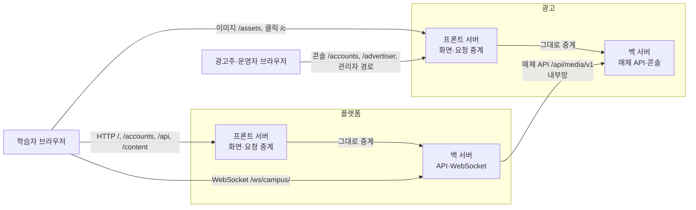
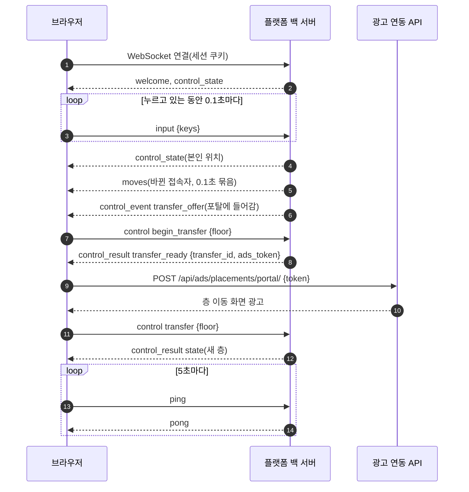
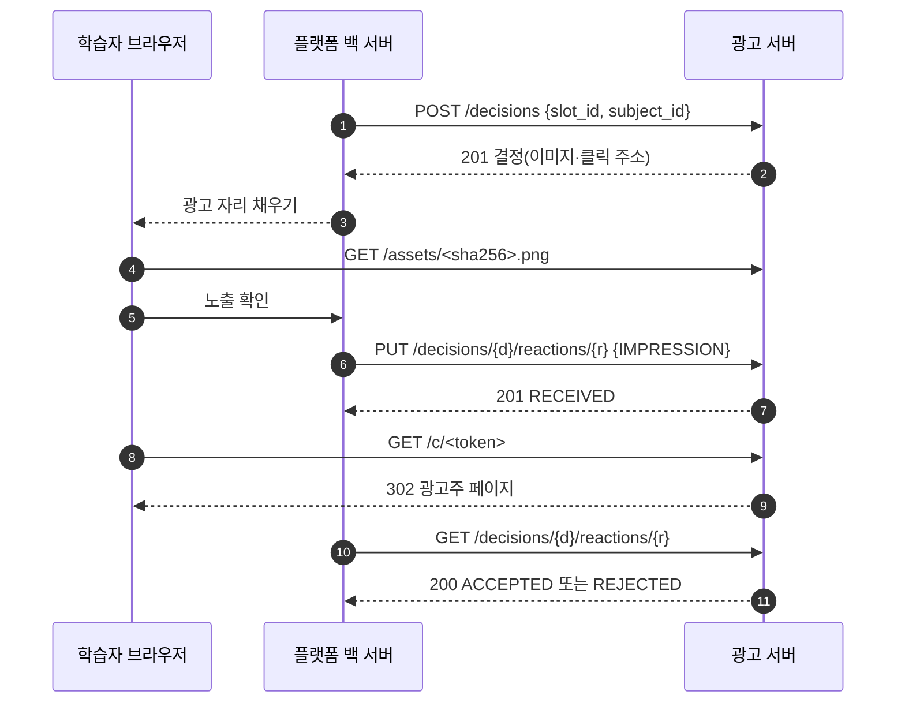

# API 명세서

> 작성일: 2026-10-18
> 대상: PLAYDATA 캠퍼스 메타버스 — 플랫폼 서버(캠퍼스·커뮤니티·학습)와 광고 서버(매체 API·광고 콘솔)
> 관련 문서: [데이터 요구사항 정의서](drd.md)

---

## 0. 한눈에 보기

| 서버 | 묶음 | 경로 | 인증 | 형식 | 절 |
|---|---|---|---|---|---|
| 플랫폼 | 계정·세션 | `/accounts/…` | 세션 쿠키 + CSRF | 폼·화면 데이터, 세션 상태는 JSON | §2.1 |
| 플랫폼 | 커뮤니티 | `/api/community/…` | 세션 쿠키 + CSRF | JSON | §2.2 |
| 플랫폼 | 학습·포인트 | `/api/learning/…` | 세션 쿠키 + CSRF | JSON | §2.3 |
| 플랫폼 | 외부 콘텐츠 열기 | `/content/<code>/open/` | 세션 쿠키 | 302 이동 | §2.4 |
| 플랫폼 | 광고 연동 | `/api/ads/…` | 세션 쿠키 + CSRF | JSON | §2.5 |
| 플랫폼 | 쪽지 | `/api/messages/…` | 세션 쿠키 + CSRF | JSON | §2.6 |
| 플랫폼 | 식단·점심 룰렛 | `/api/board/…`, `/api/campus/…` | 세션 쿠키 + CSRF | JSON·이미지 | §2.7 |
| 플랫폼 | 실시간 캠퍼스 | `/ws/campus/` | 세션 쿠키 + Origin | WebSocket JSON | §3 |
| 광고 | 매체 API | `/api/media/v1/…` | `X-Media-Key` | JSON | §4 |
| 광고 | 이미지·클릭 | `/assets/…`, `/c/…` | 없음 | 이미지·302 이동 | §4.7 |
| 광고 | 광고주 콘솔 | `/accounts/…`, `/advertiser/…` | 세션 쿠키 + CSRF | 폼·화면 데이터 | §5 |
| 광고 | 관리자 운영 | `/<관리자 경로>/operator/…` | 세션 쿠키 + CSRF(관리자) | 폼·화면 데이터 | §5.4 |

---

## 1. 공통 규칙

### 1.1 서버 구성

두 서비스 모두 **프론트 서버**(화면을 그리고 요청을 넘기는 서버, DB 없음)와 **백 서버**(판단과 저장을 하는 서버)로 나뉜다. 브라우저는 프론트 서버만 부르고, 인증·검증·저장은 모두 백 서버가 한다.



| 항목 | 플랫폼 | 광고 |
|---|---|---|
| 프론트 서버가 직접 답하는 것 | `/health/`, 정적 파일 | `/health/`, 정적 파일. `/api/media/…`는 **404**(매체 API는 공개 주소로 열지 않는다) |
| 그대로 넘기는 요청 헤더 | `Cookie`, `Content-Type`, `X-CSRFToken`, `Origin`, `Referer`, `Accept`, `User-Agent` | 위 + `Accept-Language`, `If-None-Match`, `If-Modified-Since`, `X-Request-ID` |
| 백 서버에 닿지 못할 때 | 502. `/api/…`는 `{"error":"backend_unavailable","message":"…"}`, 나머지는 HTML | 502 HTML 오류 화면 |
| WebSocket | 앞단 nginx가 플랫폼 백 서버로 바로 넘긴다 | 없음 |

### 1.2 화면 데이터 방식

화면 경로(로그인, 첫 설정, 광고 콘솔 등)는 백 서버가 HTML 대신 **화면 데이터** JSON을 돌려주고, 프론트 서버가 그것을 HTML로 그린다. 상태 코드는 백 서버 값을 그대로 쓴다. 다른 서버나 스크립트가 이 경로를 직접 부르면 아래 JSON을 받는다.

```json
{
  "presentation": {
    "template": "accounts/login.html",
    "context": { "form": { "fields": ["…"], "errors": {}, "bound": false }, "csrf_token": "…" }
  }
}
```

폼은 `fields`(이름·라벨·입력 종류·필수 여부·선택지·값)와 `errors`(필드별 오류 문구, 필드와 상관없는 오류는 `__all__` 또는 `non_field_errors`)로 직렬화된다.

### 1.3 인증

| 대상 | 방식 | 규칙 |
|---|---|---|
| 플랫폼 사용자 | 세션 쿠키 `campus_sessionid` | 로그인하면 발급한다. 최대 8시간, 30분 동안 활동이 없으면 만료된다. **한 계정 한 세션** — 새로 로그인하면 이전 세션이 끝난다 |
| 플랫폼 상태 변경 요청 | CSRF | `POST`·`PATCH`·`DELETE`는 쿠키 `campus_csrftoken`의 값을 헤더 `X-CSRFToken`(폼은 `csrfmiddlewaretoken`)으로 보낸다. 실패하면 403(HTML 본문) |
| 광고 콘솔 | 세션 쿠키 `ads_sessionid` | 역할은 광고주(`advertiser`)·관리자(`admin`). 광고주 경로를 익명으로 부르면 302 → 로그인, 다른 역할이면 403. **관리자 경로는 관리자가 아니면 모두 404** |
| 광고 콘솔 상태 변경 요청 | CSRF | 쿠키 `ads_csrftoken`의 값을 헤더 `X-CSRFToken` 또는 폼 필드로 보낸다 |
| 광고 콘솔 로그인 | 잠금 | 같은 (아이디, 접속 IP)로 5번 실패하면 5분 동안 429 |
| 매체(메타버스 백 서버) | 헤더 `X-Media-Key` | 형식 `<키 ID 소문자 16진수 32자>.<비밀 43자>`. 관리자가 발급하며, 매체마다 여러 키가 함께 유효할 수 있다(교체 유예). §4.1 |
| 광고 이미지·클릭 | 없음 | 쿠키를 만들지 않는다 |

### 1.4 요청·응답 형식

| 항목 | 규칙 |
|---|---|
| 본문 | JSON API는 UTF-8 JSON이다. `Content-Type: application/json`이 아니면 415(쪽지 API는 400) |
| 크기 | 커뮤니티 100,000바이트(413), 쪽지 20,000바이트(400), 광고 매체 API 16KiB(413). 광고 서버 전체 상한은 2MiB + 64KiB(413, 이미지 업로드 포함) |
| 끝 슬래시 | 플랫폼과 광고 콘솔 경로는 끝에 `/`가 있어야 한다. 광고 매체 API 경로는 끝에 `/`가 **없다** |
| 시각 | 플랫폼은 ISO-8601(시간대 포함), 세션 상태는 에포크 밀리초 숫자. 광고 매체 API는 UTC `…Z`(결정·접수 시각은 밀리초 3자리) |
| ID | UUID 문자열(소문자, 하이픈 포함). 플랫폼 게시글·댓글·학습 회차는 경로에 정수 ID를 쓴다 |
| 숫자 | 광고 서버는 요청 본문의 모든 숫자를 ±(2^53−1) 안으로 제한한다 |
| 요청 ID | 광고 백 서버는 모든 응답에 `X-Request-ID`를 붙인다. 요청에 UUID 형식의 `X-Request-ID`가 오면 그 값을 쓴다 |
| 캐시 | API 응답은 저장하지 않는다(`Cache-Control: no-store` 계열). 광고 이미지는 `no-cache` + `ETag` |

### 1.5 오류 응답

| 영역 | 본문 | 예 |
|---|---|---|
| 플랫폼 커뮤니티·쪽지·콘텐츠·룰렛 | `{"error":"<사용자에게 보일 문구>"}`. 폼 검증 오류는 `"fields":{"필드":["문구"]}`를 더한다 | `{"error":"본인이 쓴 글만 수정할 수 있어요."}` |
| 플랫폼 학습 | `{"error":"<코드>","message":"<문구>"}` | `{"error":"attempt_limit_reached","message":"…"}` |
| 플랫폼 광고 연동 | `{"error":"<코드>", …}` | `{"error":"ads_unavailable"}` |
| 플랫폼 세션 상태 | 상태 객체(`authenticated:false`, `reason`) | §2.1 |
| 광고 매체 API·클릭 | `application/problem+json`: `{type, title, status, code, detail?, request_id, errors?[{pointer, message}]}`. 401에는 `WWW-Authenticate`, 429·503에는 `Retry-After` | §4.1 |
| 광고 콘솔 | 400·409는 같은 화면을 오류 문구와 함께 다시 그린다. 그 밖의 오류는 오류 화면 데이터 | §5.1 |
| 공통 | 허용하지 않는 메서드는 405(빈 본문, `Allow` 헤더). 로그인이 필요한 플랫폼 화면·식단·광고 연동은 비로그인이면 302 → `/accounts/login/?next=…` | |

### 1.6 멱등·동시성

| 대상 | 방법 | 같은 요청을 다시 보내면 |
|---|---|---|
| 학습 답안 제출 | `submission_request_uuid`(UUIDv4, 제출마다 새로 만들고 재시도에는 그대로) | 같은 내용이면 저장된 응답을 그대로 돌려준다(201). 다른 내용이면 409 `submission_uuid_conflict` |
| 쪽지 보내기 | `requestId`(UUID) | 같은 내용이면 200 + 기존 메시지, 다르면 409 |
| 게시글·댓글 수정 | `version` = 화면이 읽은 `updatedAt` | 그사이 바뀌었으면 409 |
| 광고 반응 보고 | 경로의 `reaction_id`(매체 안에서 유일) | 같은 내용이면 200, 다르면 409 `conflict` |
| 광고 콘솔 생성 요청 | 폼의 숨은 값 `request_key` | 캠페인·광고 만들기는 처음 결과를, 매체 키 발급은 409를, 포인트 조정은 같은 내용이면 처음 결과를 돌려준다 |
| 광고 콘솔 수정 | 숨은 값 `expected_version`(입찰·정책) 또는 `updated_at`(캠페인·광고그룹·소재) | 그사이 바뀌었으면 409(`stale_version`) |
| 광고 결정 요청 | 멱등하지 않다 | 요청마다 새 결정이 생긴다 |

### 1.7 요청 제한

| 대상 | 제한 | 넘으면 |
|---|---|---|
| 쪽지 보내기 | 보낸 사람마다 1초에 1건 | 429 `{"error":"잠시 후 다시 보내 주세요."}` |
| 채팅(WebSocket) | 수락된 채팅 사이 0.8초 | `chat_error` |
| 점프·찌르기(WebSocket) | 점프 0.72초, 찌르기 0.25초 | `control_result.error` |
| 광고 매체 API | 매체마다 결정 초당 150건(순간 300), 반응 초당 450건(순간 600), 조회 초당 150건(순간 300) | 429 `rate_limited` + `Retry-After` |
| 광고 콘솔 로그인 | (아이디, IP)마다 5번 실패 | 5분 동안 429 |

---

## 2. 플랫폼 서버 HTTP API

### 2.1 계정·세션

**화면 경로**(폼 제출, 화면 데이터 응답)

| 메서드 | 경로 | 인증 | 요청(폼 필드) | 성공 | 실패 |
|---|---|---|---|---|---|
| GET | `/` | 로그인, 첫 설정 완료 | — | 200 캠퍼스 화면. 실시간 연결 주소(`/ws/campus/`), 마지막 위치, 쪽지 사용 여부 등을 담는다 | 비로그인 302 → 로그인, 첫 설정 전 302 → `/accounts/setup/` |
| GET | `/accounts/login/` | — | `?next=`, `?expired=idle\|maximum\|replaced`(만료 안내 문구) | 200 로그인 화면 | 로그인 상태면 302 |
| POST | `/accounts/login/` | CSRF | `username`, `password`, `next`(선택) | 302 → `next` 또는 `/`(첫 설정 전이면 `/accounts/setup/`). 세션 쿠키 발급, 같은 계정의 이전 세션 종료 | 200 + 폼 오류("아이디 또는 비밀번호를 확인해 주세요.") |
| GET | `/accounts/signup/` | — | — | 200 가입 화면 | 로그인 상태면 302 |
| POST | `/accounts/signup/` | CSRF | `username`(150자 이하, 영문·숫자·`@.+-_`, 대소문자 무시 중복 금지), `cohort`(`mlo-1`·`mlo-2`·`mlo-3`·`skn-34`·`skn-36`·`aio-4`), `password1`, `password2`(일치, 8자 이상, 흔한·숫자만·아이디와 비슷한 비밀번호 금지) | 302 → `/accounts/setup/`. 계정·프로필·포인트 지갑을 만들고 바로 로그인 | 200 + 폼 오류 |
| GET·POST | `/accounts/setup/` | 로그인 | `nickname`(2~20자, 한글·영문·숫자·공백·`-`·`_`), `avatar`(기수의 과정에 따라 `male-1`·`female-2` 또는 `male-2`·`female-1`) | 302 → `/`. 처음 한 번만 확정된다 | 200 + 폼 오류. 이미 완료면 302 → `/` |
| GET·POST | `/accounts/nickname/` | 로그인, 첫 설정 완료 | `nickname`(규칙은 위와 같음) | 302 → `/` | 200 + 폼 오류 |
| POST | `/accounts/logout/` | CSRF | `next`(선택) | 302 → `/accounts/login/`. 마지막 위치를 저장하고 세션을 끝내며, 열린 실시간 연결에 종료를 알린다 | GET은 405 |
| GET | `/learning/` | 로그인 | — | 200 학습 전용 화면 | 비로그인 302 |

**세션 상태 API**

| 메서드 | 경로 | 인증 | 요청 | 성공 | 실패 |
|---|---|---|---|---|---|
| GET | `/accounts/session/status/` | 세션 쿠키 | — | 200 세션 상태 객체 | 401 `authenticated:false` + `reason`, 503 `reason:"retry"`(일시 오류) |
| POST | `/accounts/session/activity/` | CSRF | 본문 무시 | 200 세션 상태 객체(활동 시각을 갱신해 유휴 만료를 늦춘다) | 위와 같음 |
| POST | `/api/accounts/guide/complete/` | CSRF, 로그인 | — | 200 `{"guideCompleted":true}`(여러 번 불러도 같다) | 401 `{"error":"authentication_required"}`, 409 `{"error":"profile_setup_required"}` |

세션 상태 객체:

```json
{
  "authenticated": true,
  "reason": null,
  "serverNow": 1792217880000,
  "absoluteExpiresAt": 1792246680000,
  "idleExpiresAt": 1792219680000,
  "expiresAt": 1792219680000,
  "warningSeconds": 60
}
```

`reason`은 만료되었을 때 `signed_out`(로그아웃)·`anonymous`(로그인 안 함)·`idle`(유휴 30분)·`maximum`(최대 8시간)·`replaced`(다른 곳에서 로그인)·`invalid` 중 하나다. 시각은 에포크 밀리초다.

### 2.2 커뮤니티

공통 규칙
- 순서대로 검사한다: 비로그인 401 → 첫 설정 전 403 → 허용하지 않는 메서드 405.
- 수정·삭제는 작성자나 운영자만 할 수 있다. 공지(`notice`) 작성·수정은 운영자만 할 수 있다.
- 삭제는 소프트 삭제다(목록·조회에서 사라지고 `revision`이 1 오른다).
- 분류(`category`): `notice`·`free`·`it`·`project`·`career`·`study`·`question`.

| 메서드 | 경로 | 요청 | 성공 | 주요 오류 |
|---|---|---|---|---|
| GET | `/api/community/` | — | 200 `{categories:[{id, name, description, count, canWrite}], total, user:{id, nickname, avatar, isAdmin}, limits:{title:140, body:20000, comment:2000}}`. `count`·`total`은 삭제한 글도 센다 | — |
| GET | `/api/community/posts/` | `?category=all\|<분류>`, `?q=`(100자 이하, 제목·본문 검색), `?page=`(1~100000) | 200 `{posts:[게시글(본문 제외)], pagination:{page, pages, total}}`. 한 쪽 12개, 최신순. 범위를 넘는 쪽은 마지막 쪽으로 | 400(분류·검색어·쪽 번호) |
| POST | `/api/community/posts/` | `{category, title(140자 이하), body(20,000자 이하)}` 모두 필수, 공백만은 안 된다 | 201 `{post}` | 403(공지 권한), 400 + `fields` |
| GET | `/api/community/posts/<id>/` | — | 200 `{post}`(본문 포함) | 404 "글이 삭제되었거나 존재하지 않아요." |
| PATCH | `/api/community/posts/<id>/` | `{version(필수), category?, title?, body?}` — 보내지 않은 필드는 그대로 | 200 `{post}` | 403, 404, 409 "다른 화면에서 수정된 글이에요…" |
| DELETE | `/api/community/posts/<id>/` | — | 200 `{"deleted":true}` | 403, 404, 409 |
| GET | `/api/community/posts/<id>/comments/` | `?page=` | 200 `{comments:[댓글 + replies], pagination, commentCount}`. 최상위 댓글 30개씩, 오래된 순. 지운 최상위 댓글은 답글이 남아 있을 때만 보인다 | 404 |
| POST | `/api/community/posts/<id>/comments/` | `{body(2,000자 이하), parentCommentUuid?(UUIDv4 또는 null)}` | 201 `{comment}` | 400 "답글은 원래 댓글에 남겨 주세요."(답글의 답글), 404 |
| PATCH | `/api/community/comments/<id>/` | `{body, version}`(`parentCommentUuid`는 바꿀 수 없다) | 200 `{comment}` | 400, 403, 404, 409 |
| DELETE | `/api/community/comments/<id>/` | — | 200 `{"deleted":true}` | 403, 404, 409 |

게시글 객체:

```json
{
  "id": 42,
  "postUuid": "6f1c2c1e-7d0a-4c3e-9b8a-2f6d1e0b9a11",
  "category": "study",
  "categoryLabel": "학습자료 공유",
  "revision": 2,
  "title": "SQL 조인 정리",
  "body": "…",
  "author": { "id": 7, "nickname": "데이터곰", "avatar": "male-2" },
  "createdAt": "2026-10-16T01:20:00+00:00",
  "updatedAt": "2026-10-16T02:05:31.120000+00:00",
  "commentCount": 3,
  "canEdit": true,
  "canDelete": true
}
```

댓글 객체는 `{id, commentUuid, revision, parentCommentUuid, postId, body, author, createdAt, updatedAt, isDeleted, canEdit, canDelete, canReply, replies[]}`다. 지운 댓글은 `body`가 "삭제된 댓글입니다.", `author`가 null이다. `replies`는 최상위 댓글에만 있다(답글은 1단계).

**수정 충돌**: 수정할 때는 화면이 읽은 `updatedAt`을 `version`으로 보낸다. 서버는 그사이 다른 수정이 없을 때만 저장하고, 있으면 409를 돌려준다. 삭제는 `version` 없이 서버가 같은 방식으로 확인한다.

### 2.3 학습·포인트

공통 규칙
- 메서드부터 검사한다(405 `method_not_allowed`), 이어서 비로그인이면 401 `authentication_required`.
- 과목 `subject`: `python`·`sql`. 유형 `question_type`: `multiple_choice`(4지선다)·`fill_blank`(코드 빈칸). 난이도 `difficulty`: `beginner`·`intermediate`·`advanced`.
- 학습 회차는 10문항이고, 문항마다 최대 3번 답할 수 있다. 맞히면 그 문항은 확정된다. 7문항 이상 맞히면 통과다.
- 정답 포인트는 초급 20, 중급 50, 고급 80이다(객관식·빈칸 같음).

| 메서드 | 경로 | 요청 | 성공 | 오류 |
|---|---|---|---|---|
| GET | `/api/learning/csrf/` | — | 200 `{"detail":"CSRF cookie set"}` + CSRF 쿠키 | 401 |
| GET | `/api/learning/wallet/` | — | 200 `{balance}` | 401 |
| GET | `/api/learning/wallet/history/` | `?cursor=<ledger_uuid>`(선택) | 200 `{items:[{ledger_uuid, amount, balance_after, granted_at, subject, difficulty, question_type, question_order}], next_cursor}`. 10개씩, 최신순 | 400 `invalid_submission_uuid`(커서 형식 오류), 400 `invalid_cursor` |
| POST | `/api/learning/content-open/` | `{subject?(기본 python), question_type}` | 201 `{content_uuid, wallet_balance, points_by_difficulty:{beginner:20, intermediate:50, advanced:80}}` | 400 `invalid_request`, 401, 503 `content_unavailable` |
| POST | `/api/learning/sessions/` | `{subject?(기본 python), question_type, difficulty}` | 201 회차 객체(활성 문제 중 10개를 무작위로 고른다) | 400 `invalid_request`, 409 `empty_question_pool`·`insufficient_question_pool` |
| GET | `/api/learning/sessions/<id>/` | — | 200 회차 객체 | 404 `not_found` |
| GET | `/api/learning/sessions/<id>/questions/<n>/` | — | 200 문제 객체. **처음 조회해야 답을 낼 수 있다** | 404 |
| POST | `/api/learning/sessions/<id>/questions/<n>/answers/` | 아래 | 201 답안 결과 | 아래 |
| POST | `/api/learning/sessions/<id>/complete/` | — | 200 회차 객체(이미 완료면 그대로) | 409 `unfinalized_questions`, 404 |

**답안 제출**

```json
{
  "answer": "SELECT name FROM users",
  "submission_request_uuid": "3a3c3d9e-5b8f-4e2a-9c61-0b7f2e4d8a10",
  "choice_uuid": null
}
```

| 필드 | 규칙 |
|---|---|
| `answer` | 필수, 공백만은 안 된다, 10,000자 이하. 객관식은 고른 보기의 문구 |
| `submission_request_uuid` | 필수. 소문자 UUIDv4. 제출마다 새로 만들고, 네트워크 재시도에는 같은 값을 쓴다 |
| `choice_uuid` | 객관식이면 고른 보기의 UUID(선택), 빈칸 문제면 보내지 않는다 |

| 결과 | 응답 |
|---|---|
| 성공 | 201 `{is_correct, attempt_no, attempts_remaining, outcome, is_finalized, attempt_uuid, submission_request_uuid, explanation, points:{status:"granted"\|"not_eligible"\|"no_reward", granted_points, ledger_uuid, balance_after}, …}`. 문항이 확정되면 `correct_answer`(객관식은 `correct_choice_no`)를 더한다 |
| 재전송 | 같은 키·같은 내용이면 처음 응답을 그대로 201로. 새로 저장하거나 지급하지 않는다 |
| 오류 | 400 `invalid_submission_uuid`·`invalid_request`·`invalid_choice_uuid`·`invalid_choice`, 404, 409 `submission_uuid_conflict`(같은 키, 다른 내용)·`session_completed`·`question_not_viewed`·`attempt_limit_reached`·`question_finalized`, 503 `content_unavailable` |

회차 객체는 회차 정보(`session_id`, `subject`, `question_type`, `difficulty`, `total_questions`, `correct_count`, `started_at`, `completed_at`), 문항별 진행(`questions[{question_order, answered, outcome, is_finalized, attempt_count, remaining_attempts}]`), 통과 여부(`passed`, `pass_threshold:7`), 포인트 요약(`points_summary`)을 담는다. 완료한 회차는 세 번 모두 틀린 문항의 해설(`wrong_questions`)을 더한다.

문제 객체는 `{session_id, question_order, total_questions, question:{question_uuid, subject, question_type, difficulty, category, question_text, code_snippet, choices?[{choice_uuid, choice_no, choice_text}]}, outcome, is_finalized, attempt_count, max_attempts, remaining_attempts}`다. 정답은 확정 전에 내려주지 않는다.

### 2.4 외부 콘텐츠 열기

| 메서드 | 경로 | 인증 | 성공 | 오류 |
|---|---|---|---|---|
| GET | `/content/<code>/open/` | 로그인, 첫 설정 완료 | 302 `Location: <외부 콘텐츠 주소>`. 이동하기 전에 열기 요청을 기록한다 | 401, 403, 404 "콘텐츠를 찾을 수 없어요." |

`code`는 게임 16종(`gomoku`, `war`, `dad-and-me`, `minesweeper`, `fruit-box`, `bubble-shooter`, `suika`, `flashman`, `tetris`, `worlds-hardest-game`, `bamboo-master`, `sword-upgrade`, `walk-the-stork`, `isaac`, `paladog`, `solitaire`)과 심리 테스트(`psych-test`)다. 학습 콘텐츠는 §2.3의 `content-open`을 쓴다.

### 2.5 광고 연동

플랫폼이 광고 서버(§4)를 대신 불러 캠퍼스 화면의 광고를 채운다. 광고 서버에는 사용자 ID 대신 광고 전용 가명만 보낸다.

| 메서드 | 경로 | 요청 | 성공 | 오류 |
|---|---|---|---|---|
| POST | `/api/ads/placements/rooftop/` | 본문 없음 | 200(준비됨·실패) 또는 202(준비 중) 배치 객체. 10초 회차마다 모든 사람이 같은 광고를 받는다 | 503 `ads_disabled`·`ads_unavailable`, 409 `profile_uuid_missing` |
| POST | `/api/ads/placements/portal/` | `{token}` — 층 이동 승인 때 WebSocket으로 받은 `ads_token`(15초 안, 본인만) | 위와 같은 배치 객체. 층 이동 화면의 왼쪽·오른쪽 광고 두 개 | 400 `invalid_transfer`, 503, 409 |
| POST | `/api/ads/decisions/<decision_id>/impression/` | 본문 없음(노출 시각은 서버가 정한다) | 201(처음 확인)·200(이미 보고함)·202(확인 대기) | 404 `decision_not_found`, 409 `no_ad_to_report`, 502(광고 서버 오류), 503 |

배치 객체:

```json
{
  "batch_id": "roof:1792222200",
  "state": "READY",
  "ads": [
    {
      "decision_id": "01928f3a-6b1c-7e4d-9a2b-3c4d5e6f7a8b",
      "ad": {
        "creative_id": "01928f30-1111-7abc-8def-0123456789ab",
        "title": "부트캠프 굿즈 할인",
        "image_url": "https://<광고 공개 주소>/assets/<sha256>.png",
        "click_url": "https://<광고 공개 주소>/c/<token>?s=<광고 가명>"
      }
    }
  ],
  "server_time": "2026-10-17T07:30:03.412907+00:00",
  "expires_at": "2026-10-17T07:30:10+00:00"
}
```

`batch_id`는 옥상이면 `roof:<10초 회차의 시작 시각(에포크 초)>`, 층 이동이면 `portal:<이동 ID>`다. `state`는 `PENDING`(다른 요청이 준비 중, 202)·`READY`·`FAILED`다. 광고가 없는 자리는 `ad: null`이다. 브라우저는 이미지가 화면에 50% 이상, 1초 연속 보였을 때 노출을 보고한다.

노출 보고 응답: `{decision_id, reaction_id, occurred_at, delivery_state, request_id, duplicate}`. `delivery_state`는 `SENDING`·`ACKNOWLEDGED`(광고 서버가 받음)·`UNCONFIRMED`(나중에 다시 보냄)·`BLOCKED`(광고 서버가 거절)다. 광고 서버에 닿지 못해도 보고는 남고, 백그라운드에서 같은 반응 ID로 다시 보낸다.

### 2.6 쪽지

기능 스위치로 켜고 끈다(기본 꺼짐). 꺼져 있으면 모든 요청이 404 `{"error":"쪽지를 사용할 수 없습니다."}`다.

| 메서드 | 경로 | 요청 | 성공 | 오류 |
|---|---|---|---|---|
| GET | `/api/messages/status/` | — | 200 `{enabled, viewerId, canStart, hasInbox, unread}` + CSRF 쿠키 | — |
| GET | `/api/messages/recipients/` | `?q=`(40자까지) | 200 `{recipients:[{id, nickname, avatar, cohort}]}` 최대 20명 | — |
| GET | `/api/messages/conversations/` | — | 200 `{conversations:[{id, other, preview, updatedAt, unread}]}` 최근 50개 | — |
| GET | `/api/messages/conversations/<id>/` | — | 200 `{id, other, messages:[{id, body, sentByMe, createdAt, readAt}]}` 최근 100개 | 404 |
| POST | `/api/messages/send/` | `{recipient(사용자 UUID), requestId(UUID), body(1~2,000자, 줄바꿈·탭 외 제어 문자 금지)}` | 201 `{conversationId, message}`. 같은 `requestId` 재전송은 200 + 기존 메시지 | 400, 404 "받는 사람을 찾을 수 없습니다.", 409 "이미 사용한 전송 번호입니다.", 429 |
| POST | `/api/messages/conversations/<id>/read/` | `{through(메시지 UUID)}` | 200 `{unread}` — 그 메시지까지 받은 것을 읽음으로 | 400, 404 |

새 쪽지가 오면 실시간 연결로 `private_message` 알림(본문 없음)이 간다(§3.5).

### 2.7 식단·점심 룰렛

| 메서드 | 경로 | 인증 | 성공 | 오류 |
|---|---|---|---|---|
| GET | `/api/board/menu/` | 로그인 | 200 `{imageUrl, updatedAt, sourceName}`(사진이 없으면 `imageUrl: null`) | 비로그인 302 |
| GET | `/api/board/menu/images/<file>/` | 로그인 | 200 이미지(`<sha256 64자>.<jpg\|png\|webp\|gif>`) | 404 |
| POST | `/api/campus/lunch/spin/` | CSRF, 로그인, 첫 설정 완료 | 200 `{index(0~7), label, jitter, turns}` — 서버가 무작위로 고른다. 선택지: 한식·일식·양식·중식·분식·패스트푸드·베트남음식·구내식당 | 401, 403 |

---

## 3. 플랫폼 실시간 API (WebSocket)

### 3.1 연결

| 항목 | 내용 |
|---|---|
| 주소 | `wss://<서비스 주소>/ws/campus/`(페이지가 http면 `ws://`). 캠퍼스 화면이 주소를 내려준다 |
| 인증 | 세션 쿠키 `campus_sessionid`. `Origin`의 호스트가 허용 목록에 있어야 한다(CSRF 토큰은 쓰지 않는다) |
| 거절 | 연결을 수락하기 전에 닫는다: 비로그인·비활성 계정·세션 만료(4401), 첫 설정 전(4403), 허용하지 않는 출처 |
| 메시지 | 텍스트 프레임 하나에 JSON 객체 하나. 모든 메시지에 `type`이 있다 |
| 연결 ID | 연결마다 새 `selfId`(16진수 32자)를 받는다. 사용자 ID가 아니다. 다른 사람도 이 연결 ID로만 보인다 |

연결이 수락되면 서버는 본인에게 `welcome`을 보내고, 다른 접속자에게 `join`을 보낸다. 이어서 본인에게 `control_state`를 보낸다.

```json
{
  "type": "welcome",
  "selfId": "9f2c1b7e4a6d4e0f8b3a5c7d9e1f2a3b",
  "players": [
    { "id": "9f2c…", "nickname": "데이터곰", "avatar": "male-2", "floor": "campus",
      "x": 1220.5, "y": 640.0, "dir": "down", "color": "#8a78bb", "moving": false, "inClassroom": false }
  ],
  "session": { "authenticated": true, "reason": null, "serverNow": 1792217880000, "absoluteExpiresAt": 1792246680000,
               "idleExpiresAt": 1792219680000, "expiresAt": 1792219680000, "warningSeconds": 60 },
  "serverControl": true
}
```

**접속자(Player) 객체**

| 필드 | 값 |
|---|---|
| `id` | 연결 ID |
| `nickname` | 20자까지 |
| `avatar` | `male-1`·`male-2`·`female-1`·`female-2` |
| `floor` | `campus`(18층, 0~2448 × 0~1230)·`rooftop`(옥상, 0~2448 × 0~1800) |
| `x`, `y` | 좌표(실수) |
| `dir` | `up`·`down`·`left`·`right` |
| `color` | 아바타 색 |
| `moving` | 걷는 중인지 |
| `inClassroom` | 학습교실 안인지(교실은 사람마다 따로라 다른 사람에게는 이 값만 보인다) |

### 3.2 연결과 층 이동 흐름



### 3.3 클라이언트 → 서버

| `type` | 필드 | 서버 처리 | 잘못된 입력 |
|---|---|---|---|
| `input` | `keys`: 문자열 배열(최대 8개, `w`·`a`·`s`·`d`·`arrowup`·`arrowdown`·`arrowleft`·`arrowright`), `poking`: bool(선택), `pokeContext`: 범위 객체(선택) | 서버가 충돌을 포함해 이동을 계산한다. 키는 0.35초 동안만 유효하므로 **누르고 있는 동안 계속 보낸다**(0.1초 간격 권장). `poking:true`면 0.25초마다 찌른다. 직접 응답은 없고 결과는 `control_state`·`moves`로 온다 | `control_error` |
| `control` | `requestId`: 1~64자 문자열, `action`: §3.4, `data`: 객체(선택) | 액션을 처리하고 `control_result`를 보낸다 | 형식이 틀리면 응답 없이 무시 |
| `chat` | `text`: 문자열 | 공백을 하나로 합친 뒤 1~200자, 제어 문자 금지. 저장하고 **모든 접속자**(보낸 사람 포함)에게 `chat`을 보낸다. 30일 보관 | 본인에게 `chat_error` |
| `ping` | — | 본인에게 `pong`. 연결 유휴 시간을 늘린다(로그인 유휴 시간은 늘리지 않는다) | — |
| `leave` | — | 마지막 위치를 저장하고 다른 사람에게 `leave`를 보낸 뒤 1000으로 닫는다 | — |

프레임이 4096자를 넘거나 바이너리면 1009, JSON이 아니면 1007로 닫는다. 모르는 `type`은 무시한다.

**범위 객체**(`pokeContext`, 점프·찌르기의 `data`): 캠퍼스에서는 `{"context":"world","floor":"campus"}`, 학습교실에서는 `{"context":"classroom","subject":"python"}`. 지금 있는 범위와 같아야 받아들인다.

### 3.4 `control` 액션

| `action` | `data` | 조건 | 성공 `result` | 실패 `error`(예) |
|---|---|---|---|---|
| `prepare_transfer` | `{objectId}` | 계단·포탈 가까이(교실 밖) | `{type:"transfer_offer", objectId, floor, confirm}` — 이동을 멈추고 기다린다 | "계단이나 포탈 가까이에서 이용해 주세요." |
| `cancel_transfer` | `{}` | — | `{type:"state"}` | — |
| `begin_transfer` | `{floor}` | 고른 포탈의 도착 층과 같음 | `{type:"transfer_ready", transfer_id, ads_token}` — 아직 옮기지 않는다. `ads_token`은 층 이동 광고(§2.5)에 15초 안에 쓴다 | "이동할 계단이나 포탈을 먼저 선택해 주세요." |
| `transfer` | `{floor}` | 위와 같음 | `{type:"state"}` — 층을 옮기고 위치를 저장한다 | 위와 같음 |
| `cancel_exit` | `{}` | 캠퍼스 출구 구역 | `{type:"state"}` | "캠퍼스 출구에서 이용해 주세요." |
| `interact` | `{}` | 학습교실 안의 학습 자리나 출입구 근처 | 출입구면 교실을 나가고 `{type:"state"}`, 학습 자리면 `{type:"learning_open", subject, questionType}` — 이후 문제 풀이는 §2.3 | "입장 후 2초 뒤에 나갈 수 있어요." |
| `open_booth` | `{objectId}` | 옥상 부스 가까이 | `{type:"booth_open", objectId}` — 이후 콘텐츠 열기는 §2.4 | "부스 중앙의 E 표시 가까이로 이동해 주세요." |
| `jump` | 범위 객체 | 층 이동 대기 중이 아님 | `{type:"jump", id}` | "착지한 뒤 다시 점프해 주세요." |
| `poke` | 범위 객체 | — | `{type:"poke", hit}` | "잠시 후 다시 찔러 주세요." |
| `navigate` | `{x, y}` | 교실 밖, 그 층 범위 안 | `{type:"route", points:[{x, y}, …]}` | "이동 가능한 경로가 없습니다." |

그 밖의 `action`은 "지원하지 않는 요청입니다."다. 응답은 `{"type":"control_result","requestId":"…","result":{…}}` 또는 `{"type":"control_result","requestId":"…","error":"…"}`다. 학습교실 입장은 별도 메시지 없이 교실 문턱을 지나면 서버가 처리한다.

### 3.5 서버 → 클라이언트

| `type` | 필드 | 받는 사람 | 언제 |
|---|---|---|---|
| `welcome` | `selfId`, `players[]`, `session`, `serverControl` | 본인 | 연결 직후 한 번 |
| `control_state` | `state:{main(본인 Player), hints:{nearbyId, roomId, exitRequired}, interior(교실 안 상태 또는 null)}` | 본인 | 연결 직후, `control`마다, 바뀔 때(걷는 동안 초당 약 30회) |
| `control_event` | `event:{type:"transfer_offer", objectId, floor, confirm}` | 본인 | 포탈 영역에 들어갔을 때 |
| `control_result` | `requestId` + `result` 또는 `error` | 본인 | `control`마다 |
| `control_error` | `message` | 본인 | `input` 형식 오류 |
| `moves` | `players[]`(바뀐 접속자), `effects?[]` | 모든 접속자 | 0.1초마다, 바뀐 것이 있을 때만 |
| `join` | `player` | 다른 접속자 | 누군가 들어왔을 때 |
| `leave` | `id` | 다른 접속자 | 누군가 나갔을 때 |
| `move`·`identity` | `player` | 다른 접속자·본인 | 닉네임·아바타가 바뀌었을 때 |
| `chat` | `message:{id, playerId, nickname, floor, text, sentAt}` | 모든 접속자 | 채팅이 저장됐을 때 |
| `chat_error` | `message` | 본인 | 채팅 거절 |
| `pong` | — | 본인 | `ping`마다 |
| `private_message` | `conversationId` | 받는 사람 | 새 쪽지(쪽지 기능이 켜졌을 때) |
| `session_expired` | `reason`(`idle`·`maximum`·`invalid`·`replaced`) | 본인 | 세션이 만료되어 4401로 닫기 직전 |

`effects`에는 `jump`(점프한 사람, 지속 720ms), `poke`·`poke_state`·`poke_hit`(찌르기)이 실린다. 효과는 같은 층·교실 밖·가까운 사람(점프 반경 1200, 찌르기 반경 480)에게만 간다. `moves`로는 이미 아는 접속자만 갱신하고, 새 접속자는 `join`으로 추가한다.

### 3.6 종료 코드

| 코드 | 뜻 | 클라이언트 동작 |
|---|---|---|
| 1000 | 정상 종료(`leave` 처리 뒤, 또는 클라이언트가 페이지를 닫음) | — |
| 1007 | JSON이 아님 | 다시 연결 |
| 1009 | 프레임이 너무 큼(4096자 초과) 또는 바이너리 | 다시 연결 |
| 1011 | 서버 내부 오류 | 다시 연결 |
| 4401 | 인증 없음·세션 만료(로그아웃·유휴·최대 시간·다른 곳 로그인) | 세션 상태 API(§2.1)로 한 번 확인하고, 살아 있으면 다시 연결, 아니면 로그인 화면 |
| 4403 | 첫 설정을 마치지 않음 | 첫 설정 화면으로 |
| 4408 | 연결 유휴 — 60초 넘게 아무 메시지도 받지 못함 | 다시 연결 |
| 4409 | 같은 세션의 새 연결로 바뀜(다른 탭) | **다시 연결하지 않는다.** 새로고침 안내 |

### 3.7 클라이언트 규칙

- 5초마다 `ping`을 보낸다(60초 유휴 종료를 막는다).
- 10초 동안 아무것도 받지 못하면 연결을 다시 맺는다.
- 다시 연결할 때는 1초부터 두 배씩 늘려 최대 10초까지 기다린다.
- `control` 응답은 10초까지 기다린다.
- 페이지를 닫거나 로그아웃할 때 `{"type":"input","keys":[]}`와 `{"type":"leave"}`를 보내고 1000으로 닫는다.

---

## 4. 광고 서버 매체 API

메타버스(매체)의 백 서버가 광고 자리마다 광고를 요청하고 노출·전환을 보고하는 API다. 광고 서버의 내부망 주소로만 부른다.

### 4.1 공통

| 항목 | 내용 |
|---|---|
| 기본 경로 | `/api/media/v1` |
| 인증 | `X-Media-Key: <키 ID 32자>.<비밀 43자>`. 키가 없거나 틀리거나 폐기·만료됐으면 401(구분하지 않는다), 매체가 꺼져 있으면 403 |
| 검사 순서 | 메서드(405) → 인증(401) → 매체 상태(403) → 요청 제한(429) → 본문 → 처리 |
| 본문 | `Content-Type: application/json`, 16KiB 이하, 최상위는 객체, 중첩 깊이 8 이하, 중복 키 금지, 숫자는 ±(2^53−1) |
| 요청 제한 | §1.7 |

**오류 본문**(`application/problem+json`)

```json
{
  "type": "/problems/invalid_request",
  "title": "요청이 올바르지 않습니다",
  "status": 400,
  "code": "invalid_request",
  "request_id": "5c0e6a1f-2b3d-4c5e-8f9a-0b1c2d3e4f5a",
  "errors": [ { "pointer": "/slot_id", "message": "UUID(하이픈 포함 36자) 문자열이어야 합니다." } ]
}
```

| `code` | 상태 | 뜻 |
|---|---|---|
| `invalid_request` | 400 | 본문·필드 오류(`errors[]`에 필드 위치) |
| `forbidden_context_key` | 400 | `context`에 직접 식별자 키가 있음 |
| `unauthorized` | 401 | 키 문제(`WWW-Authenticate: MediaKey realm="ads-media-api"`) |
| `forbidden` | 403 | 매체 비활성 |
| `not_found` | 404 | 없음(남의 것·형식 오류 ID 포함) |
| `conflict` | 409 | 같은 `reaction_id`로 다른 내용 |
| `payload_too_large` | 413 | 본문이 큼 |
| `unsupported_media_type` | 415 | JSON이 아님 |
| `rate_limited` | 429 | 요청 제한(`Retry-After`) |
| `unavailable` | 503 | 일시 장애(`Retry-After`). 결정 요청은 저장됐을 수도 있다 |
| `internal_error` | 500 | 서버 오류 |

### 4.2 광고 결정 요청 — `POST /decisions`

```json
{
  "slot_id": "01928f2a-0000-7000-8000-000000000001",
  "subject_id": "7b1e2c3d-4f5a-4b6c-8d9e-0f1a2b3c4d5e",
  "context": { "floor": "campus" }
}
```

| 필드 | 필수 | 규칙 |
|---|---|---|
| `slot_id` | 필수 | 광고 자리 UUID |
| `subject_id` | 자리에 따라 | 광고 가명 UUID. 개인 자리(`individual`)는 필수, 공용 자리(`shared`)는 보내면 안 된다 |
| `context` | 선택 | 객체. 속성 50개, 4KiB, 깊이 4 이하. `login_id`·`username`·`password`·`password_hash`·`nickname`·`email` 키는 어느 깊이에서든 금지(대소문자 무시) |
| 그 밖의 키 | — | 400 "알 수 없는 속성입니다." |

판정 순서: 필드 오류 400 → 자리가 없거나 다른 매체의 것 404(저장 안 함) → 매체 비활성 403 → 가명 규칙 위반 400 → 자리가 꺼져 있거나 낼 광고가 없으면 201 `ad: null` → 정상 201 + 광고.

**응답** 201, `Location: /api/media/v1/decisions/<decision_id>`

```json
{
  "decision_id": "01928f3a-6b1c-7e4d-9a2b-3c4d5e6f7a8b",
  "slot_id": "01928f2a-0000-7000-8000-000000000001",
  "slot_name": "포탈 왼쪽",
  "audience": "individual",
  "decided_at": "2026-10-17T07:30:00.123Z",
  "ad": {
    "creative_id": "01928f30-1111-7abc-8def-0123456789ab",
    "title": "부트캠프 굿즈 할인",
    "image_url": "https://<광고 공개 주소>/assets/<sha256>.png",
    "redirect_url": "https://shop.example.com/sale",
    "click_url": "https://<광고 공개 주소>/c/<token>"
  }
}
```

공용 자리의 `click_url` 끝에는 `?s={subject_id}` 자리 표시가 붙는다. 매체는 클릭한 사람의 광고 가명으로 바꿔 넣는다. 응답에 입찰가·금액은 없다. 결정은 저장이 끝난 뒤에만 201을 보내고, 같은 요청을 다시 보내면 새 결정이 생긴다.

### 4.3 결정 조회 — `GET /decisions/{decision_id}`

200 + 위와 같은 결정 본문. 이 매체가 만든 결정만 보이고, 없거나 남의 것이면 404다.

### 4.4 반응 보고 — `PUT /decisions/{decision_id}/reactions/{reaction_id}`

`reaction_id`는 매체가 만드는 UUID다. 같은 반응을 다시 보낼 때는 같은 값을 쓴다.

```json
{
  "type": "IMPRESSION",
  "occurred_at": "2026-10-17T07:30:02.500Z",
  "subject_id": "7b1e2c3d-4f5a-4b6c-8d9e-0f1a2b3c4d5e"
}
```

| 필드 | 필수 | 규칙 |
|---|---|---|
| `type` | 필수 | `IMPRESSION`(노출)·`CONVERSION`(전환). `CLICK`은 받아 두지만 거부된다(클릭은 광고 서버가 §4.7의 클릭 주소로 직접 관측한다) |
| `occurred_at` | 필수 | `YYYY-MM-DDTHH:MM:SS[.소수 1~6자리]Z` |
| `subject_id` | 선택 | 광고 가명 UUID. 개인 자리의 반응에는 필요하다(없으면 `subject_required`로 거부) |

| 상황 | 응답 |
|---|---|
| 처음 받음 | **201**. `status`는 `RECEIVED`(접수). 판정은 뒤에서 한다 |
| 같은 `reaction_id`, 같은 내용 | **200**. 처음 행의 현재 판정을 돌려준다 |
| 같은 `reaction_id`, 다른 내용 | **409** `conflict`. 처음 행은 그대로 |
| 경로 ID 형식 오류 | 400(`pointer`: `path:decision_id`·`path:reaction_id`) |
| 없는 결정·다른 매체의 결정 | 201로 받고 나중에 거부(`unknown_decision`·`media_mismatch`) |

**응답 본문**

```json
{
  "reaction_id": "2d4f6a8c-1e3b-4d5f-9a7c-8e0b2d4f6a8c",
  "decision_id": "01928f3a-6b1c-7e4d-9a2b-3c4d5e6f7a8b",
  "type": "IMPRESSION",
  "occurred_at": "2026-10-17T07:30:02.5Z",
  "received_at": "2026-10-17T07:30:02.731Z",
  "status": "RECEIVED",
  "reason_code": null,
  "subject_id": "7b1e2c3d-4f5a-4b6c-8d9e-0f1a2b3c4d5e"
}
```

`status`는 `RECEIVED`(접수, 판정 전)·`ACCEPTED`(인정, 과금)·`REJECTED`(거부)다. 판정 결과는 §4.5로 다시 조회한다.

### 4.5 반응 조회 — `GET /decisions/{decision_id}/reactions/{reaction_id}`

200 + 위와 같은 반응 본문(현재 판정). 이 매체가 보고했고 그 결정 아래에 있는 반응만 보인다.

**거부 사유(`reason_code`)**

| 코드 | 뜻 |
|---|---|
| `unknown_decision` | 없는 결정 |
| `media_mismatch` | 다른 매체의 결정 |
| `media_deactivated` | 매체를 끈 뒤의 반응 |
| `no_ad_shown` | 광고가 없던 결정 |
| `click_not_reported` | 매체가 클릭을 보고함(클릭은 서버가 관측) |
| `subject_required` | 개인 자리인데 가명이 없음 |
| `subject_mismatch` | 결정의 가명과 다름 |
| `invalid_occurred_at` | 발생 시각이 받은 시각보다 60초 넘게 미래 |
| `campaign_ended` | 캠페인이 끝난 뒤의 반응 |
| `duplicate_type` | 같은 사람·결정·유형이 이미 인정됨 |
| `window_expired` | 기간을 넘음(클릭은 결정 뒤 300초, 전환은 클릭 뒤 30일) |
| `display_ended` | 광고가 화면에서 이미 바뀐 뒤의 클릭 |
| `missing_prerequisite` | 앞 단계(노출·클릭)가 300초 안에 오지 않음 |

### 4.6 상태 확인 — `GET /health`

200 `{"status":"ok"}`. 인증과 요청 제한이 없다.

### 4.7 이미지와 클릭

| 메서드 | 경로 | 응답 |
|---|---|---|
| GET·HEAD | `/assets/<sha256 64자>.<jpg\|png>` | 200 이미지. `ETag: "<sha256>"`, `Cache-Control: no-cache`, `Cross-Origin-Resource-Policy: cross-origin`. `If-None-Match`가 맞으면 304. 그 이미지를 쓰는 캠페인이 모두 끝났거나 중단됐으면 404 |
| GET | `/c/<token>` | 302 `Location: <광고주 페이지>`, `Cache-Control: no-store`, `Referrer-Policy: no-referrer`. 클릭을 기록한다(같은 사람의 중복 클릭은 한 번). 토큰이 틀렸거나 광고가 없던 결정이면 404. HEAD는 405(링크 미리보기가 클릭으로 기록되지 않게) |

공용 자리의 클릭 주소는 `?s=<광고 가명>`으로 클릭한 사람을 알린다. 형식이 틀리면 이동만 하고 기록하지 않는다.



---

## 5. 광고 콘솔

광고주와 관리자가 쓰는 화면이다. 백 서버가 화면 데이터(§1.2)를 돌려주고 프론트 서버가 그린다. 요청은 폼(`application/x-www-form-urlencoded`, 이미지는 `multipart/form-data`)이다.

### 5.1 공통 규칙

| 경우 | 응답 |
|---|---|
| 화면 조회 | 200 화면 데이터. 문맥에는 `user`, `messages`, `csrf_token`이 늘 들어간다. 시각은 `{"$dt":"<ISO-8601>"}`, 폼은 `{"$form":{…}}`, 쪽은 `{"$page":{items, number, num_pages}}`로 표시한다 |
| 폼 제출 성공 | **302**(제출 후 이동) + 안내 메시지 |
| 폼 검증 실패 | 같은 화면을 **400**으로 다시 그린다(칸별 오류) |
| 상태 충돌 | 같은 화면을 **409**로 다시 그린다(그사이 바뀜·상한 초과·끝난 캠페인 등) |
| 켜기·끄기 같은 버튼 동작 | 결과와 상관없이 **302**. 실패 사유는 안내 메시지로 전한다. 없으면 404, 권한이 없으면 403 |
| 없음·남의 것 | 404 |
| 일시 장애 | 503 + `Retry-After` |
| 시각 입력 | 한국 시각 `YYYY-MM-DDTHH:MM`을 받아 UTC로 저장한다 |

### 5.2 공개·계정

| 메서드 | 경로 | 요청 | 성공 | 실패 |
|---|---|---|---|---|
| any | `/` | — | 302: 익명은 로그인, 관리자는 관리자 첫 화면, 광고주는 `/advertiser/` | — |
| GET·POST | `/accounts/signup/` | `username`(`[a-z0-9_]` 4~20자), `password`(10~128자, 아이디·닉네임과 비슷하거나 흔한 비밀번호 금지), `password_confirm`, `nickname`(2~20자), `class_label`(소속 반, 1~30자) | 302 → 로그인. 가입 포인트 50,000을 지급한다 | 400 |
| GET·POST | `/accounts/login/` | `username`, `password`, `next`(같은 호스트만) | 302 → `next` 또는 역할의 첫 화면 | 200(폼 오류, 실패 사유는 알리지 않는다), 429(잠금) |
| POST | `/accounts/logout/` | — | 302 → 로그인 | GET은 405 |

### 5.3 광고주 (`/advertiser/…`)

| 메서드 | 경로 | 요청 | 성공 | 실패 |
|---|---|---|---|---|
| GET | `/advertiser/` | `?days=1\|7\|14\|30\|90`, `?metric=impressions\|clicks\|conversions\|spent` | 200 대시보드: 일별 노출·클릭·전환·소진, 상위 캠페인, 알림, 지갑, 일예산 합 | — |
| GET·POST | `/advertiser/ads/new/` | `campaign_id`, `group_name`, `slot_ids[]`, `bid_amount`, `creative_source=existing\|new`, `creative_id` 또는 (`title`, `redirect_url`, `image`), `request_key`, `action=create\|preview` | `create`: 302 → 광고그룹 상세(광고그룹·노출 자리·입찰·소재를 한 번에 만든다). `preview`: 200(저장하지 않고 자리별 예상 과금) | 400, 409 |
| GET | `/advertiser/ad-groups/<id>/` | — | 200 광고그룹 상세(입찰 이력, 자리별 예상 과금, 연결된 소재) | 404 |
| POST | `/advertiser/ad-groups/<id>/bid` | `amount`, `expected_version` | 302 — 새 입찰 버전 추가 | 400, 409, 404 |
| POST | `/advertiser/ad-groups/<id>/name` | `name`, `updated_at` | 302 | 400, 409, 404 |
| POST | `/advertiser/ad-groups/<id>/slots` | `slot_ids[]`, `updated_at` | 302 | 400, 409, 404 |
| POST | `/advertiser/ad-groups/<id>/enabled` | `enabled=1`(그 밖의 값은 끄기) | 302 | 404 |
| POST | `/advertiser/ad-groups/<id>/creatives` | `new-title`, `new-redirect_url`, `new-image` | 302 — 소재 목록에 올린다 | 400, 409, 404 |
| POST | `/advertiser/ad-groups/<id>/creatives/select` | `creative_id` | 302 — 이 광고그룹에 연결하고 사용할 소재로 고른다 | 404 |
| GET·POST | `/advertiser/creatives/` | GET `?q=`, `?use=used\|unused` / POST `new-title`, `new-redirect_url`, `new-image` | 200 소재 목록 / 302 → 소재 상세 | 400, 409 |
| GET | `/advertiser/creatives/<id>/` | — | 200 소재 상세 | 404 |
| POST | `/advertiser/creatives/<id>/edit` | `<id>-title`, `<id>-redirect_url`, `<id>-updated_at` | 302 | 400, 409, 404 |
| POST | `/advertiser/creatives/<id>/image` | `<id>-image`, `<id>-updated_at` | 302 | 400, 409, 404 |
| POST | `/advertiser/creatives/<id>/archive` | — | 302 — 보관(목록에서 뺀다). 끝나지 않은 캠페인의 광고그룹이 고른 소재는 보관할 수 없다 | 안내 메시지, 404 |
| GET | `/advertiser/creatives/<id>/image-file` | — | 200 원본 이미지 | 404 |
| GET | `/advertiser/campaigns/` | `?status=ACTIVE\|PAUSED\|SUSPENDED\|ENDED`, `?q=` | 200 캠페인 목록(오늘 소진·최근 성과 포함) | — |
| GET·POST | `/advertiser/campaigns/new/` | `name`, `starts_at`, `ends_at`(선택), `daily_budget`, `request_key` | 302 → 캠페인 상세(바로 `ACTIVE`) | 400, 409 |
| GET·POST | `/advertiser/campaigns/<id>/` | POST `name`, `daily_budget`, `ends_at`, `updated_at` | 200 상세 / 302 | 400, 409, 404 |
| POST | `/advertiser/campaigns/<id>/status` | `status=ACTIVE\|PAUSED` | 302 | 안내 메시지, 404 |
| POST | `/advertiser/campaigns/<id>/end` | — | 302 — 끝낸다(되돌릴 수 없다) | 안내 메시지, 404 |
| POST | `/advertiser/campaigns/<id>/review` | `message`(500자까지) | 302 — 운영자 중단에 대한 재검토 요청 | 안내 메시지, 404 |
| GET | `/advertiser/points/` | `?before=<원장 순번>` | 200 잔액·오늘 소진·초기화 시각과 원장 50개(최신순), `next_cursor` | — |
| GET·POST | `/advertiser/me/` | POST `nickname`, `class_label` | 200 내 정보 / 302 | 400 |
| POST | `/advertiser/me/password` | `current_password`, `new_password`, `new_password_confirm` | 302 — 다른 세션은 끝난다 | 400, 409, 429 |

**값 규칙**

| 항목 | 규칙 |
|---|---|
| 금액(일예산·입찰) | 1 ~ 2^53−1 정수 포인트 |
| 캠페인 | 이름 1~100자. 종료 시각은 시작보다 뒤이고 지금보다 뒤 |
| 소재 | 제목 1~200자. 이동 주소는 `https`, 2048자 이하. 이미지는 JPEG·PNG, 2MiB 이하, 1,600만 픽셀 이하, 움직이는 이미지 금지(다시 인코딩하고 메타데이터를 지운다) |
| 광고주별 상한 | 캠페인 20개, 광고그룹 100개, 소재 100개(보관 제외), 이미지 총량 100MiB. 넘으면 409 |

### 5.4 관리자 운영 (`/<관리자 경로>/operator/…`)

관리자 경로는 배포마다 정하는 비공개 접두사다. 관리자가 아니면 모든 경로가 404다. 목록은 `?page=`로 20개씩 나눈다.

| 메서드 | 경로 | 요청 | 성공 |
|---|---|---|---|
| GET·POST | `media/` | POST `name`(1~100자, 유일) | 200 매체 목록 / 302 |
| GET | `media/<media_id>/` | — | 200 매체 상세(자리·키 목록, 발급 폼) |
| POST | `media/<id>/active` | `active=1\|0` | 302 |
| POST | `media/<id>/slots` | `name`, `audience=individual\|shared`, `floor`, `base`, `cap`, `impression_share`, `click_share`, `conversion_share`, `reason` | 302 — 자리와 첫 가격 정책을 만든다 |
| POST | `media/<id>/keys/issue` | `label`(선택), `request_key` | **200** 발급 화면 — **키 원문은 이 응답에서 한 번만** 보여 준다(`Cache-Control: no-store`) |
| POST | `media/<id>/keys/rotate` | 위 + `grace_seconds`(0·3600·86400·604800·2592000) | 200 새 키. 기존 키는 유예 뒤 만료 |
| POST | `keys/<key_id>/revoke` | `media_id` | 302 — 즉시 폐기 |
| POST | `slots/<slot_id>/active` | `active=1\|0` | 302 |
| GET·POST | `slots/<slot_id>/policy` | 정책 7개 값 + `reason`(필수) + `expected_version` | 200 정책 이력 / 302 — 새 정책 버전 |
| GET·POST | `policies/` | 정책 7개 값 + `reason` + `slots[]="<slot_id>:<본 버전>"` | 302 — 여러 자리를 한 번에(하나라도 어긋나면 모두 취소) |
| GET | `campaigns/` | `?page=` | 200 캠페인 모니터링 |
| POST | `campaigns/<id>/suspend` | `reason`(1~500자) | 302 — 중단(`SUSPENDED`) |
| POST | `campaigns/<id>/release` | `suspended_at`, `review_request_id`(선택) | 302 — 중단 해제 |
| GET | `reviews/` | — | 200 재검토 요청 목록 |
| POST | `reviews/<id>/reject` | `note`(1~500자) | 302 |
| GET | `advertisers/` | `?page=` | 200 광고주 목록(사용량·잔액) |
| GET | `advertisers/<user_id>/` | `?before=` | 200 광고주 상세(지갑·원장) |
| POST | `advertisers/<id>/active` | `active=1\|0`, `reason`(끌 때 필수) | 302 — 계정 비활성화·재활성화 |
| POST | `advertisers/<id>/adjust` | `amount`(0이 아닌 정수), `note`(1~200자), `request_key` | 302 — 포인트 조정 |
| GET | `assets/<name>` | — | 200 이미지(중단된 캠페인 것도) |

정책 값 규칙: 하한(`floor`) ≥ 100, 하한 ≤ 기준(`base`) ≤ 상한(`cap`) ≤ 2^53−1. 과금 비율(`impression_share`·`click_share`·`conversion_share`)은 각각 1~98이고 합이 100이다.

관리자 경로 아래(`/<관리자 경로>`)에는 읽기 위주의 기본 관리 화면도 있다. 계정 정보 수정과 비밀번호 초기화만 쓸 수 있다.

---

## 6. 오류 코드 모음

### 6.1 플랫폼 학습

| 코드 | 상태 | 뜻 |
|---|---|---|
| `method_not_allowed` | 405 | 허용하지 않는 메서드 |
| `authentication_required` | 401 | 로그인 필요(열린 접속 이력 없음 포함) |
| `unsupported_media_type` | 415 | JSON이 아님 |
| `invalid_json` | 400 | JSON 해석 실패 |
| `invalid_request` | 400 | 과목·유형·난이도·답안 값 오류 |
| `validation_error` | 400 | 저장 검증 실패 |
| `invalid_platform_session` | 400 | 접속 이력이 맞지 않음 |
| `invalid_submission_uuid` | 400 | 제출 키(또는 지갑 커서) 형식 오류 |
| `invalid_choice_uuid`·`invalid_choice` | 400 | 보기 오류 |
| `invalid_cursor` | 400 | 본인 원장에 없는 커서 |
| `not_found` | 404 | 없음·남의 회차 |
| `submission_uuid_conflict` | 409 | 같은 제출 키, 다른 내용 |
| `session_completed` | 409 | 끝난 회차 |
| `question_not_viewed` | 409 | 문제를 먼저 열지 않음 |
| `attempt_limit_reached` | 409 | 3번 모두 씀 |
| `question_finalized` | 409 | 이미 확정된 문항 |
| `unfinalized_questions` | 409 | 확정되지 않은 문항이 남아 완료할 수 없음 |
| `empty_question_pool`·`insufficient_question_pool` | 409 | 출제할 문제가 없거나 10개보다 적음 |
| `content_unavailable` | 503 | 학습 콘텐츠를 찾지 못함 |
| `database_busy` | 503 | 일시 오류 |

### 6.2 플랫폼 광고 연동

| 코드 | 상태 | 뜻 |
|---|---|---|
| `ads_disabled` | 503 | 광고 기능이 꺼져 있음 |
| `ads_unavailable` | 503 | 광고를 준비할 수 없음(설정·저장소 오류) |
| `unknown_placement` | 404 | 없는 광고 자리 묶음 |
| `invalid_transfer` | 400 | 층 이동 토큰이 틀렸거나 만료됨 |
| `profile_uuid_missing` | 409 | 사용자 가명 키가 없음 |
| `decision_not_found` | 404 | 없는 결정 |
| `no_ad_to_report` | 409 | 광고가 없던 결정의 노출 보고 |
| `ads_http_error`·`ads_unreachable`·`ads_invalid_response`·`ads_invalid_input` | 502 | 광고 서버 응답 문제(노출은 남겨 두고 다시 보낸다) |
| `ads_invalid_config`·`ads_storage_unavailable`·`ads_storage_not_configured` | 503 | 연동 설정·저장소 문제 |

### 6.3 광고 콘솔 상태 충돌(409)

| 코드 | 뜻 |
|---|---|
| `stale_version` | 화면을 연 뒤 다른 곳에서 바뀜 |
| `limit_exceeded` | 광고주별 상한 초과 |
| `ended` | 끝난 캠페인 |
| `suspended` | 운영자가 중단한 캠페인 |
| `not_suspended` | 중단 상태가 아님 |
| `review_pending` | 이미 재검토를 요청함 |
| `invalid_transition` | 이 상태에서 할 수 없는 동작 |

광고 콘솔은 이 코드를 응답에 싣지 않고, 화면의 오류 문구로 보여 준다.
