# 데이터 요구사항 정의서 (DRD)

> 작성일: 2026-10-17
> 대상: PLAYDATA 캠퍼스 메타버스 — 플랫폼 서버(캠퍼스·커뮤니티·학습), 데이터 파이프라인(Std and Sinker·Spark), 광고 서버
> 부록: [drd-appendix.md](drd-appendix.md)
---

## 0. 한눈에 보기

| 항목 | 내용 |
|---|---|
| 목적 | 서비스가 만드는 데이터를 **무엇을, 어떤 모양으로, 어디에 두고, 어떻게 옮기는지** 하나의 기준으로 정한다. 기능 개발·파이프라인·분석이 같은 이름과 규칙을 쓰게 한다 |
| 시스템 | 플랫폼 서버(학습자용 메타버스), 데이터 파이프라인(이벤트 표준화·적재), 광고 서버(광고주 콘솔·매체 API) |
| 저장소 | MySQL 8.4 클러스터의 DB 3개 — **운영**(플랫폼)·**광고**·**분석** / MongoDB 8.0 Replica Set — 원본·표준화 결과·광고 이벤트 / Kafka 4.3.1 — `raw.*`·`standardized.*` 토픽 14개 / Redis — 실시간 위치(디스크에 저장하지 않음) / 로컬 파일 — 광고 이미지 |
| 데이터 규모 | 플랫폼 테이블 24개(+ 계정·세션 기본 테이블), 행동 이벤트 15종(계약 16개), 분석 테이블 9개 + 오류 테이블 1개, 광고 서버 테이블 20개, MongoDB 컬렉션 5개 |
| 핵심 규칙 | 행동 데이터는 가명 키 `user_uuid`로만 연결한다 · 이벤트는 원인이 된 DB 변경과 **같은 트랜잭션**에 남긴다(outbox) · 모든 단계가 `event_uuid`로 중복을 흡수한다 · 시각은 UTC · 포인트는 정수 · 지급·과금 기록은 추가 전용 |
| 요구사항 | 29개 — 충족 28 · 부분 1(§3) |
| 확장 범위 | MVP 밖으로 정하고 연결 지점을 둔 것 — 광고 이벤트 Kafka 전환, 집계(Gold)·강의실 순위, 포인트 전환, 보관 기간 정책, 계정 기간 처리, 채팅 열람 화면, 원본 재처리 도구(§12.1) |

---

## 1. 목적과 범위

### 1.1 서비스와 데이터

PLAYDATA 캠퍼스 메타버스는 부트캠프 학습자가 가상 캠퍼스(18층과 옥상)를 돌아다니며 전체 채팅·게시판으로 소통하고, Python·SQL 문제를 풀어 포인트를 모으는 커뮤니티·학습 서비스다. 휴식 콘텐츠(게임·심리 테스트)는 직접 만들지 않고 외부로 연결한다. 캠퍼스 안의 광고 자리에는 광고주가 직접 등록한 광고가 나간다.

서비스는 학습자의 행동을 **이벤트**로 모아 분석 테이블에 쌓는다. 지금 단계의 목표는 원천 행동 데이터를 빠짐없이, 가명으로, 다시 처리할 수 있게 쌓는 것이다. 개인 학습 분석·추천·순위 같은 활용은 이 데이터 위에서 이후에 한다.

| 사용자 | 하는 일 | 데이터와의 관계 |
|---|---|---|
| 학습자 | 이동·채팅·게시판·학습·콘텐츠 이용 | 행동 이벤트의 주체. 가명 `user_uuid`로만 분석된다 |
| 광고주 | 광고 등록·예산·성과 확인 | 광고 서버의 캠페인·소재·원장 |
| 운영자 | 공지, 광고 매체·자리·정책 관리, 광고 중단 | 운영 동작은 감사 로그로 남는다 |

### 1.2 범위

| 포함 | 제외 |
|---|---|
| 플랫폼 운영 DB의 테이블과 업무 규칙 | 화면 설계, API 전체 명세(광고 매체 API는 데이터 부분만) |
| 행동 이벤트(Raw·Std) 계약과 Kafka 토픽 | 인프라 구축 절차(서버 설치·네트워크) |
| 파이프라인 저장소(MongoDB·분석 MySQL) | 외부 서비스(외부 게임·설문 등)의 내부 데이터 |
| 광고 서버 데이터와 플랫폼–광고 연동 | 브라우저 저장소의 화면 설정(§11에서만 짧게) |
| 보관·삭제, 개인정보 분류, 품질 검증 | |

### 1.3 기능 → 데이터 추적

기획 단계에서 정한 범위(In Scope)의 기능마다, 어떤 데이터가 그 기능을 받치는지 적는다.

| 기능 | 운영 데이터 | 이벤트 | 분석 테이블 | 상태 |
|---|---|---|---|---|
| 회원가입·로그인 | `auth_user`, `accounts_profile`, `eventing_platformsession` | `session_started`, `session_ended` | `account_activity_fact` | [충족] |
| 사용자 가명 | `accounts_profile.user_uuid` | 모든 이벤트의 `user_uuid` | 모든 분석 테이블 | [충족] |
| 강의실(기수) 소속 | `accounts_profile.cohort` → `eventing_classgroup` | `class_group_uuid`(이벤트 당시 값) | 모든 분석 테이블 | [충족] |
| 게시판 | `community_post`, `community_comment` | `post_*` 4종, `comment_*` 3종 | `post_activity_fact`, `comment_activity_fact` | [충족] |
| 전체 채팅 | `eventing_chatmessage`(30일 보관) | `chat_sent`(본문 제외) | `chat_activity_fact` | [충족] |
| 이동·맵 | `eventing_mapfloor`, `eventing_mapzone`, `accounts_profile.last_position`, Redis | `movement_observed`, `floor_transferred` | `movement_fact`, `floor_transfer_fact` | [충족] |
| 학습·휴식 외부 콘텐츠 | `eventing_contentcategory`, `eventing_contentitem` | `content_open_requested` | `content_activity_fact` | [충족] |
| 학습 문제·포인트 | `learning_*` 7개 | `quiz_answered`, `point_granted` | `quiz_attempt_fact`, `point_grant_fact` | [충족] |
| 광고 | 광고 서버 테이블 20개, `ad_bridge_*` 3개 | MongoDB `ad_events` 4종 | 광고 서버가 조회할 때 집계 | [충족] |
| 상호작용(찌르기·점프) | 저장하지 않음(실시간 전달만) | 없음 | — | 수집하지 않음(최소 수집) |
| 강의실 단위 순위 | MVP는 순위의 원천 데이터까지 쌓는다 | 모든 이벤트의 `class_group_uuid` | 분석 테이블을 강의실별로 집계한다 | [확장] §12.1 |
| 랜덤 이벤트(추첨) | 기능을 쓰지 않기로 확정해 코드에서 지웠다 | — | — | 범위에서 뺌 |
| NPC | 서버에 저장하는 데이터 없음 | — | — | 해당 없음 |

범위 밖(Out of Scope)으로 정한 전체 종합 순위·개인 채팅·친구 추가·도서 추천·자체 콘텐츠 제작은 데이터도 만들지 않는다. 1:1 쪽지 테이블(`direct_messages_*`)은 있지만 기능 스위치로 꺼 두는 것이 기본이고, 켜더라도 이벤트를 만들지 않는다.

### 1.4 용어

| 용어 | 뜻 |
|---|---|
| 이벤트 | 서버가 **수락하거나 관측한** 활동 한 건. 사람이 실제로 읽었는지·봤는지가 아니라 서버가 받아들인 요청을 단위로 한다 |
| Raw 메시지 | 플랫폼이 Kafka `raw.*`에 보내는 원본 이벤트 `{event_uuid, raw_manifest, raw_data}` |
| Std 메시지 | 계약 검사를 통과해 표준화된 이벤트 `{std_manifest, std_data}`. Kafka `standardized.*` |
| 분석 행(Fact) | 이벤트 한 건을 분석 테이블의 한 행으로 저장한 것 |
| outbox | 보낼 이벤트를 업무 데이터와 같은 트랜잭션으로 먼저 DB에 적어 두는 대기 테이블. 별도 작업자가 읽어 전송한다 |
| 지문(fingerprint) | 메시지 데이터를 정규 JSON으로 직렬화한 바이트의 해시(xxh3_64, 16자리). 내용이 바뀌거나 손상됐는지 확인한다 |
| 결정 | 광고 서버가 광고 요청 하나에 대해 어떤 광고를 낼지(또는 내지 않을지) 정한 기록과 그때의 스냅샷 |
| 반응 | 광고 노출·클릭·전환 보고. 접수한 뒤 규칙으로 판정해 인정(과금)하거나 거부한다 |
| 광고 가명 `subject_id` | 플랫폼이 `user_uuid`에서 비밀 키로 만든 광고 전용 가명. 광고 서버는 사용자 ID를 모른다 |
| 추가 전용 | 저장만 하고 고치거나 지우지 않는 테이블. 바뀌면 새 행(새 버전)을 더한다 |

---

## 2. 데이터 배치

### 2.1 전체 흐름

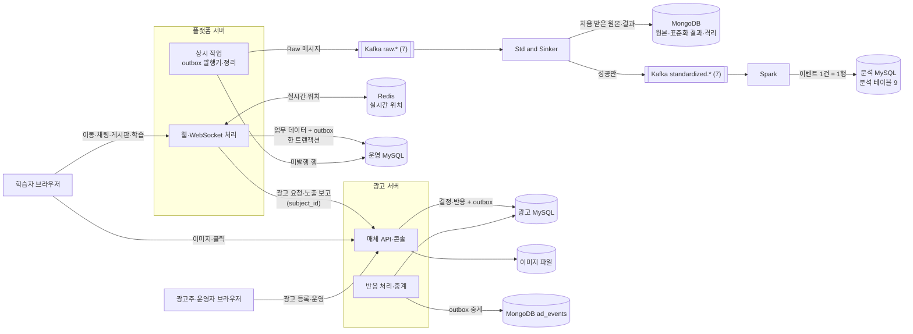

플랫폼과 광고 서버는 서로의 DB를 읽지 않는다. 둘 사이의 데이터는 광고 매체 API(HTTP) 하나로만 오간다. 파이프라인은 Kafka만 읽고 운영 DB에 접근하지 않는다.

### 2.2 저장소

| 저장소 | 구성 | 소유 | 담는 데이터 | 정본 여부 |
|---|---|---|---|---|
| 운영 MySQL | MySQL 8.4 복제 클러스터 | 플랫폼 서버 | 계정·프로필·접속 이력·게시판·채팅·학습·포인트·outbox·광고 연동(부록 A) | **정본** |
| 광고 MySQL | 같은 클러스터의 별도 DB | 광고 서버 | 계정·매체·캠페인·소재·입찰·지갑·원장·결정·반응·outbox(부록 D) | **정본** |
| 분석 MySQL | 같은 클러스터의 별도 DB | Spark | 분석 테이블 9개·처리 오류(부록 C) | 파생(이벤트에서 다시 만들 수 있다) |
| MongoDB | MongoDB 8.0 Replica Set, 과반 확인 쓰기 | Std and Sinker | `raw_logs`(처음 받은 원본), `std_logs`(표준화 결과), `raw_wrong_receipts`·`raw_conflict_receipts`(격리) | 원본 보존 |
| MongoDB `ad_events` | 같은 Replica Set | 광고 서버 | 광고 결정·반응 접수·판정·과금 이벤트(부록 D.6) | 사본(광고 MySQL이 정본) |
| Kafka | Kafka 4.3.1, 토픽마다 복제 3 | 플랫폼(Raw)·Std and Sinker(Std) | `raw.*` 7개, `standardized.*` 7개 | 전달 경로 |
| Redis | 메모리 전용(디스크에 저장하지 않음) | 플랫폼 서버 | 프로세스 사이의 실시간 위치(키마다 1시간 만료)·접속 알림 | 임시 |
| 로컬 파일 | 광고 서버 디스크 | 광고 서버 | 소재 이미지(재인코딩한 바이트, 이름 = SHA-256) | 정본 |

### 2.3 데이터 계층

프로젝트는 Bronze·Silver·Gold 세 계층(델타 아키텍처)으로 데이터를 쌓는다. 실제 저장소와의 대응은 아래와 같다.

| 계층 | 뜻 | 행동 이벤트 | 광고 |
|---|---|---|---|
| Bronze(원본) | 받은 그대로, 바꾸지 않는다 | Kafka `raw.*`, MongoDB `raw_logs` | MongoDB `ad_events`, 반응의 받은 본문(`records_reaction.raw`) |
| Silver(정제) | 계약 검사·표준화, 이벤트 1건 = 1행 | Kafka `standardized.*`, MongoDB `std_logs`, 분석 MySQL `*_fact` | 광고 MySQL의 결정·판정·원장 |
| Gold(집계) | 지표 | MVP는 분석 쿼리(정답률·활동량·동선)로 조회할 때 계산한다. 집계 테이블은 확장 범위(§12.1) | 광고주 대시보드의 일별 성과(조회할 때 계산) |

---

## 3. 데이터 요구사항

요구사항마다 이유와, 지금 어디서 지키는지(구현)를 적는다.

### 3.1 수집

| ID | 요구사항 | 이유 | 구현 | 상태 |
|---|---|---|---|---|
| DR-01 | 서버가 수락하거나 확정한 행동만 이벤트로 남긴다. 범위는 15종(§6.1)이다 | 분석의 단위를 "서버가 받아들인 요청"으로 고정해야 재현할 수 있다 | 플랫폼이 업무 처리 안에서 이벤트를 만든다. 거부된 요청은 이벤트를 만들지 않는다 | [충족] |
| DR-02 | 이벤트는 원인이 된 운영 DB 변경과 **같은 트랜잭션**에 기록한다. 저장됐는데 이벤트가 없거나, 이벤트만 있는 경우가 없어야 한다 | Kafka 전송이 실패해도 업무 데이터와 이벤트가 어긋나면 안 된다 | 15종 모두 outbox(`eventing_eventoutbox`)를 거친다. 광고 서버도 결정·반응·과금을 같은 방식(`events_outbox`)으로 남긴다 | [충족] |
| DR-03 | 이벤트는 **발생 당시의 값**(소속 반·콘텐츠 분류·글 버전)을 담고, 나중의 값으로 바꾸지 않는다 | 소속·분류가 바뀌어도 과거 분석 결과가 달라지지 않게 | `class_group_uuid`·`category_uuid`·`domain`·`revision`을 이벤트에 싣는다. 광고 결정은 입찰·정책·소재를 스냅샷으로 저장한다 | [충족] |

### 3.2 식별·형식

| ID | 요구사항 | 이유 | 구현 | 상태 |
|---|---|---|---|---|
| DR-04 | 모든 레코드와 이벤트는 UUID로 식별하고, 재시도·재발행·재처리 동안 같은 ID를 유지한다 | 단계마다 중복을 같은 키로 걸러야 한다 | 플랫폼·이벤트는 UUIDv4, 광고 서버는 UUIDv7(§4.1) | [충족] |
| DR-05 | 시각은 UTC로 저장하고, 서버 사이에는 ISO-8601 UTC 문자열로 주고받는다. 한국 시각은 화면에서만 쓴다 | 서버·저장소마다 시간대가 섞이면 순서와 기간 계산이 틀린다 | 서버 OS 시간대가 UTC이고, 애플리케이션이 시각을 UTC로 바꿔 저장한다. 이벤트 `occurred_at`은 `Z` 표기 | [충족] |
| DR-06 | 서버 사이 계약의 필드 이름은 표준 용어 사전의 소문자 snake_case 영문만 쓰고, 코드값은 대문자로 쓴다 | 플랫폼·파이프라인·분석 DB가 같은 이름을 변환 없이 쓴다 | 표준 단어 49개·용어 43개·도메인 19개. 표준화 작업자가 시작할 때 계약의 모든 필드가 사전에 있는지 검사한다(부록 B.4) | [충족] |
| DR-07 | 포인트와 금액은 정수로 다루고, 잔액은 음수가 될 수 없다 | 소수 오차와 마이너스 잔액을 막는다 | 플랫폼 `bigint unsigned` + CHECK, 광고 서버 정수 포인트(상한 2^53−1) + CHECK | [충족] |

### 3.3 개인정보·최소 수집

| ID | 요구사항 | 이유 | 구현 | 상태 |
|---|---|---|---|---|
| DR-08 | 행동 데이터는 가명 키 `user_uuid`로만 연결한다. 로그인 ID·닉네임·비밀번호는 계정 테이블 밖으로 나가지 않는다 | 분석에는 지속적인 식별이 필요하지만 실명 식별은 필요 없다 | 이벤트 공통 필드는 `user_uuid`·`session_uuid`·`class_group_uuid` 셋뿐이다 | [충족] |
| DR-09 | 채팅·게시글·댓글 본문과 제출한 답안 원문은 이벤트에 싣지 않는다 | 최소 수집. 본문은 운영 목적(확인·삭제)으로만 운영 DB에 둔다 | 플랫폼이 이벤트 유형마다 허용 필드 목록을 두고, 발행 전에 필드 집합이 정확히 같은지 검사한다. 다르면 저장을 중단한다 | [충족] |
| DR-10 | 광고 서버에는 사용자 ID 대신 광고 전용 가명만 보낸다 | 광고 서버가 학습 행동과 광고 반응을 사용자 단위로 잇지 못하게 | `subject_id` = 비밀 키로 만든 `user_uuid`의 HMAC-SHA256(§8.4). 사용자 ID는 플랫폼 안에만 남는다 | [충족] |
| DR-11 | 비밀번호와 매체 키는 해시로만 저장한다 | 유출돼도 원문을 얻지 못하게 | 플랫폼 Django 기본 해시, 광고 서버 Argon2, 매체 키 SHA-256 | [충족] |
| DR-12 | 채팅 본문은 운영 확인 목적으로 30일만 보관하고, 지난 것은 매일 지운다 | 보관 목적이 끝난 본문을 남기지 않는다 | `expires_at = sent_at + 30일`, 매일 새벽 정리 작업이 지난 행을 지운다 | [충족] |

### 3.4 무결성

| ID | 요구사항 | 이유 | 구현 | 상태 |
|---|---|---|---|---|
| DR-13 | 포인트는 정답 답안 하나에 한 번만 지급한다. 재전송·동시 제출에도 두 번 지급하지 않는다 | 포인트는 보상이라 중복 지급이 곧 손실이다 | 제출 멱등 키 UNIQUE(사용자, `submission_request_uuid`), 사용자 행 잠금으로 직렬화, 원장 `attempt_uuid` UNIQUE, 지갑 행 잠금(§5.3) | [충족] |
| DR-14 | 광고 과금은 인정된 반응 하나에 한 번만, 잔액을 넘지 않게 한다 | 광고주 포인트가 걸려 있다 | 원장 `reaction_ref` UNIQUE, 지갑 행 잠금, 모자라면 있는 만큼만 차감하고 모자란 양을 기록한다 | [충족] |
| DR-15 | 답안·포인트 원장·광고 결정·광고 원장·입찰·정책·감사 로그는 고치거나 지우지 않는다(추가 전용) | 지급·과금의 근거를 사후에 바꿀 수 없어야 한다 | 애플리케이션 계층이 수정·삭제를 막고, 바뀌면 새 버전 행을 더한다. 관련 FK는 삭제 금지(PROTECT) | [충족] |
| DR-16 | 같은 요청의 재전송은 같은 결과를 돌려주고 데이터를 두 번 만들지 않는다 | 네트워크 재시도가 흔하다 | 답안 제출 키, 광고 반응 `PUT`(같은 내용이면 200, 다르면 409), 광고주 생성 요청의 `request_key`, 쪽지 `request_id` | [충족] |

### 3.5 품질

| ID | 요구사항 | 이유 | 구현 | 상태 |
|---|---|---|---|---|
| DR-17 | 파이프라인은 필수 필드·형식·허용값·버전을 엄격히 검사하고, 값을 추정해 고쳐 넣지 않는다 | 잘못된 값이 조용히 분석에 섞이지 않게 | 누락값을 채우거나 `"3"`을 정수로 바꾸지 않는다. Std and Sinker와 Spark가 두 번 검사한다(부록 B.5) | [충족] |
| DR-18 | 메시지 내용이 전달 중에 바뀌거나 손상되지 않았는지 확인한다 | 여러 단계를 거치는 동안의 손상을 잡는다 | Raw 지문과 Std 지문(xxh3_64)을 각 단계에서 다시 계산해 비교한다. 정규화 규칙은 파이프라인의 공유 시험 벡터로 고정한다 | [충족] |
| DR-19 | 잘못된 입력과 충돌은 버리지 않고 사유와 함께 따로 남긴다 | 원인을 찾고 다시 처리할 수 있게 | 해석 불가 → `raw_wrong_receipts`, 같은 ID의 다른 내용 → `raw_conflict_receipts`, 계약 위반 → `std_logs`(FAIL), 적재 단계 오류 → `stream_processing_error` | [충족] |

### 3.6 중복·순서·복구

| ID | 요구사항 | 이유 | 구현 | 상태 |
|---|---|---|---|---|
| DR-20 | 같은 이벤트를 다시 받아도 각 저장소에는 한 건만 남는다 | 전송은 "최소 한 번"이라 중복이 생길 수 있다 | `raw_logs`·`std_logs`의 `_id`, 분석 테이블 PK, `ad_events`의 `_id`가 모두 이벤트 ID다 | [충족] |
| DR-21 | 입력 위치(Kafka offset)는 저장과 발행 확인이 끝난 뒤에만 넘긴다 | 중간에 멈춰도 빠짐없이 다시 처리한다 | Std and Sinker는 자동 커밋을 끄고 저장·발행 ACK 뒤 커밋, Spark는 체크포인트로 미완료 배치를 다시 실행한다 | [충족] |
| DR-22 | 같은 사용자의 이벤트 순서는 한 토픽 안에서 지킨다. 토픽 사이의 순서는 보장하지 않고 `occurred_at`·`revision`·연결 키로 판단한다 | 파티션을 늘려도 사용자 단위 순서는 유지해야 한다 | Kafka key = `user_uuid`. 답안과 지급은 `attempt_uuid`로 잇는다 | [충족] |
| DR-23 | 전송이 실패하면 대기 행을 남기고 같은 이벤트 ID로 다시 보낸다 | 일시 장애로 이벤트를 잃지 않는다 | 플랫폼 outbox는 ACK를 받은 뒤에만 `published_at`을 채운다. 광고 중계는 MongoDB 저장 확인 뒤에만 `sent_at`을 채운다 | [충족] |
| DR-24 | 처음 받은 원본 이벤트를 그대로 보존해 재처리의 근거로 쓴다 | 표준화 규칙이 바뀌어도 원본에서 다시 만들 수 있게 | `raw_logs`는 처음 받은 것만 저장하고 덮어쓰지 않는다 | [충족] |
| DR-25 | 저장소는 서버 한 대가 멈춰도 확정된 데이터를 잃지 않는다 | 단일 장애로 지급·과금 기록이 사라지면 안 된다 | MySQL 3대 클러스터, MongoDB 3대 + 과반 확인 쓰기, Kafka 복제 3·최소 동기 복제 2·`acks=all` | [충족] |

### 3.7 보관·운영

| ID | 요구사항 | 이유 | 구현 | 상태 |
|---|---|---|---|---|
| DR-26 | 계정 삭제는 플랫폼과 광고 서버 모두 **비활성화**로 처리한다. 비활성화한 계정은 로그인·세션·실시간 접속에서 바로 빠지고, 답안·지급·과금 기록은 근거로 남는다 | 지급·과금 기록을 지우면 장부가 맞지 않는다. 행동 데이터는 가명 키로만 이어져 있어 계정과 떨어지면 개인을 가리키지 않는다 | 플랫폼은 계정의 `is_active`를 끄면 로그인·기존 세션·WebSocket·위치 저장·쪽지 검색에서 그 계정을 뺀다. 광고 서버는 관리자가 사유와 함께 비활성화하고(감사 로그), 열린 세션·광고 송출·공개 이미지가 함께 멈춘다. 기간에 따른 자동 처리는 확장 범위다(§12.1) | [충족] |
| DR-27 | MVP 동안 원본 이벤트와 처리 기록은 지우지 않고 보존한다. 목적이 끝난 데이터만 정리한다 | 첫 운영이라 재처리·검증의 근거를 남기고, 보관 기간은 실제 데이터 양을 보고 정한다 | MongoDB 원본·결과, 분석 테이블, 광고 결정·반응·원장·이벤트 로그에는 삭제 경로가 없다. 정리 대상(채팅 본문·세션·전송이 끝난 광고 outbox·로그인 실패 기록)은 §10. 저장소별 보관 기간은 확장 범위다(§12.1) | [충족] |
| DR-28 | 전송이 끝난 outbox 행은 일정 기간 뒤 정리한다 | 대기 테이블이 계속 커지면 발행이 느려진다 | 광고 서버는 보낸 지 7일 뒤 지운다. 플랫폼은 운영 중에 같은 방식으로 더한다(§12.2) | [부분] |
| DR-29 | 채팅 본문은 운영 확인 목적으로만 저장하고, 화면이나 API로 다시 내보내지 않는다 | 본문이 보관 목적(문제 발언 확인) 밖으로 쓰이지 않게 | 본문은 보내는 순간 접속자에게 실시간으로만 전달한다. 저장한 본문을 읽어 보여 주는 기능(지난 채팅 조회 등)은 없고, 30일 뒤 지운다. 운영자 열람 화면은 확장 범위다(§12.1) | [충족] |

---

## 4. 공통 데이터 규칙

### 4.1 식별자

| 대상 | 형식 | 저장 표현 | 비고 |
|---|---|---|---|
| 플랫폼 레코드 | UUIDv4(서버 발급) | MySQL `char(32)`(하이픈 없음) | 계정·게시글·문제 등 일부 테이블은 정수 PK에 UUID 보조키(UNIQUE)를 둔다. 행동 데이터에는 UUID만 쓴다 |
| 기준정보(반·층·구역·분류·콘텐츠) | UUIDv4 고정값 | 같음 | 마이그레이션으로 넣는다. 환경이 달라도 같은 값 |
| 답안 제출 멱등 키 | UUIDv4(브라우저 발급) | 같음 | 같은 제출의 재시도에는 같은 값, 새 제출에는 새 값 |
| 이벤트 `event_uuid` | UUIDv4 | Kafka JSON은 하이픈 포함 36자, MongoDB `_id`도 같은 문자열, 분석 MySQL은 `CHAR(32)` | 재시도·재처리 동안 같다 |
| 광고 서버 레코드 | UUIDv7(시간 순서) | `char(32)` | 자동 증가 키 없음 |
| 광고 이벤트 ID | UUIDv5(`이벤트 이름/원천 ID`) | 같음 | 같은 사실은 언제 다시 만들어도 같은 ID → 중계를 다시 해도 중복이 없다 |
| 광고 가명 `subject_id` | UUID 모양(HMAC 앞 16바이트) | 같음 | §8.4 |

### 4.2 시각

- 모든 DB는 UTC로 저장한다(`datetime(6)`, 마이크로초). 플랫폼은 화면 시간대가 한국이지만 Django의 시간대 처리(`USE_TZ`)로 DB에는 UTC가 들어간다.
- 서버 사이 교환은 ISO-8601 UTC다. 행동 이벤트와 광고 매체 API는 `Z` 표기, 광고 이벤트 로그의 payload는 `+00:00` 표기다(같은 UTC, 표기만 다르다).
- 이벤트의 `occurred_at`은 **서버가 확정한 시각**이다. 브라우저가 보낸 시각을 그대로 쓰지 않는다. 광고 반응은 매체가 보낸 시각(`occurred_at`)과 서버가 받은 시각(`received_at`)을 따로 둔다.

### 4.3 이름과 코드값

- 테이블·컬럼·필드 이름은 소문자 snake_case 영문이다. 플랫폼과 광고 서버의 테이블은 Django 규칙(`<앱>_<모델>`)을 따른다.
- 식별자 필드는 `_uuid`로 끝난다(플랫폼·이벤트). 광고 서버는 `_id`를 쓴다.
- 서버 사이 계약의 코드값은 대문자 SNAKE다(`LOGOUT`, `QUIZ_ANSWERED`, `IMPRESSION`). DB 내부의 선택값은 소문자도 있다(예: 문제 난이도 `beginner`, 광고 자리 `individual`). 내부값은 계약으로 나가기 전에 대문자 코드로 바꾼다.

### 4.4 삭제 방식

| 방식 | 대상 | 뜻 |
|---|---|---|
| 비활성화 | 플랫폼·광고 서버 계정 | `is_active`를 끈다. 계정 행과 기록은 남고, 로그인·세션·실시간 접속(광고 서버는 광고 송출까지)에서 빠진다(DR-26) |
| 소프트 삭제 | 게시글·댓글 | `deleted_at`을 채운다. 행은 남고 화면에서만 사라진다. 삭제도 이벤트로 남는다 |
| 추가 전용 | 답안·포인트 원장·광고 결정·원장·입찰·정책·감사 로그 | 고치거나 지우지 않는다(DR-15) |
| 보관 | 광고 소재 | `archived_at`을 채운다. 목록에서 빠지지만 결정 기록은 그대로 그 소재를 가리킨다 |
| 기간 삭제 | 채팅 본문(30일), 광고 outbox(전송 뒤 7일), 로그인 세션 | 정리 작업이 지운다(§10) |

---

## 5. 플랫폼 운영 데이터

### 5.1 테이블 목록

| 영역 | 테이블 | 뜻 |
|---|---|---|
| 계정·접속 | `auth_user` | 로그인 계정(Django 기본) |
| | `accounts_profile` | 프로필·가명 키 `user_uuid`·기수·마지막 위치 |
| | `accounts_activelogin` | 한 계정 한 세션 |
| | `django_session` | 로그인 세션 |
| | `eventing_platformsession` | 접속 이력(로그인 1회 = 1행) |
| 기준정보 | `eventing_classgroup` | 소속 반(기수) 7개 |
| | `eventing_mapfloor`·`eventing_mapzone` | 층 2개·구역 5개 |
| | `eventing_contentcategory`·`eventing_contentitem` | 콘텐츠 분류 4개·콘텐츠 21개 |
| 커뮤니티 | `community_post`·`community_comment` | 게시글·댓글(대댓글 1단계) |
| | `eventing_chatmessage` | 전체 채팅 본문(30일) |
| | `direct_messages_conversation`·`direct_messages_message` | 1:1 쪽지(기본 꺼짐) |
| 학습·포인트 | `learning_question`·`learning_questionchoice` | 문제은행·객관식 보기 |
| | `learning_learningsession`·`learning_sessionquestion` | 학습 회차(10문항)·출제 문제 |
| | `learning_useranswer` | 답안(추가 전용) |
| | `learning_pointwallet`·`learning_pointledger` | 캠퍼스 포인트 잔액·지급 원장(추가 전용) |
| 발행 | `eventing_eventoutbox` | 이벤트 발행 대기 |
| 광고 연동 | `ad_bridge_issueddecision`·`ad_bridge_impression`·`ad_bridge_placementbatch` | 받은 결정·노출 보고·자리 배치(§8.4) |

컬럼 전체는 부록 A에 있다.

### 5.2 ERD

아래 ERD는 키와 핵심 컬럼만 보인다. 실선은 FK, 점선은 FK 없이 값으로 잇는 논리 관계다.

**ERD-1. 계정·접속·커뮤니티**

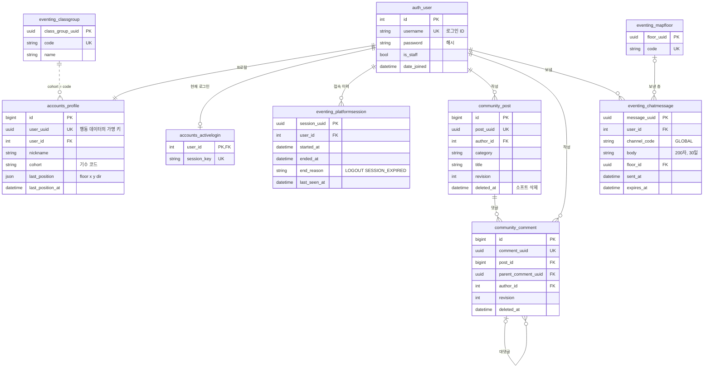

**ERD-2. 기준정보·학습·포인트**

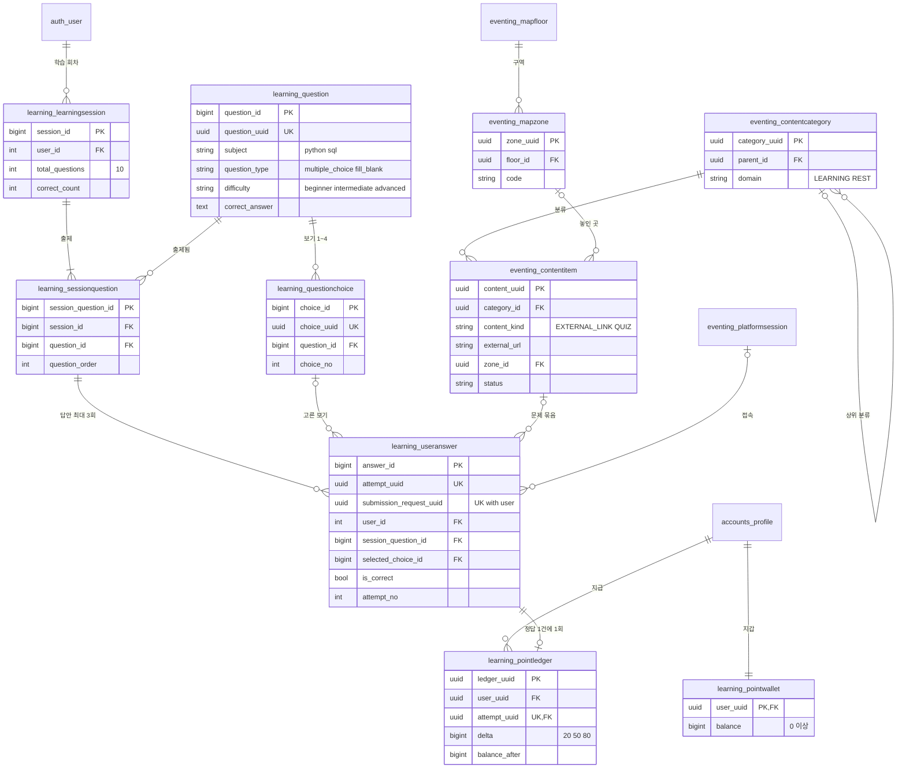

**ERD-3. 이벤트 발행·광고 연동**

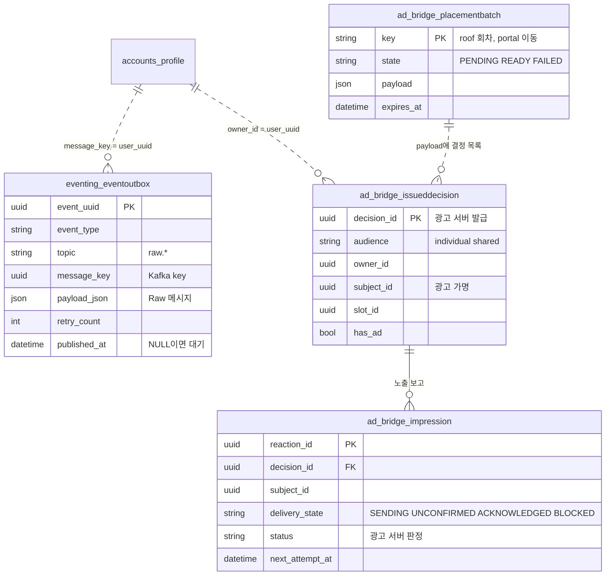

### 5.3 업무 규칙

**계정·세션**
- 가입하면 계정·프로필·포인트 지갑(0P)을 한 트랜잭션으로 만든다. `user_uuid`는 이때 발급하고 바꾸지 않는다.
- `last_seen_at`은 서버가 마지막으로 접속을 확인한 시각이다. 위치를 관측한 시각(`last_position_at`)과는 따로 둔다.
- **한 계정 한 세션**이다. 새로 로그인하면 이전 세션을 끝내고(`SESSION_EXPIRED`) 새 접속 이력을 연다.
- 세션 종료는 로그아웃(`LOGOUT`)과 만료(`SESSION_EXPIRED`) 두 가지다. 만료는 요청·실시간 접속·매일 정리 작업에서 감지하며, `ended_at`은 서버가 만료를 **감지한 시각**이다.
- 실시간 연결(WebSocket)이 끊기는 것만으로는 세션을 끝내지 않고, 이벤트도 만들지 않는다.

**위치**
- 실시간 위치는 Redis에 임시로만 둔다(1시간 만료, 디스크에 저장하지 않음). DB에는 체크포인트만 저장한다.
- DB에는 5초마다 체크포인트로 마지막 위치를 저장한다. 층을 옮기거나 접속을 끝낼 때는 바로 저장한다. 더 새로 관측한 위치일 때만 덮어쓴다.
- 좌표가 바뀌었을 때만 `movement_observed`를 만든다(방향만 바뀐 것은 만들지 않는다). 층 이동은 위치 저장·`movement_observed`·`floor_transferred`를 한 트랜잭션으로 남긴다.

**게시판**
- `revision`은 1에서 시작해 수정·삭제마다 1씩 늘린다. 수정·삭제는 화면이 본 `revision`이 그대로일 때만 된다(낙관적 잠금).
- 삭제는 소프트 삭제다. 대댓글은 1단계까지다(`parent_comment_uuid`).
- 상세 조회마다 `post_read`를 남긴다. 이것은 서버가 조회 요청을 받아들였다는 사실이지, 사용자가 실제로 읽었다는 증거는 아니다.

**학습·포인트**
- 학습 회차는 10문항이고, 문항마다 답안을 최대 3건 남긴다(`attempt_no`). 맞히면 그 문항에는 더 답할 수 없다.
- 채점은 서버가 하고, 결과(`is_correct`)를 답안과 이벤트에 남긴다. 정답은 서버만 안다.
- 정답이면 난이도별 배점(초급 20 · 중급 50 · 고급 80)을 지급한다. 객관식과 빈칸의 배점이 같고, 몇 번째 시도에 맞혔는지는 상관없다. 따라서 **회차·문항마다 최대 1회** 지급하고, 새 회차에서 같은 문제를 다시 맞히면 다시 지급한다.
- 답안 저장·채점·지갑 증가·원장·두 이벤트(`quiz_answered`, `point_granted`)를 **한 트랜잭션**으로 확정한다. 중간에 실패하면 모두 취소한다.
- 같은 제출 키로 다시 오면 저장된 응답을 그대로 돌려주고 아무것도 새로 만들지 않는다. 같은 키에 다른 답이 오면 거절한다.

**채팅**
- 본문은 200자까지 저장한다. 운영 DB에 30일 보관하고 이벤트에는 본문을 싣지 않는다.

---

## 6. 행동 이벤트 데이터

### 6.1 이벤트 목록

| # | 이벤트 | Raw 토픽 → Std 토픽 | 언제 | 분석 테이블 |
|---|---|---|---|---|
| 1 | `session_started` | `raw.account` → `standardized.account` | 로그인 | `account_activity_fact` |
| 2 | `session_ended` | 〃 | 로그아웃·만료 감지 | 〃 |
| 3 | `chat_sent` | `raw.chat` → `standardized.chat` | 채팅 저장 | `chat_activity_fact` |
| 4~7 | `post_created`·`post_updated`·`post_deleted`·`post_read` | `raw.board` → `standardized.board` | 글 저장·수정·삭제·상세 조회 | `post_activity_fact` |
| 8~10 | `comment_created`·`comment_updated`·`comment_deleted` | `raw.comment` → `standardized.comment` | 댓글 저장·수정·삭제 | `comment_activity_fact` |
| 11 | `content_open_requested` | `raw.content_usage` → `standardized.content_usage` | 콘텐츠 열기 요청 | `content_activity_fact` |
| 12 | `quiz_answered` | 〃 | 답안 채점 | `quiz_attempt_fact` |
| 13 | `movement_observed` | `raw.movement` → `standardized.movement` | 5초 체크포인트에서 좌표 변화 | `movement_fact` |
| 14 | `floor_transferred` | 〃 | 층 이동 완료 | `floor_transfer_fact` |
| 15 | `point_granted` | `raw.points` → `standardized.points` | 정답 포인트 지급 | `point_grant_fact` |

이벤트마다의 필드는 부록 B.2에 있다. `quiz_answered`만 버전 1.1(빈칸 문제 추가)이고 나머지는 1.0이다. 수신 쪽은 `quiz_answered` 1.0도 계속 받는다.

**수집하지 않는 것**: 찌르기·점프 같은 실시간 상호작용, 포인트 조회, 쪽지, 광고 노출(광고는 광고 서버가 따로 기록한다).

### 6.2 메시지 구조

**Raw 메시지** (`raw.content_usage`, 빈칸 문제를 맞힌 예)

```json
{
  "event_uuid": "b0e17ee5-af42-4dc0-92c4-bba6255e0fcb",
  "raw_manifest": {
    "schema_version": "1.1",
    "event_type": "quiz_answered",
    "occurred_at": "2026-10-16T06:38:00.123Z",
    "source": "platform_server_1",
    "fingerprint_algorithm": "xxh3_64",
    "fingerprint": "3f9a1c0d7e2b4a65"
  },
  "raw_data": {
    "user_uuid": "9b788d18-603c-4d64-9091-b54c9b1f3e67",
    "session_uuid": "2b1dd465-0e1a-43eb-a902-87ec1f89c1d1",
    "class_group_uuid": "34db861d-72df-4258-9fad-35878bcd9ae6",
    "attempt_uuid": "56fd1d9c-b1ae-4a3d-9c4a-b86811f0ab25",
    "question_uuid": "8b59b8ad-7d8d-46f4-838b-9c3a1ca0f91a",
    "content_uuid": "424c4db5-0a92-42e2-a009-23c675c2b889",
    "question_type": "FILL_BLANK",
    "choice_uuid": null,
    "is_correct": true
  }
}
```

**Std 메시지** (같은 이벤트를 표준화한 결과, `standardized.content_usage`)

```json
{
  "std_manifest": {
    "event_type": "QUIZ_ANSWERED",
    "std_schema_version": "1.1",
    "status": "SUCCESS",
    "processed_at": "2026-10-16T06:38:00.456Z",
    "parser_version": "1.1.0",
    "fingerprint_algorithm": "xxh3_64",
    "fingerprint": "a81c44e09f3d2b17",
    "error_code": null
  },
  "std_data": {
    "event_uuid": "b0e17ee5-af42-4dc0-92c4-bba6255e0fcb",
    "occurred_at": "2026-10-16T06:38:00.123Z",
    "user_uuid": "9b788d18-603c-4d64-9091-b54c9b1f3e67",
    "session_uuid": "2b1dd465-0e1a-43eb-a902-87ec1f89c1d1",
    "class_group_uuid": "34db861d-72df-4258-9fad-35878bcd9ae6",
    "attempt_uuid": "56fd1d9c-b1ae-4a3d-9c4a-b86811f0ab25",
    "question_uuid": "8b59b8ad-7d8d-46f4-838b-9c3a1ca0f91a",
    "content_uuid": "424c4db5-0a92-42e2-a009-23c675c2b889",
    "question_type": "FILL_BLANK",
    "choice_uuid": null,
    "is_correct": true,
    "event_type": "QUIZ_ANSWERED"
  }
}
```

UUID와 지문 값은 설명용이다. 표준화는 이름을 바꾸지 않는다. 시각을 UTC `Z` 표기로 맞추고, 이벤트 종류를 대문자 상수로 더하고, 좌표만 실수로 바꾼다. Raw의 `schema_version`·`source`·Raw 지문은 Std에 들어가지 않는다.

### 6.3 Kafka 전달 계약

| 항목 | Raw(플랫폼 → `raw.*`) | Std(Std and Sinker → `standardized.*`) |
|---|---|---|
| key | `user_uuid`(UTF-8) | `std_data.user_uuid`(UTF-8) |
| value | Raw 메시지 JSON(UTF-8) | Std 메시지 JSON(UTF-8) |
| headers | 없음 | `event_type`, `std_schema_version`(manifest 값 복사) |
| 발행 조건 | outbox 커밋 뒤 | 결과가 SUCCESS일 때만(FAIL·격리는 발행하지 않는다) |
| 토픽 | 정해진 7개만 쓴다(자동으로 만들지 않는다) | 같음 |

전달은 "최소 한 번"이다. 발행 뒤 상태를 기록하기 전에 멈추면 같은 `event_uuid`로 다시 나갈 수 있고, 수신 쪽이 이벤트 ID로 중복을 흡수한다(DR-20).

### 6.4 표준화와 보존 (Std and Sinker)

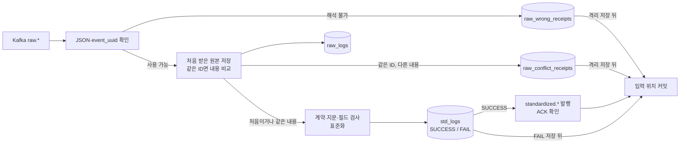

- 입력 위치는 **결과를 어딘가에 남긴 뒤에만** 넘긴다. 성공은 Std 발행 ACK까지, 실패·격리는 그 기록까지 끝나야 한다(DR-21).
- `raw_logs`는 처음 받은 원본만 저장한다. 같은 ID가 다시 오면 내용을 바이트 수준으로 비교해, 같으면 재전송으로 보고 계속 처리하고 다르면 충돌로 격리한다.
- `std_logs`는 이벤트마다 결과 하나다. 새 파서 버전이 예전의 FAIL을 SUCCESS로 바꿀 때만 교체하고, 같은 버전인데 결과가 다르면 처리를 멈춘다(규칙이 결정적이지 않다는 뜻이므로).
- 검사 순서: 구조 → 계약(이벤트·버전) → manifest → Raw 지문 → 필드 형식 → 조건 규칙(예: 빈칸이면 `choice_uuid`는 null) → Kafka key = `user_uuid`. 위반하면 첫 위반의 코드로 FAIL이다(부록 B.5).

---

## 7. 분석 데이터

### 7.1 테이블 목록

| 테이블 | 받는 이벤트 | 테이블별 핵심 컬럼 |
|---|---|---|
| `account_activity_fact` | 세션 시작·종료 | `event_type`, `end_reason` |
| `chat_activity_fact` | 채팅 | `message_uuid`, `floor_uuid` |
| `post_activity_fact` | 게시글 4종 | `post_uuid`, `action`, `revision`, `zone_uuid` |
| `comment_activity_fact` | 댓글 3종 | `comment_uuid`, `post_uuid`, `parent_comment_uuid`, `action`, `revision` |
| `content_activity_fact` | 콘텐츠 열기 | `content_uuid`, `category_uuid`, `domain`, `content_kind`, `action`, `zone_uuid` |
| `quiz_attempt_fact` | 답안 | `attempt_uuid`, `question_uuid`, `content_uuid`, `question_type`, `choice_uuid`, `is_correct` |
| `movement_fact` | 이동 | `floor_uuid`, `zone_uuid`, `x`, `y`, `input_kind` |
| `floor_transfer_fact` | 층 이동 | `from_floor_uuid`, `to_floor_uuid`, `zone_uuid` |
| `point_grant_fact` | 포인트 지급 | `ledger_uuid`, `attempt_uuid`, `delta`, `balance_after` |
| `stream_processing_error` | (오류) | 입력 위치, `event_uuid`, `error_code`, `error_detail` |

모든 분석 테이블은 공통 컬럼(`event_uuid` PK, `occurred_at`, `user_uuid`, `class_group_uuid`, `session_uuid`, 파서 버전·순위, Std 지문)을 갖고, (`user_uuid`, `occurred_at`) 색인으로 사용자별 시간순 조회를 한다(부록 C).

### 7.2 ERD

분석 테이블에는 FK가 없다. 이벤트는 순서 없이 도착할 수 있고(토픽이 다르면 순서를 보장하지 않는다), 각 행은 이벤트 당시의 값을 그대로 보존하기 때문이다. 아래 점선은 조회할 때 쓰는 연결 키다.

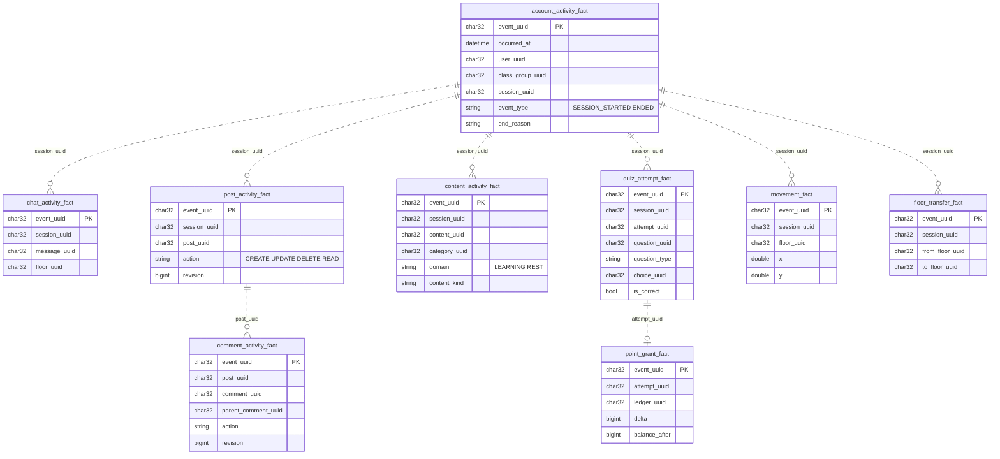

### 7.3 적재 규칙 (Spark)

- 입력은 `standardized.*` 7개 토픽이다.
- Std and Sinker를 믿지 않고 **다시 검사한다**: headers와 manifest 일치, 등록된 (이벤트, 버전)과 파서 버전, Std 지문, 필드 집합(모르는 필드도 거부), Kafka key = `user_uuid`.
- 저장은 이벤트 ID 기준이다. 이미 행이 있으면 파서 순위를 비교한다 — 새 순위가 낮으면 건너뛰고, 같고 지문도 같으면 건너뛰고(재전송), 같은데 지문이 다르면 오류로 남기고 기존 행을 유지하고, 높으면 새 값으로 갱신한다.
- UUID는 하이픈을 빼서 `CHAR(32)`로, 시각은 UTC `DATETIME(6)`으로 넣는다. `quiz_answered` 1.0 행은 `question_type`을 `MULTIPLE_CHOICE`로 채운다.
- 쓰기가 실패하면 배치 전체가 실패하고, 같은 체크포인트에서 그 배치를 다시 실행한다. 일부 테이블만 써진 상태여도 멱등 저장이 중복을 흡수한다.
- 집계(정답률·활동량·동선)는 적재와 분리된 쿼리로 한다.

---

## 8. 광고 데이터

광고 서버는 광고주가 광고를 등록하고, 메타버스(매체)가 광고 자리마다 광고를 요청하며, 노출·클릭·전환 반응에 따라 광고주 포인트를 차감하는 독립 서버다. 테이블마다의 컬럼과 코드값 전체는 부록 D에 있다.

### 8.1 테이블 목록

| 영역 | 테이블 | 뜻 |
|---|---|---|
| 계정·감사 | `foundation_user` | 광고주·관리자 계정 |
| | `foundation_audit_log` [추가 전용] | 운영·계정 동작 기록 |
| 마스터 | `masters_media`, `masters_slot` | 매체(메타버스), 광고 자리(개인 `individual` · 공용 `shared`) |
| | `masters_media_key` | 매체 인증 키(해시) |
| | `masters_bid_policy` [추가 전용] | 자리마다의 가격 하한·기준·상한과 과금 비율(버전) |
| | `masters_media_deactivation` [추가 전용] | 매체를 끈 기록 |
| 광고 운영 | `campaigns_campaign` | 캠페인(기간·일예산·상태) |
| | `campaigns_ad_group`, `campaigns_ad_group_slot` | 광고그룹과 노출할 자리 |
| | `campaigns_creative` | 소재(제목·이동 주소·이미지) |
| | `campaigns_ad_group_creative` [추가 전용], `campaigns_creative_image` [추가 전용] | 소재 연결 이력, 소재가 가진 이미지 |
| | `campaigns_bid` [추가 전용] | 입찰가(버전) |
| | `campaigns_review_request` | 운영자 중단에 대한 재검토 요청 |
| 지갑·원장 | `billing_wallet`, `billing_ledger_entry` [추가 전용] | 광고 포인트 잔액, 가입 지급·과금·조정 원장 |
| 결정·반응 | `records_decision` [추가 전용] | 광고 요청 하나의 결정과 스냅샷 |
| | `records_reaction` | 반응 수신함과 판정 결과 |
| 이벤트 | `events_outbox` | MongoDB로 옮길 이벤트 대기 |

### 8.2 ERD

**ERD-4. 마스터·광고 운영·지갑**

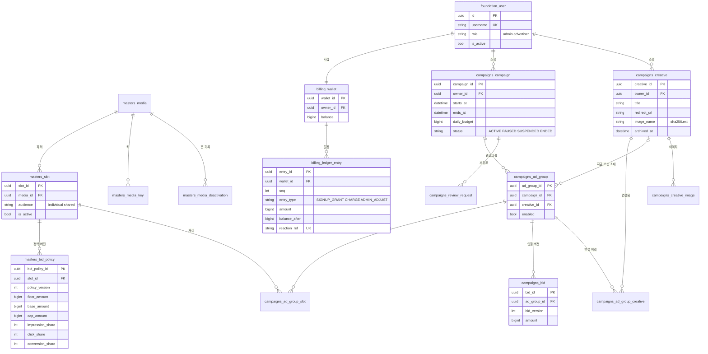

**ERD-5. 결정·반응·과금·이벤트**

결정과 반응은 FK를 두지 않는다. 결정은 그때의 값을 스냅샷으로 가지므로, 캠페인이나 소재가 바뀌어도 기록은 바뀌지 않는다.

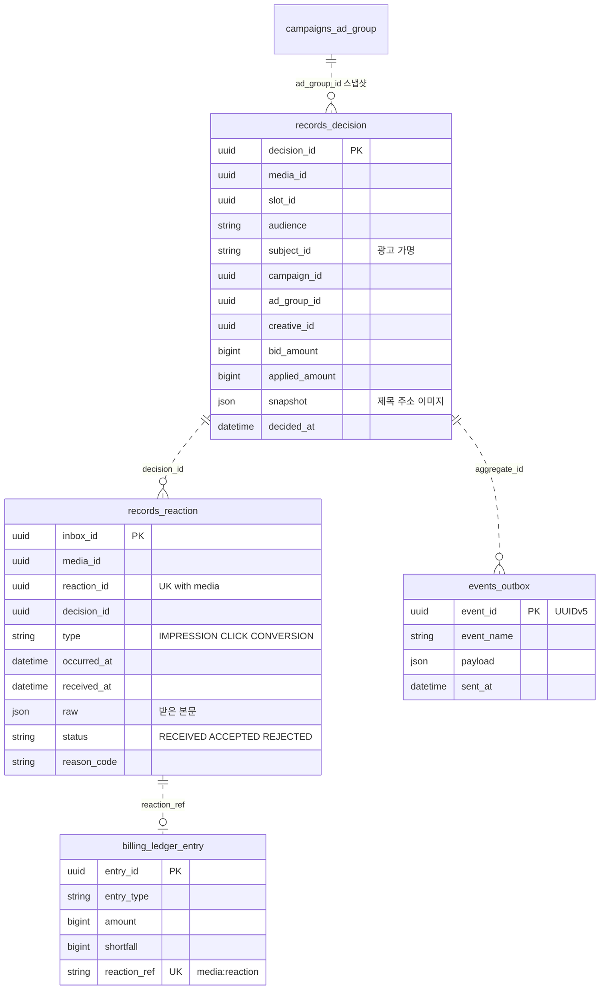

### 8.3 광고 이벤트 로그 (`ad_events`)

광고 서버는 업무 처리와 같은 트랜잭션으로 `events_outbox`에 이벤트를 적고, 상시 중계가 MongoDB `ad_events`로 옮긴다. 이벤트 ID가 결정적(UUIDv5)이라 다시 옮겨도 중복이 생기지 않고, 같은 ID에 다른 내용이 오면 중계가 멈춘다.

| 이벤트 | 언제 | 핵심 내용 |
|---|---|---|
| `ad.decision`(v2) | 광고 요청을 결정할 때(광고가 없을 때도) | 매체·자리·가명, 뽑힌 광고와 그때의 입찰·정책·금액, 후보 수와 탈락 사유별 수 |
| `ad.reaction_received`(v1) | 반응을 접수할 때 | 반응 유형·보고 시각·받은 본문 |
| `ad.reaction`(v1) | 판정할 때 | 인정·거부, 적용 규칙, 판정 근거 |
| `ad.charge`(v1) | 과금할 때 | 요청 금액·실제 차감액·부족분·예산 일 |

매체가 보낸 문맥(`context`)과 광고주 계정 ID는 이벤트에 싣지 않는다. 필드 전체는 부록 D.6에 있다.

### 8.4 플랫폼–광고 연동

| 항목 | 내용 |
|---|---|
| 광고 가명 | `subject_id` = 플랫폼만 아는 비밀 키로 만든 HMAC-SHA256(`user_uuid`)의 앞 16바이트(UUID 모양). 같은 사람은 늘 같은 가명이지만, 광고 서버는 이것으로 사용자 ID를 알 수 없다 |
| 공용 자리(옥상) | 10초 회차마다 결정을 한 번 받아 모든 사람이 같은 광고를 본다. 가명을 보내지 않는다 |
| 개인 자리(층 이동 화면) | 이동할 때 사람마다 결정을 받는다. 가명을 보낸다 |
| 노출 보고 | 브라우저에서 이미지가 50% 이상, 1초 연속 보이면 플랫폼에 알리고, 플랫폼이 시각을 정해 광고 서버에 보고한다. 결정 하나에 사람마다 노출 하나(UNIQUE) |
| 재전송 | 광고 서버가 확인할 때까지 같은 `reaction_id`로 다시 보낸다. 광고 서버는 같은 반응을 한 번만 기록한다. 받아들일 수 없는 요청이면 멈춘다(`BLOCKED`) |
| 클릭 | 브라우저가 광고 서버의 클릭 주소로 바로 간다. 광고 서버가 클릭을 기록하고 광고주 페이지로 보낸다. 플랫폼은 클릭을 저장하지 않는다 |
| 이미지 | 광고 서버가 직접 내준다. 캠페인이 끝났거나 중단되면 404 |
| 포인트 | 캠퍼스 포인트(학습 보상)와 광고 포인트(광고주 예산)는 서로 다른 장부다. 둘 사이의 전환은 확장 범위다(§12.1) |

---

## 9. 데이터 흐름

### 9.1 이벤트가 분석 테이블에 닿기까지

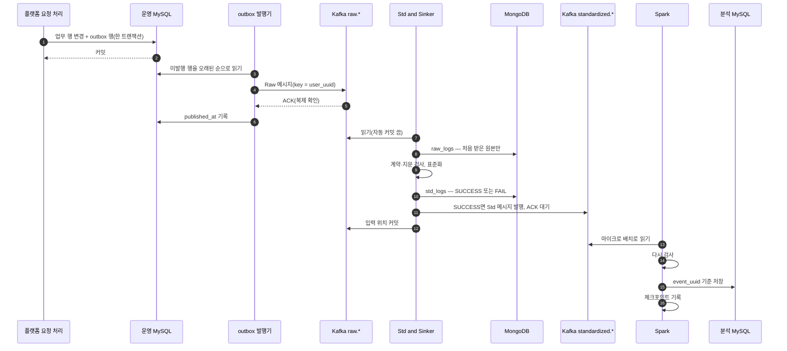

outbox 발행기는 서버 전체에 하나만 돈다(여러 프로세스가 같은 행을 집어 중복 발행하지 않게). Kafka가 멈춰 있으면 행이 outbox에 쌓이고, 다시 연결되면 순서대로 나간다.

### 9.2 로그인과 세션 종료

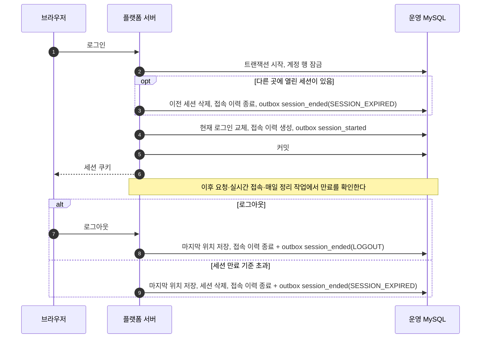

### 9.3 학습 답안과 포인트 지급

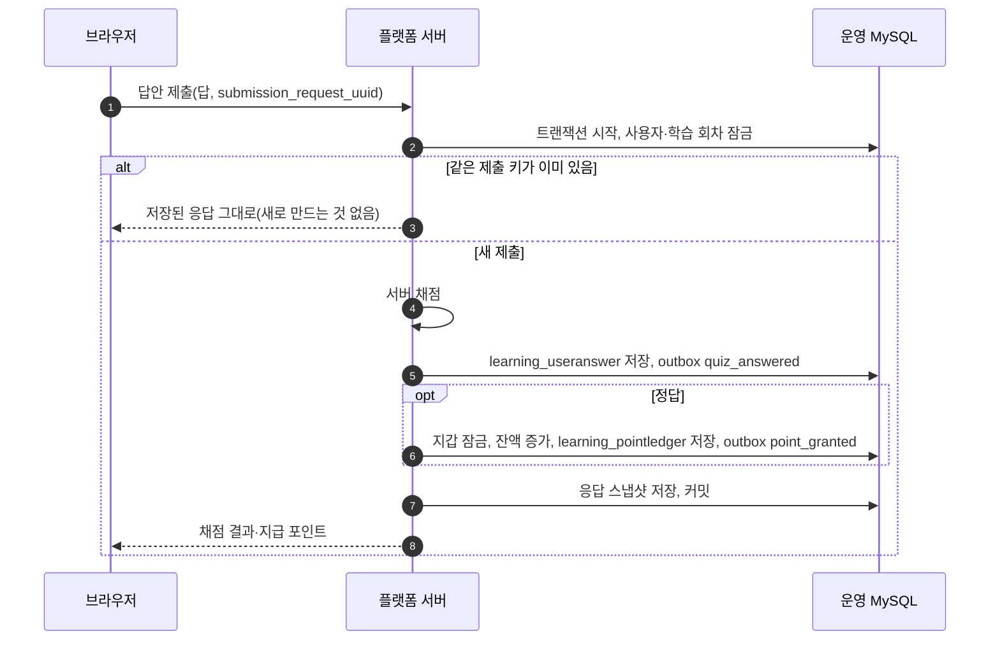

중간 어디에서 실패해도 답안·지갑·원장·두 이벤트가 함께 취소된다. 분석 쪽에서는 `quiz_attempt_fact`와 `point_grant_fact`를 `attempt_uuid`로 잇는다.

### 9.4 이동과 층 이동

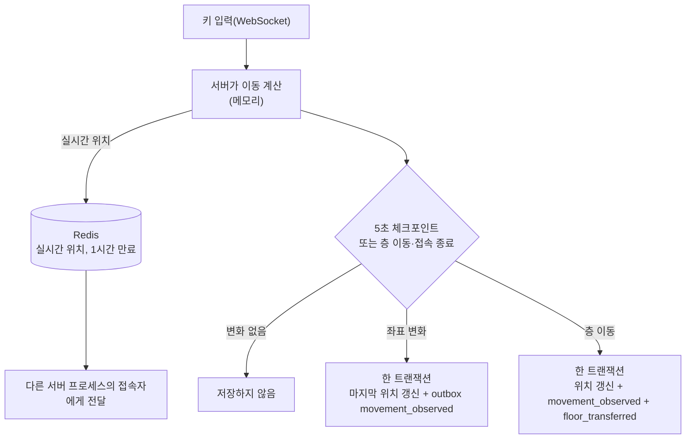

이동 이벤트는 사용자당 최대 5초에 한 건이다. 실시간 위치는 화면 표시용이라 이벤트로 남기지 않는다.

### 9.5 광고 요청·노출·클릭·과금

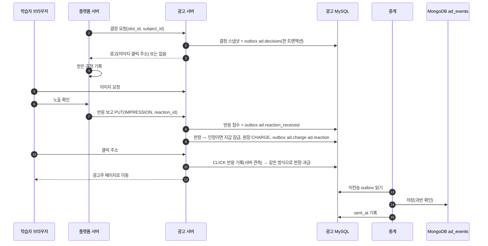

반응 판정은 규칙 11개를 순서대로 적용한다(결정이 있는가, 같은 매체인가, 광고가 실제로 나갔는가, 클릭은 결정 뒤 300초 안인가, 같은 사람·유형으로 이미 인정됐는가 등). 전제가 아직 안 왔으면(예: 노출보다 클릭이 먼저 도착) 최대 300초까지 보류한다. 인정된 반응만 과금하고, 과금액은 결정 때의 적용 금액에 그 반응 유형의 비율을 곱한 값이다.

---

## 10. 수명주기·보관·삭제

MVP는 첫 운영이라 원본 이벤트와 처리 기록을 지우지 않고 모두 보존한다(DR-27). 정리하는 것은 목적이 끝난 데이터(채팅 본문, 로그인 세션, 전송이 끝난 광고 outbox, 로그인 실패 기록)뿐이다. 저장소별 보관 기간은 운영 데이터가 쌓인 뒤 확장 범위에서 정한다(§12.1).

| 데이터 | 저장소 | MVP 보관 | 삭제·정리 방식 | 이후 |
|---|---|---|---|---|
| 계정·프로필·지갑 | 운영 MySQL | 계속 | 삭제는 비활성화로 처리하고 기록은 남긴다(DR-26) | 계정 기간 처리(§12.1) |
| 로그인 세션 | 운영 MySQL | 최대 8시간·유휴 30분 | 만료를 감지하면 행 삭제, 매일 정리 | — |
| 접속 이력 | 운영 MySQL | 계속 | 지우지 않는다 | 보관 기간 정책 |
| 채팅 본문 | 운영 MySQL | 30일 | 매일 새벽 4시(한국 시각) 삭제 | — |
| 게시글·댓글 | 운영 MySQL | 계속 | 소프트 삭제 | — |
| 답안·포인트 원장 | 운영 MySQL | 계속 | 지우지 않는다(추가 전용) | — |
| 플랫폼 outbox | 운영 MySQL | 계속 | 정리 작업 없음(DR-28) | 운영 중 보완(§12.2) |
| 실시간 위치 | Redis | 1시간(키 만료) | 자동 만료, 디스크에 저장하지 않음 | — |
| Raw·Std 토픽 | Kafka | 브로커 기본 보관 기간 | 브로커가 정리한다. 원본 보존은 MongoDB `raw_logs`가 맡는다 | 토픽별 보관 기간 명시 |
| 원본·표준화 결과·격리 | MongoDB | 계속 | 지우지 않는다(재처리 근거) | 보관 기간 정책 |
| 분석 테이블·오류 | 분석 MySQL | 계속 | 지우지 않는다 | 보관 기간 정책 |
| 광고 결정·반응·감사 로그 | 광고 MySQL | 계속 | 지우지 않는다 | 보관 기간 정책 |
| 광고 원장 | 광고 MySQL | 계속 | **지우지 않는다**(확정) | — |
| 광고 outbox | 광고 MySQL | 전송 뒤 7일 | 정리 명령이 삭제(미전송은 지우지 않는다) | — |
| 광고 이벤트 로그 | MongoDB `ad_events` | 계속 | 지우지 않는다 | 보관 기간 정책 |
| 광고 로그인 실패 기록 | 광고 MySQL | 30일 | 매주 정리 | — |
| 소재 이미지 파일 | 광고 서버 디스크 | 계속 | 소재를 보관해도 파일은 남는다(지난 결정의 근거) | 보관 기간 정책 |

---

## 11. 보안·개인정보

### 11.1 분류

| 등급 | 뜻 | 데이터 | 다루는 규칙 |
|---|---|---|---|
| 식별 | 사람을 바로 가리키거나 인증에 쓰는 값 | 로그인 ID, 비밀번호 해시, 매체 키 해시, IP(감사·로그인 잠금), 광고주 계정 이름 | 계정·감사 테이블 밖으로 내보내지 않는다. 비밀번호·키는 해시만 둔다 |
| 본문 | 사람이 쓴 글 | 채팅·게시글·댓글 본문, 답안 원문, 쪽지 | 운영 DB에만 둔다. 이벤트에 싣지 않는다. 채팅은 30일 |
| 가명 행동 | 가명 키로 이은 행동 기록 | `user_uuid`·`session_uuid`·`class_group_uuid`와 행동 이벤트 전체, 분석 테이블, 광고 `subject_id`와 결정·반응 | 가명 키로만 잇는다. 광고 서버에는 광고 전용 가명만 간다 |
| 일반 | 공개되거나 서비스가 정한 값 | 층·구역·콘텐츠·문제(정답 제외), 광고 소재(제목·이미지·주소) | 제한 없음. 문제 정답은 서버만 안다 |

### 11.2 장치

- **필드 허용 목록**: 플랫폼은 이벤트 유형마다 허용 필드를 정해 두고, 발행 전에 필드 집합이 정확히 같은지 검사한다(DR-09). 민감 정보를 빼는 책임은 발행하는 쪽(플랫폼)에 있다.
- **광고 가명**: 비밀 키 HMAC(DR-10). 매체가 보내는 문맥(`context`)에는 직접 식별자 키를 넣을 수 없게 광고 서버가 거절한다.
- **오류 기록**: 파이프라인의 오류 기록은 필드 이름만 남기고 원문 값은 남기지 않는다. 광고 서버의 로그·감사 기록은 비밀번호·토큰·키 이름의 값을 지운다.
- **이미지**: 광고 서버는 올린 이미지를 다시 인코딩하면서 위치 정보 등 메타데이터를 지운다.
- **브라우저 저장소**: 화면 설정(닉네임·채팅창 표시 여부), 진행 중인 학습 회차와 제출 키만 둔다. 서버 데이터의 사본은 두지 않는다.

---

## 12. 확장 범위와 운영 중 보완

### 12.1 확장 범위

MVP는 첫 운영(부트캠프 내부)에 필요한 범위를 구현했다. 아래는 처음부터 MVP 밖으로 정한 것이다. 나중에 붙일 수 있도록 연결 지점을 먼저 만들어 두었다.

| 확장 | 하는 일 | 연결 지점(지금 있는 것) |
|---|---|---|
| 광고 이벤트 Kafka 전환 | 이벤트가 광고 서버의 중계로 감당하지 못할 만큼 늘면, MongoDB 중계 대신 Kafka로 내보낸다 | 광고 서버는 모든 이벤트를 업무 트랜잭션 안에서 outbox에 결정적 ID(UUIDv5)로 쌓는다. 전환할 때는 outbox를 읽어 Kafka로 보내는 라우터(CDC)를 붙이고 지금의 중계를 끈다. 결정·반응 로직과 outbox에 쓰는 코드는 바뀌지 않고, 메시지 키는 `decision_id`로 정해 두었다 |
| 집계 계층(Gold)·강의실 단위 순위 | 정답률·활동량·강의실 순위 같은 지표를 집계 테이블로 쌓는다 | 모든 분석 테이블이 이벤트 당시의 `class_group_uuid`와 (`user_uuid`, `occurred_at`) 색인을 가진다 |
| 포인트 전환 | 캠퍼스 포인트(학습 보상)를 광고 포인트로 바꿔 쓴다 | 캠퍼스 포인트에는 지급 원장과 `point_granted` 이벤트가 있다. 광고 원장에는 충전 유형(`TOPUP`)과 그 제약이 이미 자리 잡혀 있다 |
| 보관 기간 정책 | 저장소마다 보관 기간을 정하고, 지난 데이터를 자동으로 정리하거나 다른 곳에 보관한다 | 기간 단위 정리 작업이 채팅(30일)·광고 outbox(7일)에 이미 있어 같은 방식으로 늘린다. Kafka는 토픽 설정으로 기간을 정한다 |
| 계정 기간 처리 | 입과 후 1년에 계정을 비활성화하고, 수료 후 1년 6개월에 식별 정보를 지운다(익명화) | 계정 삭제가 플랫폼·광고 서버 모두 비활성화로 통일돼 있다(DR-26). 행동 데이터는 가명 키로만 이어지므로 계정의 식별 정보만 지우면 익명이 된다 |
| 채팅 열람 화면 | 운영자가 문제가 된 발언을 화면에서 확인하고, 열람 이력을 남긴다 | 본문은 운영 DB의 한 테이블에만 있고 다른 경로로 나가지 않는다(DR-29). 열람 화면과 이력 테이블만 더하면 된다 |
| 원본 재처리 도구 | 표준화 규칙이 바뀌었을 때 보존한 원본에서 이벤트를 골라 다시 표준화한다 | `raw_logs`가 처음 받은 원본과 Kafka 위치를 그대로 갖고 있다. 모든 단계가 `event_uuid`로 멱등이라 다시 넣어도 중복이 생기지 않는다 |

### 12.2 운영 중 보완

MVP 동작에는 영향이 없지만, 운영하면서 손볼 것이다.

| # | 항목 | 관련 요구 | 내용 |
|---|---|---|---|
| 1 | 플랫폼 outbox 정리 | DR-28 | 발행이 끝난 행을 일정 기간 뒤 지우는 작업을 광고 서버와 같은 방식으로 더한다 |
| 2 | 포인트 토픽 구독 확인 | DR-01 | 표준화 작업자의 구독 토픽은 실행 환경값으로 정한다. 운영 설정에 `raw.points`가 들어 있는지 확인한다(빠지면 `point_grant_fact`가 비게 된다) |
| 3 | 쓰지 않는 테이블 정리 | — | 기능을 지운 추첨 테이블(`raffle_*`)을 운영 DB에서 지운다 |
